# Signoff release board

> **导览首页** — start here. This page is the human guide to signoff metrics; CSV/FileCheck under `test/lit/csv_gates` stays a util.

**Live snapshot:** readiness `WARN` · legacy `` · 46 catalog metrics

| PASS | WARN | MISS | ERROR |
| ---: | ---: | ---: | ---: |
| 36 | 0 | 0 | 0 |

## Contents

1. [How to read this board](#how-to-read-this-board)
2. [Catalog map](#catalog-map)
3. [Readiness board](#readiness-board)
4. [Categories](#categories)
   - [Quality gates (`quality_gate`)](#category-quality_gate)
   - [Performance / iSTA (`performance`)](#category-performance)
   - [Evidence artifacts (`artifact`)](#category-artifact)
   - [Reports (`report`)](#category-report)
   - [Flow completion (`flow`)](#category-flow)
   - [Configuration snapshots (`configuration`)](#category-configuration)
   - [Provenance (`provenance`)](#category-provenance)
5. [Per-metric index](#per-metric-index)

<details>
<summary>Jump to a metric (full list)</summary>

- [`quality.drc.clean`](#qualitydrcclean) — Final DRC clean
- [`quality.lvs.clean`](#qualitylvsclean) — Final LVS clean
- [`quality.rcx.corner_coverage`](#qualityrcxcorner_coverage) — RCX corner coverage
- [`quality.rcx.spef_parse_health`](#qualityrcxspef_parse_health) — RCX SPEF integrity
- [`quality.sta.setup_closed`](#qualitystasetup_closed) — STA setup closure
- [`quality.sta.hold_closed`](#qualitystahold_closed) — STA hold closure
- [`quality.mpc.minimum_area`](#qualitympcminimum_area) — Minimum core area
- [`quality.mpc.maximum_area`](#qualitympcmaximum_area) — Maximum core area
- [`artifact.harden.gds`](#artifacthardengds) — Harden GDS
- [`artifact.harden.lef`](#artifacthardenlef) — Harden LEF
- [`artifact.harden.lib`](#artifacthardenlib) — Harden LIB
- [`artifact.lvs.def`](#artifactlvsdef) — LVS DEF
- [`artifact.lvs.verilog`](#artifactlvsverilog) — LVS Verilog
- [`artifact.lvs.gds`](#artifactlvsgds) — LVS GDS
- [`artifact.lvs.report`](#artifactlvsreport) — LVS report
- [`artifact.lvs.json`](#artifactlvsjson) — LVS JSON
- [`artifact.rcx.spef_outputs`](#artifactrcxspef_outputs) — RCX SPEF outputs
- [`report.sta.timing_reports`](#reportstatiming_reports) — STA timing reports
- [`artifact.sta.corner_summaries`](#artifactstacorner_summaries) — STA structured corner summaries
- [`artifact.sta.timing_paths`](#artifactstatiming_paths) — STA structured timing paths
- [`artifact.synthesis.netlist`](#artifactsynthesisnetlist) — Mapped synthesis netlist
- [`artifact.postroutelec.result`](#artifactpostroutelecresult) — Post-route LEC result
- [`artifact.lec.result`](#artifactlecresult) — Synthesis LEC result
- [`flow.route.completed`](#flowroutecompleted) — route flow completed
- [`flow.drc.completed`](#flowdrccompleted) — drc flow completed
- [`flow.lvs.completed`](#flowlvscompleted) — lvs flow completed
- [`flow.filler.completed`](#flowfillercompleted) — filler flow completed
- [`flow.postroutelec.completed`](#flowpostrouteleccompleted) — postRouteLec flow completed
- [`flow.rcx.completed`](#flowrcxcompleted) — RCX flow completed
- [`flow.sta.completed`](#flowstacompleted) — sta flow completed
- [`flow.harden.completed`](#flowhardencompleted) — Harden flow completed
- [`provenance.initial.rtl`](#provenanceinitialrtl) — Initial RTL
- [`provenance.initial.sdc`](#provenanceinitialsdc) — Initial SDC
- [`configuration.db`](#configurationdb) — Configuration db
- [`configuration.rcx`](#configurationrcx) — Configuration RCX
- [`configuration.sta`](#configurationsta) — Configuration sta
- [`performance.sta.setup_wns`](#performancestasetup_wns) — STA setup WNS
- [`performance.sta.setup_tns`](#performancestasetup_tns) — STA setup TNS
- [`performance.sta.hold_wns`](#performancestahold_wns) — STA hold WNS
- [`performance.sta.hold_tns`](#performancestahold_tns) — STA hold TNS
- [`performance.sta.frequency`](#performancestafrequency) — STA frequency
- [`performance.power.dynamic`](#performancepowerdynamic) — Dynamic power
- [`performance.power.leakage`](#performancepowerleakage) — Leakage power
- [`performance.host.latency`](#performancehostlatency) — Host wall latency
- [`performance.host.throughput`](#performancehostthroughput) — Host throughput
- [`performance.host.peak_memory`](#performancehostpeak_memory) — Host peak memory

</details>

## How to read this board

Signoff readiness is `PASS | WARN | MISS | ERROR`. Quality-gate failures are **ERROR**; missing evidence is **MISS**; optional gaps are **WARN**.

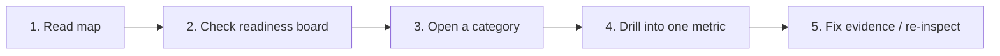

| Step | What you do |
| --- | --- |
| Map | See which domains exist (quality / artifact / flow / …) |
| Readiness board | See where cards sit right now |
| Category | Open one domain diagram |
| Per metric | Drill one id → step → state |

## Catalog map

One hub per domain — click a category section below for detail.

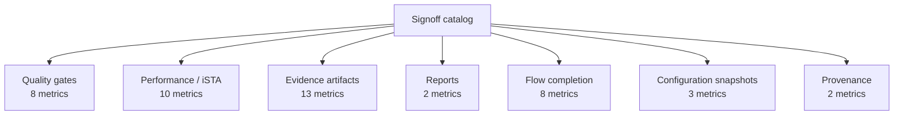

| Domain | Metrics | Role |
| --- | ---: | --- |
| [Quality gates](#category-quality_gate) | 8 | Machine predicates (DRC/LVS/STA/RCX/area). Failures → ERROR readiness. |
| [Performance / iSTA](#category-performance) | 10 | Numeric timing (WNS/TNS/freq) and power slots for multi-version compare. |
| [Evidence artifacts](#category-artifact) | 13 | Required files from Harden / LVS / RCX / STA / synthesis (and optional LEC). |
| [Reports](#category-report) | 2 | Human-readable reports tied to steps (e.g. STA timing reports). |
| [Flow completion](#category-flow) | 8 | Ledger steps that must have completed for a full package. |
| [Configuration snapshots](#category-configuration) | 3 | Workspace config JSON (db / rcx / sta) frozen for the run. |
| [Provenance](#category-provenance) | 2 | Initial RTL / SDC inputs that anchor the workspace. |

## Readiness board

Cards placed by live assessment (PASS=36, WARN=0, MISS=0, ERROR=0).

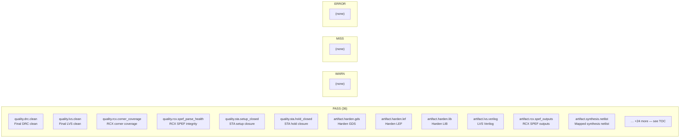

## Categories

### Category: `quality_gate`

<a id="category-quality_gate"></a>

**Quality gates.** Machine predicates (DRC/LVS/STA/RCX/area). Failures → ERROR readiness.

| id | title | step | optional |
| --- | --- | --- | --- |
| [`quality.drc.clean`](#qualitydrcclean) | Final DRC clean | `drc` |  |
| [`quality.lvs.clean`](#qualitylvsclean) | Final LVS clean | `lvs` |  |
| [`quality.rcx.corner_coverage`](#qualityrcxcorner_coverage) | RCX corner coverage | `RCX` |  |
| [`quality.rcx.spef_parse_health`](#qualityrcxspef_parse_health) | RCX SPEF integrity | `RCX` |  |
| [`quality.sta.setup_closed`](#qualitystasetup_closed) | STA setup closure | `sta` |  |
| [`quality.sta.hold_closed`](#qualitystahold_closed) | STA hold closure | `sta` |  |
| [`quality.mpc.minimum_area`](#qualitympcminimum_area) | Minimum core area | `Harden` |  |
| [`quality.mpc.maximum_area`](#qualitympcmaximum_area) | Maximum core area | `Harden` |  |


[↑ Contents](#contents) · [↑ Map](#catalog-map) · [↑ Readiness](#readiness-board)

### Category: `performance`

<a id="category-performance"></a>

**Performance / iSTA.** Numeric timing (WNS/TNS/freq) and power slots for multi-version compare.

| id | title | step | optional |
| --- | --- | --- | --- |
| [`performance.sta.setup_wns`](#performancestasetup_wns) | STA setup WNS | `sta` | yes |
| [`performance.sta.setup_tns`](#performancestasetup_tns) | STA setup TNS | `sta` | yes |
| [`performance.sta.hold_wns`](#performancestahold_wns) | STA hold WNS | `sta` | yes |
| [`performance.sta.hold_tns`](#performancestahold_tns) | STA hold TNS | `sta` | yes |
| [`performance.sta.frequency`](#performancestafrequency) | STA frequency | `sta` | yes |
| [`performance.power.dynamic`](#performancepowerdynamic) | Dynamic power | `sta` | yes |
| [`performance.power.leakage`](#performancepowerleakage) | Leakage power | `sta` | yes |
| [`performance.host.latency`](#performancehostlatency) | Host wall latency | `host` | yes |
| [`performance.host.throughput`](#performancehostthroughput) | Host throughput | `host` | yes |
| [`performance.host.peak_memory`](#performancehostpeak_memory) | Host peak memory | `host` | yes |

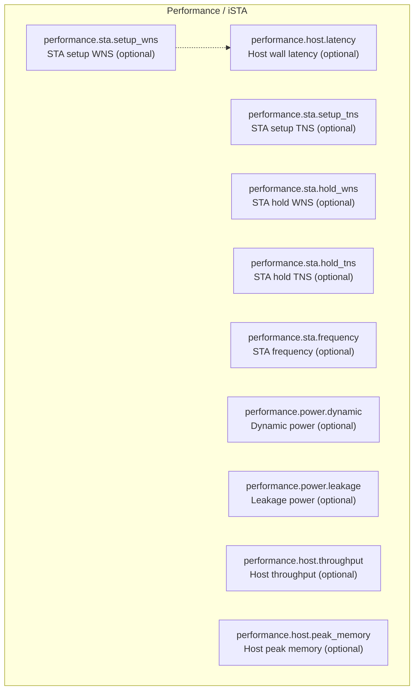

[↑ Contents](#contents) · [↑ Map](#catalog-map) · [↑ Readiness](#readiness-board)

### Category: `artifact`

<a id="category-artifact"></a>

**Evidence artifacts.** Required files from Harden / LVS / RCX / STA / synthesis (and optional LEC).

| id | title | step | optional |
| --- | --- | --- | --- |
| [`artifact.harden.gds`](#artifacthardengds) | Harden GDS | `Harden` |  |
| [`artifact.harden.lef`](#artifacthardenlef) | Harden LEF | `Harden` |  |
| [`artifact.harden.lib`](#artifacthardenlib) | Harden LIB | `Harden` |  |
| [`artifact.lvs.def`](#artifactlvsdef) | LVS DEF | `lvs` |  |
| [`artifact.lvs.verilog`](#artifactlvsverilog) | LVS Verilog | `lvs` |  |
| [`artifact.lvs.gds`](#artifactlvsgds) | LVS GDS | `lvs` |  |
| [`artifact.lvs.json`](#artifactlvsjson) | LVS JSON | `lvs` |  |
| [`artifact.rcx.spef_outputs`](#artifactrcxspef_outputs) | RCX SPEF outputs | `RCX` |  |
| [`artifact.sta.corner_summaries`](#artifactstacorner_summaries) | STA structured corner summaries | `sta` |  |
| [`artifact.sta.timing_paths`](#artifactstatiming_paths) | STA structured timing paths | `sta` |  |
| [`artifact.synthesis.netlist`](#artifactsynthesisnetlist) | Mapped synthesis netlist | `Synthesis` |  |
| [`artifact.postroutelec.result`](#artifactpostroutelecresult) | Post-route LEC result | `postRouteLec` | yes |
| [`artifact.lec.result`](#artifactlecresult) | Synthesis LEC result | `lec` | yes |

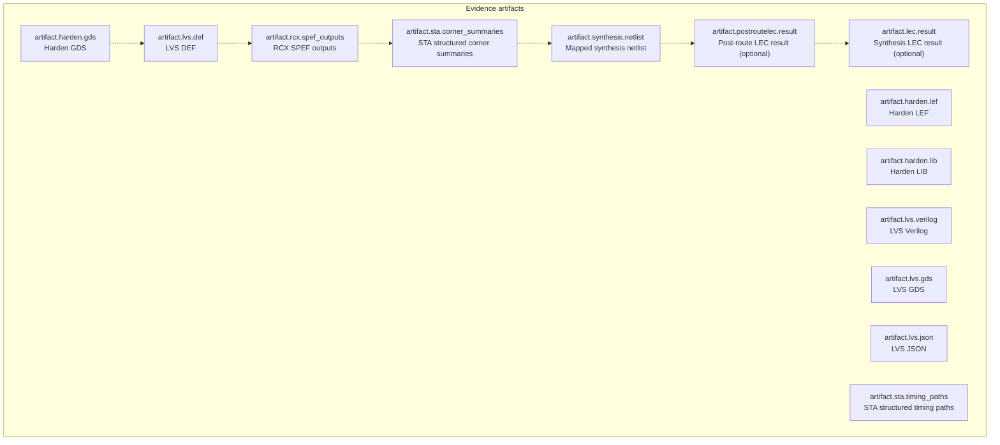

[↑ Contents](#contents) · [↑ Map](#catalog-map) · [↑ Readiness](#readiness-board)

### Category: `report`

<a id="category-report"></a>

**Reports.** Human-readable reports tied to steps (e.g. STA timing reports).

| id | title | step | optional |
| --- | --- | --- | --- |
| [`artifact.lvs.report`](#artifactlvsreport) | LVS report | `lvs` |  |
| [`report.sta.timing_reports`](#reportstatiming_reports) | STA timing reports | `sta` |  |

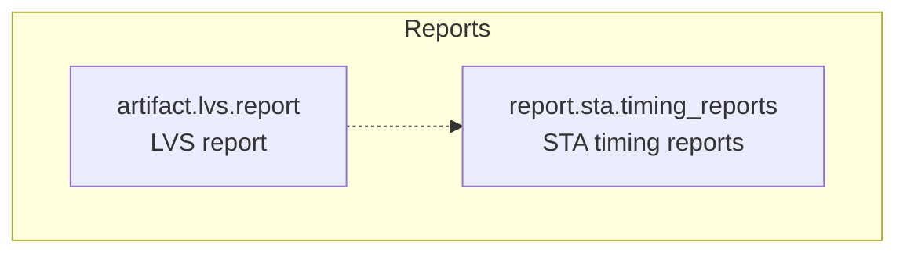

[↑ Contents](#contents) · [↑ Map](#catalog-map) · [↑ Readiness](#readiness-board)

### Category: `flow`

<a id="category-flow"></a>

**Flow completion.** Ledger steps that must have completed for a full package.

| id | title | step | optional |
| --- | --- | --- | --- |
| [`flow.route.completed`](#flowroutecompleted) | route flow completed | `route` |  |
| [`flow.drc.completed`](#flowdrccompleted) | drc flow completed | `drc` |  |
| [`flow.lvs.completed`](#flowlvscompleted) | lvs flow completed | `lvs` |  |
| [`flow.filler.completed`](#flowfillercompleted) | filler flow completed | `filler` |  |
| [`flow.postroutelec.completed`](#flowpostrouteleccompleted) | postRouteLec flow completed | `postRouteLec` | yes |
| [`flow.rcx.completed`](#flowrcxcompleted) | RCX flow completed | `RCX` |  |
| [`flow.sta.completed`](#flowstacompleted) | sta flow completed | `sta` |  |
| [`flow.harden.completed`](#flowhardencompleted) | Harden flow completed | `Harden` |  |

```mermaid
flowchart TB
  subgraph cat_flow["Flow completion"]
    flow_route_completed["flow.route.completed<br/>route flow completed"]
    flow_drc_completed["flow.drc.completed<br/>drc flow completed"]
    flow_lvs_completed["flow.lvs.completed<br/>lvs flow completed"]
    flow_filler_completed["flow.filler.completed<br/>filler flow completed"]
    flow_postroutelec_completed["flow.postroutelec.completed<br/>postRouteLec flow completed (optional)"]
    flow_rcx_completed["flow.rcx.completed<br/>RCX flow completed"]
    flow_sta_completed["flow.sta.completed<br/>sta flow completed"]
    flow_harden_completed["flow.harden.completed<br/>Harden flow completed"]
  end
  flow_route_completed -.-> flow_drc_completed
  flow_drc_completed -.-> flow_lvs_completed
  flow_lvs_completed -.-> flow_filler_completed
  flow_filler_completed -.-> flow_postroutelec_completed
  flow_postroutelec_completed -.-> flow_rcx_completed
  flow_rcx_completed -.-> flow_sta_completed
  flow_sta_completed -.-> flow_harden_completed
```

[↑ Contents](#contents) · [↑ Map](#catalog-map) · [↑ Readiness](#readiness-board)

### Category: `configuration`

<a id="category-configuration"></a>

**Configuration snapshots.** Workspace config JSON (db / rcx / sta) frozen for the run.

| id | title | step | optional |
| --- | --- | --- | --- |
| [`configuration.db`](#configurationdb) | Configuration db | `workspace` |  |
| [`configuration.rcx`](#configurationrcx) | Configuration RCX | `workspace` |  |
| [`configuration.sta`](#configurationsta) | Configuration sta | `workspace` |  |

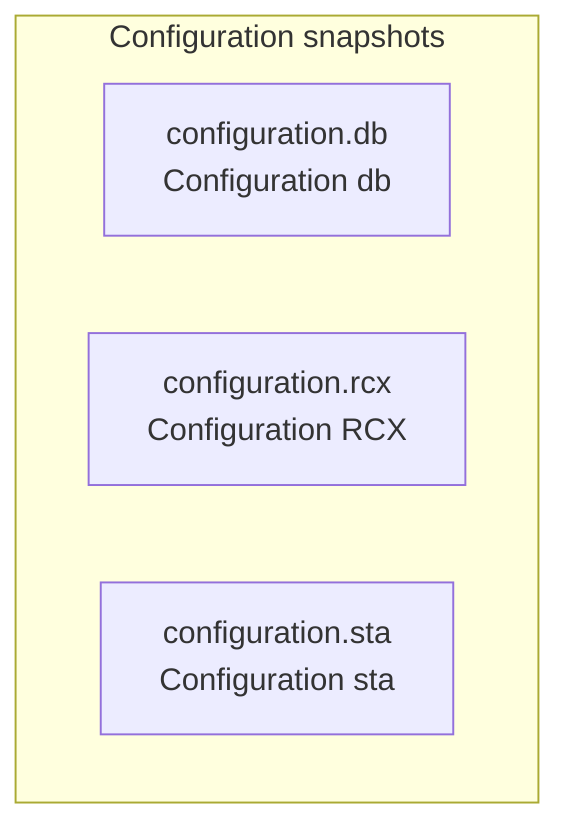

[↑ Contents](#contents) · [↑ Map](#catalog-map) · [↑ Readiness](#readiness-board)

### Category: `provenance`

<a id="category-provenance"></a>

**Provenance.** Initial RTL / SDC inputs that anchor the workspace.

| id | title | step | optional |
| --- | --- | --- | --- |
| [`provenance.initial.rtl`](#provenanceinitialrtl) | Initial RTL | `workspace` |  |
| [`provenance.initial.sdc`](#provenanceinitialsdc) | Initial SDC | `workspace` |  |

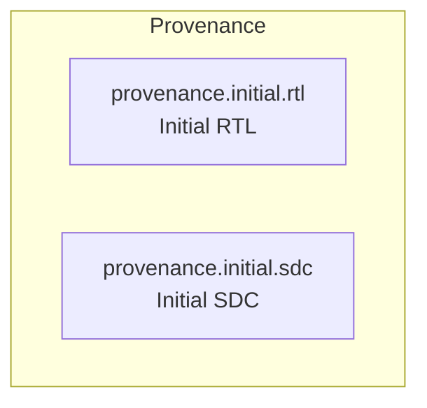

[↑ Contents](#contents) · [↑ Map](#catalog-map) · [↑ Readiness](#readiness-board)

## Per-metric index

Each metric: step → id → board state.

### `quality.drc.clean`

- **Final DRC clean** · category `quality_gate` · step `drc` · optional `False` · state **PASS**

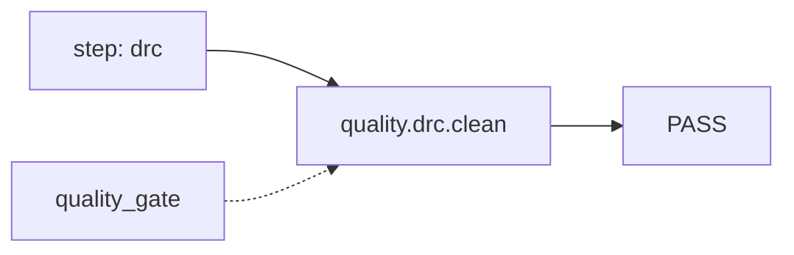

[↑ category `quality_gate`](#category-quality_gate) · [↑ Contents](#contents)

### `quality.lvs.clean`

- **Final LVS clean** · category `quality_gate` · step `lvs` · optional `False` · state **PASS**

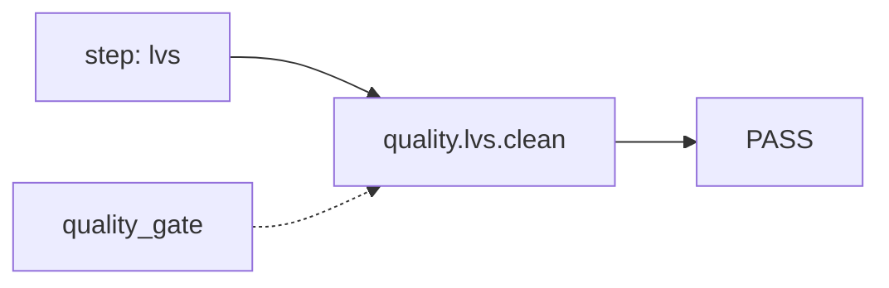

[↑ category `quality_gate`](#category-quality_gate) · [↑ Contents](#contents)

### `quality.rcx.corner_coverage`

- **RCX corner coverage** · category `quality_gate` · step `RCX` · optional `False` · state **PASS**

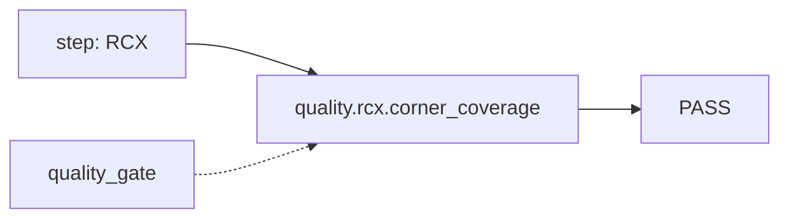

[↑ category `quality_gate`](#category-quality_gate) · [↑ Contents](#contents)

### `quality.rcx.spef_parse_health`

- **RCX SPEF integrity** · category `quality_gate` · step `RCX` · optional `False` · state **PASS**

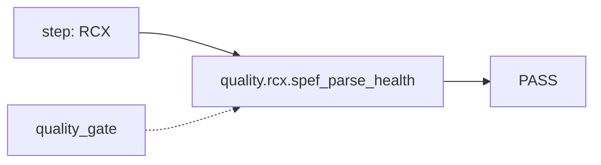

[↑ category `quality_gate`](#category-quality_gate) · [↑ Contents](#contents)

### `quality.sta.setup_closed`

- **STA setup closure** · category `quality_gate` · step `sta` · optional `False` · state **PASS**

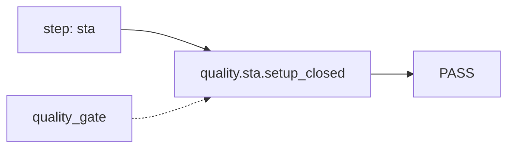

[↑ category `quality_gate`](#category-quality_gate) · [↑ Contents](#contents)

### `quality.sta.hold_closed`

- **STA hold closure** · category `quality_gate` · step `sta` · optional `False` · state **PASS**

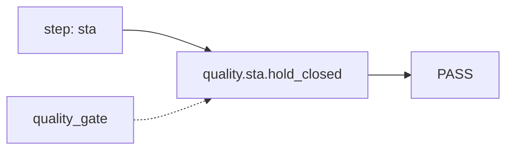

[↑ category `quality_gate`](#category-quality_gate) · [↑ Contents](#contents)

### `quality.mpc.minimum_area`

- **Minimum core area** · category `quality_gate` · step `Harden` · optional `False` · state **ATTENTION**

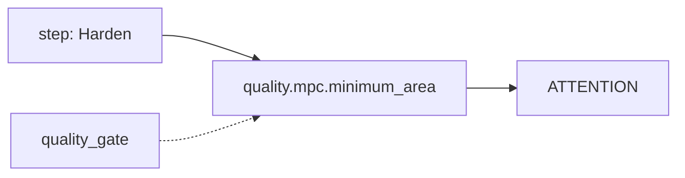

[↑ category `quality_gate`](#category-quality_gate) · [↑ Contents](#contents)

### `quality.mpc.maximum_area`

- **Maximum core area** · category `quality_gate` · step `Harden` · optional `False` · state **ATTENTION**

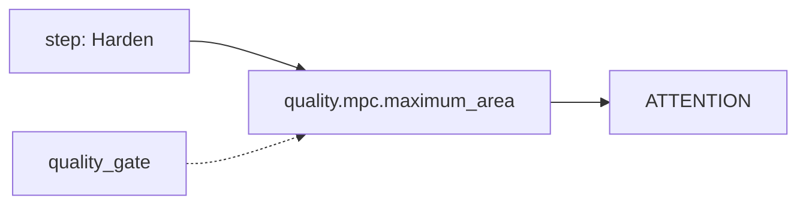

[↑ category `quality_gate`](#category-quality_gate) · [↑ Contents](#contents)

### `artifact.harden.gds`

- **Harden GDS** · category `artifact` · step `Harden` · optional `False` · state **PASS**

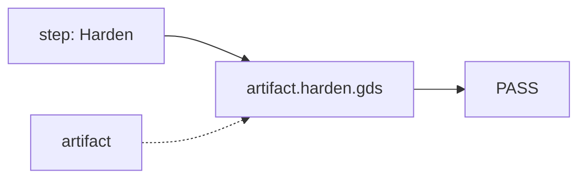

[↑ category `artifact`](#category-artifact) · [↑ Contents](#contents)

### `artifact.harden.lef`

- **Harden LEF** · category `artifact` · step `Harden` · optional `False` · state **PASS**

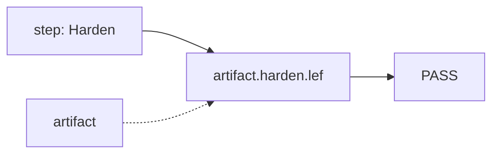

[↑ category `artifact`](#category-artifact) · [↑ Contents](#contents)

### `artifact.harden.lib`

- **Harden LIB** · category `artifact` · step `Harden` · optional `False` · state **PASS**

```mermaid
flowchart LR
  step_artifact_harden_lib["step: Harden"] --> metric_artifact_harden_lib["artifact.harden.lib"]
  metric_artifact_harden_lib --> state_artifact_harden_lib["PASS"]
  cat_artifact_harden_lib["artifact"] -.-> metric_artifact_harden_lib
```

[↑ category `artifact`](#category-artifact) · [↑ Contents](#contents)

### `artifact.lvs.def`

- **LVS DEF** · category `artifact` · step `lvs` · optional `False` · state **ATTENTION**

```mermaid
flowchart LR
  step_artifact_lvs_def["step: lvs"] --> metric_artifact_lvs_def["artifact.lvs.def"]
  metric_artifact_lvs_def --> state_artifact_lvs_def["ATTENTION"]
  cat_artifact_lvs_def["artifact"] -.-> metric_artifact_lvs_def
```

[↑ category `artifact`](#category-artifact) · [↑ Contents](#contents)

### `artifact.lvs.verilog`

- **LVS Verilog** · category `artifact` · step `lvs` · optional `False` · state **PASS**

```mermaid
flowchart LR
  step_artifact_lvs_verilog["step: lvs"] --> metric_artifact_lvs_verilog["artifact.lvs.verilog"]
  metric_artifact_lvs_verilog --> state_artifact_lvs_verilog["PASS"]
  cat_artifact_lvs_verilog["artifact"] -.-> metric_artifact_lvs_verilog
```

[↑ category `artifact`](#category-artifact) · [↑ Contents](#contents)

### `artifact.lvs.gds`

- **LVS GDS** · category `artifact` · step `lvs` · optional `False` · state **ATTENTION**

```mermaid
flowchart LR
  step_artifact_lvs_gds["step: lvs"] --> metric_artifact_lvs_gds["artifact.lvs.gds"]
  metric_artifact_lvs_gds --> state_artifact_lvs_gds["ATTENTION"]
  cat_artifact_lvs_gds["artifact"] -.-> metric_artifact_lvs_gds
```

[↑ category `artifact`](#category-artifact) · [↑ Contents](#contents)

### `artifact.lvs.report`

- **LVS report** · category `report` · step `lvs` · optional `False` · state **ATTENTION**

```mermaid
flowchart LR
  step_artifact_lvs_report["step: lvs"] --> metric_artifact_lvs_report["artifact.lvs.report"]
  metric_artifact_lvs_report --> state_artifact_lvs_report["ATTENTION"]
  cat_artifact_lvs_report["report"] -.-> metric_artifact_lvs_report
```

[↑ category `report`](#category-report) · [↑ Contents](#contents)

### `artifact.lvs.json`

- **LVS JSON** · category `artifact` · step `lvs` · optional `False` · state **ATTENTION**

```mermaid
flowchart LR
  step_artifact_lvs_json["step: lvs"] --> metric_artifact_lvs_json["artifact.lvs.json"]
  metric_artifact_lvs_json --> state_artifact_lvs_json["ATTENTION"]
  cat_artifact_lvs_json["artifact"] -.-> metric_artifact_lvs_json
```

[↑ category `artifact`](#category-artifact) · [↑ Contents](#contents)

### `artifact.rcx.spef_outputs`

- **RCX SPEF outputs** · category `artifact` · step `RCX` · optional `False` · state **PASS**

```mermaid
flowchart LR
  step_artifact_rcx_spef_outputs["step: RCX"] --> metric_artifact_rcx_spef_outputs["artifact.rcx.spef_outputs"]
  metric_artifact_rcx_spef_outputs --> state_artifact_rcx_spef_outputs["PASS"]
  cat_artifact_rcx_spef_outputs["artifact"] -.-> metric_artifact_rcx_spef_outputs
```

[↑ category `artifact`](#category-artifact) · [↑ Contents](#contents)

### `report.sta.timing_reports`

- **STA timing reports** · category `report` · step `sta` · optional `False` · state **ATTENTION**

```mermaid
flowchart LR
  step_report_sta_timing_reports["step: sta"] --> metric_report_sta_timing_reports["report.sta.timing_reports"]
  metric_report_sta_timing_reports --> state_report_sta_timing_reports["ATTENTION"]
  cat_report_sta_timing_reports["report"] -.-> metric_report_sta_timing_reports
```

[↑ category `report`](#category-report) · [↑ Contents](#contents)

### `artifact.sta.corner_summaries`

- **STA structured corner summaries** · category `artifact` · step `sta` · optional `False` · state **ATTENTION**

```mermaid
flowchart LR
  step_artifact_sta_corner_summaries["step: sta"] --> metric_artifact_sta_corner_summaries["artifact.sta.corner_summaries"]
  metric_artifact_sta_corner_summaries --> state_artifact_sta_corner_summaries["ATTENTION"]
  cat_artifact_sta_corner_summaries["artifact"] -.-> metric_artifact_sta_corner_summaries
```

[↑ category `artifact`](#category-artifact) · [↑ Contents](#contents)

### `artifact.sta.timing_paths`

- **STA structured timing paths** · category `artifact` · step `sta` · optional `False` · state **ATTENTION**

```mermaid
flowchart LR
  step_artifact_sta_timing_paths["step: sta"] --> metric_artifact_sta_timing_paths["artifact.sta.timing_paths"]
  metric_artifact_sta_timing_paths --> state_artifact_sta_timing_paths["ATTENTION"]
  cat_artifact_sta_timing_paths["artifact"] -.-> metric_artifact_sta_timing_paths
```

[↑ category `artifact`](#category-artifact) · [↑ Contents](#contents)

### `artifact.synthesis.netlist`

- **Mapped synthesis netlist** · category `artifact` · step `Synthesis` · optional `False` · state **PASS**

```mermaid
flowchart LR
  step_artifact_synthesis_netlist["step: Synthesis"] --> metric_artifact_synthesis_netlist["artifact.synthesis.netlist"]
  metric_artifact_synthesis_netlist --> state_artifact_synthesis_netlist["PASS"]
  cat_artifact_synthesis_netlist["artifact"] -.-> metric_artifact_synthesis_netlist
```

[↑ category `artifact`](#category-artifact) · [↑ Contents](#contents)

### `artifact.postroutelec.result`

- **Post-route LEC result** · category `artifact` · step `postRouteLec` · optional `True` · state **PASS**

```mermaid
flowchart LR
  step_artifact_postroutelec_result["step: postRouteLec"] --> metric_artifact_postroutelec_result["artifact.postroutelec.result"]
  metric_artifact_postroutelec_result --> state_artifact_postroutelec_result["PASS"]
  cat_artifact_postroutelec_result["artifact"] -.-> metric_artifact_postroutelec_result
```

[↑ category `artifact`](#category-artifact) · [↑ Contents](#contents)

### `artifact.lec.result`

- **Synthesis LEC result** · category `artifact` · step `lec` · optional `True` · state **ATTENTION**

```mermaid
flowchart LR
  step_artifact_lec_result["step: lec"] --> metric_artifact_lec_result["artifact.lec.result"]
  metric_artifact_lec_result --> state_artifact_lec_result["ATTENTION"]
  cat_artifact_lec_result["artifact"] -.-> metric_artifact_lec_result
```

[↑ category `artifact`](#category-artifact) · [↑ Contents](#contents)

### `flow.route.completed`

- **route flow completed** · category `flow` · step `route` · optional `False` · state **PASS**

```mermaid
flowchart LR
  step_flow_route_completed["step: route"] --> metric_flow_route_completed["flow.route.completed"]
  metric_flow_route_completed --> state_flow_route_completed["PASS"]
  cat_flow_route_completed["flow"] -.-> metric_flow_route_completed
```

[↑ category `flow`](#category-flow) · [↑ Contents](#contents)

### `flow.drc.completed`

- **drc flow completed** · category `flow` · step `drc` · optional `False` · state **PASS**

```mermaid
flowchart LR
  step_flow_drc_completed["step: drc"] --> metric_flow_drc_completed["flow.drc.completed"]
  metric_flow_drc_completed --> state_flow_drc_completed["PASS"]
  cat_flow_drc_completed["flow"] -.-> metric_flow_drc_completed
```

[↑ category `flow`](#category-flow) · [↑ Contents](#contents)

### `flow.lvs.completed`

- **lvs flow completed** · category `flow` · step `lvs` · optional `False` · state **PASS**

```mermaid
flowchart LR
  step_flow_lvs_completed["step: lvs"] --> metric_flow_lvs_completed["flow.lvs.completed"]
  metric_flow_lvs_completed --> state_flow_lvs_completed["PASS"]
  cat_flow_lvs_completed["flow"] -.-> metric_flow_lvs_completed
```

[↑ category `flow`](#category-flow) · [↑ Contents](#contents)

### `flow.filler.completed`

- **filler flow completed** · category `flow` · step `filler` · optional `False` · state **PASS**

```mermaid
flowchart LR
  step_flow_filler_completed["step: filler"] --> metric_flow_filler_completed["flow.filler.completed"]
  metric_flow_filler_completed --> state_flow_filler_completed["PASS"]
  cat_flow_filler_completed["flow"] -.-> metric_flow_filler_completed
```

[↑ category `flow`](#category-flow) · [↑ Contents](#contents)

### `flow.postroutelec.completed`

- **postRouteLec flow completed** · category `flow` · step `postRouteLec` · optional `True` · state **PASS**

```mermaid
flowchart LR
  step_flow_postroutelec_completed["step: postRouteLec"] --> metric_flow_postroutelec_completed["flow.postroutelec.completed"]
  metric_flow_postroutelec_completed --> state_flow_postroutelec_completed["PASS"]
  cat_flow_postroutelec_completed["flow"] -.-> metric_flow_postroutelec_completed
```

[↑ category `flow`](#category-flow) · [↑ Contents](#contents)

### `flow.rcx.completed`

- **RCX flow completed** · category `flow` · step `RCX` · optional `False` · state **PASS**

```mermaid
flowchart LR
  step_flow_rcx_completed["step: RCX"] --> metric_flow_rcx_completed["flow.rcx.completed"]
  metric_flow_rcx_completed --> state_flow_rcx_completed["PASS"]
  cat_flow_rcx_completed["flow"] -.-> metric_flow_rcx_completed
```

[↑ category `flow`](#category-flow) · [↑ Contents](#contents)

### `flow.sta.completed`

- **sta flow completed** · category `flow` · step `sta` · optional `False` · state **PASS**

```mermaid
flowchart LR
  step_flow_sta_completed["step: sta"] --> metric_flow_sta_completed["flow.sta.completed"]
  metric_flow_sta_completed --> state_flow_sta_completed["PASS"]
  cat_flow_sta_completed["flow"] -.-> metric_flow_sta_completed
```

[↑ category `flow`](#category-flow) · [↑ Contents](#contents)

### `flow.harden.completed`

- **Harden flow completed** · category `flow` · step `Harden` · optional `False` · state **PASS**

```mermaid
flowchart LR
  step_flow_harden_completed["step: Harden"] --> metric_flow_harden_completed["flow.harden.completed"]
  metric_flow_harden_completed --> state_flow_harden_completed["PASS"]
  cat_flow_harden_completed["flow"] -.-> metric_flow_harden_completed
```

[↑ category `flow`](#category-flow) · [↑ Contents](#contents)

### `provenance.initial.rtl`

- **Initial RTL** · category `provenance` · step `workspace` · optional `False` · state **PASS**

```mermaid
flowchart LR
  step_provenance_initial_rtl["step: workspace"] --> metric_provenance_initial_rtl["provenance.initial.rtl"]
  metric_provenance_initial_rtl --> state_provenance_initial_rtl["PASS"]
  cat_provenance_initial_rtl["provenance"] -.-> metric_provenance_initial_rtl
```

[↑ category `provenance`](#category-provenance) · [↑ Contents](#contents)

### `provenance.initial.sdc`

- **Initial SDC** · category `provenance` · step `workspace` · optional `False` · state **PASS**

```mermaid
flowchart LR
  step_provenance_initial_sdc["step: workspace"] --> metric_provenance_initial_sdc["provenance.initial.sdc"]
  metric_provenance_initial_sdc --> state_provenance_initial_sdc["PASS"]
  cat_provenance_initial_sdc["provenance"] -.-> metric_provenance_initial_sdc
```

[↑ category `provenance`](#category-provenance) · [↑ Contents](#contents)

### `configuration.db`

- **Configuration db** · category `configuration` · step `workspace` · optional `False` · state **PASS**

```mermaid
flowchart LR
  step_configuration_db["step: workspace"] --> metric_configuration_db["configuration.db"]
  metric_configuration_db --> state_configuration_db["PASS"]
  cat_configuration_db["configuration"] -.-> metric_configuration_db
```

[↑ category `configuration`](#category-configuration) · [↑ Contents](#contents)

### `configuration.rcx`

- **Configuration RCX** · category `configuration` · step `workspace` · optional `False` · state **PASS**

```mermaid
flowchart LR
  step_configuration_rcx["step: workspace"] --> metric_configuration_rcx["configuration.rcx"]
  metric_configuration_rcx --> state_configuration_rcx["PASS"]
  cat_configuration_rcx["configuration"] -.-> metric_configuration_rcx
```

[↑ category `configuration`](#category-configuration) · [↑ Contents](#contents)

### `configuration.sta`

- **Configuration sta** · category `configuration` · step `workspace` · optional `False` · state **PASS**

```mermaid
flowchart LR
  step_configuration_sta["step: workspace"] --> metric_configuration_sta["configuration.sta"]
  metric_configuration_sta --> state_configuration_sta["PASS"]
  cat_configuration_sta["configuration"] -.-> metric_configuration_sta
```

[↑ category `configuration`](#category-configuration) · [↑ Contents](#contents)

### `performance.sta.setup_wns`

- **STA setup WNS** · category `performance` · step `sta` · optional `True` · state **PASS**

```mermaid
flowchart LR
  step_performance_sta_setup_wns["step: sta"] --> metric_performance_sta_setup_wns["performance.sta.setup_wns"]
  metric_performance_sta_setup_wns --> state_performance_sta_setup_wns["PASS"]
  cat_performance_sta_setup_wns["performance"] -.-> metric_performance_sta_setup_wns
```

[↑ category `performance`](#category-performance) · [↑ Contents](#contents)

### `performance.sta.setup_tns`

- **STA setup TNS** · category `performance` · step `sta` · optional `True` · state **PASS**

```mermaid
flowchart LR
  step_performance_sta_setup_tns["step: sta"] --> metric_performance_sta_setup_tns["performance.sta.setup_tns"]
  metric_performance_sta_setup_tns --> state_performance_sta_setup_tns["PASS"]
  cat_performance_sta_setup_tns["performance"] -.-> metric_performance_sta_setup_tns
```

[↑ category `performance`](#category-performance) · [↑ Contents](#contents)

### `performance.sta.hold_wns`

- **STA hold WNS** · category `performance` · step `sta` · optional `True` · state **PASS**

```mermaid
flowchart LR
  step_performance_sta_hold_wns["step: sta"] --> metric_performance_sta_hold_wns["performance.sta.hold_wns"]
  metric_performance_sta_hold_wns --> state_performance_sta_hold_wns["PASS"]
  cat_performance_sta_hold_wns["performance"] -.-> metric_performance_sta_hold_wns
```

[↑ category `performance`](#category-performance) · [↑ Contents](#contents)

### `performance.sta.hold_tns`

- **STA hold TNS** · category `performance` · step `sta` · optional `True` · state **PASS**

```mermaid
flowchart LR
  step_performance_sta_hold_tns["step: sta"] --> metric_performance_sta_hold_tns["performance.sta.hold_tns"]
  metric_performance_sta_hold_tns --> state_performance_sta_hold_tns["PASS"]
  cat_performance_sta_hold_tns["performance"] -.-> metric_performance_sta_hold_tns
```

[↑ category `performance`](#category-performance) · [↑ Contents](#contents)

### `performance.sta.frequency`

- **STA frequency** · category `performance` · step `sta` · optional `True` · state **PASS**

```mermaid
flowchart LR
  step_performance_sta_frequency["step: sta"] --> metric_performance_sta_frequency["performance.sta.frequency"]
  metric_performance_sta_frequency --> state_performance_sta_frequency["PASS"]
  cat_performance_sta_frequency["performance"] -.-> metric_performance_sta_frequency
```

[↑ category `performance`](#category-performance) · [↑ Contents](#contents)

### `performance.power.dynamic`

- **Dynamic power** · category `performance` · step `sta` · optional `True` · state **PASS**

```mermaid
flowchart LR
  step_performance_power_dynamic["step: sta"] --> metric_performance_power_dynamic["performance.power.dynamic"]
  metric_performance_power_dynamic --> state_performance_power_dynamic["PASS"]
  cat_performance_power_dynamic["performance"] -.-> metric_performance_power_dynamic
```

[↑ category `performance`](#category-performance) · [↑ Contents](#contents)

### `performance.power.leakage`

- **Leakage power** · category `performance` · step `sta` · optional `True` · state **PASS**

```mermaid
flowchart LR
  step_performance_power_leakage["step: sta"] --> metric_performance_power_leakage["performance.power.leakage"]
  metric_performance_power_leakage --> state_performance_power_leakage["PASS"]
  cat_performance_power_leakage["performance"] -.-> metric_performance_power_leakage
```

[↑ category `performance`](#category-performance) · [↑ Contents](#contents)

### `performance.host.latency`

- **Host wall latency** · category `performance` · step `host` · optional `True` · state **PASS**

```mermaid
flowchart LR
  step_performance_host_latency["step: host"] --> metric_performance_host_latency["performance.host.latency"]
  metric_performance_host_latency --> state_performance_host_latency["PASS"]
  cat_performance_host_latency["performance"] -.-> metric_performance_host_latency
```

[↑ category `performance`](#category-performance) · [↑ Contents](#contents)

### `performance.host.throughput`

- **Host throughput** · category `performance` · step `host` · optional `True` · state **PASS**

```mermaid
flowchart LR
  step_performance_host_throughput["step: host"] --> metric_performance_host_throughput["performance.host.throughput"]
  metric_performance_host_throughput --> state_performance_host_throughput["PASS"]
  cat_performance_host_throughput["performance"] -.-> metric_performance_host_throughput
```

[↑ category `performance`](#category-performance) · [↑ Contents](#contents)

### `performance.host.peak_memory`

- **Host peak memory** · category `performance` · step `host` · optional `True` · state **PASS**

```mermaid
flowchart LR
  step_performance_host_peak_memory["step: host"] --> metric_performance_host_peak_memory["performance.host.peak_memory"]
  metric_performance_host_peak_memory --> state_performance_host_peak_memory["PASS"]
  cat_performance_host_peak_memory["performance"] -.-> metric_performance_host_peak_memory
```

[↑ category `performance`](#category-performance) · [↑ Contents](#contents)

---

_Generated by `.github/scripts/generate-signoff-kanban.py` from `chipcompiler.engine.signoff.catalog`._

## Version

| Field | Value |
| --- | --- |
| Git commit | [`675aa4e7925e`](https://github.com/plitenh/ecc/commit/675aa4e7925e45ccb7c245abc0a43fc638ba455c) |
| Git commit (full) | `675aa4e7925e45ccb7c245abc0a43fc638ba455c` |
| Snapshot SHA-256 | `c02ccd944015ba46b90a57d1238fb2586e70d431f04b78cf138dd458d6c23ed9` |

Compare snapshots with `plitenh/ecc-ci`:

- pairwise: `scripts/diff_signoff_snapshots.py` (versions · item delta · state delta)
- multi-point batch diagram: `scripts/diagram_signoff_compare.py` (mermaid + ASCII matrix across N versions)
