# Signoff release kanban

Generated from `engine.signoff.catalog`. CSV gates remain a util; this board diagramizes each metric for GitHub.

**Mode:** catalog topology (no assessment JSON — all cards in category views).

## Readiness board

```mermaid
flowchart LR
  subgraph col_catalog["catalog"]
    quality_drc_clean["quality.drc.clean<br/>Final DRC clean"]
    quality_lvs_clean["quality.lvs.clean<br/>Final LVS clean"]
    quality_rcx_corner_coverage["quality.rcx.corner_coverage<br/>RCX corner coverage"]
    quality_rcx_spef_parse_health["quality.rcx.spef_parse_health<br/>RCX SPEF integrity"]
    quality_sta_setup_closed["quality.sta.setup_closed<br/>STA setup closure"]
    quality_sta_hold_closed["quality.sta.hold_closed<br/>STA hold closure"]
    quality_mpc_minimum_area["quality.mpc.minimum_area<br/>Minimum core area"]
    quality_mpc_maximum_area["quality.mpc.maximum_area<br/>Maximum core area"]
    artifact_harden_gds["artifact.harden.gds<br/>Harden GDS"]
    artifact_harden_lef["artifact.harden.lef<br/>Harden LEF"]
    artifact_harden_lib["artifact.harden.lib<br/>Harden LIB"]
    artifact_lvs_def["artifact.lvs.def<br/>LVS DEF"]
    artifact_lvs_verilog["artifact.lvs.verilog<br/>LVS Verilog"]
    artifact_lvs_gds["artifact.lvs.gds<br/>LVS GDS"]
    artifact_lvs_report["artifact.lvs.report<br/>LVS report"]
    artifact_lvs_json["artifact.lvs.json<br/>LVS JSON"]
    artifact_rcx_spef_outputs["artifact.rcx.spef_outputs<br/>RCX SPEF outputs"]
    report_sta_timing_reports["report.sta.timing_reports<br/>STA timing reports"]
    artifact_sta_corner_summaries["artifact.sta.corner_summaries<br/>STA structured corner summaries"]
    artifact_sta_timing_paths["artifact.sta.timing_paths<br/>STA structured timing paths"]
    artifact_synthesis_netlist["artifact.synthesis.netlist<br/>Mapped synthesis netlist"]
    artifact_postroutelec_result["artifact.postroutelec.result<br/>Post-route LEC result"]
    artifact_lec_result["artifact.lec.result<br/>Synthesis LEC result"]
    flow_route_completed["flow.route.completed<br/>route flow completed"]
    flow_drc_completed["flow.drc.completed<br/>drc flow completed"]
    flow_lvs_completed["flow.lvs.completed<br/>lvs flow completed"]
    flow_filler_completed["flow.filler.completed<br/>filler flow completed"]
    flow_postroutelec_completed["flow.postroutelec.completed<br/>postRouteLec flow completed"]
    flow_rcx_completed["flow.rcx.completed<br/>RCX flow completed"]
    flow_sta_completed["flow.sta.completed<br/>sta flow completed"]
    flow_harden_completed["flow.harden.completed<br/>Harden flow completed"]
    provenance_initial_rtl["provenance.initial.rtl<br/>Initial RTL"]
    provenance_initial_sdc["provenance.initial.sdc<br/>Initial SDC"]
    configuration_db["configuration.db<br/>Configuration db"]
    configuration_rcx["configuration.rcx<br/>Configuration RCX"]
    configuration_sta["configuration.sta<br/>Configuration sta"]
  end
```

## By category

### `artifact`

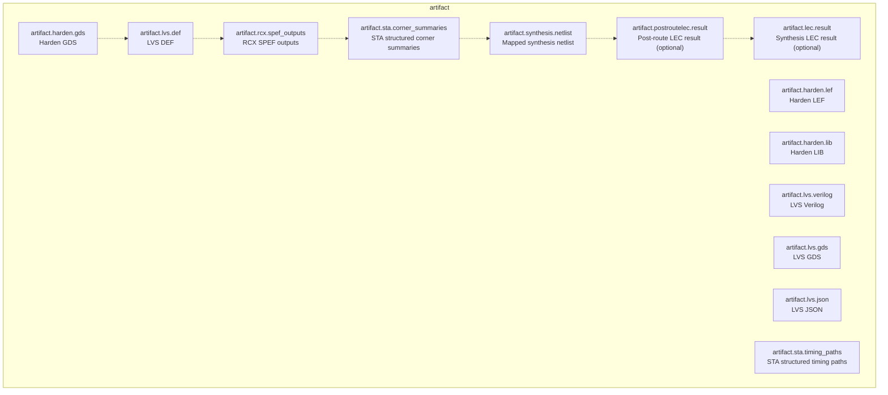

### `configuration`

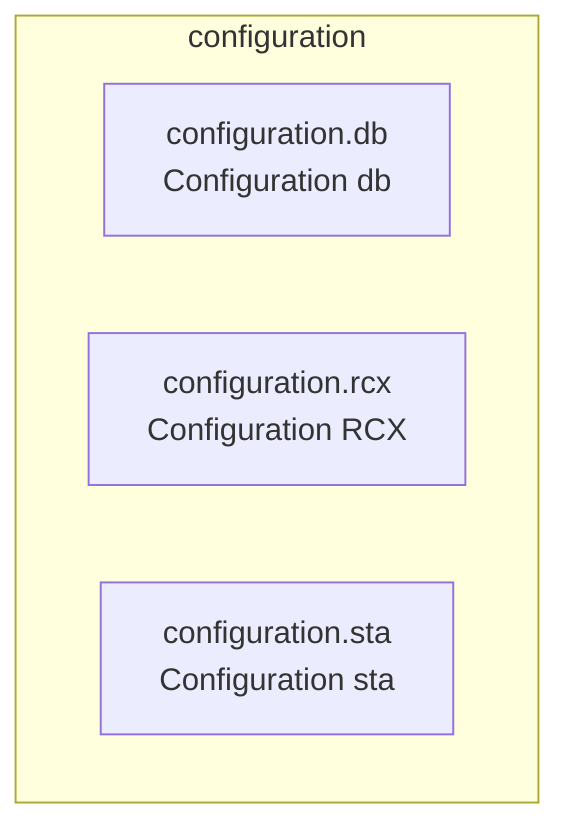

### `flow`

```mermaid
flowchart TB
  subgraph cat_flow["flow"]
    flow_route_completed["flow.route.completed<br/>route flow completed"]
    flow_drc_completed["flow.drc.completed<br/>drc flow completed"]
    flow_lvs_completed["flow.lvs.completed<br/>lvs flow completed"]
    flow_filler_completed["flow.filler.completed<br/>filler flow completed"]
    flow_postroutelec_completed["flow.postroutelec.completed<br/>postRouteLec flow completed (optional)"]
    flow_rcx_completed["flow.rcx.completed<br/>RCX flow completed"]
    flow_sta_completed["flow.sta.completed<br/>sta flow completed"]
    flow_harden_completed["flow.harden.completed<br/>Harden flow completed"]
  end
  flow_route_completed -.-> flow_drc_completed
  flow_drc_completed -.-> flow_lvs_completed
  flow_lvs_completed -.-> flow_filler_completed
  flow_filler_completed -.-> flow_postroutelec_completed
  flow_postroutelec_completed -.-> flow_rcx_completed
  flow_rcx_completed -.-> flow_sta_completed
  flow_sta_completed -.-> flow_harden_completed
```

### `provenance`

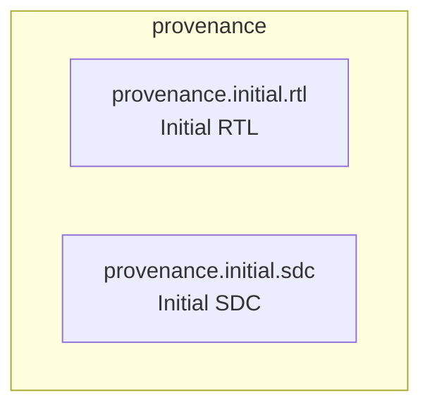

### `quality_gate`

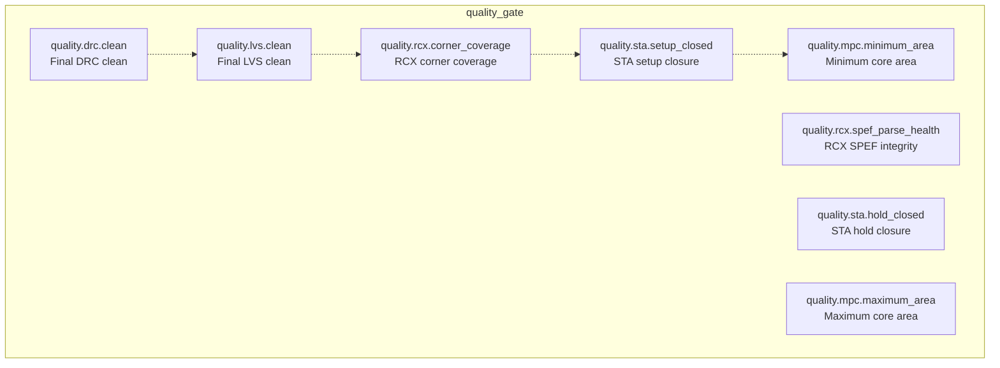

### `report`

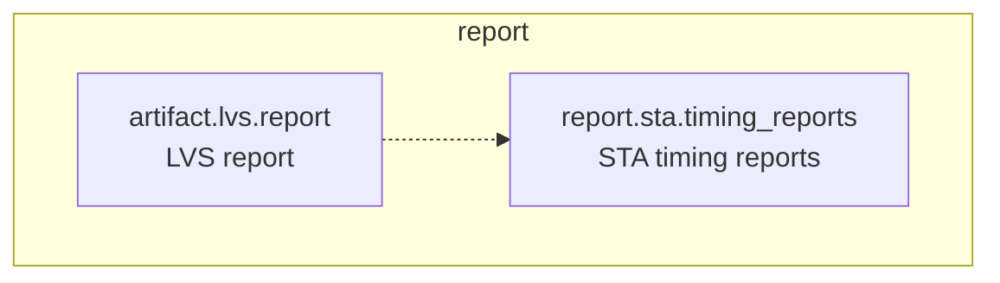

## Per metric

### `quality.drc.clean`

- title: Final DRC clean
- step: `drc`
- category: `quality_gate`
- optional: `False`
- board state: **catalog**

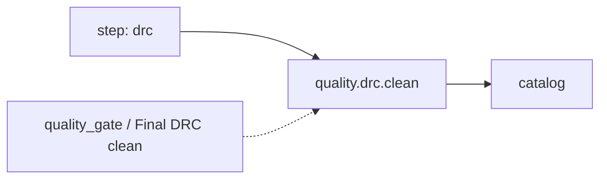

### `quality.lvs.clean`

- title: Final LVS clean
- step: `lvs`
- category: `quality_gate`
- optional: `False`
- board state: **catalog**

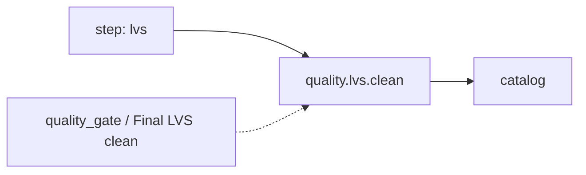

### `quality.rcx.corner_coverage`

- title: RCX corner coverage
- step: `RCX`
- category: `quality_gate`
- optional: `False`
- board state: **catalog**

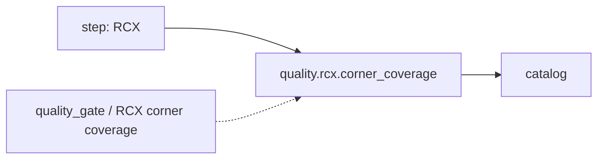

### `quality.rcx.spef_parse_health`

- title: RCX SPEF integrity
- step: `RCX`
- category: `quality_gate`
- optional: `False`
- board state: **catalog**

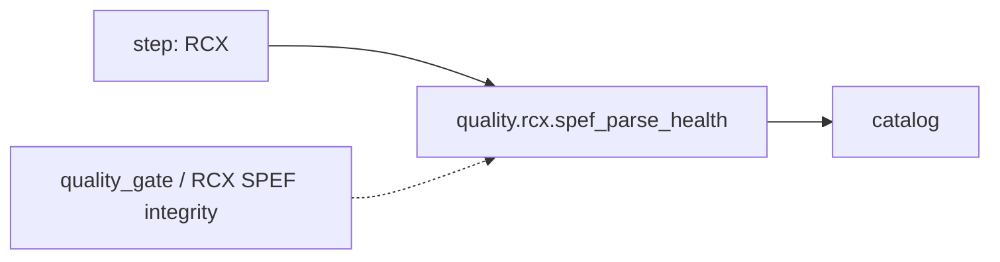

### `quality.sta.setup_closed`

- title: STA setup closure
- step: `sta`
- category: `quality_gate`
- optional: `False`
- board state: **catalog**

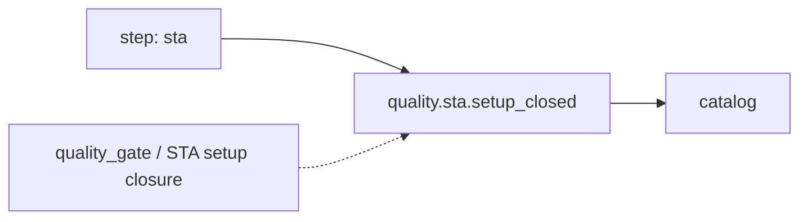

### `quality.sta.hold_closed`

- title: STA hold closure
- step: `sta`
- category: `quality_gate`
- optional: `False`
- board state: **catalog**


### `quality.mpc.minimum_area`

- title: Minimum core area
- step: `Harden`
- category: `quality_gate`
- optional: `False`
- board state: **catalog**

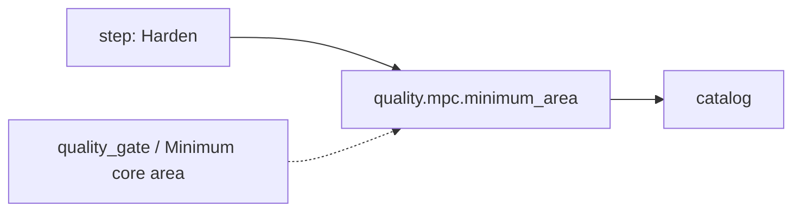

### `quality.mpc.maximum_area`

- title: Maximum core area
- step: `Harden`
- category: `quality_gate`
- optional: `False`
- board state: **catalog**

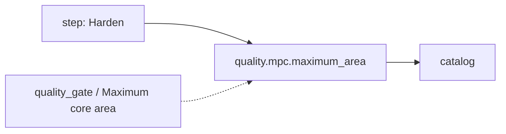

### `artifact.harden.gds`

- title: Harden GDS
- step: `Harden`
- category: `artifact`
- optional: `False`
- board state: **catalog**

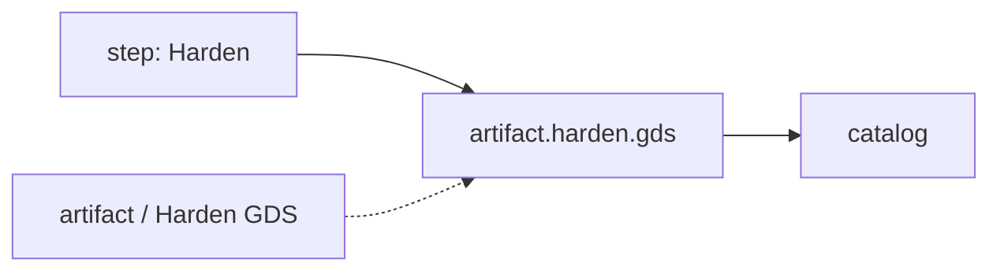

### `artifact.harden.lef`

- title: Harden LEF
- step: `Harden`
- category: `artifact`
- optional: `False`
- board state: **catalog**

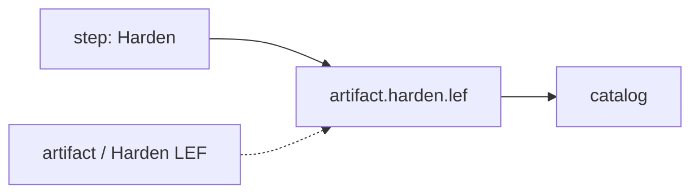

### `artifact.harden.lib`

- title: Harden LIB
- step: `Harden`
- category: `artifact`
- optional: `False`
- board state: **catalog**

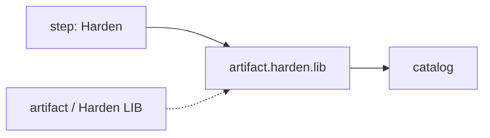

### `artifact.lvs.def`

- title: LVS DEF
- step: `lvs`
- category: `artifact`
- optional: `False`
- board state: **catalog**

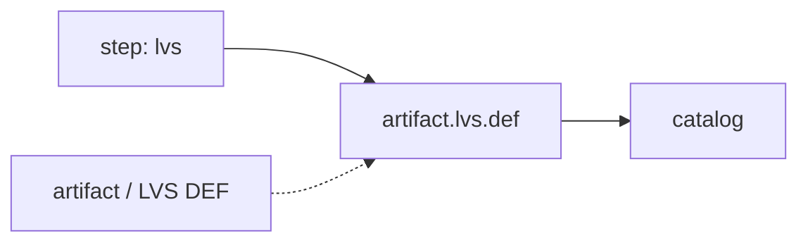

### `artifact.lvs.verilog`

- title: LVS Verilog
- step: `lvs`
- category: `artifact`
- optional: `False`
- board state: **catalog**

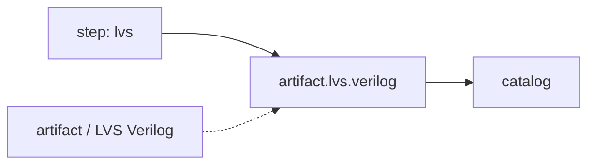

### `artifact.lvs.gds`

- title: LVS GDS
- step: `lvs`
- category: `artifact`
- optional: `False`
- board state: **catalog**

```mermaid
flowchart LR
  step_artifact_lvs_gds["step: lvs"] --> metric_artifact_lvs_gds["artifact.lvs.gds"]
  metric_artifact_lvs_gds --> state_artifact_lvs_gds["catalog"]
  catalog_artifact_lvs_gds["artifact / LVS GDS"] -.-> metric_artifact_lvs_gds
```

### `artifact.lvs.report`

- title: LVS report
- step: `lvs`
- category: `report`
- optional: `False`
- board state: **catalog**

```mermaid
flowchart LR
  step_artifact_lvs_report["step: lvs"] --> metric_artifact_lvs_report["artifact.lvs.report"]
  metric_artifact_lvs_report --> state_artifact_lvs_report["catalog"]
  catalog_artifact_lvs_report["report / LVS report"] -.-> metric_artifact_lvs_report
```

### `artifact.lvs.json`

- title: LVS JSON
- step: `lvs`
- category: `artifact`
- optional: `False`
- board state: **catalog**

```mermaid
flowchart LR
  step_artifact_lvs_json["step: lvs"] --> metric_artifact_lvs_json["artifact.lvs.json"]
  metric_artifact_lvs_json --> state_artifact_lvs_json["catalog"]
  catalog_artifact_lvs_json["artifact / LVS JSON"] -.-> metric_artifact_lvs_json
```

### `artifact.rcx.spef_outputs`

- title: RCX SPEF outputs
- step: `RCX`
- category: `artifact`
- optional: `False`
- board state: **catalog**

```mermaid
flowchart LR
  step_artifact_rcx_spef_outputs["step: RCX"] --> metric_artifact_rcx_spef_outputs["artifact.rcx.spef_outputs"]
  metric_artifact_rcx_spef_outputs --> state_artifact_rcx_spef_outputs["catalog"]
  catalog_artifact_rcx_spef_outputs["artifact / RCX SPEF outputs"] -.-> metric_artifact_rcx_spef_outputs
```

### `report.sta.timing_reports`

- title: STA timing reports
- step: `sta`
- category: `report`
- optional: `False`
- board state: **catalog**

```mermaid
flowchart LR
  step_report_sta_timing_reports["step: sta"] --> metric_report_sta_timing_reports["report.sta.timing_reports"]
  metric_report_sta_timing_reports --> state_report_sta_timing_reports["catalog"]
  catalog_report_sta_timing_reports["report / STA timing reports"] -.-> metric_report_sta_timing_reports
```

### `artifact.sta.corner_summaries`

- title: STA structured corner summaries
- step: `sta`
- category: `artifact`
- optional: `False`
- board state: **catalog**

```mermaid
flowchart LR
  step_artifact_sta_corner_summaries["step: sta"] --> metric_artifact_sta_corner_summaries["artifact.sta.corner_summaries"]
  metric_artifact_sta_corner_summaries --> state_artifact_sta_corner_summaries["catalog"]
  catalog_artifact_sta_corner_summaries["artifact / STA structured corner summaries"] -.-> metric_artifact_sta_corner_summaries
```

### `artifact.sta.timing_paths`

- title: STA structured timing paths
- step: `sta`
- category: `artifact`
- optional: `False`
- board state: **catalog**

```mermaid
flowchart LR
  step_artifact_sta_timing_paths["step: sta"] --> metric_artifact_sta_timing_paths["artifact.sta.timing_paths"]
  metric_artifact_sta_timing_paths --> state_artifact_sta_timing_paths["catalog"]
  catalog_artifact_sta_timing_paths["artifact / STA structured timing paths"] -.-> metric_artifact_sta_timing_paths
```

### `artifact.synthesis.netlist`

- title: Mapped synthesis netlist
- step: `Synthesis`
- category: `artifact`
- optional: `False`
- board state: **catalog**

```mermaid
flowchart LR
  step_artifact_synthesis_netlist["step: Synthesis"] --> metric_artifact_synthesis_netlist["artifact.synthesis.netlist"]
  metric_artifact_synthesis_netlist --> state_artifact_synthesis_netlist["catalog"]
  catalog_artifact_synthesis_netlist["artifact / Mapped synthesis netlist"] -.-> metric_artifact_synthesis_netlist
```

### `artifact.postroutelec.result`

- title: Post-route LEC result
- step: `postRouteLec`
- category: `artifact`
- optional: `True`
- board state: **catalog**

```mermaid
flowchart LR
  step_artifact_postroutelec_result["step: postRouteLec"] --> metric_artifact_postroutelec_result["artifact.postroutelec.result"]
  metric_artifact_postroutelec_result --> state_artifact_postroutelec_result["catalog"]
  catalog_artifact_postroutelec_result["artifact / Post-route LEC result"] -.-> metric_artifact_postroutelec_result
```

### `artifact.lec.result`

- title: Synthesis LEC result
- step: `lec`
- category: `artifact`
- optional: `True`
- board state: **catalog**

```mermaid
flowchart LR
  step_artifact_lec_result["step: lec"] --> metric_artifact_lec_result["artifact.lec.result"]
  metric_artifact_lec_result --> state_artifact_lec_result["catalog"]
  catalog_artifact_lec_result["artifact / Synthesis LEC result"] -.-> metric_artifact_lec_result
```

### `flow.route.completed`

- title: route flow completed
- step: `route`
- category: `flow`
- optional: `False`
- board state: **catalog**

```mermaid
flowchart LR
  step_flow_route_completed["step: route"] --> metric_flow_route_completed["flow.route.completed"]
  metric_flow_route_completed --> state_flow_route_completed["catalog"]
  catalog_flow_route_completed["flow / route flow completed"] -.-> metric_flow_route_completed
```

### `flow.drc.completed`

- title: drc flow completed
- step: `drc`
- category: `flow`
- optional: `False`
- board state: **catalog**

```mermaid
flowchart LR
  step_flow_drc_completed["step: drc"] --> metric_flow_drc_completed["flow.drc.completed"]
  metric_flow_drc_completed --> state_flow_drc_completed["catalog"]
  catalog_flow_drc_completed["flow / drc flow completed"] -.-> metric_flow_drc_completed
```

### `flow.lvs.completed`

- title: lvs flow completed
- step: `lvs`
- category: `flow`
- optional: `False`
- board state: **catalog**

```mermaid
flowchart LR
  step_flow_lvs_completed["step: lvs"] --> metric_flow_lvs_completed["flow.lvs.completed"]
  metric_flow_lvs_completed --> state_flow_lvs_completed["catalog"]
  catalog_flow_lvs_completed["flow / lvs flow completed"] -.-> metric_flow_lvs_completed
```

### `flow.filler.completed`

- title: filler flow completed
- step: `filler`
- category: `flow`
- optional: `False`
- board state: **catalog**

```mermaid
flowchart LR
  step_flow_filler_completed["step: filler"] --> metric_flow_filler_completed["flow.filler.completed"]
  metric_flow_filler_completed --> state_flow_filler_completed["catalog"]
  catalog_flow_filler_completed["flow / filler flow completed"] -.-> metric_flow_filler_completed
```

### `flow.postroutelec.completed`

- title: postRouteLec flow completed
- step: `postRouteLec`
- category: `flow`
- optional: `True`
- board state: **catalog**

```mermaid
flowchart LR
  step_flow_postroutelec_completed["step: postRouteLec"] --> metric_flow_postroutelec_completed["flow.postroutelec.completed"]
  metric_flow_postroutelec_completed --> state_flow_postroutelec_completed["catalog"]
  catalog_flow_postroutelec_completed["flow / postRouteLec flow completed"] -.-> metric_flow_postroutelec_completed
```

### `flow.rcx.completed`

- title: RCX flow completed
- step: `RCX`
- category: `flow`
- optional: `False`
- board state: **catalog**

```mermaid
flowchart LR
  step_flow_rcx_completed["step: RCX"] --> metric_flow_rcx_completed["flow.rcx.completed"]
  metric_flow_rcx_completed --> state_flow_rcx_completed["catalog"]
  catalog_flow_rcx_completed["flow / RCX flow completed"] -.-> metric_flow_rcx_completed
```

### `flow.sta.completed`

- title: sta flow completed
- step: `sta`
- category: `flow`
- optional: `False`
- board state: **catalog**

```mermaid
flowchart LR
  step_flow_sta_completed["step: sta"] --> metric_flow_sta_completed["flow.sta.completed"]
  metric_flow_sta_completed --> state_flow_sta_completed["catalog"]
  catalog_flow_sta_completed["flow / sta flow completed"] -.-> metric_flow_sta_completed
```

### `flow.harden.completed`

- title: Harden flow completed
- step: `Harden`
- category: `flow`
- optional: `False`
- board state: **catalog**

```mermaid
flowchart LR
  step_flow_harden_completed["step: Harden"] --> metric_flow_harden_completed["flow.harden.completed"]
  metric_flow_harden_completed --> state_flow_harden_completed["catalog"]
  catalog_flow_harden_completed["flow / Harden flow completed"] -.-> metric_flow_harden_completed
```

### `provenance.initial.rtl`

- title: Initial RTL
- step: `workspace`
- category: `provenance`
- optional: `False`
- board state: **catalog**

```mermaid
flowchart LR
  step_provenance_initial_rtl["step: workspace"] --> metric_provenance_initial_rtl["provenance.initial.rtl"]
  metric_provenance_initial_rtl --> state_provenance_initial_rtl["catalog"]
  catalog_provenance_initial_rtl["provenance / Initial RTL"] -.-> metric_provenance_initial_rtl
```

### `provenance.initial.sdc`

- title: Initial SDC
- step: `workspace`
- category: `provenance`
- optional: `False`
- board state: **catalog**

```mermaid
flowchart LR
  step_provenance_initial_sdc["step: workspace"] --> metric_provenance_initial_sdc["provenance.initial.sdc"]
  metric_provenance_initial_sdc --> state_provenance_initial_sdc["catalog"]
  catalog_provenance_initial_sdc["provenance / Initial SDC"] -.-> metric_provenance_initial_sdc
```

### `configuration.db`

- title: Configuration db
- step: `workspace`
- category: `configuration`
- optional: `False`
- board state: **catalog**

```mermaid
flowchart LR
  step_configuration_db["step: workspace"] --> metric_configuration_db["configuration.db"]
  metric_configuration_db --> state_configuration_db["catalog"]
  catalog_configuration_db["configuration / Configuration db"] -.-> metric_configuration_db
```

### `configuration.rcx`

- title: Configuration RCX
- step: `workspace`
- category: `configuration`
- optional: `False`
- board state: **catalog**

```mermaid
flowchart LR
  step_configuration_rcx["step: workspace"] --> metric_configuration_rcx["configuration.rcx"]
  metric_configuration_rcx --> state_configuration_rcx["catalog"]
  catalog_configuration_rcx["configuration / Configuration RCX"] -.-> metric_configuration_rcx
```

### `configuration.sta`

- title: Configuration sta
- step: `workspace`
- category: `configuration`
- optional: `False`
- board state: **catalog**

```mermaid
flowchart LR
  step_configuration_sta["step: workspace"] --> metric_configuration_sta["configuration.sta"]
  metric_configuration_sta --> state_configuration_sta["catalog"]
  catalog_configuration_sta["configuration / Configuration sta"] -.-> metric_configuration_sta
```

