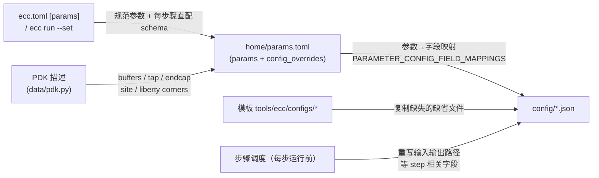

# ECC Flow 工具配置参考（按步骤）

本文整理 ECC RTL-to-Harden 流程中**每一步实际使用的工具配置文件、全部参数及其含义**。配置取值与生成逻辑已按 v0.1.0-alpha.12 源码重新核对（模板位于 [chipcompiler/tools/*/configs/](https://github.com/openecos-projects/ecc/tree/main/chipcompiler/tools/ecc/configs/)），并对照了一次真实的 gcd@ics55 harden 运行。

- 想了解命令用法 → [ECC CLI 用户指南](ecc-user-guide.cn.md)（终端：`ecc doc ug --lang cn`）；从零上手 → [入门教程](ecc-tutorial.cn.md)（终端：`ecc doc tutorial --lang cn`）
- 配置查看命令：`ecc config <step>`（列出该步骤实际生效的配置文件）；参数查看与修改命令：`ecc param`（见 §1.4）

## 0. 配置体系总览

STA 并行调度参数：`sta.max_parallel_corners` 为整数 1–4，默认 1，
通过 `ecc param set sta.max_parallel_corners 3 --workspace baseline` 设置。
参数经标准配置刷新写入 STA JSON 的 `max_parallel_corners`。ECC/Studio Linux
runtime 将其作为最大并行 corner 数，内存余量不足时减少并行度；
非 Linux 为串行。`ECOS_AGENT_STA_WORKERS` 不再覆盖此配置。

### 0.1 配置文件放在哪

每次运行（run）的 workspace 下有一个共享 `config/` 目录，所有步骤的 JSON 配置都落在这里，**同名文件会被后运行的步骤原地重写**（每步只更新与自己相关的字段）：

```
<workspace>/                 # 新项目/manifest 项目为 <project>/<id>；legacy 项目为 runs/<id>
├── home/
│   ├── params.toml        # schema_version 2；参数中枢（见 §1）
│   ├── flow.json          # schema_version 1；步骤状态
│   └── config-derived-manifest.json # 上次配置派生后的文件哈希
├── config/                # ← 本文档的主角：11 个 JSON + Tcl 交接文件 + 打包的 EMIR 工艺文件
│   ├── db_ecc.json        # 数据库构建（读入 LEF/DEF/网表/LIB/SDC，每个 ecc 步骤共用）
│   ├── floorplan_ecc.json # 布局规划
│   ├── cts_ecc.json       # 时钟树综合
│   ├── route_ecc.json     # 布线
│   ├── drc_ecc.json       # DRC（空配置，规则来自 tech LEF）
│   ├── filler_ecc.json    # 填充单元
│   ├── rcx_ecc.json       # 寄生提取
│   ├── sta_ecc.json       # 静态时序分析（多 corner）
│   ├── sizer_ecc.json     # ECC Sizer hold pass 选项
│   ├── dreamplace_ecc.json# DreamPlace 布局/合法化（placement 与 legalization 共用）
│   ├── emir_ecc.json      # iEMIR 工艺文件选择
│   ├── macro_location.tcl # 宏摆放 Tcl 交接文件（见 §1.5；由 macroPlacement 或 macro.placements 参数写出）
│   └── ics55_synthetic.tech # 为 EMIR 复制的打包默认工艺文件
├── Synthesis_yosys/
│   └── data/global_var.tcl  # 综合步骤的"配置"（Tcl 变量，非 JSON）
├── lec_kepler_formal/         # 综合级 LEC（默认引擎；data/lec_config.yaml）
├── timing_optimization_sizer/
│   └── script/<design>.{env_file,cmd_file}  # 自动生成的 Sizer 配置
└── postRouteLec_kepler_formal/  # 布线后 LEC 步骤（默认引擎；YAML 配置）
```

> 历史变化：旧版本的 `flow_ecc.json`（配置路径聚合器）与 `fixfanout_ecc.json`（高扇出修复，独立步骤）已随 ecc-tools 更新移除。`cts.max_fanout` 现在同时写入自动生成 SDC 的 `set_max_fanout` 约束和 CTS 的 `max_fanout` 字段。

### 0.2 配置值从哪来（生成机制）

配置文件在 workspace 创建时从模板复制，随后按三层来源刷新（实现：`init_workspace_config` / `refresh_workspace_config` / `update_step_config`）：



| 来源 | 决定的内容 | 举例 |
|---|---|---|
| 模板默认值 | 算法类参数的出厂值 | CTS `skew_bound=0.08` |
| 用户参数 | 旧语义参数 + 全部已审核静态工具字段 | `floorplan.core_util` → `die_util.utilization`；`cts.skew_bound` → CTS JSON |
| PDK | 工艺相关单元与库 | `buffer_type` ← PDK buffers 列表；STA liberty corners |
| 步骤调度 | 输入/输出路径（链式传递） | `db_ecc.json` 的 `def_path` 每步指向上一步输出 |

> ⚠️ **不要直接手改 `config/` 下的受管文件**：JSON 参数字段会在步骤运行前按 `params.toml` + PDK 重新刷新，宏摆放则有独立的 `ecc macro` 接口。`home/config-derived-manifest.json` 记录每次派生后的受管 JSON 和 `macro_location.tcl`；`ecc workspace refresh` 会先与该记录比对，发现后续修改时返回 `derived_configs_modified`，而不会默默丢弃手改内容；只有确定要覆盖时才加 `--force`。旧 workspace 若还没有该清单，因无比对基线，首次 refresh 会直接进行。正确入口是 `ecc param set`、`ecc macro`、`ecc.toml [params.*]` 或一次性 `ecc run --set`。workspace 的输入、输出、临时和生成文件路径不会作为 CLI 参数暴露；PDK 内容路径使用 `pdk.*` 参数（见 §1.2）。

### 0.3 每个步骤用到哪些配置

`ecc config <step>` 的真实输出归纳（映射源码 `_STEP_CONFIG_KEYS`，位于 [chipcompiler/data/workspace/__init__.py](https://github.com/openecos-projects/ecc/blob/main/chipcompiler/data/workspace/__init__.py)）：

| 步骤 | db_ecc | 专属配置 | 说明 |
|---|---|---|---|
| synthesis | — | `global_var.tcl`（Tcl） | Yosys 用 Tcl 变量驱动，不走 JSON |
| lec | — | 引擎生成配置 | 综合级 LEC；当前默认引擎为 `kepler_formal`（YAML），`yosys_lec` 使用 Tcl，`lec_dual` 同时运行两者；未证明时步骤失败并终止后续流程 |
| preFloorplan | ✓ | `floorplan_ecc.json` | 自动宏布局 |
| macroPlacement | — | `dreamplace_ecc.json` + `macro_location.tcl` | 写入 Tcl 宏摆放交接文件（设置了 `macro.placements` 时跳过 DreamPlace，见 §1.5） |
| postFloorplan | ✓ | `floorplan_ecc.json` + `macro_location.tcl` | 读取 Tcl 宏摆放交接文件 |
| preplace | ✓ | 无 | Sizer 的布局前准备读取 `db_ecc.json` |
| placement | — | `dreamplace_ecc.json` | 与 legalization 共用一个文件 |
| diff_sizing | — | `dreamplace_ecc.json` | 独立可微 sizing 与 DreamPlace 布局共用该配置 |
| cts | ✓ | `cts_ecc.json` | |
| legalization | — | `dreamplace_ecc.json` | 每步重写 `def_input`/`result_dir` 等 |
| timing optimization | ✓ | `sizer_ecc.json` + `dreamplace_ecc.json` | Sizer 使用 ECC 配置和生成的脚本，随后做内部 DreamPlace 合法化；见 §6 |
| routing | ✓ | `route_ecc.json` | |
| filler | ✓ | `filler_ecc.json` | |
| lvs | — | 无 | 工具默认行为 |
| drc | ✓ | `drc_ecc.json`（空） | 规则来自 tech LEF |
| antennaCheck | ✓ | 无 | 读取 `db_ecc.json`；advisory 步骤，分析未完成不会单独中断 flow |
| postroutelec | — | 引擎生成配置 | 对 `filler` 网表做布线后 LEC；引擎选择与证据契约同 `lec`，见 §11 |
| rcx | ✓ | `rcx_ecc.json` | corner 由 PDK 决定（见 §12） |
| sta | ✓ | `sta_ecc.json` + `rcx_ecc.json` | 读 rcx 配置以对齐 SPEF |
| powerAnalysis | — | 无显式步骤配置 | 运行器内部复用 `db_ecc.json`，不在 `_STEP_CONFIG_KEYS` 中 |
| emir | ✓ | `emir_ecc.json` | iEMIR 工艺文件；advisory 步骤，见 §13.5 |
| harden | — | 无专属配置 | 工具内部复用 `db_ecc.json` 定位输入输出，但不在 `_STEP_CONFIG_KEYS` 中；`ecc config harden` 会明确显示该步骤没有配置 |

## 1. 参数传递链（用户可调参数）

### 1.1 旧语义参数（13 个）

来源：[chipcompiler/data/parameter_schema.py](https://github.com/openecos-projects/ecc/blob/main/chipcompiler/data/parameter_schema.py) 的 `_LEGACY_PARAM_REGISTRY`（`PARAM_REGISTRY` 的兼容段；直配参数见 §1.2 的 `config_params/` schema）；`chipcompiler/cli/project/params.py` 现在仅是 CLI 兼容 facade。这些参数保持兼容；优先级：`--set` > `ecc.toml [params]` > 默认值。「写入位置」列为该参数最终落到的工具配置字段。

| 参数 | 类型 / 范围 | 默认 | 写入位置（config 字段） | 含义 |
|---|---|---|---|---|
| `design.frequency_mhz` | float [1e-6, 10000] MHz | 100.0 | 综合脚本 `clk_freq_mhz` + 自动 SDC 时钟周期 | 目标时钟频率 |
| `floorplan.core_util` | float [0.01, 1.0] | 0.4 | floorplan `die_builder.die_util.utilization` | 核心利用率（面积按单元面积/利用率反推） |
| `floorplan.core_margin` | int×2（µm） | [2, 2] | floorplan `die_builder.margin.{left,right,top,bottom}_micron` | 核心到 die 边的留白 [水平, 垂直] |
| `floorplan.aspect_ratio` | float [0.1, 10] | 1.0 | floorplan `die_builder.die_util.aspect_ratio` | 核心宽高比 |
| `cts.max_fanout` | int [1, 200] | 32 | 自动生成 SDC 的 `set_max_fanout` + cts `max_fanout` | 设计与时钟树最大扇出约束 |
| `place.target_density` | float [0.1, 1.0] | 0.4 | dreamplace `target_density` | 全局布局目标密度 |
| `place.target_overflow` | float [0.0, 1.0] | 0.1 | dreamplace `stop_overflow` | 全局布局溢出收敛目标 |
| `place.global_right_padding` | int [0, 100] | 0 | 仅记录于 params.toml | 布局 site 右侧全局 padding（当前版本尚未接入工具配置字段） |
| `place.cell_padding_x` | int [0, 10000]（dbu） | 200 | dreamplace `cell_padding_x` | 单元 X 方向 padding（绕线拥塞缓解） |
| `place.routability_opt` | {0, 1} | 1 | dreamplace `routability_opt_flag` | 布局阶段开启绕线拥塞驱动优化 |
| `route.bottom_layer` | MET1–MET5 | MET2 | route `RT.-bottom_routing_layer` + db `LayerSettings.routing_layer_1st` | 绕线最低层 |
| `route.top_layer` | MET2–MET6 | MET5 | route `RT.-top_routing_layer` | 绕线最高层 |
| `sta.max_paths` | int [1, 100000] | 1000 | STA 引擎参数（不落 JSON，运行时传入） | 每份 STA 时序报告的最大路径数 |

### 1.2 每步骤直配 schema 与 PDK 路径

`chipcompiler/data/config_params/` 为每个配置 owner 保留一个人工审核的 Python schema 文件。所有静态工具字段均可由 `ecc param` 修改；默认 `ecc param list` 只保留旧参数和已覆盖字段，使用以下命令检查完整字段、类型和 JSON 目标：

```bash
ecc param list --step cts
ecc param list --step floorplan
ecc param list --all              # 完整审核 schema（配置了 preset 的项目里 pdk.* 需要 --all --plain）
ecc param list --all --plain      # 完整目录，含 pdk.* 路径参数
ecc param set cts.skew_bound 0.05
ecc param set floorplan.phy_placer.well_tap.distance_micron 30.0
ecc param set cts.routing_layer '[4, 5]'
ecc run --set place.num_threads=12
```

标量按 schema 类型解析；列表和对象值使用 JSON 字面量，数组整体替换。持久化值写入嵌套 TOML 表，例如：

```toml
[params.floorplan.phy_placer.well_tap]
distance_micron = 30.0

[pdk.overrides]
tech = "prtech/techLEF/N551P6M_ecos.lef"
```

`die_builder` 的 `die_util`/`margin` 等旧字段不在此列，仍通过 §1.1 的语义参数（`floorplan.core_util`、`floorplan.core_margin`、`floorplan.aspect_ratio`）设置。

允许的 PDK 路径参数为 `pdk.tech`、`pdk.lefs`、`pdk.libs`、`pdk.mapping_file`、`pdk.sdc` 和 `pdk.spef`；其中 `tech/lefs/libs/mapping_file` 是 PDK 内容路径，相对 `pdk.root` 解析，而 `pdk.sdc`/`pdk.spef` 是设计数据，相对**项目目录**解析；六者都做文件存在校验。`pdk.root` 仍使用 `ecc pdk set-root`。workspace 内置路径（DB 的 DEF/网表/输出、DreamPlace 的输入/结果目录、步骤临时目录和 STA 多 corner liberty 结构）均不提供 CLI 参数。

### 1.3 参数中枢 params.toml

`home/params.toml` 是带 schema 版本的文档。新文件在顶层写入 `schema_version = 2`；早于版本化机制的合法文件按 version 0 处理，workspace 迁移路径打开它时会依次迁移到 version 2。如文件声明的版本高于当前 ECC 支持上限，则返回 `unsupported_schema_version`，不会静默解析。

该文件保存规范化的 workspace 参数、`config_overrides` 以及 **flow 运行后回填的结果值**（如实际 die/core 尺寸、利用率）。`config_overrides` 是 CLI 从审核 schema 生成的嵌套 TOML 补丁；每次 workspace 刷新都会在 PDK 和语义参数映射之后重新应用。`home/parameters.json` 仅在迁移旧 workspace 时读取。

文件由四个节区构成：

| 节区 | 内容 |
|---|---|
| `[design]` | `name` / `top` / `clock_port` / `frequency_mhz`，与项目级 `ecc.toml [design]` 同词汇 |
| `[pdk]` | `name` / `root` / `config`；`config` 以 workspace 相对路径存储，加载时还原为绝对路径 |
| `[flow]` | `preset = "rtl2gds"`，或 `start` + `end` 成对出现（只接受持久化规范步骤名），另可声明 `skip_steps` 与 `lec_engine`；目标缺省时由 `home/flow.json` 的首末步骤推导 |
| `[params]` | 规范扁平参数（snake_case）；嵌套值渲染为子表（如 `[params.die]`、`[params.floorplan.phy_placer.well_tap]`） |

**身份参数在运行时仍使用规范扁平键，但 v2 不再在文件中保存两份**：`design`、`top_module`、`clock`、`frequency_max`、`pdk`、`pdk_root`、`pdk_config` 以 `[design]`/`[pdk]` 的人读词汇持久化；加载时重建为程序消费的 `[params]` 扁平键。旧版 v1 文件仍接受读取，并在可写 workspace 打开时迁移去重。这样 `[design]`/`[pdk]`/`[flow]` 保持与 `ecc.toml` 同词汇，步骤参数、`config_overrides` 与回填结果仍由运行时扁平参数中枢提供。

保存时身份字段只渲染到 `[design]`/`[pdk]`，加载仍兼容 v1 的 `[params]` 镜像。若旧文件被手工改到两处不一致，加载规则为：**`[design]`/`[pdk]` 的非空值覆盖 `[params]` 副本；节区键为空或缺失时回落到 `[params]` 副本**。写入采用临时文件 + 原子 rename，不穿透 symlink。

通过 `ecc param set KEY VALUE --workspace NAME` 写入的已创建 workspace 覆盖也保存在 `[params]`：实际参数值与 `config_overrides` 共同决定刷新后的步骤配置，`workspace_param_overrides` 列表记录 `key`、首次修改前的 `baseline` 和当前 `value`，供 `ecc param diff --workspace NAME` 使用。`ecc param unset KEY --workspace NAME` 会恢复该 `baseline` 并清除这条本地覆盖记录；其所属步骤及后续步骤会失效，直到再次运行。PDK 资源路径和引用不能在此处局部修改，应更新 `ecc.toml` 后执行 `ecc workspace refresh NAME`。

### 1.4 参数配置 CLI 命令（`ecc param`）

参数的查看与修改统一走 `ecc param` 子命令（子命令定义：[chipcompiler/cli/commands/param.py](https://github.com/openecos-projects/ecc/blob/main/chipcompiler/cli/commands/param.py)；项目作用域实现：[chipcompiler/cli/command_handlers/param.py](https://github.com/openecos-projects/ecc/blob/main/chipcompiler/cli/command_handlers/param.py)，workspace 作用域实现：[chipcompiler/cli/command_handlers/workspace_params.py](https://github.com/openecos-projects/ecc/blob/main/chipcompiler/cli/command_handlers/workspace_params.py)）：

| 命令 | 作用 |
|---|---|
| `ecc param list [--step STEP] [--all]` | 列出参数。缺省只显示 §1.1 的旧语义参数和已显式覆盖的直配参数；`--step STEP` 按 group/applies 过滤出该步骤的完整已审核 schema；`--all` 显示全部审核 schema（配置了 flow preset 时，`pdk.*` 参数仅出现在 `--all --plain`） |
| `ecc param show KEY` | 单参数详情：当前值 / 默认值 / 来源 / 类型 / 取值范围 / 写入目标（`maps_to`、`config_target`、`pdk_target`）及描述 |
| `ecc param set KEY VALUE` | 校验后写入参数覆盖（两种作用域见下表）；取值非法（超范围、不在 choices、类型不符）直接报 `invalid_value`，不落盘 |
| `ecc param unset KEY` | 移除该参数的覆盖，恢复默认值（workspace 作用域恢复到首次修改前的 `baseline`） |
| `ecc param apply [--set KEY=VALUE...] [--unset KEY...]` | 原子批量应用多个 set/unset 修改（默认项目作用域；`--workspace NAME` 指定单个 workspace，workspace 作用域下 `--step STEP` 把批次限制为该步骤可配置的参数）。批内任一校验失败则什么都不写 |
| `ecc param diff` | 只列出与默认值不同的参数（workspace 作用域：局部覆盖及其 `baseline`） |

所有子命令共享的通用选项：

| 选项 | 作用 |
|---|---|
| `--project DIR` | 指定项目目录（缺省为当前目录） |
| `--workspace NAME` | 切换到 workspace 作用域：操作 project.json 清单中声明的指定 workspace，而不是项目 `ecc.toml` |
| `--plain` | 机器可读的 `key=value` 输出（便于脚本解析）；缺省为人类可读文本 |
| `--json` | 记录数组输出——仅 `list`、`show`、`diff` 支持 |

两种作用域的行为差异：

| | 项目作用域（默认） | workspace 作用域（`--workspace NAME`） |
|---|---|---|
| 写入位置 | `ecc.toml` 的 `[params.<group>]` 或 `[pdk.overrides]`（保留注释与格式） | `<workspace>/home/params.toml` 的 `[params]`，同时记录 `workspace_param_overrides` |
| 生效时机 | 下次 `ecc run` **新建** workspace 时 | 立即刷新生成配置；参数所属步骤及其后缀标记为待执行（输出 `from_step` / `invalidated_steps`），后续 `ecc run --workspace NAME` 从该步骤续跑 |
| 可改参数 | 全部已审核 schema（含 `pdk.*` 路径参数） | 不含 `pdk.*`（路径改动必须改 `ecc.toml` 后执行 `ecc workspace refresh NAME`）；且参数所属步骤必须存在于该 workspace 的持久化 flow，否则报 `workspace_param_refresh_failed` |
| 前提 | 项目须有 `ecc.toml`；缺少该文件的纯清单项目会报 `param_requires_ecc_toml` | 须为清单项目中声明的受管 workspace（否则报 `workspace_param_requires_managed_workspace`） |
| 恢复 | `unset` 从 `ecc.toml` 删除对应键 | `unset` 恢复 `baseline` 并清除该条覆盖记录 |

取值解析：标量按 schema 类型解析；列表与对象必须写成 JSON 字面量，数组整体替换，例如 `ecc param set cts.routing_layer '[4, 5]'`。

一次性覆盖用 `ecc run --set KEY=VALUE`：仅在**新建**（含 `--overwrite`）workspace 时生效并记录到 `home/cli-param-overrides.json`；对已有 workspace 使用会报 `set_requires_fresh_run`，此时应改用 `ecc param set KEY VALUE --workspace NAME` 或 `--overwrite` 重建。

完整命令输出示例见 [ECC CLI 用户指南 §9](ecc-user-guide.cn.md)（终端：`ecc doc ug --lang cn`）。

### 1.5 手工宏摆放（`ecc macro`）

`macro.placements` 保存手工硬宏摆放，取值为 `{instance, x, y, orientation}` 对象的 JSON 数组（坐标单位微米；实例以 `fixed` 状态提交）。它与 §1.1 的语义参数同类——不写入任何 `config/*.json` 字段，而是在创建或刷新 workspace 配置时渲染进 `config/macro_location.tcl`。只要它非空，`macroPlacement` 保留 load/save 流程但跳过 DreamPlace 宏摆放、保留生成的交接文件；`postFloorplan` 随后依据该文件提交宏。清空该参数即恢复 DreamPlace 自动摆放。

| 命令 | 作用 |
|---|---|
| `ecc macro set INSTANCE --x X --y Y --orient ORIENT` | 按 instance 新增/更新一条摆放（方向：`R0`、`R90`、`R180`、`R270`、`MX`、`MY`、`MX90`、`MY90`） |
| `ecc macro remove INSTANCE` | 删除一条摆放；删除最后一个条目会清空该参数 |
| `ecc macro import PATH` | 解析 `placeInstance` 交接文件（微米、R 记法；跳过注释与 `setInstancePlacementStatus` 行）并整表替换该参数；空文件清空参数，畸形语句整体报错不写入 |
| `ecc macro show` | 列出当前摆放与生成的 Tcl 路径；workspace scope 额外解析现有 Tcl 输出 `file_placements` 与 `diverged`（文件与参数是否一致） |

`ecc param` 的两种 scope 都适用：项目 scope（默认）把列表存进 `ecc.toml` `[params.macro]`，在下一次新建 run 或 `ecc workspace refresh` 时生效；`--workspace NAME` 写入 `home/params.toml`，立即重生成 Tcl，并把 `macroPlacement` 及其后缀标记为待重跑。该列表也可以按普通 JSON 参数设置，例如 `ecc param set macro.placements '[{"instance": "u0", "x": 10.0, "y": 20.0, "orientation": "R0"}]'`。

交接文件必须覆盖设计中的全部硬宏，否则 `postFloorplan` 会报出缺失的实例名。文件格式详见 [floorplan-flow.cn.md](floorplan-flow.cn.md)。

### 1.6 自动生成的 SDC

未声明 `[design].sdc` 时，workspace 创建过程会写出 `origin/<design>.sdc`；用户提供的 SDC 则只复制、不重新生成。ECC 通过首行 `# Auto-generated SDC file` 标记识别自己生成的文件，参数变化时也只刷新带该标记的 SDC。

当前生成器按 `design.frequency_mhz` 为 `design.clock_port` 创建真实时钟（无端口时创建虚拟时钟），把输入/输出 delay 设为 0，分别按周期的 1.5% 和 0.5% 设置 setup/hold uncertainty，把时钟 transition 上限设为 0.15 ns、输入 transition 上限设为 0.20 ns，按 `cts.max_fanout` 写入 `set_max_fanout`，并在 PDK 的 `sdc_load > 0` 时增加输出负载约束。

## 2. 公共配置：db_ecc.json

所有 ecc 工具步骤共用。每个步骤启动时先用它把 LEF/DEF/网表/LIB 载入内存数据库（subflow 的 "load data" 阶段）。`INPUT.def_path/verilog_path` 与 `OUTPUT.output_dir_path` 三个字段**每步运行前被重写**，实现步骤间文件链。

| 字段 | 示例值（harden 步运行时） | 来源 | 含义 |
|---|---|---|---|
| `INPUT.tech_lef_path` | `…/prtech/techLEF/N551P6M_ecos.lef` | PDK | 工艺 LEF（层定义/规则） |
| `INPUT.lef_paths` | `[H7CR_lef, H7CL_lef, H7CH_lef]` | PDK | 标准单元 LEF（抽象）；IO LEF 需通过 `pdk.lefs` 配置 |
| `INPUT.def_path` | `sta_ecc/output/gcd_sta.def.gz` | 每步重写 | 输入 DEF（上一步版图） |
| `INPUT.verilog_path` | `sta_ecc/output/gcd_sta.v.gz` | 每步重写 | 输入门级网表 |
| `INPUT.lib_path` | H7CR/H7CL/H7CH SS 库 | PDK | 公共时序库；Yosys 综合阶段排除 H7CH |
| `INPUT.sdc_path` | `origin/gcd.sdc` | workspace | 时序约束（自动生成或用户提供） |
| `INPUT.spef` | `""` | PDK/workspace | 预置寄生文件（RCX 前一般为空） |
| `OUTPUT.output_dir_path` | `Harden_ecc/output` | 每步重写 | 本步骤产物输出目录 |
| `LayerSettings.routing_layer_1st` | `MET2` | 参数 `route.bottom_layer` | 首个可用绕线层（影响数据库层设置） |

## 3. synthesis（Yosys）

无 JSON 配置。Yosys 由两段 Tcl 驱动：`script/yosys_synthesis.tcl`（综合主脚本）+ `data/global_var.tcl`（每次运行生成，即本步骤的"配置文件"）。内容取自真实运行：

| Tcl 变量 | 示例值 | 来源 | 含义 |
|---|---|---|---|
| `top_design` | `gcd` | `ecc.toml design.top` | 综合顶层模块 |
| `clk_freq_mhz` | `100` | 参数 `design.frequency_mhz` | 目标频率（换算 `clk_period_ps` 供时序驱动综合） |
| `use_slang` | `false` | 运行时探测 | 是否用 slang 前端读 SystemVerilog（默认 Verilog 模式） |
| `rtl_file` | `[origin/gcd.v]` | `ecc.toml design.rtl` / filelist | RTL 源文件列表 |
| `final_netlist_file` | `output/gcd_Synthesis.v.gz` | 步骤调度 | 输出门级网表（供 floorplan） |
| `golden_netlist_file` | `output/gcd_Synthesis_golden.v` | 步骤调度 | 两次 LEC 共用的 golden 网表（clockgate 映射前导出） |
| `final_netlist_sim_file` | `…_sim.v.gz` | 步骤调度 | 仿真用网表（含 SDF 相关信息） |
| `synth_stat_json` / `synth_check_rpt` 等 | `report/`、`feature/` 下 | 步骤调度 | 统计与检查报告输出 |
| `keep_hierarchy` | `false` | 模板 | 是否保留模块层级 |
| `dont_use_cells` | `[DFFSRQX* … ICG*]` | PDK/模板 | 综合禁用单元（通配符） |
| `tie_low_cell/port` | `TIELOH7R` / `Z` | PDK | 低电平约束单元及输出端口 |
| `tie_high_cell/port` | `TIEHIH7R` / `Z` | PDK | 高电平约束单元及输出端口 |
| `abc_driver_cell` | `BUFX0P5H7L` | PDK | ABC 映射假设的驱动单元 |
| `abc_load` | `0.015` | PDK | ABC 映射负载电容（pF） |
| `lib_stdcell_list` | H7CR/H7CL | PDK（排除 H7CH） | 传给 ABC、DFF 和 clockgate 的库列表；`pdk.libs` 中配置的 IO 库也会传入，不额外排除 |
| `lib_list` | H7CR/H7CL | PDK / workspace DB | 通过 `read_liberty -lib` 读取的模型库；配置 IO 库后用于识别已有 IO 实例，H7CH 仍不加载 |
| `tmp_dir` | `Synthesis_yosys/data/tmp` | 步骤调度 | 中间文件目录 |

ICS55 内置 PDK 不默认加载 IO cell 的 LEF 和 Liberty。设计需要 IO cell 时，在
`[pdk.overrides]` 中把 `IP/IO/ICsprout_55LLULP1233_IO_251013/lef/ICSIOA_N55_3P3_1P6M1TM_ecos.lef`
加入 `lefs`，把同目录 `liberty/` 下的 `ICSIOA_N55_3P3_ss_1p08_2p97_125c.lib` 加入
`libs`。覆盖是整列表替换，需同时列出标准单元文件。CTS、setup Sizer 及综合后 STA
从该列表取得 IO 库；最终 STA 和 hold Sizer 使用 §13 的 `sta.liberty`。Sizer 要求
Liberty 单元有对应的 LEF master，因此 IO 的 LEF 与 Liberty 必须同时配置。

PDK 中 `ss_1p08_2p97_m40c`、`ff_1p32_3p63_125c`、`ff_1p32_3p63_m40c` 三个 IO 库的
上升延迟和上升转换表仍为错误值（约 200 ns）。它们出现在 `pdk.libs` 中时 PDK 校验
直接失败，错误信息会给出同工艺角的已修正库。已创建 workspace 的 DB 库列表不会自动
移除此前默认加载的 IO 库。

另有环境变量 `YOSYS_SYNTH_STRATEGY`（如 `DELAY 4` / `AREA N` / `BALANCE N`）控制综合策略方向，默认 `DELAY 4`（提频优先）。

## 4. floorplan（ecc-tools）

配置 `floorplan_ecc.json` 由 `preFloorplan` 和 `postFloorplan` 共享。`preFloorplan` 在配置了 `clock` 时先标记时钟网络，再派生 `floorplan_ecc_simple.json`（`macro_placer.mode = "auto"`、`file_path` 为空），然后执行 load data → init simple floorplan → save data。`macroPlacement` 执行仅宏单元摆放，并通过 `tcl_save` 写入 `config/macro_location.tcl` 形成交接检查点（设置了 `macro.placements` 参数时跳过 DreamPlace，交接文件改由配置刷新渲染，见 §1.5）。`postFloorplan` 把共享配置改为 `macro_placer.mode = "file"` 并指向该文件，再执行 load data → init/run floorplan → create tracks → place IO pins → tap cells → PDN → save data → analysis。

### ifp（iFP 布图引擎）

| 参数 | 默认 | 含义 |
|---|---|---|
| `temp_directory_path` | 每步生成 → `preFloorplan_ecc/data/fp` 或 `postFloorplan_ecc/data/fp` | iFP 中间数据目录 |
| `thread_number` | 16 | 并行线程数 |

### macro_placer（宏摆放）

| 参数 | 默认 | 含义 |
|---|---|---|
| `mode` | `auto` | `auto` 自动摆放宏单元；`file` 从 `file_path` 读取宏位置 |
| `file_path` | `""` | `mode=file` 时使用的宏位置文件；流程固定指向 `config/macro_location.tcl` |
| `macro_placement_halo` | 3.0 | 宏单元布置 halo（µm，禁止标准单元靠近的范围） |
| `macro_routing_halo` | 3.0 | 宏单元绕线 halo（µm，禁止绕线的范围） |

### die_builder（die/核心区域规划）★ 用户参数作用区

| 参数 | 默认 | 含义 |
|---|---|---|
| `mode` | `die_util` | 布图模式：`die_util`=按利用率反推尺寸；`die_size`=直接给 die 尺寸 |
| `site_name` | PDK → `core7` | 标准单元行 site 名 |
| `margin.left/right/top/bottom_micron` | 参数 `floorplan.core_margin` → 2.0 | core 到 die 边缘留白（µm） |
| `die_util.aspect_ratio` | 参数 `floorplan.aspect_ratio` → 1.0 | core 宽高比 |
| `die_util.utilization` | 参数 `floorplan.core_util` → 0.4 | core 利用率（单元面积/核心面积） |
| `die_size.width/height_micron` | 100.1 / 246.6 | `mode=die_size` 时的 die 尺寸（`die_util` 模式下不生效） |

### io_placer（IO 引脚排布）

| 参数 | 默认 | 含义 |
|---|---|---|
| `mode` | `auto` | `auto` 自动摆放 IO 引脚；`file` 从 `file_path` 读取 IO 引脚位置 |
| `file_path` | `""` | `mode=file` 时使用的 IO 引脚位置文件 |
| `io_layer_list` | `["MET3","MET4"]` | IO 引脚允许的金属层 |

### phy_placer（物理单元插入）

| 参数 | 默认 | 含义 |
|---|---|---|
| `well_tap.cell_name` | PDK → `FILLTAPH7R` | well tap 单元 |
| `well_tap.distance_micron` | 58.0 | tap 插入间距（µm，满足阱接触规则） |
| `side_endcap.left/right_cell_name` | PDK → `FILLTAPH7R` | 行首/行尾 endcap 单元 |
| `edge_endcap.top/bottom_cell_name_list` | FILLCAP/FILLER 系列 | die 上下边缘 endcap 备选单元（按宽度择优） |
| `boundary_tap.top/bottom_cell_name_list` | 同上 | die 边界 tap 备选单元 |
| `boundary_tap.rule_micron` | 30.0 | 边界 tap 插入规则距离（µm） |

### pdn_generator（电源网络）

| 参数 | 默认 | 含义 |
|---|---|---|
| `global_connect` | VDD/VSS → 实例电源脚 | 电源/地网络与单元引脚的全局连接声明（`is_power` 区分电源/地） |
| `rail`（MET1, 0.16µm） | 见默认 | 标准单元行电源轨：层 + 宽度 |
| `stripe`（MET4/MET5） | 宽 1.0、间距 16.0、偏移 0.5 | 电源条带：层/宽度/间距（pitch）/偏移（µm） |
| `connect_layers` | MET1–MET4、MET4–MET5 | 相邻层电源过孔连接对 |

## 5. macro placement / placement / diff_sizing / legalization（DreamPlace）

这些步骤共用 `config/dreamplace_ecc.json`；每次步骤运行前重写 `def_input`、`verilog_input`、`result_dir`。`macroPlacement` 使用 `macroPlacement_dreamplace/data/macro`；placement 读取 post-floorplan 输出并使用 `place_dreamplace/data/pl`；`diff_sizing` 复用 placement 配置；legalization 读取 CTS 输出并使用 `legalization_dreamplace/data/pl`。参数即上游 DreamPlace 的 JSON 参数集，分组解释如下（默认值 = 模板值；`*` = 用户参数映射点）。

### 输入输出

| 参数 | 默认 | 含义 |
|---|---|---|
| `aux_input` | `""` | Bookshelf aux 输入（可选，一般用 LEF/DEF） |
| `lef_input` | PDK tech LEF + 单元 LEF | LEF 输入列表 |
| `def_input` | 每步重写 | 输入 DEF |
| `verilog_input` | 每步重写 | 输入门级网表 |
| `result_dir` | 每步重写 | 结果输出目录 |
| `base_design_name` | 设计名（gcd） | 结果文件命名基名 |
| `route_info_input` | `default` | 绕线信息输入（拥塞预估用） |

### 流程开关（哪些阶段生效）

| 参数 | 默认 | 含义 |
|---|---|---|
| `global_place_flag` | 1 | 执行全局布局 |
| `legalize_flag` | 1 | 执行合法化 |
| `detailed_place_flag` | 1 | 执行详细布局 |
| `enable_fillers` | 0 | 独立布局阶段不插入 filler |
| `routability_opt_flag` | 1 `*place.routability_opt` | 绕线拥塞驱动的布局优化 |
| `timing_opt_flag` / `timing_eval_flag` | 0 / 1 | 旧版时序优化开关关闭；启用时序评估 |
| `macro_place_flag` | 0 | 专用 `macroPlacement` 步骤会启用该开关 |
| `plot_flag` / `get_congestion_map` / `evaluate_pl` | 1 / 0 / 0 | 出图 / 拥塞图导出 / 布局评估 |
| `dump_global_place_solution_flag` / `dump_legalize_solution_flag` | 0 | 导出中间解 |

### 全局布局核心（★ 主要调优区）

`place.timing_grad_balance_target_ratio` 默认 0.01，在 legacy direct-loss placement
首次启用 timing 梯度时，根据 timing 与 wirelength 梯度的 L1 范数初始化
外层 timing 权重，之后沿用该权重。设为 0.0 可关闭平衡，保留外层权重 1.0。
它是初始梯度比例目标，不是直接将 WNS/TNS 系数乘以 0.2。
独立 `size_only` sizing 不初始化坐标梯度平衡；显式配置仍优先于默认值。
`place.timing_grad_balance_reset_on_restart` 默认值为 `0`，inflation/GP
restart 后保留当前 timing 权重及缓存的 balance 状态；设为 `1` 时每次 restart
后重新初始化 timing balance 权重。

GP 内 sizing 窗口的系数策略使用一个参数 `place.timing_opt_coefficients`。
默认固定为 WNS/TNS/cap/slew = 500/5/1/1，窗口外层 α=1。
以下 `ecc.toml` 配置与默认值一致：

```toml
[params.place.timing_opt_coefficients]
mode = "fixed"
wns = 500.0
tns = 5.0
slew = 1.0
cap = 1.0
```

固定模式必须提供四个非负有限数值，窗口内外层 timing 权重固定为 1.0，
四个值直接作为实际权重；继承模式沿用 placement 的实时系数和外层 α。
该策略只在 GP 内 S 轮期间覆盖系数及外层权重，正常或异常退出均恢复；独立 `diff_sizing`
继续使用自己的配置。窗口报告的 `sizing.coefficients` 保存实际使用值。
切回继承模式时只需将 `mode` 改为 `"inherit"`；可保留固定预设的四项数值，
继承模式始终使用 placement 实时值。

独立 S50 使用单独的 `place.diff_sizing_coefficients`，默认 WNS/TNS/cap/slew
也是 500/5/1/1。该参数只在 `diff_sizing` 步骤生效，外层 timing 权重固定为 1，
不继承 placement 的实时系数或外层 α，也不影响 GP 内 S10 窗口。
只覆盖部分字段时，其余字段保留原有配置（未配置则使用默认值）；数值必须非负且有限。
例如单独调整 S50 为 1000/10/1/1：

```toml
[params.place.diff_sizing_coefficients]
wns = 1000.0
tns = 10.0
cap = 1.0
slew = 1.0
```

新建 workspace 也可使用
`ecc run --set 'place.diff_sizing_coefficients={"tns":10.0}'` 单独覆盖 TNS。
已有 workspace 使用
`ecc param set place.diff_sizing_coefficients '{"tns":10.0}' --workspace NAME`。
S50 继续使用 RRR=3、padding=0、固定 512×512 bins 和最终 legalization。

`diff_opt` 是 placement 之后、`diff_sizing` 之前的独立步骤，用来替换新 workspace
中的 `diff_buffering`。它从上一阶段的 DEF/Verilog 开始，只支持 placement parasitic，
并可以执行 discrete sizing、candidate buffering 或二者交错：每个 segment 保留三个候选位置，
使用 ICS55 的 BUFX8H7L、BUFX12H7L、BUFX16H7L、BUFX20H7L 四档 buffer，
每轮每条 net 最多接受一个动作，再按全局梯度收益排序选取配置比例的 net。
默认使用 joint 模式：执行五组 S1+B1，权重均为 500/5/1/1；合计 5 轮
sizing、5 轮 buffering。
每轮 buffering 的选择比例为 0.1%。buffer 实体化后完整刷新拓扑，
使用 padding=0 做 geometry-only legalization，并保存新的 DEF/Verilog 和终态 hard STA。
该步骤不执行 GP，按三元组顺序执行离散 sizing 或 buffering。
每个子阶段使用自己的目标恢复最佳状态，不复用 placement 的外层 α。
当前 PDK 必须包含上述四个 master；缺少时会明确报错。

流程通过有序三元组配置。第一个字段是 `sz` 或 `bf`，第二个字段是离散 round 数，
第三个字段按 `wns, tns, slew, cap` 排列：

```toml
[params.place]
diff_optimization_mode = "joint"
diff_optimization_flows = [
  ["sz", 1, [500.0, 5.0, 1.0, 1.0]],
  ["bf", 1, [500.0, 5.0, 1.0, 1.0]],
  ["sz", 1, [500.0, 5.0, 1.0, 1.0]],
  ["bf", 1, [500.0, 5.0, 1.0, 1.0]],
  ["sz", 1, [500.0, 5.0, 1.0, 1.0]],
  ["bf", 1, [500.0, 5.0, 1.0, 1.0]],
  ["sz", 1, [500.0, 5.0, 1.0, 1.0]],
  ["bf", 1, [500.0, 5.0, 1.0, 1.0]],
  ["sz", 1, [500.0, 5.0, 1.0, 1.0]],
  ["bf", 1, [500.0, 5.0, 1.0, 1.0]],
  ["sz", 1, [500.0, 5.0, 1.0, 1.0]],
  ["bf", 1, [500.0, 5.0, 1.0, 1.0]],
  ["sz", 1, [500.0, 5.0, 1.0, 1.0]],
  ["bf", 1, [500.0, 5.0, 1.0, 1.0]],
  ["sz", 1, [500.0, 5.0, 1.0, 1.0]],
  ["bf", 1, [500.0, 5.0, 1.0, 1.0]],
  ["sz", 1, [500.0, 5.0, 1.0, 1.0]],
  ["bf", 1, [500.0, 5.0, 1.0, 1.0]],
  ["sz", 1, [500.0, 5.0, 1.0, 1.0]],
  ["bf", 1, [500.0, 5.0, 1.0, 1.0]],
]
```

上例也是新 workspace 的默认配置，即十轮 S1+B1。列表只执行一次，S1+B1 的重复由列表显式表示；
每个 S phase 执行一次离散 sizing，每个 B phase 执行一次 buffering。
切换为 sizing-only 或 buffering-only 时，应同时将 flow 列表改为对应动作；
JSON 中也可设为 `null`，分别使用该模式的 S50 或 B10 简写。

`diff_opt` 固定使用 placement 寄生参数，输入 GGR/RRR、route grid、
route-extracted SPEF 或 post-route RC 会直接报错。旧的 `diff_buffering_*` 参数仍作为
buffering-only `diff_opt` 的兼容别名。

可以用 `ecc run --project PROJECT --workspace NAME --from diff_opt --to diff_opt`
单独执行；结束范围改为 `--to diff_sizing` 则继续做独立 GR S50。
已有 workspace 继续使用保存的 `diff_buffering` alias；新建 workspace 使用
`diff_opt → diff_sizing` 两个独立步骤。

独立 S50 的连续 sizing step 数由 `place.diff_sizing_continuous_steps` 控制，默认值为 0。
它表示投影到合法 cell 之前执行的 continuous real-size step 数；设为 0 会直接使用
输入 master 的 logits 进入 `discrete_gradient_topk`，设为 3 则执行 3 个连续 sizing
step 后再投影到合法 cell 并切换到离散 sizing。

`place.timing_action_gradient_mode` 选择独立 sizing 的梯度路径：默认
`lut_action`，使用四方向 LUT action backward，并为每个被选中的实例提交一个
合法的 size/VT neighbor；`off` 可回退到原路径。该模式目前要求
`diff_sizing_continuous_steps=0`，使用 real-size 坐标，并以 S50 stage 的迭代数作为
离散 action 轮数。该模式要求活动的 ECC-Tools 扩展导出与 cap table 同序的
`flat_lib_pin_names`；只修改源文件不够，必须重新编译并加载与当前 Python
版本匹配的扩展。该默认只作用于独立 `diff_sizing`；`diff_opt` 仍保持原路径。
由于默认已开启，若要设置 `diff_sizing_continuous_steps>0`，需显式把
`timing_action_gradient_mode` 设为 `off`。

独立 `diff_sizing` 的 RC 来源由 `place.diff_sizing_timing_rc_mode` 控制，
默认 `gr`，可选 `placement` 或 `gr`。`placement` 使用 placement 寄生参数，
不创建 GR session，也不执行 RRR/terminal GR STA；`gr` 保持原有冻结 GR
snapshot + RRR3 路径。显式设置 `place.timing_rc_mode` 也会作为该步骤的
兼容入口，专用参数优先。

`place.diff_sizing_optimization_flows` 可把一个 `diff_sizing` 步骤组织成
有序的 action phase 链，每项格式为：

```text
[action, rounds, [wns, tns, slew, cap], selection_percent]
```

`action` 为 `quad`、`up` 或 `down`：`quad` 在四个方向中选一个，`up` 只在
`size_up`/`vt_speedup` 中二选一，`down` 只在 `size_down`/`vt_slowdown` 中二选一。
`selection_percent` 是每轮参与选择的 sizeable instance 百分比，范围 `(0, 100]`；
例如 `1` 表示 1%，`0.1` 表示 0.1%。每个 phase 使用自己的轮数和系数，phase
按列表顺序执行；stage iteration 会自动等于各 phase 轮数之和。默认 `null`
在独立 `diff_sizing` 的 `lut_action` 模式下展开为单个 `up` phase：50 轮，
每轮 `size_up`/`vt_speedup` 共享 1% 预算，系数读取 `diff_sizing_coefficients`
（默认 `[500, 5, 1, 1]`）。生成的步骤配置等价于：

```toml
[params.place]
diff_sizing_optimization_flows = [["up", 50, [500, 5, 1, 1], 1.0]]
```

显式提供 phase 链时使用链内的系数和预算；如需四方向选择，可显式配置 `quad`。
`timing_action_gradient_mode=off` 仍使用原有路径，不能指定 action phase 链。

自定义链示例：

```toml
[params.place]
diff_sizing_optimization_flows = [
  ["up", 10, [500, 5, 1, 1], 1],
  ["down", 1, [500, 5, 1, 1], 0.1],
  ["quad", 10, [500, 5, 1, 1], 1],
]
```

`place.timing_action_score_objective` 控制局部 LUT action 分数微分的对象，默认
`loss`，即沿用 `place.diff_sizing_coefficients` 的加权目标；默认
`timing_objective_lane=timing_slew_cap`，因此 WNS/TNS 与 cap/slew 权重都会
进入目标；如需只比较 WNS/TNS，可设为 `timing_only`。`tns` 或 `wns` 可改为只对
单一指标求导。该参数只影响 action 排序分数，不改变最终提交后的真实 STA 评估。

`place.timing_coeff_growth_factor` 控制每次 GP density-weight 更新时，WNS/TNS
系数共同乘上的倍率，默认 `1.01`，逐次增长；设为 `1.0` 表示不增长，设为 `0.99` 则逐次衰减。
倍率必须为正的有限数值，累计增长最多为 placement 起始 WNS/TNS 系数的
`1000` 倍；slew/cap 和 norm 外层权重沿用各自设置。
窗口的继承模式读取增长后的实时系数，固定模式使用指定值；独立
`diff_sizing` S50 的 `size_only` 模式跳过这项增长。新建 workspace 可通过
`ecc run --set place.timing_coeff_growth_factor=1.0` 或 `ecc.toml` 的
`[params.place] timing_coeff_growth_factor = 1.0` 配置；已有 workspace 使用
`ecc param set place.timing_coeff_growth_factor 1.0 --workspace NAME`。

`place.timing_aggregation_mode` 控制 AAT/RAT 传播以及 endpoint rise/fall 和
timing-check 候选的聚合方式：默认 `smooth` 使用 LSE，`hard` 使用 max/min。
`place.timing_aggregation_tau_ps` 是正的平滑温度，默认 2.0 ps；越小越接近硬
max/min，越大梯度分配越平滑。`smooth` 下 endpoint WNS/TNS 使用聚合后的
soft slack，并继续对 endpoint slack 做负值截断后求和；`hard` 保持硬 min/max。
`place.timing_metric_scope` 控制哪些 max timing check 进入 placement 的
WNS/TNS。默认 `setup_plus_recovery` 同时包含普通 setup 和异步 recovery；
`setup_only` 用于显式对照并排除只有 recovery 的端点。两种模式下 STA
backend 都会导出 recovery check。
例如，在 `ecc.toml` 中设置：

```toml
[params.place]
timing_aggregation_mode = "smooth"
timing_aggregation_tau_ps = 2.0
timing_metric_scope = "setup_plus_recovery"
```

| 参数 | 默认 | 含义 |
|---|---|---|
| `target_density` | 0.4 `*place.target_density`（模板 0.4） | 目标布局密度（越低越松、越利绕线） |
| `stop_overflow` | 0.1 `*place.target_overflow` | 溢出收敛阈值，达标即停 |
| `overflow_reference_mode` | `initial` | overflow 面积归一化模式：`initial` 固定 GP 起始面积；`ordinary` 保留原 PR 的面积发布行为，有联合面积时使用 native + virtual，否则沿用 PlaceDB 面积。均不含 filler；归一化值也用于 gamma 和基于 overflow 的调度 |
| `density_weight` | 8e-05 | 密度项初始权重（自动调整的起点） |
| `inflation_density_weight_scale` | 0.001 | inflation 后按 Xplace 的 `||∇WL||₁ / ||∇density||₁` 重启密度权重时的倍率，默认让重启后的密度力保持较小；设为 `1.0` 直接使用归一化比例，设为 `0.1` 可复现 DreamPlace 历史重启比例 |
| `inflation_filler_consumption_mode` | `filler_first` | routability inflation 消耗空白区域的方式：`filler_first` 先缩小 filler，filler 用尽后才提高 target density；`proportional` 按同一比例缩小 filler 和其他空白区域；`capacity_only` 保留 filler，直到达到布局区域容量上限 |
| `timing_coeff_growth_factor` | 1.01 `*place.timing_coeff_growth_factor` | GP density-weight 更新时 WNS/TNS 系数的共同倍率；1.0 停止增长，`size_only` 不应用 |
| `timing_grad_balance_target_ratio` | 0.01 `*place.timing_grad_balance_target_ratio` | direct-loss placement 初始 timing / wirelength 梯度 L1 范数比例目标；0.0 关闭 |
| `timing_grad_balance_reset_on_restart` | 0 `*place.timing_grad_balance_reset_on_restart` | inflation/GP restart 后是否重新初始化 timing balance 权重；1 表示重新初始化，0 表示保留当前权重 |
| `timing_aggregation_mode` | `smooth` `*place.timing_aggregation_mode` | AAT/RAT 传播聚合方式：`hard` 或 `smooth`（LSE） |
| `timing_aggregation_tau_ps` | 2.0 `*place.timing_aggregation_tau_ps` | `smooth` 模式的正平滑温度，单位 ps |
| `timing_metric_scope` | `setup_plus_recovery` `*place.timing_metric_scope` | placement WNS/TNS 的 max timing check：`setup_only` 或 `setup_plus_recovery` |
| `num_bins_x/y` | 256/256 | 密度网格划分数 |
| `global_place_stages[]` | 见下 | 多阶段全局布局表（可多段） |
| `global_place_stages[].iteration` | 3000 | 本阶段迭代上限，收敛时可提前停止 |
| `global_place_stages[].learning_rate` | 0.01 | 学习率 |
| `global_place_stages[].learning_rate_decay` | 1.0 | 学习率衰减 |
| `global_place_stages[].wirelength` | `weighted_average` | 线长模型 |
| `global_place_stages[].optimizer` | `nesterov` | 优化器 |
| `global_place_stages[].Llambda_density_weight_iteration` / `Lsub_iteration` | 1 / 1 | 密度权重自适应步长 |
| `RePlAce_ref_hpwl` | 350000 | RePlAce 参考线长（能量归一） |
| `RePlAce_LOWER_PCOF` / `UPPER_PCOF` | 0.95 / 1.05 | RePlAce 能量系数上下界 |
| `RePlAce_skip_energy_flag` | 0 | 跳过能量计算 |
| `gamma` | 4 | 抛物线线长平滑系数 |
| `gp_noise_ratio` | 0.0 | 初始布局扰动比例 |
| `random_center_init_flag` / `init_loc_perc_x/y` | 1 / 0.5 / 0.5 | 初始布局放中心及比例 |
| `auto_adjust_bins` | 1 | 自动调整网格数 |

### 绕线拥塞（routability）

| 参数 | 默认 | 含义 |
|---|---|---|
| `route_num_bins_x/y` | 512/512 | 拥塞评估网格 |
| `node_area_adjust_overflow` | 0.15 | 面积调整触发溢出阈值 |
| `two_stage_density_scaler` | 1000 | 两阶段密度缩放因子 |
| `max_num_area_adjust` | 5 | 最大面积调整轮数 |
| `adjust_gpugr_area_flag` | 1 | 使用 GGR 拥塞图指导面积膨胀 |
| `adjust_nctugr_area_flag` / `adjust_rudy_area_flag` / `adjust_pin_area_flag` | 0 / 0 / 0 | 旧 ECC/iRT EGR 兼容路径 / RUDY / 引脚面积调整 |
| `gpugr_backend` | `auto` | 设备和扩展均支持 CUDA 时使用 CUDA，否则使用并行 CPU `cpu_pr_mt`，线程数由 `num_threads` 控制 |
| `gpugr_area_adjust_rrr_iters` | 0 | inflation 只运行 pattern routing，CPU 后端要求为 0 |
| `gpugr_area_adjust_congestion_mode` | `max_hv` | 水平和垂直 overflow 按最大值聚合 |
| `l_shape_routability_flag` / `l_shape_update_interval` | 1 / 30 | 启用 L-shape 目标 / 拓扑与方向更新间隔 |
| `l_shape_weight_max_multiplier` | 10.0 `*place.l_shape_weight_max_multiplier` | 自适应 L-shape 权重在每个校准周期内最多增长到首次校准权重的该倍数；0 表示关闭相对上限 |
| `area_adjust_stop_ratio` / `route_area_adjust_stop_ratio` / `pin_area_adjust_stop_ratio` | 0.01 / 0.01 / 0.05 | 各类面积调整停止比例 |
| `unit_horizontal_capacity` / `unit_vertical_capacity` / `unit_pin_capacity` | 1.5625 / 1.45 / 0.058 | 单位绕线/引脚容量 |
| `max_route_opt_adjust_rate` / `route_opt_adjust_exponent` | 2.0 / 2.0 | 绕线面积调整倍率上限/指数 |
| `pin_stretch_ratio` / `max_pin_opt_adjust_rate` | 1.4142 / 1.5 | 引脚拉伸比 / 调整倍率上限 |
| `risa_weights` | 0 | 使用 RISA 拥塞权重 |

GPUGR 默认继承 workspace 的 `bottom_layer`/`top_layer`。
`[params.dreamplace]` 中显式设置的
`gpugr_bottom_routing_layer`/`gpugr_top_routing_layer` 优先。
其他 DreamPlace 专用参数也可放在该节，不必新增 ECC 顶层参数。

### 单元 padding 与边界

| 参数 | 默认 | 含义 |
|---|---|---|
| `cell_padding_x` | 200 dbu `*place.cell_padding_x` | 单元 X 向 padding（数据库单位） |
| `bndry_padding_x/y` | 0 | 边界 padding |

### 宏单元

| 参数 | 默认 | 含义 |
|---|---|---|
| `macro_halo_x/y` / `macro_pin_halo_x/y` | 0 | 宏/宏引脚 halo |
| `macro_overlap_flag` / `macro_overlap_weight` / `macro_overlap_mult_weight` | 0 / 8e-6 / 1 | 宏重叠处理 |

### 时序驱动

| 参数 | 默认 | 含义 |
|---|---|---|
| `with_sta` / `enable_net_weighting` / `differentiable_timing_obj` | 1 / 0 / 1 | 内嵌 STA / 网络加权 / 可微时序目标 |
| `pin2pin_max/min_weight` / `pin2pin_accumulate_weight` / `pin2pin_weight` / `pin2pin_net_weighting` | 50 / 10 / 0.2 / 0.0005 / 0 | 引脚间时序权重参数 |
| `net_weighting_scheme` | `lilith` | 网络加权方案 |
| `max_net_weight` | `inf` | 网络权重上限 |
| `momentum_decay_factor` / `start_iter` | 0.5 / 0 | 动量衰减 / 起始迭代 |

模板启用了基于 STA 的时序评估（`with_sta=1`、`differentiable_timing_obj=1`、
`timing_eval_flag=1`），但旧版 `timing_opt_flag` 仍为 `0`。时序优化应视为
需要显式启用的能力；请使用上文已审核的 `place.*` 时序参数，不要假设旧开关
控制全部时序行为。

### 运行时与数值

| 参数 | 默认 | 含义 |
|---|---|---|
| `gpu` / `gpu_id` | 0 / 0 | 是否用 GPU 及设备号（CPU 模式为主） |
| `num_threads` | 8 | CPU 线程数 |
| `dtype` | `float32` | 计算精度 |
| `random_seed` | 3000 | 随机种子（复现用） |
| `deterministic_flag` | 1 | 强制确定性运行 |
| `scale_factor` / `shift_factor` | 1.0 / [0,0] | 坐标缩放/平移 |
| `ignore_net_weight` / `ignore_net_degree` | 1 / 100 | 忽略网表权重 / 最大处理网度 |
| `sort_nets_by_degree` | 0 | 按网度排序 |
| `detailed_place_engine` / `detailed_place_command` | `""` | 外部详细布局引擎及命令 |
| `pin_density` | -1 | 默认关闭引脚密度 inflation；设置为 (0, 1) 内的值可启用 |
| `use_bb` | 0 | 使用包围盒线长 |

## 6. timing optimization（Sizer）

Timing optimization 是多阶段子流程：先用 `workspace.pdk.libs`（通常为 MAX/`ss_rcworst`）运行 setup Sizer；若 `sta_ecc.json` 声明了 `MIN` corner，再用该 corner 的 FF Liberty 执行一次 `-hold_only` 修复；然后用 DreamPlace 对最终暂存 DEF/网表做合法化，最后发布 ECC 产物。`ecc config timing_optimization` 会列出 `db_ecc.json`、`sizer_ecc.json` 和 `dreamplace_ecc.json`。ECC 自己的 Sizer 配置提供 hold pass 控制项，完整命令行仍由生成的脚本承载。

最后的内部 DreamPlace 合法化使用 `legalize_flag=1`、`detailed_place_flag=0`，以保护已修复的 hold 时序。


`config/sizer_ecc.json` 由 ECC 管理，与 ecc-sizer 仓库的命令行默认值分开。hold 阶段配置统一放在 `hold_stage` 对象中，便于后续扩展其他 hold-stage 控制项：

| 字段 | 默认值 | 含义 |
|---|---:|---|
| `hold_stage.hold_margin` | `0.04` ns | FF/MIN hold-only pass 传给 ecc-sizer 的 `-hold_margin` 附加 hold slack margin。只影响该 pass，不是最终多 corner signoff margin。 |
| `hold_stage.rc_mode` | `global_routing` | Hold 寄生模型：`global_routing` 生成完整的分层/via `setRCFile`；`placement` 是显式的 scalar-RC 对照模式。 |
| `hold_stage.global_routing_rc.corner` | `MIN_m40/Cbest` | 分层 RC 映射的来源 corner 标签。 |
| `hold_stage.global_routing_rc.layers` | CX55 MET1–MET5 映射 | 各布线层的单位线电阻（ohm/um）和电容（pF/um）。默认电容为 CX55 Cbest 原表值的 0.5 倍。StarRC 表中的 M6/M7 不在 ECC 使用的 CX55 LEF 中，因此不写入默认 RC 文件。 |

| `hold_stage.global_routing_rc.vias` | CX55 CT/VIA1–VIA4 映射 | 当前 MET1–MET5 叠层的各 via/cut 电阻（ohm）。CT_NP/CT_PP 使用保守的 30 ohm。 |
| `hold_stage.placement_wire_rc` | CX55 `MIN_m40/Cbest` scalar 值 | 显式 placement-RC 对照模式，电阻单位为 ohm/um，电容单位为 pF/um。默认电容同样为 Cbest 原表值的 0.5 倍。 |

| 生成文件或选项 | 来源 | 含义 |
|---|---|---|
| `timing_optimization_sizer/script/<design>.env_file` | 存在时取 Sizer 的 `submit/env_base_file`，否则为 `-num_vt 1`；再追加 PDK | Sizer 环境：追加工艺/单元 LEF（`-lef`）、liberty（`-lib`）及 `<sizer-root>/src/sizer_os.tcl`（`-tclFile`） |
| `timing_optimization_sizer/script/<design>.cmd_file` | workspace 步骤 + PDK | Sizer 命令：`-useOpenSTA`、顶层模块、输入 `-def`/`-v`、`-sdc`、可选 `-spef` 及暂存输出路径 |
| `timing_optimization_sizer/script/hold.env_file` / `hold.cmd_file` | `sta_ecc.json` 中的 `MIN` Liberty | 可选 FF/MIN `-hold_only` pass；默认 hold 模式使用 propagated clock 和 GR RC |
| `timing_optimization_sizer/script/hold.rc_file` | `hold_stage.global_routing_rc` | 生成 `set_layer_rc`/`set_layer_rc -via` 文件，并通过 `-setRCFile` 在 GR RC 初始化前加载 |
| `config/sizer_ecc.json` | ECC 模板，也可由 `timing_opt.*` 覆盖 | ECC 管理的 Sizer 控制项，统一放在 `hold_stage` 下；所选 RC 模式及其来源会写入 hold 脚本 |
| `data/to/sizer_setup.def.gz` / `sizer_setup.v.gz` | setup Sizer 输出 | hold pass 的输入快照；只有在 hold pass 成功写出产物后才继续合法化 |
| `-min_route_layer` / `-max_route_layer` | 设置后取 `route.bottom_layer` / `route.top_layer` | 直接传给 Sizer 的布线层限制 |
| `data/to/sizer.def.gz` / `sizer.v.gz` | Sizer 输出 | 被内部 DreamPlace 合法化消费的暂存产物；合法化成功后保存为 Timing optimization 步骤输出 |

FF hold pass 只使用 `sta_ecc.json` 的 `MIN` Liberty 组，用于在 setup sizing 后提前修复 hold。默认 `global_routing` 模式通过 `-setRCFile` 加载完整的分层/via RC 映射，再在配置的布线层范围内执行 GR；`placement` 保留为显式 scalar-RC 对照模式。它不是最终 STA 的多 corner signoff，也不等价于 `MIN/RCbest` SPEF 评估。最终签核仍由 STA 按完整 `sta_ecc.json` 的 corner/SPEF 组合执行。

运行时根目录必须含 `src/sizer_os.tcl`；ECC 从 `CHIPCOMPILER_ECC_SIZER_ROOT`，或从 `PATH` 上的 `Sizer` 二进制逐级向上查找。`ecc doctor` 同时要求此 runtime root 与 Sizer 可执行文件。完整 `rtl2gds` 链需要 Sizer；对新建或 `--overwrite` 的 `rtl2gds` 目标，`ecc run` 环境预检也会检查它，缺失时会在创建 workspace 前以 `env_not_ready` 失败。已有 workspace 或 `--workspace` 重跑不执行该预检，仍可能在 Timing optimization 执行时失败。

## 7. cts（ecc-tools）

配置 `cts_ecc.json`。子阶段：load data → run CTS → save data → analysis。

| 参数 | 模板默认 | 示例（gcd） | 含义 |
|---|---|---|---|
| `skew_bound` | `"0.08"` | 0.08 | 允许的时钟偏斜上限（ns） |
| `max_buf_tran` | `"0.5"` | 0.5 | 时钟缓冲最大翻转时间（ns） |
| `root_input_slew` | `"0.0"` | 0.0 | 时钟根节点输入翻转（ns） |
| `max_sink_tran` | `"0.5"` | 0.5 | 时钟叶节点（sink）最大翻转（ns） |
| `max_cap` | `"0.15"` | 0.15 | 缓冲最大负载电容（pF） |
| `max_fanout` | `"32"` | 32 `*cts.max_fanout` | 时钟缓冲最大扇出 |
| `routing_layer` | `[4,5]` | [4,5] | 时钟走线层范围（层序号，MET4–MET5） |
| `buffer_type` | `[]` | PDK → `[BUFX8H7L, BUFX12H7L, BUFX16H7L, BUFX20H7L]` | 可选时钟缓冲单元（驱动强度递增） |

## 8. routing（ecc-tools）

配置 `route_ecc.json`，`RT` 组即绕线器参数。子阶段：load data → run routing → save data → analysis。

| 参数 | 模板默认 | 示例（gcd） | 含义 |
|---|---|---|---|
| `RT.-bottom_routing_layer` | `""` | MET2 `*route.bottom_layer` | 绕线最低金属层 |
| `RT.-top_routing_layer` | `""` | MET5 `*route.top_layer` | 绕线最高金属层 |
| `RT.-thread_number` | `"50"` | 50 | 布线并行线程数 |
| `RT.-enable_timing` | `"0"` | 0 | 时序驱动布线（默认关） |
| `RT.-output_csv` / `-output_inter_result` | `"0"` | 0 | 导出 CSV / 中间结果 |
| `RT.-temp_directory_path` | 每步生成 → `route_ecc/data/rt` | 布线中间数据目录 |

## 9. drc / lvs（ecc-tools）

- **drc**：`drc_ecc.json` 为空对象 `{}`——检查规则来自 tech LEF 的层定义与规则，无可调参数。
- **lvs**：无配置文件，工具按默认流程比对版图与网表（输入输出经 `db_ecc.json` 链式传递）。
- **antennaCheck**：使用与 DRC 相同的布线后版图数据库作为输入。ECC 生成原生 `antenna_check.rpt` 报告并复制为 `antennaCheck_ecc/report/antennaCheck.rpt`，同时通过 `-step_json` 将 feature 路径传给 ecc-tools；ecc-tools 写出结构化的 `feature/antennaCheck.step.json`。该 JSON 使用 `schema_version: 1`，标识步骤为 `antennaCheck`，记录 `antenna_check.violation_count` 和诊断计数，并在 `violations` 数组中保存详细违例。ECC 判定步骤成功时，原生报告和结构化 JSON 必须同时存在；signoff checklist 以非阻塞报告项检查规范报告。

原生接口可以这样指定输出路径：

```python
ecc.check_antenna(config_dict={"-step_json": "/path/to/antennaCheck.step.json"})
```

```tcl
check_antenna -step_json /path/to/antennaCheck.step.json
```

两者的子阶段均为 load data → run DRC/LVS → save data → analysis。

## 10. filler（ecc-tools）

配置 `filler_ecc.json`。子阶段：load data → run filler → save data → analysis。

| 参数 | 默认 | 含义 |
|---|---|---|
| `-min_filler_width` | 1 | 允许填充的最小 filler 宽度（site 数；间隙小于该值不填充） |

## 11. lec / postroutelec（可选引擎的 LEC）

这两个步骤没有经过审核的 JSON schema，也没有 `ecc param` 字段。项目
`ecc.toml` 的 `[flow] lec_engine` 选择引擎：代码默认值为 `kepler_formal`，
`yosys_lec` 是 Yosys/Tcl 实现，`lec_dual`（别名 `dual`）并行运行两者并汇总判定。
所选引擎记录在 workspace flow ledger 中，并决定步骤目录与生成的配置：

| `lec_engine` | 默认步骤目录 | 生成的配置 | 报告 |
|---|---|---|---|
| `kepler_formal`（默认） | `lec_kepler_formal/`、`postRouteLec_kepler_formal/` | `data/lec_config.yaml`、`script/run_lec.yaml` | `report/equiv_status.rpt`、`report/run_lec_status.rpt`、`report/miter_log.txt` |
| `yosys_lec` | `lec_yosys_lec/`、`postRouteLec_yosys_lec/` | `data/lec_config.tcl`、`script/run_lec.tcl` | `report/equiv_status.rpt`、`report/run_lec_status.rpt`，以及失败网表证据 |
| `lec_dual` | `lec_dual/`、`postRouteLec_dual/`，另含两个引擎目录 | 各引擎配置 | 汇总结果及各引擎报告 |

两个步骤共用与引擎无关的结果契约 `output/<设计>_<步骤>_result.json`：`status` 为 `proven` 或 `incomplete`，并记录双方网表的路径、SHA-256、大小与报告路径。只有这些身份信息仍与当前文件一致时证明才有效；未证明或过期的结果会使步骤失败。

| 项 | 内容 |
|---|---|
| `lec` 输入 | 综合映射网表为 gate；声明的 `design.golden_netlist`（或解析后的步骤接线）为 golden。它紧跟 synthesis，且**默认被跳过**（`[flow] skip_steps` 默认为 `["lec"]`）。 |
| `postRouteLec` 输入 | 综合映射网表为 golden，`filler` 输出网表为 gate（`filler_ecc/output/<设计>_filler.v.gz`）。它位于 `antennaCheck` 之后、`RCX` 之前；post-route LEC 是唯一不按 checker 结果继续传递的例外。 |
| 签核 | 当前有效的 `status=proven` 计入签核清单；布线后 LEC 结果进入签核包的 `final/reports/postRouteLec/`。 |

启用综合级 LEC 并可选地固定引擎：

```toml
[flow]
preset = "rtl2gds"
skip_steps = []
lec_engine = "kepler_formal"  # yosys_lec | lec_dual（或 dual）
```

另有 `synthesis_lec` preset（synthesis + `lec`）可单独做综合级等价检查；它同样需要 `skip_steps = []`。

## 12. rcx（ecc-tools）

配置 `rcx_ecc.json` 仅含运行参数；**corner 组合由 PDK 内部决定**（ecc-tools 按 PDK 名加载对应提取规则），因此配置里看不到 corner 列表。子阶段：load data → run rcx。

| 参数 | 模板默认 | 示例（gcd） | 含义 |
|---|---|---|---|
| `thread_num` | 64 | 64 | 提取并行线程数 |
| `output` | `/RCX_ecc/output` | `RCX_ecc/data` | 提取结果（SPEF）输出目录 |

输出 SPEF 按 `<设计>_<RCcorner>_<温度>C.spef` 命名（如 `gcd_Cworst_125C.spef`），corner 集合与 STA 的 `signoff` 对齐（由 STA 步骤按 sta_ecc.json 校验 SPEF 完整性）。

## 13. sta（ecc-tools）

配置 `sta_ecc.json`，由 `liberty`（corner → liberty 列表）与 `signoff`（签核 corner 组合）两部分构成；liberty 相对路径在配置刷新时展开为 PDK 绝对路径。子阶段：load data → run sta。`STA max paths` 参数（默认 1000）在运行时直接传入引擎，不落此文件。

| 字段 | 示例（gcd@ics55） | 含义 |
|---|---|---|
| `liberty[].corner` | `MAX` / `WCL` / `TYP` / `MIN` / `ML` | 时序 corner 类型（慢/最差低温/典型/快/快高温库组） |
| `liberty[].temperature` | 125 / -40 / 25 / -40 / 125 | 标准单元库组温度（℃），用于选择对应温度的 SPEF，不覆盖 IO 库的表征温度 |
| `liberty[].path` | H7CR + H7CL + H7CH | 该 corner 的 liberty 文件（PDK 相对路径自动展开） |
| `signoff[0]` | MAX:[Cworst,RCworst]；WCL:[Cworst,RCworst]；TYP:[TYPICAL]；MIN/ML:[Cworst,RCworst,Cbest,RCbest] | 签核要跑的「liberty corner × RC corner」组合，共 13 个分析 corner |

ics55 的 corner 命名：`Cworst/Cbest`=电容最差/最好，`RCworst/RCbest`=RC 均最差/最好，`TYPICAL`=典型。

默认 `sta.liberty` 不包含 IO 库。设计使用 IO cell 时，需在 `sta.liberty` 中为每个
corner 加入 PDK `IP/IO/ICsprout_55LLULP1233_IO_251013/liberty/` 下的 IO 库。只有三种
表征可用：MAX/WCL 使用 `ss_1p08_2p97_125c`，TYP 使用 `tt_1p2_3p3_25c`，MIN/ML 使用
`ff_1p32_3p63v_0c`。其余三个 IO 库（`ss_1p08_2p97_m40c`、`ff_1p32_3p63_125c`、
`ff_1p32_3p63_m40c`）时序表有误，配置刷新时直接报错。IO 库表征温度可以与 corner
温度不同，例如 MIN 的标准单元用 -40°C 库，IO 用 0°C 库；标准单元库、SPEF 温度及
上述 13 个分析 corner 不受影响。`sta.liberty` 设置会替换整份默认列表，需同时列出
标准单元库。

每个 corner 的报告由 ecc-tools 按路径类型拆分输出（`sta_ecc/report/<lib_corner>_<温度>/<RCcorner>/`）：

| 文件 | 说明 |
|---|---|
| `qor_summary.rpt` | 时序质量摘要 |
| `timing_max_{in2out,in2reg,reg2out,reg2reg}.rpt` | setup 报告（按路径类型：输入到输出/输入到寄存器/寄存器到输出/寄存器到寄存器），**签核要求 4 份齐全** |
| `timing_min_{in2out,in2reg,reg2out,reg2reg}.rpt` | hold 报告（同上拆分，非签核必需） |

功耗由独立的 `powerAnalysis` iPW 步骤产生，而不是由每个 STA corner
产生。其原生输出为
`powerAnalysis_ecc/data/pw/power_reporter/power.rpt` 和
`powerAnalysis_ecc/data/pw/power_reporter/instance_power.bin`；ECC 将该报告原子复制为
`powerAnalysis_ecc/report/powerAnalysis.rpt`，并从报告生成
`powerAnalysis_ecc/feature/powerAnalysis.step.json` 供 QoR 使用，将数据放在
其 `power_summary` 关键字下。signoff checklist 同时检查该规范报告。
旧的 `powerAnalysis_ecc/feature/power_summary.json`
保留作兼容回退。step 文件不再生成重复的顶层 `metrics` 对象。报告存在时，
签核包会将其单独收录为 `final/timing/power/power.rpt`。

### 13.5 emir（iEMIR）

`emir_ecc.json` 只有一个公开字段 `technology_file_path`。模板值为空时，
workspace 刷新会填入 workspace 内的 `config/ics55_synthetic.tech`（创建
workspace 时从打包资源复制）。旧 workspace 中指向打包路径的默认值会在刷新时
迁移到该副本。选择 `emir` 步骤时，预检要求配置的路径实际存在。修改方式：

```bash
ecc param list --step emir
ecc param set emir.technology_file_path /path/to/process.tech --workspace NAME
```

iEMIR 读取前序流程产生的已布线数据库、post-floorplan 的 PDN 位置文件
（`postFloorplan_ecc/data/fp/pdn_generator/power.ploc`）以及 `powerAnalysis`
生成的逐实例功耗。子阶段为 load data → run EMIR → save data。原生报告位于
`emir_ecc/data/emir/emir_reporter/`，并会复制到 `emir_ecc/report/`。
`emir` 是 advisory 步骤：分析未完成会被记录，但不会单独阻断后续流程。

## 14. harden（ecc-tools）

无专属配置文件：复用 `db_ecc.json` 定位输入（`filler` 输出的 DEF/网表）与输出（`Harden_ecc/output`）。子阶段仅 load data → run harden。当前产物为 `<设计>_Harden.gds`、`<设计>_Harden.lef` 与 `<设计>_Harden.lib`（版图 / 抽象 LEF / 时序 LIB）。Harden 不发布 geometry snapshot，也不生成 PNG；若旧 workspace 中仍留有历史 `<设计>_Harden.png`，签核包仍可能将其收录。

## 15. 各步骤的 ECC CLI 配置命令

所有字段的设置方式相同——`ecc param set KEY VALUE`——因此每个步骤只给出少量代表性示例；执行列出的 `ecc param list --step STEP` 可查看当前版本完整的可调字段、默认值和约束。`VALUE` 是待替换的值占位符；列表和对象必须传入 JSON 字面量，例如 `ecc param set cts.routing_layer '[4, 5]'`。命令默认写入项目的 `ecc.toml`；要修改已创建的 workspace，请在命令末尾追加 `--workspace NAME`（PDK 路径参数除外，见 §1.4）。

### 15.1 公共 db 配置与 PDK 路径

`db_ecc.json` 的 DEF、网表、输出目录等路径由步骤调度生成，不能通过 CLI 设置。下列 PDK/设计资源路径会写入相应的 db 字段：

```bash
ecc param list --all --plain   # pdk 是配置 owner 而非 flow 步骤：--step pdk 列不出内容
ecc param show pdk.tech
ecc param set pdk.tech VALUE   # pdk.lefs、pdk.libs、pdk.mapping_file、pdk.sdc、pdk.spef 用法相同
```

`pdk.root` 使用 `ecc pdk set-root PATH`，不属于 `ecc param`。绕线首层由 routing 步骤的 `route.bottom_layer` 设置，见 §15.6。

### 15.2 synthesis

除目标频率外，`global_var.tcl` 的输入、输出和 PDK 派生变量均不提供逐字段 CLI 覆盖：

```bash
ecc param list --step synthesis
ecc param set design.frequency_mhz VALUE
```

### 15.3 floorplan

`temp_directory_path` 为流程生成/保护路径，不能通过 CLI 设置；其余已审核的 `floorplan_ecc.json` 字段用法相同，例如：

```bash
ecc param list --step floorplan
ecc param set floorplan.core_util VALUE
ecc param set floorplan.die_builder.die_size.width_micron VALUE   # 嵌套字段使用点路径
ecc param set floorplan.phy_placer.well_tap.distance_micron VALUE
```

### 15.4 placement / legalization

placement 与 legalization 共用 `dreamplace_ecc.json`，因此使用同一组 `place.*` 参数。`aux_input`、LEF/DEF/网表输入、结果目录和设计名由流程管理，不提供 CLI 参数；`place.global_right_padding` 仅保存为兼容参数，当前不映射到 DreamPlace JSON。

```bash
ecc param list --step placement
ecc param set place.target_density VALUE
ecc param set place.num_threads VALUE
```

### 15.5 timing optimization

Sizer 的 FF/MIN hold-only pass 使用 ECC 自己维护的配置。其内部 DreamPlace 合法化使用 §15.4 的 `place.*` 参数，布线层限制使用 §15.6 的 `route.bottom_layer` / `route.top_layer`；Sizer 的输入、输出和生成脚本仍由流程管理。

```bash
ecc param list --step timing_optimization
ecc param set timing_opt.hold_margin VALUE
ecc param set timing_opt.hold_rc_mode global_routing
```

`timing_opt.hold_margin` 映射到 `sizer_ecc.json` 的 `hold_stage.hold_margin`，单位是 ns，默认值为 `0.04`，并会以 `-hold_margin VALUE` 写入生成的 `hold.cmd_file`。`timing_opt.hold_rc_mode` 选择 `hold_stage` RC 模式；`global_routing` 还会生成 `hold.rc_file` 并写入 `-setRCFile`。


### 15.6 cts 与 routing

```bash
ecc param list --step cts
ecc param set cts.max_fanout VALUE
ecc param set cts.skew_bound VALUE
ecc param set cts.routing_layer VALUE
ecc param set cts.buffer_type VALUE

ecc param list --step routing
ecc param set route.bottom_layer VALUE
ecc param set route.top_layer VALUE
ecc param set route.RT.-thread_number VALUE
```

`route_ecc.json` 的临时目录由步骤调度生成，不能通过 CLI 设置。

### 15.7 lec、drc、lvs、postroutelec 与 powerAnalysis

这些步骤没有可由 `ecc param` 修改的步骤配置：`drc_ecc.json` 为空，LEC 使用 `[flow] lec_engine` 选择的引擎生成配置（见 §11），LVS 走工具默认流程，`powerAnalysis` 没有显式步骤配置（运行器内部复用 `db_ecc.json`）。可用下列命令确认实际配置文件：

```bash
ecc config lec
ecc config drc
ecc config lvs
ecc config postroutelec
ecc config poweranalysis
```

### 15.8 filler

```bash
ecc param list --step filler
ecc param set filler.-min_filler_width VALUE
```

### 15.9 rcx

`output` 是流程生成路径；可调运行参数为：

```bash
ecc param list --step rcx
ecc param set rcx.thread_num VALUE
```

### 15.10 sta

`liberty` 默认取 PDK 提供的 corner 列表，一般无需改动；确需修改时可通过
`ecc param set sta.liberty` 传 JSON 字面量（corner/temperature/path 条目）。
STA JSON 的签核 corner 和运行时最大路径数可配置：

```bash
ecc param list --step sta
ecc param set sta.signoff VALUE
ecc param set sta.max_paths VALUE
```

### 15.11 harden

harden 没有专属 `ecc param` schema；它只复用流程生成的 `db_ecc.json` 输入输出。使用 `ecc config harden` 可确认该步骤没有配置文件。

### 15.12 emir

`emir_ecc.json` 当前唯一经过审核的字段是工艺文件：

```bash
ecc param list --step emir
ecc param set emir.technology_file_path /path/to/process.tech
ecc param set emir.technology_file_path /path/to/process.tech --workspace NAME
```

字段为空时，workspace 刷新会选择 workspace 内的
`config/ics55_synthetic.tech`；显式配置的路径必须在步骤运行前存在。EMIR 是
advisory 步骤，应记录未完成的分析，而不是假定它会阻断 Harden。

## 16. 配置查看与修改速查

```bash
ecc config pre_floorplan     # 看 floorplan 各阶段实际用的配置文件列表
ecc config --plain            # 项目级配置（ecc.toml 解析后）
ecc param list --step cts                 # 查看 CTS 全部可调字段
ecc param list --all                      # 查看完整审核 schema（--all --plain 同时列出 pdk.*）
ecc param apply --set k=v --unset k2      # 原子批量应用参数修改
ecc param show KEY / diff                 # 单参数 / 与默认差异
ecc param set place.target_density 0.55  # 改参数（写入 ecc.toml，下次新建 workspace 时生效）
ecc param set cts.skew_bound 0.05         # 直配 CTS JSON 字段
ecc param unset place.target_density     # 移除覆盖，恢复默认值
ecc param set cts.skew_bound 0.06 --workspace default  # 只改指定 workspace（见 §1.4）
ecc param diff --workspace default        # 该 workspace 的局部覆盖及 baseline
ecc run --set place.target_density=0.55  # 一次性覆盖：仅新建（含 --overwrite）workspace 时生效
```

修改层级建议：**参数统一走 `ecc param`（宏摆放走 `ecc macro`）；用 `--step` / `--all` 发现字段；不要直接改 `params.toml` 或 `config/` 下的受管文件**。步骤配置派生会覆盖映射字段；完整的 `ecc workspace refresh` 在检测到修改时会拒绝执行，除非显式传入 `--force`。

---

*参数默认值已按 v0.1.0-alpha.12 源码模板重新核对，并对照了 ics55 PDK 下 gcd 设计的真实运行；`*` 标记表示该字段由用户参数驱动。*

## 17. 自动化配置边界

本节面向自动化代理（agent）和批量脚本，约束配置参数时的操作边界。

调参之前，先用 `ecc param list --all`、`ecc param show` 或当前版本的 `--help` 确认哪些字段是公开的，再按字段所属的 scope 用 `ecc param set` / `ecc param unset` 修改。一般不要直接编辑 `home/params.toml`、生成的 JSON/Tcl 或内部模板。唯一的例外是 QoR 参考中列出的 `qor_profile` 和 `qor_power_budget_w`：它们是 workspace 参数，不在 CLI schema 里，但仍要遵守 QoR 文档中的语义和复验要求。`run --set` 只对新 workspace 生效，并且要记录到候选实验的来源信息（provenance）里；在已有 workspace 上改参数时，先确认哪些步骤会失效、需要重跑哪些范围。

文档里提到、但当前公开 schema 中没有的字段，不等于可以直接使用的接口。流程策略应通过项目 `ecc.toml` 的 `[flow]` 键配置（`preset`、可选的 `start`/`end`、`skip_steps`、`lec_engine`），不要手改已持久化的 workspace `home/params.toml` 或 `home/flow.json`；同样不要手写 QoR profile/预算或未经审核的 DreamPlace 字段。如果遇到能力缺口（capability gap），如实记录版本、命令输出和影响即可，不要假装配置成功。修改 frequency、corner、约束或验证覆盖都会改变实验的语义：这类实验要建独立候选，不能和原始结果直接对比。
