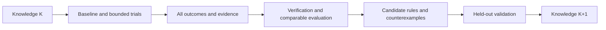

# ECC ICS55 调优经验测试用户手册

[English](ecc-experience-testing-guide.en.md)

本手册指导用户与 AI 大模型对任意 ECC 支持的设计开展 ICS55 调优测试，保存真实
证据，验证经验是否有效，并逐步形成可供 ECC 使用的版本化知识库。内部测试集
只作为外部输入，不定义产品的目录、设计名称、类型或规模标准。

**当前版本可用 run、param、report、sweep、explore、signoff 和 reproducible 完成
运行与证据采集。ecc_experience 已提供 P0 的 collect/list/show/verify，以及 P1 的
enable/status/disable、提交后 attempt outbox 和 drain 恢复，以及 campaign 台账、
recommend、plan、evaluate、release 和受预算约束的 optimize。跨设计相似推荐、资源
预测仍待开发；经验包 export/import 已提供显式选择、离线完整性检查和幂等导入。**执行前必须以安装版本的
帮助和输出契约确认能力，不能照猜测调用。

本手册不是测试完成记录。示例路径、名称和预算仅演示操作，不能视为已验证配置。
具体设计配置与候选创建方法参见 [PPA/DSE 用户手册](ecc-ppa-dse-guide.cn.md)。

## 1. 两种使用模式

| 模式 | 进入条件 | 能完成什么 |
| --- | --- | --- |
| 外部台账模式 | 当前 ECC CLI 可用 | 运行、保存报告、对照、总结；经验由用户/AI 保存在外部 |
| 原生经验模式 | 安装版本实际提供经验接口，且其 schema/能力已核对 | P0 显式采集、查询、校验；其他阶段按实际可用范围执行 |

缺少原生接口时继续使用外部台账，结果标记 native experience unavailable。
不能把手写 JSON/Markdown 描述为 ECC 已自动收集的案例或可直接加载的知识包。
不要假定当前 `ecc doc` 已有 experience 主题；通过文档链接阅读本文。

## 2. AI 的执行契约

AI 在用户给定的输入、目标、参数和预算范围内自主完成一轮测试，每次操作后按
证据选择下一步。必须遵守：

- 原始输入只读，workspace 和证据输出隔离；不覆盖历史 trial。
- 受管状态通过公开 CLI 修改，不手改 flow、参数、checklist 或报告制造通过。
- 优化候选冻结 RTL、SDC、频率、corner、activity、工艺和验收条件。
- 只搜索当前 schema 合法且实际工具支持的参数；记录实际生效证据等级。
- 保存失败、无收益、取消和复用记录，不只保留 winner。
- unknown、缺失、陈旧和不可解析分别记录，不转成零或 passed。
- 选优条件不改变当前 flow 执行策略，不增加 checklist blocked 的运行门槛。
- 不将现有 DRC 报告描述成 GDS DRC 或 foundry 签核。
- 不上传内部设计、经验或产物，不将私有输入约定写入产品代码。
- 预算内自主推进；缺失必需规格、能力不足或预算耗尽时报告具体原因。

## 3. 测试开始前准备什么

| 输入 | 必须说明 |
| --- | --- |
| 设计 | 已准备的 ECC project，或经实际支持接口验证的 WorkspaceSpec/Bindings |
| 规格 | top、真实 clock、SDC/周期和 IO 条件、目标、硬约束、允许参数 |
| 工艺 | 实际 ICS55 库/LEF/RC/corner 资源及内容摘要 |
| 环境 | ECC binary/版本、EDA 工具、CPU/RAM，适用时 GPU；使用已安装工具 |
| 预算 | 候选数量、总时间、单任务限时、并发和资源上限 |
| 输出 | 新的 campaign/trial 目录、台账位置，原生模式下明确的 store |
| 评价 | baseline、指标/单位、验收范围、可选外部设计族分组、留出策略 |

时钟名称不是周期。没有设计目标时不能擅自设定所有设计为同一频率。缺少必需
约束的设计标 needs_constraints；导入/综合诊断与合格 PPA 结果分开。

类型和家族可缺省，不能从目录名推断；规模以综合后的实际指标为主。寄存器
存储与真实 macro 实现分开记录。超出当前 ECC 输入能力时列明缺口，不静默改写 RTL。

内部数据的本地转换器可以生成准备好的项目和外部任务清单。产品不要求该数据
具有固定元数据文件名、每设计一个目录或固定类型列表。

## 4. 冻结本轮条件并发现能力

记录 campaign ID、选定设计、输入/约束摘要、有效配置、工具/工艺、硬件、seed、
并发、预算和知识版本。条件变化创建新 trial 或新可比组；旧结果保持不变。

以下变量供后续 Bash 模板使用，必须替换路径。证据目录在 workspace 和源码仓库外，
每个 trial 使用新目录。所有片段分步执行，检查退出码后再进入依赖步骤。

```bash
ECC_TEST_BIN="ecc"
ECC_TEST_PROJECT="/absolute/path/to/prepared-project"
ECC_TEST_EVIDENCE="/absolute/path/to/test-output/campaign-001/baseline-001"
ECC_TEST_BASELINE="baseline-001"
mkdir -p "$ECC_TEST_EVIDENCE"
```

下面的可选记录函数保存原始 stdout/stderr、NUL 分隔 argv、UTC 起止时间和退出码。
正常记录时函数返回原命令退出码，不负责判断业务通过；调用失败后应诊断，不盲目运行 winner。
记录写入失败返回 1，应另记采集故障，不直接归因为 EDA 失败。它拒绝覆盖已有命令文件。
其他记录方式也可以，但必须保留同等信息。

```bash
ecc_test_capture() {
  local test_label="$1"
  shift
  case "$test_label" in
    ""|*[!a-zA-Z0-9_.-]*) return 2 ;;
  esac
  local command_prefix="$ECC_TEST_EVIDENCE/$test_label"
  local command_exit=0
  local record_suffix
  for record_suffix in argv started finished stdout stderr exit; do
    if [ -e "$command_prefix.$record_suffix" ]; then
      printf '%s\n' "Refusing to overwrite command evidence: $command_prefix" >&2
      return 2
    fi
  done
  printf '%s\0' "$@" > "$command_prefix.argv" || return 1
  date -u '+%Y-%m-%dT%H:%M:%SZ' > "$command_prefix.started" || return 1
  if "$@" > "$command_prefix.stdout" 2> "$command_prefix.stderr"; then
    command_exit=0
  else
    command_exit=$?
  fi
  printf '%s\n' "$command_exit" > "$command_prefix.exit" || return 1
  date -u '+%Y-%m-%dT%H:%M:%SZ' > "$command_prefix.finished" || return 1
  return "$command_exit"
}
```

预检已有能力：

```bash
ecc_test_capture root-help "$ECC_TEST_BIN" --help
ecc_test_capture version "$ECC_TEST_BIN" version --json
ecc_test_capture project "$ECC_TEST_BIN" project show --project "$ECC_TEST_PROJECT" --plain
ecc_test_capture config "$ECC_TEST_BIN" config --project "$ECC_TEST_PROJECT" --json
ecc_test_capture doctor "$ECC_TEST_BIN" doctor --project "$ECC_TEST_PROJECT" --json
ecc_test_capture inputs-check "$ECC_TEST_BIN" check --project "$ECC_TEST_PROJECT" --plain
ecc_test_capture parameter-catalog "$ECC_TEST_BIN" param list --all --project "$ECC_TEST_PROJECT" --json
```

根帮助没有 experience 时直接选择外部台账模式。存在该组时，再核对实际子命令、
选项、schema 和适用版本；有同名命令不等于本文全部规划已实现。预检失败先分类，
不能自动安装/升级工具、改变工艺或降低验收来消除问题。

## 5. 建立真实 baseline

确认 baseline 名称未占用、项目/spec 正确、预算可承担完整流程后执行：

```bash
ecc_test_capture baseline-run "$ECC_TEST_BIN" run \
  --project "$ECC_TEST_PROJECT" --workspace "$ECC_TEST_BASELINE" --preset rtl2gds --plain
```

run 返回 0 只是执行结果之一。检查实际请求阶段、skip/reuse、checklist、checker
和证据覆盖。当前 syn_sta preset 不能当作最终 routed STA 的替代。

baseline 失败也要保存证据并诊断，可用于失败覆盖；它不能作为已合格 winner。
目标不可行与工具/环境故障分开。将实际成本用于调整后续候选预算。

## 6. 每次运行后保存什么

### 6.1 现有 CLI 的采集模板

workspace 必须处于稳定终态，没有其他会话运行或修改它。先保存原始 committed
snapshot，再获取报告；报告刷新后另存 snapshot，以区分分析刷新与新执行。

```bash
ecc_test_capture state "$ECC_TEST_BIN" status \
  --project "$ECC_TEST_PROJECT" --workspace "$ECC_TEST_BASELINE" --json
ecc_test_capture snapshot-before-refresh "$ECC_TEST_BIN" report snapshot \
  --project "$ECC_TEST_PROJECT" --workspace "$ECC_TEST_BASELINE" \
  --output "$ECC_TEST_EVIDENCE/committed-before-refresh.json" --json
ecc_test_capture step-overview "$ECC_TEST_BIN" report step \
  --project "$ECC_TEST_PROJECT" --workspace "$ECC_TEST_BASELINE" --json
ecc_test_capture placement-detail "$ECC_TEST_BIN" report step placement \
  --project "$ECC_TEST_PROJECT" --workspace "$ECC_TEST_BASELINE" \
  --section feature --section analysis --section checklist --section outputs --json
ecc_test_capture diagnosis "$ECC_TEST_BIN" diagnose run \
  --project "$ECC_TEST_PROJECT" --workspace "$ECC_TEST_BASELINE" --json
ecc_test_capture signoff-inspect "$ECC_TEST_BIN" signoff inspect \
  --project "$ECC_TEST_PROJECT" --workspace "$ECC_TEST_BASELINE" --json
ecc_test_capture qor "$ECC_TEST_BIN" report qor \
  --project "$ECC_TEST_PROJECT" --workspace "$ECC_TEST_BASELINE" \
  --output "$ECC_TEST_EVIDENCE/qor-report.txt" --json
ecc_test_capture checklist "$ECC_TEST_BIN" report checklist \
  --project "$ECC_TEST_PROJECT" --workspace "$ECC_TEST_BASELINE" \
  --output "$ECC_TEST_EVIDENCE/checklist-report.txt" --json
ecc_test_capture signoff-check "$ECC_TEST_BIN" signoff check \
  --project "$ECC_TEST_PROJECT" --workspace "$ECC_TEST_BASELINE" --json
ecc_test_capture snapshot-after-refresh "$ECC_TEST_BIN" report snapshot \
  --project "$ECC_TEST_PROJECT" --workspace "$ECC_TEST_BASELINE" \
  --output "$ECC_TEST_EVIDENCE/committed-after-refresh.json" --json
```

placement 只是当前流程的示例 token；先查询 overview，其他流程使用实际存在的
阶段。其他阶段同样保存 feature/analysis/checklist/outputs，不只采集 placement。
snapshot 不存在、版本不兼容或报告失败时保留原错误，记录 evidence unknown。

signoff inspect 会刷新分析，report qor/checklist 会写报告。刷新不是新 attempt，
不能增加执行样本或重记运行成本。若任务正在运行则推迟稳定采集，而非读取一半。

### 6.2 台账的最少字段

每个 trial 保存输入/约束/工艺/工具身份、有效参数、请求/实际值与证据等级、
seed/硬件/并发、执行阶段、复用来源、原始指标/单位/source/corner、QoR 版本、
flow/checklist/checker 状态、资源 scope、失败原因、命令退出码和证据摘要。

执行、质量、证据、采集四个状态分开。同一 workspace 重跑是新 attempt；复制
前缀是 reuse；重新查询/分析是新 observation，三者不能混为多次独立实验。

旧 peak_memory_mb 不统一代表绝对进程树峰值，零也可能是采集缺口。没有新的
测量事实时标 legacy/unknown；耗时求和不能冒充并行整轮墙钟时间。

## 7. 小预算候选与阶段 DSE

先按 [PPA/DSE 手册](ecc-ppa-dse-guide.cn.md) 创建独立候选或小 sweep。每个候选
都保存完整参数，不能假定 sweep 自动继承历史 workspace 的 override。

参数改变先验证 schema、工具映射和实际生效。没有回执时只能声明 configured 或
materialized，不能宣称 effective。当前未接入实际工具的参数不作为搜索维度。

对已有 sweep 查询并保存证据：

```bash
ECC_TEST_SWEEP="sweep-001"
ecc_test_capture sweep-verify "$ECC_TEST_BIN" sweep verify \
  --project "$ECC_TEST_PROJECT" --name "$ECC_TEST_SWEEP" --json
ecc_test_capture sweep-compare "$ECC_TEST_BIN" sweep compare \
  --project "$ECC_TEST_PROJECT" --name "$ECC_TEST_SWEEP" --json
ecc_test_capture candidate-ranking "$ECC_TEST_BIN" explore rank \
  --project "$ECC_TEST_PROJECT" --name "$ECC_TEST_SWEEP" --json
ecc_test_capture candidate-matrix "$ECC_TEST_BIN" explore export \
  --project "$ECC_TEST_PROJECT" --name "$ECC_TEST_SWEEP" \
  --format json --output "$ECC_TEST_EVIDENCE/candidate-matrix.json" --json
```

先使用 results 中的真实 candidate project/workspace 采集各候选，不能用原项目
的 report project 代替 sweep 清单。每个候选使用独立的命令证据目录。

前段 DSE 明确运行边界和局部验收；stage-validated 与 full-flow-validated 分开。
只有 shortlist 继续完整流程。前段 HPWL/拥塞改善不自动证明最终 PPA 改善。
compare run 用于同 workspace 的前后观察，不代替跨候选的原始指标对照。

## 8. 正确比较和选择 winner

1. 先检查输入、约束、工艺、工具、分析/指标单位、阶段和目标是否可比。
2. 根据本轮硬约束筛选候选；缺证据不能判定通过。
3. 同时比较原始 PPA、QoR 和成本，保留 Pareto 候选及反例。
4. 记录完整配置组合，不能拼接不同实验的单项最佳值。
5. 从未占用的 fresh workspace 完整复验 winner，携带所有有效参数。
6. 复验不满足则保留结论为未验证/失败，不能只展示原 winner 成绩。

重复 seed 和同设计变体不能当成多个独立设计。降低频率、换 activity/corner 或
取消检查属于规格变化，不是原目标下的优化收益。

## 9. 负向与兼容性测试

在隔离 trial、可删除副本或合成 fixture 中执行，不污染 baseline 或用户原输入。
故意损坏证据仅属于读入/校验测试，不能记成真实 EDA 参数失败经验。

| 场景 | 操作边界 | 正确结果 |
| --- | --- | --- |
| DRC/LVS/STA 不满足 | 使用真实失败结果或独立失败设计；注明 checker 范围 | 保留违例、失败 gate 和退出码，不能入选合格 winner |
| QoR 缺失 | 独立证据 fixture 中移除指定来源，并核对其他副本 | missing/unknown，不把缺失分数写成 0 |
| checklist 损坏 | 独立 fixture 中制造非法格式 | 解析错误/unknown，不是 passed |
| 旧 workspace | 使用保留的旧版 fixture，只读查询/导入 | 明确兼容范围、缺失字段，不自动迁移 |
| 证据陈旧 | 独立 fixture 的输入/参数与结果身份不一致 | stale，不参与严格推荐 |
| 重复收集/重跑/复用 | 原生模块可用后分别测试 | 重复幂等、重跑新 attempt、复用引用原成本 |
| OOM/timeout/取消 | 明确授权的独立预算测试，确认任务实际停止 | resource/cancelled/unknown，成本为不完整观测 |
| store 不可写/采集失败 | 原生模式的独立故障测试 | 采集失败可见，成功 step 不回滚，通知不受阻 |
| source/wheel/frozen | 测试实际安装的对应 artifact | 契约可用、资源 scope 清楚、不依赖源码/内部路径 |

不要为了覆盖而强行使所有设计失败。无法真实复现的场景列为 not_run，说明
原因；fixture 通过与真实 EDA 场景通过分别报告。

检查退出码和 JSON 业务结果。当前质量查询可返回 6（失败）或 7（未知），其
stdout 仍可能是有效 JSON。20/21 表示忙/冲突，应处理实际原因。124 可出现在
限时执行记录中；保留实际返回值和进程状态，不假定所有命令同样编码。

## 10. 原生经验模块可用后的测试

P0 显式采集、查询和校验已经实现。P1 的自动记录只保存提交后的小型事实到项目
outbox；它不修改参数、不阻塞工程提交，也不把经验写进源码或 wheel。只读推荐、
计划、比较、release、有预算的完整流程优化及串行 baseline campaign 已实现；
跨设计迁移和并发/阶段调度仍待开发。逐项按安装版本帮助确认能力。

```bash
EXPERIENCE_STORE=/absolute/path/to/experience-store
ecc experience --help
ecc experience collect --project "$PROJECT" --workspace baseline-001 \
  --store "$EXPERIENCE_STORE" --json
ecc experience list --store "$EXPERIENCE_STORE" --json
```

对需要持续积累的项目，先显式指定项目外的 store：

```bash
ecc experience enable --project "$PROJECT" --store "$EXPERIENCE_STORE" --json
ecc experience status --project "$PROJECT" --json
ecc run --project "$PROJECT" --workspace baseline-001 --json
ecc experience drain --project "$PROJECT" --json
ecc experience disable --project "$PROJECT" --json
```

`enable` 只保存项目级记录配置；普通 `run`、单 step、rerun 和失败流程仍使用
原有执行规则。每次实际执行得到独立 attempt ID；每个已完成 step 在 Engineering
Snapshot 提交成功后产生一个事件，包含 workspace revision、step 终态以及已有
runtime/peak-memory 的来源 scope。记录器异常只报告到运行日志，不改变 EDA 退出码。
`drain` 只处理同时存在开始、step 提交和终态事件的 attempt，并核对最终 snapshot
摘要；源 workspace 在此期间变化时保留 outbox，返回失败原因，避免把新报告装进旧
attempt。成功后事件移动到项目 outbox 外的 processed 目录，并以 attempt_id 写入
案例 source。`status` 的 pending 数量可用于恢复检查；不要手动删除 pending 事件。

批量测试先用通用 campaign manifest 做只读校验：

```bash
ecc experience campaign validate --manifest campaign.json --json
```

当前校验确认 schema、ICS55 profile 字段、baseline 模式、预算边界、设计 ID 唯一、
输入目录存在，以及 store/output 不覆盖输入或互相覆盖；返回的 fingerprint 可写入
外部 campaign ledger。校验不会运行 EDA、创建 workspace 或创建 output/store 目录。
manifest 使用相对路径，设计清单与标签转换由用户环境负责；ECC 不扫描私有数据集。

### 串行 baseline 批次

已准备好的 project 可直接执行：

```bash
ecc experience campaign run --manifest campaign.json --json
ecc experience campaign run --manifest campaign.json --retry-failed --json
```

第一版要求 `mode=baseline`、`max_concurrent_flows=1`，且不设置
`knowledge_release_id`。每项 `designs[].workspace` 是输入项目中已注册、有
Engineering Snapshot、声明输入可读且 PDK 与 `process_profile` 一致的源 workspace。
`validate` 做通用清单校验；`run` 进一步核对这些可执行条件。

执行器通过公开 `init → workspace import → workspace derive → run` 命令，在
`output_root/attempts/trial-<id>/project/baseline` 创建独立项目与全流程重跑的
workspace。派生复用源配置、约束、skip 策略和输入；不修改源项目的注册信息、
源配置和报告。派生过程可能复制源 workspace 的已有文件，请预留磁盘空间。

请求参数在执行前校验；执行后只允许与 ECC-Tools 几何报告一致的实际 die 长宽比/
尺寸回写，并在 `runtime_parameter_updates` 保存请求值、观测值和报告摘要。
其他参数变化仍返回 21。案例保存执行后真实参数，不将几何回写当作新的调优策略。

`output_root/campaign-run.json` 保存冻结输入、可观测工具版本、attempt/run ID、
命令 argv、日志路径、原始退出码、`execution_status`、`acceptance`、
`collection_status` 和案例 verification；EDA 输出在每个 attempt 的命令 stdout/
stderr 中，运行标记日志遵循 workspace 内 `log/<run-id>.log` 规范。
完整校验明细单独保存在 attempt 的 `case-verification.json`，结果索引只保存摘要。
冻结版 CLI 额外保存自身可执行文件摘要，避免同版本号的不同构建被视为同一运行时。
`campaign status` 额外通过 `execution` 报告执行器状态、结果路径与 active trials；
原有 ledger 的 counts 仍统计不可变 trial 记录，执行器只在 attempt 终态后登记一次。

再次运行默认跳过已登记的终态设计；`--retry-failed` 对失败、blocked 或取消的设计
创建新 attempt，每次调用每个设计至多尝试一次，累计不超过
`max_trials_per_design`。成功设计不会重复运行。终态结果已落盘但尚未登记时，
续跑幂等补写 ledger，不重跑 EDA。每次续跑均核对 manifest、源配置/声明输入摘要
以及 ECC/可观测工具版本；变化返回 21。不要修改冻结条件后沿用原 output_root。

只有实际进入 run 的 attempt 才会以真实 run ID 采集证据；执行成功、验收通过与
采集成功是独立事实。全部 flow/checklist/signoff/QoR 和案例验证通过才记为 pass；
未知证据记为 blocked；保留失败与取消记录。续跑也会重新验证已有案例，不能只相信
ledger 中的 pass。退出码：0 全部通过，2 输入错误/不支持模式，6 失败或 blocked，
7 已登记案例证据缺失/未知，20 执行锁忙或存在未完成 intent，21 冻结条件变化，
124 超时，130 取消。某个设计失败后仍继续其他设计；取消或条件变化则停止调度。

正常取消和超时会清理受管理的进程树。若强制杀死调度器，留下 running intent，
执行器返回 20，拒绝自动接管：先结合 `campaign-run.json` 中的项目路径，使用
`ecc process list --project <attempt-project> --json` 检查并按现有 process 命令
取消残留进程。保留原输出做审计，确认进程退出后用新的 output_root/store 建立新
campaign；本版不自动恢复运行中的 attempt。并发调度、阶段 DSE 和资源预测尚未实现。

声明输入摘要不覆盖完整 include/PDK 内容闭包；工具版本也不等于所有可执行文件
内容摘要。本命令建立基线、保留经验，不声明 PPA 已改善或经验已跨设计泛化。

### 批次数据质量审计

批次结束后，在生成知识 release 前审计全部试验历史：

```bash
ecc experience campaign quality --manifest campaign.json --json
```

可选 `--ledger PATH` 与 status/summary 保持一致。quality 是只读查询，不运行 EDA，
不改写源 workspace、store 或 ledger。summary 只看每个设计的最新试验；quality
保留所有失败、重试、取消记录，分别报告 `execution_status` 和 `quality_status`。
执行失败的完整案例仍可作为反例，不能因为被重试就消失。

报告的 `coverage` 展示提交身份、attempt、声明输入指纹、参数、工艺和有限 QoR
的完整性；`trials` 关联案例、当前 verification、异常 findings、QoR 和 step 状态。
核心证据缺失、旧 workspace、无 attempt 或无 QoR 返回 unknown；损坏/陈旧证据、
非数字/非有限 QoR、PDK family 与 manifest 不符返回 fail。可选报告未生成只计入
`artifact_counts`，不会当作必需文件丢失。零/缺失内存显示 null，step 的 runtime/
memory 明确标为 `legacy_flow_step_ledger`，不表示独立进程树测量或资源预测。

`diversity` 对存储完整的案例统计唯一 case、执行身份和声明输入指纹，标出重复引用；
coverage 的分母是 trial 引用数，不是独立样本数。重复采集同一次执行不会增加
`unique_execution_identities`。不同输入指纹不能证明设计家族独立，
`evaluation_groups_provided` 仅采用用户显式提供的分组，不根据设计名推断。

退出码：0 采集检查通过，6 至少一项失败，7 存在未知/缺失或 pending/running，
2 输入错误，21 manifest 改变。quality pass 不等于 flow/signoff 通过，也不证明
参数生效、跨设计收益或完整 include/PDK 闭包；生成 release 前仍需相应验收。
已有 wheel/PyInstaller 和 design matrix 经验 smoke 会检查本命令的 unknown 与
损坏案例退出码，不伪造独立执行身份来获得 pass。

### 外部执行与 ledger

新执行的 flow step 可选保存 `resource_observation`，并随 Engineering Snapshot 和
经验案例冻结。其 `attempt_id` 只在真正执行工具时生成，skip 保留原身份；重跑/
失效/reset 清除旧引用。旧 workspace 无此字段仍可正常读取，不补造历史测量。

`peak_rss_bytes` 是 Linux `/proc` 对当时进程树的绝对 RSS 采样峰值；原
`peak memory (mb)` 保持旧口径。`isolated_worker_process_tree` 测量独立 worker
及其后代；`shared_process_tree` 用于 in-process/frozen，共享进程中其他工作也可能
计入，因此标 partial。`status` 为 available/partial/unavailable；读取失败/没有
样本时峰值为 null，不用零替代。记录包含 UTC 时间、monotonic 耗时、采样周期、
次数、PID/start ID、host/boot 身份和原因。RSS 可能重复共享页并漏掉短峰，不等同
cgroup/PSS 或工具独占内存，也不能据此直接产生经过校准的资源预测。
`campaign quality` 的每个 step 同时展示该新字段，缺省不改变旧案例的质量门槛。

校验通过后，可以让 ECC 创建一个可恢复的 campaign ledger。初始化只创建
`output_root/campaign-ledger.json`，保存 manifest fingerprint、设计清单和空的试验
记录，不启动 EDA：

```bash
ecc experience campaign init --manifest campaign.json --json
```

每完成一个外部试验后登记一次结果。`--trial-id` 应由调度器稳定生成，重复提交同一
内容会返回 `already_present`；同一个 ID 提交不同内容会返回 revision conflict：

```bash
ecc experience campaign record \
  --ledger output/campaign-ledger.json \
  --design design-001 \
  --workspace baseline-001 \
  --status pass \
  --trial-id trial-001 \
  --case-id "$CASE_ID" \
  --json
```

允许的试验状态为 `running`、`pass`、`fail`、`blocked`、`cancelled`。`case_id` 可选，
但推荐先用 `experience collect` 或 `drain` 生成案例，再写入台账以保留证据关联。
用下面的命令恢复批次进度；它会重新校验 manifest fingerprint，发现 manifest 被
修改时拒绝继续：

```bash
ecc experience campaign status --manifest campaign.json --json
```

批次结束或中断恢复前，用 summary 同时查看最新试验、关联案例校验状态和 QoR 摘要：

```bash
ecc experience campaign summary --manifest campaign.json --json
```

`campaign_status` 只表示调度状态；`campaign_summary` 额外报告
`evidence_status`、`integrity` 和 `evidence_counts`。没有 `case_id` 或案例缺失时会
明确报告 evidence missing，不会把 trial 的 `pass` 误认为 QoR 或 signoff 通过。

ledger 是调度和恢复记录，不等于 ECC 的 QoR 结论。QoR、step 报告、工具版本和参数
仍必须通过 workspace 证据与 experience case 保存；只有完成验证的案例才可用于经验
总结或后续推荐。

对已有经验做初步检索时使用只读推荐命令：

```bash
ecc experience recommend \
  --project "$PROJECT" \
  --workspace "$WORKSPACE" \
  --store "$EXPERIENCE_STORE" \
  --limit 10 \
  --json
```

如果已经形成并校验了 release，推荐必须显式绑定它：

```bash
ecc experience recommend \
  --project "$PROJECT" \
  --workspace "$WORKSPACE" \
  --store "$EXPERIENCE_STORE" \
  --release "$OUTPUT_ROOT/experience-release.json" \
  --json
```

带 `--release` 时，ECC 先执行 release 校验，只从其中列出的案例检索；release
缺失、被篡改、案例缺失或重新校验失败时，返回空 recommendations，并保留
`release_verification` 结果。省略 `--release` 仍保持现有兼容行为，只从当前 store
检索，适合尚未发布知识版本的本地探索。

当前推荐只匹配完整的输入内容指纹，返回历史案例中的已观察参数，并将
`safe_to_apply` 固定为 `false`。输出中的绝对环境路径会替换为
`<path-redacted>`，不会把本机 PDK 路径当作可迁移参数。这不是自动调参，也不证明参数对 QoR 有因果作用；
AI 必须检查 verification、QoR、参数回执和适用工艺后，另建 workspace 验证。没有
完整输入指纹、经验库不存在或没有可验证案例时，命令返回
`status=insufficient_evidence` 和空 recommendations，不猜测参数。

需要把推荐结果交给后续人工或 AI 审阅时，可生成 plan 文件：

```bash
ecc experience plan \
  --project "$PROJECT" \
  --workspace "$WORKSPACE" \
  --store "$EXPERIENCE_STORE" \
  --release "$OUTPUT_ROOT/experience-release.json" \
  --output "$OUTPUT_ROOT/optimization-plan.json" \
  --json
```

plan 绑定查询 workspace、输入指纹、案例和 fingerprint，并固定声明
release（如果提供）、`manual_review`、`requires_new_workspace=true`、`auto_apply=false`。它是可审阅的
执行建议，不会修改参数、复制 workspace 或启动 flow。没有显式优化预算和参数
白名单的旧计划继续只用于人工审阅，不能直接交给 optimize 执行。

### 10.1 受控执行经验计划

仅在希望启动真实流程时，生成带执行范围的计划，审阅后显式调用 optimize：

```bash
ecc experience plan \
  --project "$PROJECT" --workspace "$WORKSPACE" \
  --store "$EXPERIENCE_STORE" \
  --allow-param floorplan.core_util \
  --allow-param place.target_density \
  --max-trials 4 --max-seconds 3600 --trial-timeout 900 \
  --patience 2 --target-score 95 \
  --output "$OUTPUT_ROOT/bounded-plan.json" --json

ecc experience optimize \
  --project "$PROJECT" --store "$EXPERIENCE_STORE" \
  --plan "$OUTPUT_ROOT/bounded-plan.json" \
  --output "$OUTPUT_ROOT/optimization-001" --json
```

`--release` 可继续用于生成计划；执行前重新验证 release ID 与案例。默认 plan
仍然只读；`--allow-param` 使计划包含明确的执行限制，生成计划本身不会启动 EDA。
optimize 的 `--project` 可在 project 或 workspace 目录内省略，基线由计划指定。
输出目录必须全新，经验 store 与基线 workspace 不得重叠。

| 限制 | 当前行为 |
| --- | --- |
| 候选来源 | 同输入内容指纹的真实已观察配置；证据失败或非白名单参数不同的候选不执行，重复配置去重；不自行发明搜索空间 |
| 参数范围 | 仅显式允许的 core_util/core_margin/aspect_ratio、placement density/overflow/padding/routability 和 CTS fanout/skew/transition/cap 参数；名称、类型和范围由现有 ECC catalog 校验 |
| 固定条件 | 校验基线快照及直接绑定输入内容；保持 design、工艺声明、flow 和其他配置；只允许旧快照缺失字段补齐为当前 catalog 默认值 |
| 次数预算 | `max_trials` 为新 workspace 总上限，包含最佳候选的独立复跑，至少 2；串行执行，不修改基线 |
| 时间预算 | 校验后开始计算总时间；每次 trial 的派生、参数应用、flow 与报告检查共享单次限时；到时停止子进程，不只停止等待；清理可额外使用短暂宽限时间 |
| 提前停止 | 候选耗尽、次数上限、目标分数、连续无改进/失败次数、超时或用户取消；达到搜索停止条件后仍须独立复跑最佳候选 |
| 验证范围 | 当前执行基线定义的完整 flow；阶段 DSE 继续使用 sweep/explore，不能冒充完整流程验证 |

底层复用 `workspace derive`、`param apply`、`run`、`status` 与 `signoff check`，使用
系统中已安装的工具。基线已 blocked 不会阻止调优，基线状态原样进入结果；新候选
及复跑必须满足现有 flow/checklist/signoff 判据、有限 QoR 和案例证据校验，才会被
接受。此处 signoff 仍限 ECC 已支持的检查，不包含 GDS DRC/foundry 签核。

`result.json` 在执行过程中原子更新，记录每个 workspace、run ID、配置变化、命令
日志路径、退出码、case ID、验证状态、分数、失败与停止原因。运行完成的新快照
会关联实际 run ID 采集进 store；运行或采集失败也保留试验结果与日志，不伪造通过。
只有独立复跑通过才能返回 `status=complete`。`improved=false` 允许表示完整验证
成功但没有 QoR 收益；基线缺少分数时 `improved=null`，比较证据不足。

| 退出码 | 含义 |
| --- | --- |
| 0 | 有候选且独立复跑完成验收；不保证分数提高 |
| 2 | 计划、指纹、预算、参数或输出目录无效 |
| 6 | 无合格候选或独立复跑验收失败 |
| 7 | 没有可执行的观察配置 |
| 21 | 基线输入/快照发生变化 |
| 124 / 130 | 超时 / 用户取消 |
| 1 | I/O 或其他执行故障 |

当前控制器要求 Linux，支持 Ctrl-C/SIGTERM 取消并清理独立会话中的 step 子进程。
它不会自动恢复中断运行、自动删除失败 workspace、发布 release、放宽 SDC/频率/
corner 或执行 RTL 修改。再次运行使用新输出目录和新预算。参数证据仍标为
`configured`，不宣称每个参数都被工具消费；输入闭包、PDK 文件内容和外部工具升级
的完整冻结尚未实现。当前不强制 RAM/CPU 配额，也不新增资源预测模型。实际总结
必须同时给出基线验收状态、最佳候选及复跑分数、收益或无收益、成本和这些限制。

### 10.2 比较与发布案例

比较两个已采集案例的 QoR 时使用只读命令：

```bash
ecc experience evaluate \
  --store "$EXPERIENCE_STORE" \
  --baseline "$BASELINE_CASE_ID" \
  --candidate "$CANDIDATE_CASE_ID" \
  --json
```

该命令要求两个案例具有相同且完整的输入内容指纹，并且证据校验没有失败、QoR
分数是有限数值。案例缺少稳定 attempt 身份时，验证状态可以是 `unknown`，但不会
隐藏任何 unknown finding。输出包含两侧验证结果、分数、差值和差值百分比，当前
约定 QoR 分数越高越好。输入指纹不一致返回 `status=incompatible`，证据或分数
不足返回 `status=insufficient_evidence`，不会启动 EDA、修改 workspace 或自动接受
优化结论。只有在同一设计、同一工艺和相同约束下，AI 才能把 `improved` 作为候选
结果，并继续检查 checklist、signoff 和原始报告。

确认一组案例可以作为可审计知识版本时，先创建 release：

```bash
ecc experience release create \
  --store "$EXPERIENCE_STORE" \
  --case-id "$CASE_ID_1" \
  --case-id "$CASE_ID_2" \
  --output "$OUTPUT_ROOT/experience-release.json" \
  --json

ecc experience release verify \
  --store "$EXPERIENCE_STORE" \
  --release "$OUTPUT_ROOT/experience-release.json" \
  --json
```

release 只接受证据校验为 `pass`、完整输入指纹存在的案例，记录案例 ID、输入/工艺
指纹、workspace revision 和 QoR 摘要，不复制私有 workspace 路径和大型产物，也不
自动修改参数或启用经验。输出文件是原子写入且内容地址可核验；同一内容重复创建
幂等，覆盖不同内容会失败。`release verify` 会重新读取 store 并核对案例摘要，
适合在 CI、备份恢复或交给 AI 前执行。没有稳定 attempt、QoR 不可用、证据损坏或
旧 workspace 来源不完整的案例不能进入 release。

从 collect/list 的 JSON 取得实际 case_id 后执行：

```bash
CASE_ID=case-id-returned-by-collect
ecc experience show "$CASE_ID" --store "$EXPERIENCE_STORE" --json
ecc experience verify "$CASE_ID" --store "$EXPERIENCE_STORE" --json
ecc experience verify --store "$EXPERIENCE_STORE" --json
```

collect 复用 --project/--workspace 的当前目录默认规则；list/show/verify 只需要
显式 store，可以在项目外执行。store 与源 workspace 必须分离。重复采集同一
观察返回 already_present；revision 或证据改变产生另一个观察，不能据此计数独立
执行。collect 不启动 EDA、不刷新报告、不迁移旧 workspace，也不校正损坏文件。

store 中每个 cases/case_id/case.json 保存版本、源 revision、原始快照、指标单位、
参数与证据引用。小型 JSON/TOML 证据按摘要复制到该案例的 evidence/；大型报告、
网表和版图只保存来源与摘要，源文件删除后不能当作完整可重现交付。report_text
按文本证据保留，不能仅凭 .json 后缀认定格式。完整产物仍通过 reproducible 导出。

verify 的 integrity 表示已复制证据的完整性；status 同时考虑源文件是否变化、
遗失或损坏，以及缺失 QoR、旧版来源等限制。退出 6 表示明确失败，7 表示未知，
JSON 始终保留。P0 的显式 collect 没有 attempt 身份；P1 通过 drain 生成的案例有
稳定 attempt_id，但仍只代表已提交观察，不能单独证明参数有效。EDA 违例和证据
损坏分开。

正常写入采用单 collector 与临时目录原子发布，不覆盖既有案例。store 内的
.write-lock 表示写入占用；崩溃遗留时先确认原 collector 已停止，再移除这个空
锁目录。不要删除案例或正在写入的临时目录来制造通过。

| 阶段 | 测试 | 必须证明 |
| --- | --- | --- |
| 显式采集 | collect、show、verify | 案例可追溯、源 workspace 不变、重复收集幂等 |
| 持续记录 | enable 后执行 run/step/rerun，再 drain | attempt、提交 revision、资源 scope 可追溯；源变化不混入旧案例 |
| 推荐 | 无类型、新设计、无案例、版本不兼容 | 可解释匹配或 insufficient_evidence，无虚构配置 |
| 受控优化 | 明确 plan 的目标、参数和预算后执行 | 不扩大范围，真实反馈、停止原因和 fresh 复验 |
| 知识评价 | 固定 K、留出设计、默认策略对照 | 同预算收益和反例可追溯，无评价泄漏 |
| 交换/恢复 | round trip、重复导入、进程中断后恢复 | 摘要一致、幂等、不覆盖旧任务或私有输入 |

知识库为空是正常冷启动场景。收集可以工作，推荐需要说明不足；不能返回
“已学习的最佳配置”。AI 自己的文字总结不能升级为 validated rule。

### 10.3 备份和交换经验案例

选择需要分享的案例，不会默认导出整个 store：

```bash
ecc experience export \
  --store "$EXPERIENCE_STORE" \
  --case-id "$CASE_ID_1" \
  --case-id "$CASE_ID_2" \
  --output "$OUTPUT_ROOT/experience.tar.gz" --json

ecc experience import \
  --package "$OUTPUT_ROOT/experience.tar.gz" \
  --store "$OUTPUT_ROOT/imported-store" --json
```

也可以用 `--release "$OUTPUT_ROOT/experience-release.json"` 替代全部 `--case-id`；
两种选择不能同时使用。包包含该 release、其中所有案例，以及案例已复制到 store 的
小型证据。导入结果的 `release.path` 是目标 store 内可供 `release verify`、
`recommend --release`、`plan --release` 使用的实际路径。

这两条命令只需要显式 store，可以在项目外运行；输出包必须位于源 store 外，输入包
必须位于目标 store 外。同一内容重复导出/导入返回 `already_present`；不同内容不能
覆盖已有包、案例或 release。混合导入会分别报告 `created_count` 和
`already_present_count`。完整校验先于目标 store 创建，发布前检查既有内容；本次
发布途中发生可捕获的写入错误会回滚本次新增内容。写锁仍遵循单 collector 规则，
不保证进程被强制杀死或掉电时多个目录能作为一个原子事务同时可见。

包 manifest 记录 schema、案例集合、每个文件的 SHA-256/大小和内容地址 package ID。
拒绝路径越界、符号/硬链接、重复或未声明文件、损坏摘要、无效案例身份和 release
元数据不匹配。第一版限制压缩包 128 MiB、完整解压归档 256 MiB、单文件 32 MiB、
20000 个数据文件和 10000 个案例；超限时拆分案例选择，不能通过关闭校验继续。
相同输入产生字节一致的 gzip tar 包。内容摘要用于完整性检查，不是发布者身份签名。

导入的 `integrity=pass` 和 `source_verification=not_performed` 只说明包内证据完整。
原案例身份、source、失败和未知事实保持不变。包不会沿来源路径复制 RTL、PDK、大型
产物或工具，也不重跑 EDA、自动启用经验或修改参数；案例与小型报告中仍可能包含
设计名、路径和设计数据，分享前应审查实际内容。

源 workspace 不在当前机器时，原 `experience verify`/`release verify` 仍可返回
`unknown`；源文件变化时仍可失败。release 绑定推荐仍要求原验证条件通过，导入不会
豁免新鲜度检查。无 release 的 observed-only 查询保留现有不自动应用的行为。
需要完整设计交付时继续使用 `ecc reproducible export`。

| 情况 | 退出码 |
| --- | --- |
| 成功、重复同内容 | 0 |
| 选择缺失/冲突、非法命令参数 | 2 |
| 包损坏、schema/成员/案例/release 不一致、超限 | 6 |
| store 正在写入 | 20 |
| 既有内容冲突 | 21 |
| 文件系统 I/O 错误 | 1 |

已有 PyInstaller 与 design matrix 的经验 smoke 同时执行导出、导入、重复导入、
案例内容一致性检查与损坏包拒绝，不为此再跑一次 EDA flow。

## 11. 如何从测试生成下一知识版本



1. 固定 K 的案例/规则、特征与推荐策略版本，记录每次推荐来源。
2. 新结果进入 staging；本 design 的局部反馈可以指导其后续候选。
3. 全局评价结束前，留出设计的结果不进入 K。
4. 先验证参数生效、可比收益、失败分类和资源 scope，再归纳配置条件。
5. 与默认或固定受限策略进行同预算对照，统计所有尝试和采集开销。
6. 评价首次可行时间、候选数、最终原始 PPA、前段优势保持率和预算覆盖。
7. 证据足够的规则进入限定 scope 的 K+1；不足的保持候选状态。
8. 保存支持案例、反例、独立设计数、版本条件、验证方法和退役原因。

家族来自外部来源或结构证据，不依赖私有名字分支。分组信息缺失时报告泛化
限制。知识发布能力未实现时只保存 staging/评价材料，不手造可加载 release。

新案例/知识版本通常更新外部 store；采集、匹配或工具映射的通用改进需要修改
并发布 ECC。内部经验默认不进入源码、wheel 或 PyInstaller 资源。

## 12. 复现、导出和保留

对 fresh 复验后的 workspace，保存完整有效配置、输入/工艺/工具摘要及独立证据包：

```bash
ecc_test_capture reproducible-export "$ECC_TEST_BIN" reproducible export \
  --project "$ECC_TEST_PROJECT" --workspace "$ECC_TEST_BASELINE" \
  --output "$ECC_TEST_EVIDENCE/reproducible-package"
ecc_test_capture reproducible-verify "$ECC_TEST_BIN" reproducible verify \
  --package "$ECC_TEST_EVIDENCE/reproducible-package" --json
```

此时 ECC_TEST_BASELINE 必须改成实际 fresh 复验 workspace，并使用新的证据目录。
导出成功不证明所有外部 PDK、工具和依赖已经打包；核对 manifest 与未包含资源。
signoff 包与 reproducible 包用途不同，按 PPA/DSE 手册执行真实可用的交付接口。

baseline、winner、fresh 和关键失败优先保留完整证据；其他候选的保留等级明确
记录。索引可重建，原始案例不能用索引替代。清理后重新标记证据可用性，不
继续宣称完整可复现；未经授权不删除源输入或历史 workspace。

## 13. 每轮必需交付物

- campaign/spec-resolved 与约束覆盖说明、能力/环境记录。
- 全部 selected designs 和 trials 的矩阵，包括未运行原因。
- 命令 argv、stdout/stderr、退出码、阶段报告、snapshot 和证据摘要。
- baseline/candidate/winner/fresh 的原始指标、完整参数与可比性。
- 资源 scope、失败分类、实际耗时/成本和预算消耗。
- 推荐有效性、支持案例、反例、未知项与知识版本；未评价不得宣称有效。
- 人类 summary.md 和机器 summary.json，内容一致。

下面是外部测试总结模板，不是当前 ECC 原生 schema；按事实填充，未知保留：

```json
{
  "schema": "ecc-experience-test-summary/1",
  "campaign_id": "example-campaign",
  "mode": "external-ledger",
  "native_experience_available": false,
  "knowledge_release_id": null,
  "selected_designs": [],
  "trials": [],
  "comparability": "unknown",
  "recommendation_effect": "not_evaluated",
  "winner": null,
  "fresh_validation": "not_run",
  "artifacts": [],
  "checks_run": [],
  "checks_not_run": [],
  "limitations": []
}
```

不能只给“最佳参数是 X”。说明收益、成本、适用范围、失败和未验证内容。
文档/fixture 检查通过、EDA flow 通过、推荐泛化通过是不同结论。

## 14. 停止、恢复与结论标准

预算耗尽、必需输入/约束缺失、资源不可承担或能力不足时停止调度新的候选，
保存已有证据和停止原因。确认取消的进程实际停止；不要删除结果后重新开始。
恢复前核对冻结条件和旧任务存活情况，重试生成新 attempt。

只有请求范围执行完成、硬约束满足、证据完整、指标可比且必要 fresh 复验通过，
才能声明本 design 的调优结果验证成功。只有独立留出对照支持，才能声明经验
提高新设计收敛。采集未完成或原生能力不可用的部分必须明确列出。

## 15. 可交给 AI 的任务模板

```text
阅读本手册与 PPA/DSE 用户手册。只对我指定的输入开展 ICS55 测试。
先核对实际 ECC/工具版本、帮助、spec 和约束，选择外部台账或真实可用的原生经验模式。
原始输入只读，输出隔离；不硬编码内部目录、设计名或类型，不上传内部数据。
固定目标、工艺、分析条件、允许参数和预算后，建立 baseline，小预算试验并采集全部结果。
验证参数生效、指标单位、阶段范围和资源 scope，失败与未知如实保留。
若原生知识版本可用，固定 K，关联推荐和反馈；评价结束前不回流留出结果。
对 winner 做 fresh 验证，输出 trial 矩阵、summary.json、summary.md 和证据清单。
预算内自主继续；必需信息缺失或能力不足时说明具体缺口，不编造命令或通过结果。
```
