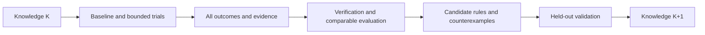

# ECC ICS55 调优经验测试用户手册

[English](ecc-experience-testing-guide.en.md)

本手册指导用户与 AI 大模型对任意 ECC 支持的设计开展 ICS55 调优测试，保存真实
证据，验证经验是否有效，并逐步形成可供 ECC 使用的版本化知识库。内部测试集
只作为外部输入，不定义产品的目录、设计名称、类型或规模标准。

**当前版本可用 run、param、report、sweep、explore、signoff 和 reproducible 完成
运行与证据采集。ecc_experience 已提供 P0 的 collect/list/show/verify，以及 P1 的
enable/status/disable、提交后 attempt outbox 和 drain 恢复。推荐、受控优化和知识
版本管理仍待开发。**执行前必须以安装版本的
帮助和输出契约确认能力，不能照猜测调用。

本手册不是测试完成记录。示例路径、名称和预算仅演示操作，不能视为已验证配置。
具体设计配置与候选创建方法参见 [PPA/DSE 用户手册](ecc-ppa-dse-guide.cn.md)。

## 1. 两种使用模式

| 模式 | 进入条件 | 能完成什么 |
| --- | --- | --- |
| 外部台账模式 | 当前 ECC CLI 可用 | 运行、保存报告、对照、总结；经验由用户/AI 保存在外部 |
| 原生经验模式 | 安装版本实际提供经验接口，且其 schema/能力已核对 | P0 显式采集、查询、校验；其他阶段按实际可用范围执行 |

缺少原生接口时继续使用外部台账，结果标记 native experience unavailable。
不能把手写 JSON/Markdown 描述为 ECC 已自动收集的案例或可直接加载的知识包。
不要假定当前 `ecc doc` 已有 experience 主题；通过文档链接阅读本文。

## 2. AI 的执行契约

AI 在用户给定的输入、目标、参数和预算范围内自主完成一轮测试，每次操作后按
证据选择下一步。必须遵守：

- 原始输入只读，workspace 和证据输出隔离；不覆盖历史 trial。
- 受管状态通过公开 CLI 修改，不手改 flow、参数、checklist 或报告制造通过。
- 优化候选冻结 RTL、SDC、频率、corner、activity、工艺和验收条件。
- 只搜索当前 schema 合法且实际工具支持的参数；记录实际生效证据等级。
- 保存失败、无收益、取消和复用记录，不只保留 winner。
- unknown、缺失、陈旧和不可解析分别记录，不转成零或 passed。
- 选优条件不改变当前 flow 执行策略，不增加 checklist blocked 的运行门槛。
- 不将现有 DRC 报告描述成 GDS DRC 或 foundry 签核。
- 不上传内部设计、经验或产物，不将私有输入约定写入产品代码。
- 预算内自主推进；缺失必需规格、能力不足或预算耗尽时报告具体原因。

## 3. 测试开始前准备什么

| 输入 | 必须说明 |
| --- | --- |
| 设计 | 已准备的 ECC project，或经实际支持接口验证的 WorkspaceSpec/Bindings |
| 规格 | top、真实 clock、SDC/周期和 IO 条件、目标、硬约束、允许参数 |
| 工艺 | 实际 ICS55 库/LEF/RC/corner 资源及内容摘要 |
| 环境 | ECC binary/版本、EDA 工具、CPU/RAM，适用时 GPU；使用已安装工具 |
| 预算 | 候选数量、总时间、单任务限时、并发和资源上限 |
| 输出 | 新的 campaign/trial 目录、台账位置，原生模式下明确的 store |
| 评价 | baseline、指标/单位、验收范围、可选外部设计族分组、留出策略 |

时钟名称不是周期。没有设计目标时不能擅自设定所有设计为同一频率。缺少必需
约束的设计标 needs_constraints；导入/综合诊断与合格 PPA 结果分开。

类型和家族可缺省，不能从目录名推断；规模以综合后的实际指标为主。寄存器
存储与真实 macro 实现分开记录。超出当前 ECC 输入能力时列明缺口，不静默改写 RTL。

内部数据的本地转换器可以生成准备好的项目和外部任务清单。产品不要求该数据
具有固定元数据文件名、每设计一个目录或固定类型列表。

## 4. 冻结本轮条件并发现能力

记录 campaign ID、选定设计、输入/约束摘要、有效配置、工具/工艺、硬件、seed、
并发、预算和知识版本。条件变化创建新 trial 或新可比组；旧结果保持不变。

以下变量供后续 Bash 模板使用，必须替换路径。证据目录在 workspace 和源码仓库外，
每个 trial 使用新目录。所有片段分步执行，检查退出码后再进入依赖步骤。

```bash
ECC_TEST_BIN="ecc"
ECC_TEST_PROJECT="/absolute/path/to/prepared-project"
ECC_TEST_EVIDENCE="/absolute/path/to/test-output/campaign-001/baseline-001"
ECC_TEST_BASELINE="baseline-001"
mkdir -p "$ECC_TEST_EVIDENCE"
```

下面的可选记录函数保存原始 stdout/stderr、NUL 分隔 argv、UTC 起止时间和退出码。
正常记录时函数返回原命令退出码，不负责判断业务通过；调用失败后应诊断，不盲目运行 winner。
记录写入失败返回 1，应另记采集故障，不直接归因为 EDA 失败。它拒绝覆盖已有命令文件。
其他记录方式也可以，但必须保留同等信息。

```bash
ecc_test_capture() {
  local test_label="$1"
  shift
  case "$test_label" in
    ""|*[!a-zA-Z0-9_.-]*) return 2 ;;
  esac
  local command_prefix="$ECC_TEST_EVIDENCE/$test_label"
  local command_exit=0
  local record_suffix
  for record_suffix in argv started finished stdout stderr exit; do
    if [ -e "$command_prefix.$record_suffix" ]; then
      printf '%s\n' "Refusing to overwrite command evidence: $command_prefix" >&2
      return 2
    fi
  done
  printf '%s\0' "$@" > "$command_prefix.argv" || return 1
  date -u '+%Y-%m-%dT%H:%M:%SZ' > "$command_prefix.started" || return 1
  if "$@" > "$command_prefix.stdout" 2> "$command_prefix.stderr"; then
    command_exit=0
  else
    command_exit=$?
  fi
  printf '%s\n' "$command_exit" > "$command_prefix.exit" || return 1
  date -u '+%Y-%m-%dT%H:%M:%SZ' > "$command_prefix.finished" || return 1
  return "$command_exit"
}
```

预检已有能力：

```bash
ecc_test_capture root-help "$ECC_TEST_BIN" --help
ecc_test_capture version "$ECC_TEST_BIN" version --json
ecc_test_capture project "$ECC_TEST_BIN" project show --project "$ECC_TEST_PROJECT" --plain
ecc_test_capture config "$ECC_TEST_BIN" config --project "$ECC_TEST_PROJECT" --json
ecc_test_capture doctor "$ECC_TEST_BIN" doctor --project "$ECC_TEST_PROJECT" --json
ecc_test_capture inputs-check "$ECC_TEST_BIN" check --project "$ECC_TEST_PROJECT" --plain
ecc_test_capture parameter-catalog "$ECC_TEST_BIN" param list --all --project "$ECC_TEST_PROJECT" --json
```

根帮助没有 experience 时直接选择外部台账模式。存在该组时，再核对实际子命令、
选项、schema 和适用版本；有同名命令不等于本文全部规划已实现。预检失败先分类，
不能自动安装/升级工具、改变工艺或降低验收来消除问题。

## 5. 建立真实 baseline

确认 baseline 名称未占用、项目/spec 正确、预算可承担完整流程后执行：

```bash
ecc_test_capture baseline-run "$ECC_TEST_BIN" run \
  --project "$ECC_TEST_PROJECT" --workspace "$ECC_TEST_BASELINE" --preset rtl2gds --plain
```

run 返回 0 只是执行结果之一。检查实际请求阶段、skip/reuse、checklist、checker
和证据覆盖。当前 syn_sta preset 不能当作最终 routed STA 的替代。

baseline 失败也要保存证据并诊断，可用于失败覆盖；它不能作为已合格 winner。
目标不可行与工具/环境故障分开。将实际成本用于调整后续候选预算。

## 6. 每次运行后保存什么

### 6.1 现有 CLI 的采集模板

workspace 必须处于稳定终态，没有其他会话运行或修改它。先保存原始 committed
snapshot，再获取报告；报告刷新后另存 snapshot，以区分分析刷新与新执行。

```bash
ecc_test_capture state "$ECC_TEST_BIN" status \
  --project "$ECC_TEST_PROJECT" --workspace "$ECC_TEST_BASELINE" --json
ecc_test_capture snapshot-before-refresh "$ECC_TEST_BIN" report snapshot \
  --project "$ECC_TEST_PROJECT" --workspace "$ECC_TEST_BASELINE" \
  --output "$ECC_TEST_EVIDENCE/committed-before-refresh.json" --json
ecc_test_capture step-overview "$ECC_TEST_BIN" report step \
  --project "$ECC_TEST_PROJECT" --workspace "$ECC_TEST_BASELINE" --json
ecc_test_capture placement-detail "$ECC_TEST_BIN" report step placement \
  --project "$ECC_TEST_PROJECT" --workspace "$ECC_TEST_BASELINE" \
  --section feature --section analysis --section checklist --section outputs --json
ecc_test_capture diagnosis "$ECC_TEST_BIN" diagnose run \
  --project "$ECC_TEST_PROJECT" --workspace "$ECC_TEST_BASELINE" --json
ecc_test_capture signoff-inspect "$ECC_TEST_BIN" signoff inspect \
  --project "$ECC_TEST_PROJECT" --workspace "$ECC_TEST_BASELINE" --json
ecc_test_capture qor "$ECC_TEST_BIN" report qor \
  --project "$ECC_TEST_PROJECT" --workspace "$ECC_TEST_BASELINE" \
  --output "$ECC_TEST_EVIDENCE/qor-report.txt" --json
ecc_test_capture checklist "$ECC_TEST_BIN" report checklist \
  --project "$ECC_TEST_PROJECT" --workspace "$ECC_TEST_BASELINE" \
  --output "$ECC_TEST_EVIDENCE/checklist-report.txt" --json
ecc_test_capture signoff-check "$ECC_TEST_BIN" signoff check \
  --project "$ECC_TEST_PROJECT" --workspace "$ECC_TEST_BASELINE" --json
ecc_test_capture snapshot-after-refresh "$ECC_TEST_BIN" report snapshot \
  --project "$ECC_TEST_PROJECT" --workspace "$ECC_TEST_BASELINE" \
  --output "$ECC_TEST_EVIDENCE/committed-after-refresh.json" --json
```

placement 只是当前流程的示例 token；先查询 overview，其他流程使用实际存在的
阶段。其他阶段同样保存 feature/analysis/checklist/outputs，不只采集 placement。
snapshot 不存在、版本不兼容或报告失败时保留原错误，记录 evidence unknown。

signoff inspect 会刷新分析，report qor/checklist 会写报告。刷新不是新 attempt，
不能增加执行样本或重记运行成本。若任务正在运行则推迟稳定采集，而非读取一半。

### 6.2 台账的最少字段

每个 trial 保存输入/约束/工艺/工具身份、有效参数、请求/实际值与证据等级、
seed/硬件/并发、执行阶段、复用来源、原始指标/单位/source/corner、QoR 版本、
flow/checklist/checker 状态、资源 scope、失败原因、命令退出码和证据摘要。

执行、质量、证据、采集四个状态分开。同一 workspace 重跑是新 attempt；复制
前缀是 reuse；重新查询/分析是新 observation，三者不能混为多次独立实验。

旧 peak_memory_mb 不统一代表绝对进程树峰值，零也可能是采集缺口。没有新的
测量事实时标 legacy/unknown；耗时求和不能冒充并行整轮墙钟时间。

## 7. 小预算候选与阶段 DSE

先按 [PPA/DSE 手册](ecc-ppa-dse-guide.cn.md) 创建独立候选或小 sweep。每个候选
都保存完整参数，不能假定 sweep 自动继承历史 workspace 的 override。

参数改变先验证 schema、工具映射和实际生效。没有回执时只能声明 configured 或
materialized，不能宣称 effective。当前未接入实际工具的参数不作为搜索维度。

对已有 sweep 查询并保存证据：

```bash
ECC_TEST_SWEEP="sweep-001"
ecc_test_capture sweep-verify "$ECC_TEST_BIN" sweep verify \
  --project "$ECC_TEST_PROJECT" --name "$ECC_TEST_SWEEP" --json
ecc_test_capture sweep-compare "$ECC_TEST_BIN" sweep compare \
  --project "$ECC_TEST_PROJECT" --name "$ECC_TEST_SWEEP" --json
ecc_test_capture candidate-ranking "$ECC_TEST_BIN" explore rank \
  --project "$ECC_TEST_PROJECT" --name "$ECC_TEST_SWEEP" --json
ecc_test_capture candidate-matrix "$ECC_TEST_BIN" explore export \
  --project "$ECC_TEST_PROJECT" --name "$ECC_TEST_SWEEP" \
  --format json --output "$ECC_TEST_EVIDENCE/candidate-matrix.json" --json
```

先使用 results 中的真实 candidate project/workspace 采集各候选，不能用原项目
的 report project 代替 sweep 清单。每个候选使用独立的命令证据目录。

前段 DSE 明确运行边界和局部验收；stage-validated 与 full-flow-validated 分开。
只有 shortlist 继续完整流程。前段 HPWL/拥塞改善不自动证明最终 PPA 改善。
compare run 用于同 workspace 的前后观察，不代替跨候选的原始指标对照。

## 8. 正确比较和选择 winner

1. 先检查输入、约束、工艺、工具、分析/指标单位、阶段和目标是否可比。
2. 根据本轮硬约束筛选候选；缺证据不能判定通过。
3. 同时比较原始 PPA、QoR 和成本，保留 Pareto 候选及反例。
4. 记录完整配置组合，不能拼接不同实验的单项最佳值。
5. 从未占用的 fresh workspace 完整复验 winner，携带所有有效参数。
6. 复验不满足则保留结论为未验证/失败，不能只展示原 winner 成绩。

重复 seed 和同设计变体不能当成多个独立设计。降低频率、换 activity/corner 或
取消检查属于规格变化，不是原目标下的优化收益。

## 9. 负向与兼容性测试

在隔离 trial、可删除副本或合成 fixture 中执行，不污染 baseline 或用户原输入。
故意损坏证据仅属于读入/校验测试，不能记成真实 EDA 参数失败经验。

| 场景 | 操作边界 | 正确结果 |
| --- | --- | --- |
| DRC/LVS/STA 不满足 | 使用真实失败结果或独立失败设计；注明 checker 范围 | 保留违例、失败 gate 和退出码，不能入选合格 winner |
| QoR 缺失 | 独立证据 fixture 中移除指定来源，并核对其他副本 | missing/unknown，不把缺失分数写成 0 |
| checklist 损坏 | 独立 fixture 中制造非法格式 | 解析错误/unknown，不是 passed |
| 旧 workspace | 使用保留的旧版 fixture，只读查询/导入 | 明确兼容范围、缺失字段，不自动迁移 |
| 证据陈旧 | 独立 fixture 的输入/参数与结果身份不一致 | stale，不参与严格推荐 |
| 重复收集/重跑/复用 | 原生模块可用后分别测试 | 重复幂等、重跑新 attempt、复用引用原成本 |
| OOM/timeout/取消 | 明确授权的独立预算测试，确认任务实际停止 | resource/cancelled/unknown，成本为不完整观测 |
| store 不可写/采集失败 | 原生模式的独立故障测试 | 采集失败可见，成功 step 不回滚，通知不受阻 |
| source/wheel/frozen | 测试实际安装的对应 artifact | 契约可用、资源 scope 清楚、不依赖源码/内部路径 |

不要为了覆盖而强行使所有设计失败。无法真实复现的场景列为 not_run，说明
原因；fixture 通过与真实 EDA 场景通过分别报告。

检查退出码和 JSON 业务结果。当前质量查询可返回 6（失败）或 7（未知），其
stdout 仍可能是有效 JSON。20/21 表示忙/冲突，应处理实际原因。124 可出现在
限时执行记录中；保留实际返回值和进程状态，不假定所有命令同样编码。

## 10. 原生经验模块可用后的测试

P0 显式采集、查询和校验已经实现。P1 的自动记录只保存提交后的小型事实到项目
outbox；它不修改参数、不阻塞工程提交，也不把经验写进源码或 wheel。其余阶段是
后续验收流程，逐项按安装版本帮助确认能力。

```bash
EXPERIENCE_STORE=/absolute/path/to/experience-store
ecc experience --help
ecc experience collect --project "$PROJECT" --workspace baseline-001 \
  --store "$EXPERIENCE_STORE" --json
ecc experience list --store "$EXPERIENCE_STORE" --json
```

对需要持续积累的项目，先显式指定项目外的 store：

```bash
ecc experience enable --project "$PROJECT" --store "$EXPERIENCE_STORE" --json
ecc experience status --project "$PROJECT" --json
ecc run --project "$PROJECT" --workspace baseline-001 --json
ecc experience drain --project "$PROJECT" --json
ecc experience disable --project "$PROJECT" --json
```

`enable` 只保存项目级记录配置；普通 `run`、单 step、rerun 和失败流程仍使用
原有执行规则。每次实际执行得到独立 attempt ID；每个已完成 step 在 Engineering
Snapshot 提交成功后产生一个事件，包含 workspace revision、step 终态以及已有
runtime/peak-memory 的来源 scope。记录器异常只报告到运行日志，不改变 EDA 退出码。
`drain` 只处理同时存在开始、step 提交和终态事件的 attempt，并核对最终 snapshot
摘要；源 workspace 在此期间变化时保留 outbox，返回失败原因，避免把新报告装进旧
attempt。成功后事件移动到项目 outbox 外的 processed 目录，并以 attempt_id 写入
案例 source。`status` 的 pending 数量可用于恢复检查；不要手动删除 pending 事件。

从 collect/list 的 JSON 取得实际 case_id 后执行：

```bash
CASE_ID=case-id-returned-by-collect
ecc experience show "$CASE_ID" --store "$EXPERIENCE_STORE" --json
ecc experience verify "$CASE_ID" --store "$EXPERIENCE_STORE" --json
ecc experience verify --store "$EXPERIENCE_STORE" --json
```

collect 复用 --project/--workspace 的当前目录默认规则；list/show/verify 只需要
显式 store，可以在项目外执行。store 与源 workspace 必须分离。重复采集同一
观察返回 already_present；revision 或证据改变产生另一个观察，不能据此计数独立
执行。collect 不启动 EDA、不刷新报告、不迁移旧 workspace，也不校正损坏文件。

store 中每个 cases/case_id/case.json 保存版本、源 revision、原始快照、指标单位、
参数与证据引用。小型 JSON/TOML 证据按摘要复制到该案例的 evidence/；大型报告、
网表和版图只保存来源与摘要，源文件删除后不能当作完整可重现交付。report_text
按文本证据保留，不能仅凭 .json 后缀认定格式。完整产物仍通过 reproducible 导出。

verify 的 integrity 表示已复制证据的完整性；status 同时考虑源文件是否变化、
遗失或损坏，以及缺失 QoR、旧版来源等限制。退出 6 表示明确失败，7 表示未知，
JSON 始终保留。P0 的显式 collect 没有 attempt 身份；P1 通过 drain 生成的案例有
稳定 attempt_id，但仍只代表已提交观察，不能单独证明参数有效。EDA 违例和证据
损坏分开。

正常写入采用单 collector 与临时目录原子发布，不覆盖既有案例。store 内的
.write-lock 表示写入占用；崩溃遗留时先确认原 collector 已停止，再移除这个空
锁目录。不要删除案例或正在写入的临时目录来制造通过。

| 阶段 | 测试 | 必须证明 |
| --- | --- | --- |
| 显式采集 | collect、show、verify | 案例可追溯、源 workspace 不变、重复收集幂等 |
| 持续记录 | enable 后执行 run/step/rerun，再 drain | attempt、提交 revision、资源 scope 可追溯；源变化不混入旧案例 |
| 推荐 | 无类型、新设计、无案例、版本不兼容 | 可解释匹配或 insufficient_evidence，无虚构配置 |
| 受控优化 | 明确 plan 的目标、参数和预算后执行 | 不扩大范围，真实反馈、停止原因和 fresh 复验 |
| 知识评价 | 固定 K、留出设计、默认策略对照 | 同预算收益和反例可追溯，无评价泄漏 |
| 交换/恢复 | round trip、重复导入、进程中断后恢复 | 摘要一致、幂等、不覆盖旧任务或私有输入 |

知识库为空是正常冷启动场景。收集可以工作，推荐需要说明不足；不能返回
“已学习的最佳配置”。AI 自己的文字总结不能升级为 validated rule。

## 11. 如何从测试生成下一知识版本



1. 固定 K 的案例/规则、特征与推荐策略版本，记录每次推荐来源。
2. 新结果进入 staging；本 design 的局部反馈可以指导其后续候选。
3. 全局评价结束前，留出设计的结果不进入 K。
4. 先验证参数生效、可比收益、失败分类和资源 scope，再归纳配置条件。
5. 与默认或固定受限策略进行同预算对照，统计所有尝试和采集开销。
6. 评价首次可行时间、候选数、最终原始 PPA、前段优势保持率和预算覆盖。
7. 证据足够的规则进入限定 scope 的 K+1；不足的保持候选状态。
8. 保存支持案例、反例、独立设计数、版本条件、验证方法和退役原因。

家族来自外部来源或结构证据，不依赖私有名字分支。分组信息缺失时报告泛化
限制。知识发布能力未实现时只保存 staging/评价材料，不手造可加载 release。

新案例/知识版本通常更新外部 store；采集、匹配或工具映射的通用改进需要修改
并发布 ECC。内部经验默认不进入源码、wheel 或 PyInstaller 资源。

## 12. 复现、导出和保留

对 fresh 复验后的 workspace，保存完整有效配置、输入/工艺/工具摘要及独立证据包：

```bash
ecc_test_capture reproducible-export "$ECC_TEST_BIN" reproducible export \
  --project "$ECC_TEST_PROJECT" --workspace "$ECC_TEST_BASELINE" \
  --output "$ECC_TEST_EVIDENCE/reproducible-package"
ecc_test_capture reproducible-verify "$ECC_TEST_BIN" reproducible verify \
  --package "$ECC_TEST_EVIDENCE/reproducible-package" --json
```

此时 ECC_TEST_BASELINE 必须改成实际 fresh 复验 workspace，并使用新的证据目录。
导出成功不证明所有外部 PDK、工具和依赖已经打包；核对 manifest 与未包含资源。
signoff 包与 reproducible 包用途不同，按 PPA/DSE 手册执行真实可用的交付接口。

baseline、winner、fresh 和关键失败优先保留完整证据；其他候选的保留等级明确
记录。索引可重建，原始案例不能用索引替代。清理后重新标记证据可用性，不
继续宣称完整可复现；未经授权不删除源输入或历史 workspace。

## 13. 每轮必需交付物

- campaign/spec-resolved 与约束覆盖说明、能力/环境记录。
- 全部 selected designs 和 trials 的矩阵，包括未运行原因。
- 命令 argv、stdout/stderr、退出码、阶段报告、snapshot 和证据摘要。
- baseline/candidate/winner/fresh 的原始指标、完整参数与可比性。
- 资源 scope、失败分类、实际耗时/成本和预算消耗。
- 推荐有效性、支持案例、反例、未知项与知识版本；未评价不得宣称有效。
- 人类 summary.md 和机器 summary.json，内容一致。

下面是外部测试总结模板，不是当前 ECC 原生 schema；按事实填充，未知保留：

```json
{
  "schema": "ecc-experience-test-summary/1",
  "campaign_id": "example-campaign",
  "mode": "external-ledger",
  "native_experience_available": false,
  "knowledge_release_id": null,
  "selected_designs": [],
  "trials": [],
  "comparability": "unknown",
  "recommendation_effect": "not_evaluated",
  "winner": null,
  "fresh_validation": "not_run",
  "artifacts": [],
  "checks_run": [],
  "checks_not_run": [],
  "limitations": []
}
```

不能只给“最佳参数是 X”。说明收益、成本、适用范围、失败和未验证内容。
文档/fixture 检查通过、EDA flow 通过、推荐泛化通过是不同结论。

## 14. 停止、恢复与结论标准

预算耗尽、必需输入/约束缺失、资源不可承担或能力不足时停止调度新的候选，
保存已有证据和停止原因。确认取消的进程实际停止；不要删除结果后重新开始。
恢复前核对冻结条件和旧任务存活情况，重试生成新 attempt。

只有请求范围执行完成、硬约束满足、证据完整、指标可比且必要 fresh 复验通过，
才能声明本 design 的调优结果验证成功。只有独立留出对照支持，才能声明经验
提高新设计收敛。采集未完成或原生能力不可用的部分必须明确列出。

## 15. 可交给 AI 的任务模板

```text
阅读本手册与 PPA/DSE 用户手册。只对我指定的输入开展 ICS55 测试。
先核对实际 ECC/工具版本、帮助、spec 和约束，选择外部台账或真实可用的原生经验模式。
原始输入只读，输出隔离；不硬编码内部目录、设计名或类型，不上传内部数据。
固定目标、工艺、分析条件、允许参数和预算后，建立 baseline，小预算试验并采集全部结果。
验证参数生效、指标单位、阶段范围和资源 scope，失败与未知如实保留。
若原生知识版本可用，固定 K，关联推荐和反馈；评价结束前不回流留出结果。
对 winner 做 fresh 验证，输出 trial 矩阵、summary.json、summary.md 和证据清单。
预算内自主继续；必需信息缺失或能力不足时说明具体缺口，不编造命令或通过结果。
```
