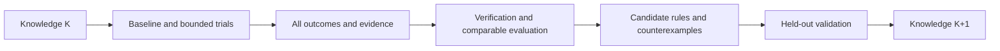

# ECC ICS55 User Manual for Testing Optimization Experience

[Simplified Chinese](ecc-experience-testing-guide.cn.md)

This manual helps users and AI language models test any ECC-supported design on
ICS55, preserve evidence, evaluate optimization experience, and build a versioned
knowledge store for ECC. Private benchmarks are external inputs; their layouts,
names, types, and size distributions do not define product behavior.

**The current CLI provides run, param, report, sweep, explore, signoff, and
reproducible for execution and evidence collection. ecc_experience now provides P0
collect/list/show/verify and P1 enable/status/disable, post-commit attempt outbox
recording, and drain recovery, plus campaign ledgers, recommend, plan, evaluate,
release, and budgeted optimize. Cross-design similarity retrieval, resource
prediction remain planned; experience export/import now supports explicit selection,
offline integrity checks, and idempotent merging.**
Check the installed runtime's help and output contracts before using any capability.

This manual is not a completed test record. Example paths, names, and budgets explain
the procedure; they are not validated configurations. For design preparation and
candidate creation, use the [PPA/DSE manual](ecc-ppa-dse-guide.en.md).

## 1. Two operating modes

| Mode | Entry condition | Available work |
| --- | --- | --- |
| External ledger | Current ECC CLI is available | Execute, save reports, compare, and summarize; users/AI maintain external records |
| Native experience | Installed experience interfaces and their schemas/capabilities have been verified | P0 explicit collection, queries, and verification; other stages only within available scope |

When native interfaces are absent, continue with the external ledger and report
native experience unavailable. Handwritten JSON/Markdown is not an automatically
collected ECC case or a directly loadable knowledge package. Do not assume the
current `ecc doc` command has an experience topic; follow the documentation links.

## 2. AI execution contract

The AI autonomously completes a round within the supplied inputs, goals, parameters,
and budget, choosing each next action from evidence:

- Keep source inputs read-only and workspace/evidence output separate; preserve previous trials.
- Change managed state through public CLI commands; never edit flow, parameters, checklists, or reports to manufacture a pass.
- Freeze RTL, SDC, frequency, corners, activity, process, and acceptance conditions across optimization candidates.
- Search only schema-valid parameters connected to the actual tools; record evidence of their effect.
- Preserve failures, no-gain trials, cancellations, and reuse, not only winners.
- Distinguish unknown, missing, stale, and unparseable evidence; do not turn them into zero or passed.
- Candidate acceptance does not change flow execution policy or add a checklist-blocked execution gate.
- Do not describe existing DRC reports as GDS DRC or foundry signoff.
- Do not upload private designs, experience, or artifacts, or encode private input conventions in product code.
- Continue within budget; report specific missing requirements, unavailable capabilities, or exhausted budgets.

## 3. Required preparation

| Input | Required declaration |
| --- | --- |
| Design | Prepared ECC project, or WorkspaceSpec/Bindings validated through an available interface |
| Specification | Top, actual clocks, SDC/period and IO conditions, goals, hard constraints, allowed parameters |
| Process | Actual ICS55 library/LEF/RC/corner resources and content digests |
| Environment | ECC binary/version, EDA tools, CPU/RAM and GPU when applicable; use installed tools |
| Budget | Candidate count, total time, task timeout, concurrency, and resource limits |
| Output | New campaign/trial directories, ledger, and explicit store in native mode |
| Evaluation | Baseline, metrics/units, acceptance scope, optional external family groups, holdout policy |

A clock name is not a period. Do not assign every design the same frequency without
a specification. Mark missing required constraints as needs_constraints; distinguish
import/synthesis diagnostics from accepted PPA results.

Type and family may be absent; do not infer them from directory names. Measure size
after synthesis. Record register storage separately from mapped macros. Report unsupported
input capabilities instead of silently rewriting RTL.

A local converter can prepare projects and an external task list for private data.
The product does not require fixed metadata filenames, one directory per design, or
a predetermined type list.

## 4. Freeze conditions and discover capabilities

Record campaign ID, selected designs, input/constraint digests, effective configuration,
tools/process, hardware, seeds, concurrency, budget, and knowledge release. Changed
conditions create a new trial or comparison group; preserve earlier results.

Replace paths in the following Bash templates. Keep evidence outside workspaces and
source repositories, with a new directory for each trial. Execute snippets in stages,
inspect exit codes, and enter dependent stages only when their prerequisites hold.

```bash
ECC_TEST_BIN="ecc"
ECC_TEST_PROJECT="/absolute/path/to/prepared-project"
ECC_TEST_EVIDENCE="/absolute/path/to/test-output/campaign-001/baseline-001"
ECC_TEST_BASELINE="baseline-001"
mkdir -p "$ECC_TEST_EVIDENCE"
```

The optional function below preserves raw stdout/stderr, NUL-delimited argv, UTC
timestamps, and exit code. Successful recording returns the command's exit code
without deciding business acceptance. Diagnose a failed call before advancing to a
winner. Recording write failures return 1 and must be classified separately from
EDA failures. It refuses to overwrite evidence. Other recorders must preserve
equivalent information.

```bash
ecc_test_capture() {
  local test_label="$1"
  shift
  case "$test_label" in
    ""|*[!a-zA-Z0-9_.-]*) return 2 ;;
  esac
  local command_prefix="$ECC_TEST_EVIDENCE/$test_label"
  local command_exit=0
  local record_suffix
  for record_suffix in argv started finished stdout stderr exit; do
    if [ -e "$command_prefix.$record_suffix" ]; then
      printf '%s\n' "Refusing to overwrite command evidence: $command_prefix" >&2
      return 2
    fi
  done
  printf '%s\0' "$@" > "$command_prefix.argv" || return 1
  date -u '+%Y-%m-%dT%H:%M:%SZ' > "$command_prefix.started" || return 1
  if "$@" > "$command_prefix.stdout" 2> "$command_prefix.stderr"; then
    command_exit=0
  else
    command_exit=$?
  fi
  printf '%s\n' "$command_exit" > "$command_prefix.exit" || return 1
  date -u '+%Y-%m-%dT%H:%M:%SZ' > "$command_prefix.finished" || return 1
  return "$command_exit"
}
```

Discover existing capabilities:

```bash
ecc_test_capture root-help "$ECC_TEST_BIN" --help
ecc_test_capture version "$ECC_TEST_BIN" version --json
ecc_test_capture project "$ECC_TEST_BIN" project show --project "$ECC_TEST_PROJECT" --plain
ecc_test_capture config "$ECC_TEST_BIN" config --project "$ECC_TEST_PROJECT" --json
ecc_test_capture doctor "$ECC_TEST_BIN" doctor --project "$ECC_TEST_PROJECT" --json
ecc_test_capture inputs-check "$ECC_TEST_BIN" check --project "$ECC_TEST_PROJECT" --plain
ecc_test_capture parameter-catalog "$ECC_TEST_BIN" param list --all --project "$ECC_TEST_PROJECT" --json
```

If root help has no experience group, select external-ledger mode. If it exists,
verify actual subcommands, options, schemas, and versions; a matching name does not
prove every planned feature exists. Classify preflight failures. Do not automatically
install/upgrade tools, change process resources, or weaken acceptance to remove them.

## 5. Establish a real baseline

Confirm the baseline name is unused, project/spec is correct, and a full flow fits
the budget:

```bash
ecc_test_capture baseline-run "$ECC_TEST_BIN" run \
  --project "$ECC_TEST_PROJECT" --workspace "$ECC_TEST_BASELINE" --preset rtl2gds --plain
```

An exit code of zero is one execution observation. Check requested stages, skip/reuse,
checklists, checkers, and evidence coverage. The current syn_sta preset is not a
substitute for final routed STA.

Preserve and diagnose failed baselines for failure coverage; they are not accepted
winners. Distinguish infeasible goals from tool/environment failures. Use measured
costs to adjust subsequent trial budgets.

## 6. Evidence after each execution

### 6.1 Current CLI collection template

The workspace must be stable and terminal, with no other session executing or
modifying it. Save the original committed snapshot before reports, then another
snapshot after refresh, distinguishing analysis refresh from a new execution.

```bash
ecc_test_capture state "$ECC_TEST_BIN" status \
  --project "$ECC_TEST_PROJECT" --workspace "$ECC_TEST_BASELINE" --json
ecc_test_capture snapshot-before-refresh "$ECC_TEST_BIN" report snapshot \
  --project "$ECC_TEST_PROJECT" --workspace "$ECC_TEST_BASELINE" \
  --output "$ECC_TEST_EVIDENCE/committed-before-refresh.json" --json
ecc_test_capture step-overview "$ECC_TEST_BIN" report step \
  --project "$ECC_TEST_PROJECT" --workspace "$ECC_TEST_BASELINE" --json
ecc_test_capture placement-detail "$ECC_TEST_BIN" report step placement \
  --project "$ECC_TEST_PROJECT" --workspace "$ECC_TEST_BASELINE" \
  --section feature --section analysis --section checklist --section outputs --json
ecc_test_capture diagnosis "$ECC_TEST_BIN" diagnose run \
  --project "$ECC_TEST_PROJECT" --workspace "$ECC_TEST_BASELINE" --json
ecc_test_capture signoff-inspect "$ECC_TEST_BIN" signoff inspect \
  --project "$ECC_TEST_PROJECT" --workspace "$ECC_TEST_BASELINE" --json
ecc_test_capture qor "$ECC_TEST_BIN" report qor \
  --project "$ECC_TEST_PROJECT" --workspace "$ECC_TEST_BASELINE" \
  --output "$ECC_TEST_EVIDENCE/qor-report.txt" --json
ecc_test_capture checklist "$ECC_TEST_BIN" report checklist \
  --project "$ECC_TEST_PROJECT" --workspace "$ECC_TEST_BASELINE" \
  --output "$ECC_TEST_EVIDENCE/checklist-report.txt" --json
ecc_test_capture signoff-check "$ECC_TEST_BIN" signoff check \
  --project "$ECC_TEST_PROJECT" --workspace "$ECC_TEST_BASELINE" --json
ecc_test_capture snapshot-after-refresh "$ECC_TEST_BIN" report snapshot \
  --project "$ECC_TEST_PROJECT" --workspace "$ECC_TEST_BASELINE" \
  --output "$ECC_TEST_EVIDENCE/committed-after-refresh.json" --json
```

Placement is an example token from the current flow. Read the overview first; other
flows use their actual stages. Preserve feature/analysis/checklist/outputs for other
stages too. Missing/incompatible snapshots and failed reports retain their errors
and an unknown evidence status.

Signoff inspect refreshes analysis; report qor/checklist writes reports. Refresh is
not a new attempt or additional execution cost. Defer stable collection while a
task is running instead of treating partially updated files as complete evidence.

### 6.2 Minimum ledger fields

For every trial preserve input/constraint/process/tool identity, effective parameters,
requested/actual values and evidence level, seed/hardware/concurrency, executed stages,
reuse lineage, raw metrics/units/source/corner, QoR version, flow/checklist/checker
states, resource scope, failure reason, exit codes, and evidence digests.

Keep execution, quality, evidence, and collection statuses separate. Rerunning a
workspace creates a new attempt; copied prefixes are reuse; report refresh creates
a new observation. These are not multiple independent experiments.

Legacy peak_memory_mb does not uniformly mean absolute process-tree peak. Zero can
reflect missing measurement. Mark legacy/unknown without new facts. Summed stage
time is not parallel campaign wall time.

## 7. Bounded candidates and stage DSE

Use the [PPA/DSE manual](ecc-ppa-dse-guide.en.md) to create isolated candidates or a
small sweep. Preserve full configurations; a sweep does not automatically inherit
historical workspace overrides.

Validate schema, backend mapping, and effect before attributing a parameter change.
Without receipts, claim only configured or materialized, not effective. Parameters
unconnected to the actual tool are not search dimensions.

Collect an existing sweep:

```bash
ECC_TEST_SWEEP="sweep-001"
ecc_test_capture sweep-verify "$ECC_TEST_BIN" sweep verify \
  --project "$ECC_TEST_PROJECT" --name "$ECC_TEST_SWEEP" --json
ecc_test_capture sweep-compare "$ECC_TEST_BIN" sweep compare \
  --project "$ECC_TEST_PROJECT" --name "$ECC_TEST_SWEEP" --json
ecc_test_capture candidate-ranking "$ECC_TEST_BIN" explore rank \
  --project "$ECC_TEST_PROJECT" --name "$ECC_TEST_SWEEP" --json
ecc_test_capture candidate-matrix "$ECC_TEST_BIN" explore export \
  --project "$ECC_TEST_PROJECT" --name "$ECC_TEST_SWEEP" \
  --format json --output "$ECC_TEST_EVIDENCE/candidate-matrix.json" --json
```

Use the actual candidate project/workspace recorded in results to collect each
candidate. The original project's report project is not the sweep candidate list.
Give each candidate a separate command-evidence directory.

Stage DSE declares its boundary and local acceptance. Distinguish stage-validated
from full-flow-validated; advance only a shortlist. Better early HPWL/congestion
does not prove final PPA improvement. Compare run compares observations within one
workspace; it does not replace raw metric comparison across candidates.

## 8. Comparison and winner selection

1. Check comparable inputs, constraints, process, tools, analysis/units, stages, and goals.
2. Filter by this round's hard constraints; missing evidence cannot pass.
3. Compare raw PPA, QoR, and cost, retaining Pareto candidates and counterexamples.
4. Preserve complete configuration recipes; do not combine individual best values from unrelated trials.
5. Validate the winner fully in an unused fresh workspace with all effective parameters.
6. If fresh validation fails, report unvalidated/failed rather than only showing the original score.

Repeated seeds and related variants are not independent designs. Lower frequency,
changed activity/corners, or removed checks change the spec; they do not demonstrate
improvement under the original goal.

## 9. Negative and compatibility tests

Use isolated trials, disposable copies, or synthetic fixtures. Preserve baselines
and source inputs. Deliberate evidence corruption tests readers/verifiers; it is
not a real EDA parameter failure sample.

| Scenario | Allowed scope | Correct outcome |
| --- | --- | --- |
| DRC/LVS/STA violation | Real failed result or isolated failing design; declare checker coverage | Preserve violations, failed gates, and exit codes; exclude from accepted winners |
| Missing QoR | Remove a specific source in an isolated evidence fixture; check other copies | Missing/unknown, not a zero score |
| Corrupt checklist | Invalid format in an isolated fixture | Parse failure/unknown, not passed |
| Legacy workspace | Preserved old fixture, read-only inspection/import | Explicit compatibility/missing fields; no automatic migration |
| Stale evidence | Fixture inputs/config differ from result identity | Stale; excluded from strict recommendation |
| Recollection/rerun/reuse | Separate tests after native module availability | Idempotent collection, new rerun attempt, reuse of original cost |
| OOM/timeout/cancel | Explicitly authorized isolated budget test; confirm actual termination | Resource/cancelled/unknown; incomplete cost observation |
| Unwritable store/collector failure | Isolated native-mode fault test | Visible collection failure, no successful-step rollback or notification blockage |
| Source/wheel/frozen | Actual installed artifacts | Usable contract, explicit resource scope, no source/private-path dependency |

Do not force every design to fail for coverage. Report unavailable reproductions as
not_run with reasons. Report fixture validation separately from real EDA coverage.

Inspect both exit code and JSON business status. Quality queries may return 6
(failed) or 7 (unknown) while stdout remains valid JSON. Codes 20/21 indicate busy/
conflict. A timed execution record may contain 124; preserve actual codes and process
states rather than assuming all commands use the same timeout encoding.

## 10. Native experience acceptance when available

P0 explicit collection, queries, and verification are implemented. P1 automatic
recording writes only small committed facts to a project outbox; it does not change
parameters, block engineering commits, or write experience data into source or the
wheel. Read-only recommendation, reviewable plans, comparison, releases, and bounded
full-flow optimization and serial baseline campaigns are also implemented. Cross-design
transfer and parallel/stage scheduling remain future work. Check installed help.

```bash
EXPERIENCE_STORE=/absolute/path/to/experience-store
ecc experience --help
ecc experience collect --project "$PROJECT" --workspace baseline-001 \
  --store "$EXPERIENCE_STORE" --json
ecc experience list --store "$EXPERIENCE_STORE" --json
```

For continuous accumulation, explicitly configure a store outside the project:

```bash
ecc experience enable --project "$PROJECT" --store "$EXPERIENCE_STORE" --json
ecc experience status --project "$PROJECT" --json
ecc run --project "$PROJECT" --workspace baseline-001 --json
ecc experience drain --project "$PROJECT" --json
ecc experience disable --project "$PROJECT" --json
```

`enable` stores project-level recording configuration; ordinary `run`, single-step
runs, reruns, and failures keep the existing execution rules. Each real execution gets
an independent attempt ID. After each Engineering Snapshot commit, the recorder writes
one event with workspace revision, step terminal state, and the existing runtime/peak
memory facts with their source scope. Recorder errors are logged and do not change the
EDA exit code. `drain` processes only attempts with start, committed-step, and terminal
events, and checks the final snapshot digest. If the source workspace changed, events
remain pending and the reason is reported, preventing new reports from being attached
to an old attempt. Successful events move into the project processed directory and the
case source receives the attempt ID. Use `status` to monitor pending events; do not
delete pending events manually.

Validate a generic campaign manifest before batch testing:

```bash
ecc experience campaign validate --manifest campaign.json --json
```

The validator checks the schema, ICS55 profile field, baseline mode, budget bounds,
unique design IDs, existing input directories, and that store/output paths do not
overlap inputs or each other. Its fingerprint can be recorded in an external campaign
ledger. Validation does not run EDA, create workspaces, or create output/store
directories. Manifest paths are relative; design discovery and label conversion remain
in the user environment. ECC does not scan private datasets.

### Serial baseline campaigns

Execute prepared ECC projects directly:

```bash
ecc experience campaign run --manifest campaign.json --json
ecc experience campaign run --manifest campaign.json --retry-failed --json
```

The first version requires `mode=baseline`, `max_concurrent_flows=1`, and no
`knowledge_release_id`. Each `designs[].workspace` identifies a registered source
workspace with a committed Engineering Snapshot, readable declared inputs, and a PDK
matching `process_profile`. `validate` checks the generic manifest; `run` additionally
checks these execution requirements.

The runner invokes public `init → workspace import → workspace derive → run` commands
to create an isolated project and a workspace for a full rerun at
`output_root/attempts/trial-<id>/project/baseline`. Derivation preserves source
configuration, constraints, skip policy, and inputs. Source project registration,
configuration, and reports remain unchanged. Derivation may copy existing workspace
files, so reserve enough disk space.

Requested parameters are checked before execution. Afterwards, only realized die
aspect ratio/dimension updates matching ECC-Tools geometry reports are accepted;
`runtime_parameter_updates` records requested/observed values and report digests.
Other parameter changes still return 21. Cases retain actual post-run parameters;
geometry write-back is not treated as a new optimization strategy.

`output_root/campaign-run.json` stores frozen inputs, observed runtime versions,
attempt/run IDs, command argv, log paths, raw exit codes, `execution_status`,
`acceptance`, `collection_status`, and case verification. Command stdout/stderr files
contain EDA output; execution markers use the standard workspace `log/<run-id>.log`.
Full verification findings live in the attempt's `case-verification.json`; the result
index retains a compact summary. Frozen CLI builds also record their executable digest,
so different builds sharing a version string are not treated as the same runtime.
`campaign status` also exposes runner status, result path, and active trials through
`execution`. Existing ledger counts still describe immutable trial records; the runner
records each attempt once, after it reaches a terminal state.

Repeated execution skips designs with terminal ledger records by default.
`--retry-failed` creates new attempts for unsuccessful, blocked, or cancelled designs,
at most once per design per invocation, bounded by `max_trials_per_design` across
invocations. Successful designs are skipped. A terminal result saved before its ledger
record is replayed idempotently without running EDA again. Resume checks the manifest,
source configuration/declared input digests, and ECC/observed tool versions; changes
return 21. Start a new output_root after changing frozen conditions.

Only an attempt that actually entered run is collected with its real run ID. Execution,
acceptance, and collection are separate facts. Pass requires flow/checklist/signoff/QoR
and case verification to pass; unknown evidence is blocked. Failures and cancellations
remain recorded. Resume rechecks linked cases instead of trusting a ledger pass.
Exit codes: 0 all pass, 2 invalid input/unsupported mode, 6 failure or blocked, 7 missing
or unknown evidence on recorded cases, 20 busy lock or unfinished intent, 21 changed
frozen conditions, 124 timeout, 130 cancellation. A failed design does not stop other
designs; cancellation or changed conditions stop scheduling.

Normal cancellation and timeout clean up managed process trees. A forcibly killed
runner may leave a running intent; execution then returns 20 and refuses takeover.
Inspect the attempt project recorded in `campaign-run.json` with
`ecc process list --project <attempt-project> --json` and cancel remaining processes
using existing process commands. Preserve the old output for audit. After confirming
process exit, start a new campaign with new output_root/store paths. In-flight attempt
recovery, parallel scheduling, stage DSE, and resource prediction are not implemented.

Declared input digests do not verify the complete include/PDK closure; observed versions
do not hash every executable. Baseline collection does not demonstrate PPA improvement
or cross-design generalization.

### External execution and ledgers

After validation, initialize a resumable campaign ledger. Initialization creates only
`output_root/campaign-ledger.json`, containing the manifest fingerprint, design list, and
empty trial records; it does not start EDA:

```bash
ecc experience campaign init --manifest campaign.json --json
```

Record one result after each externally executed trial. The scheduler should provide a
stable `--trial-id`: repeating the same payload returns `already_present`, while reusing
the ID with different data returns a revision conflict:

```bash
ecc experience campaign record \
  --ledger output/campaign-ledger.json \
  --design design-001 \
  --workspace baseline-001 \
  --status pass \
  --trial-id trial-001 \
  --case-id "$CASE_ID" \
  --json
```

Allowed trial states are `running`, `pass`, `fail`, `blocked`, and `cancelled`. `case_id`
is optional, but collect or drain the experience case before recording it when possible so
the trial retains an evidence link. Recover campaign progress with:

```bash
ecc experience campaign status --manifest campaign.json --json
```

At the end of a batch, or before resuming an interrupted one, combine the latest trial
state with linked case verification and QoR facts:

```bash
ecc experience campaign summary --manifest campaign.json --json
```

`campaign_status` reports scheduling state only. `campaign_summary` also reports
`evidence_status`, `integrity`, and `evidence_counts`. A missing `case_id` or missing case
is reported as missing evidence; a trial `pass` is never promoted to a QoR or signoff pass.

Status revalidates the manifest fingerprint and refuses to continue after the manifest has
changed. The ledger is a scheduling and recovery record, not a QoR verdict. QoR, step
reports, tool versions, and parameters still belong in workspace evidence and experience
cases; only verified cases should feed experience summaries or later recommendations.

Use the read-only recommendation command to retrieve observed configurations:

```bash
ecc experience recommend \
  --project "$PROJECT" \
  --workspace "$WORKSPACE" \
  --store "$EXPERIENCE_STORE" \
  --limit 10 \
  --json
```

Once a release has been created and verified, bind recommendations to it explicitly:

```bash
ecc experience recommend \
  --project "$PROJECT" \
  --workspace "$WORKSPACE" \
  --store "$EXPERIENCE_STORE" \
  --release "$OUTPUT_ROOT/experience-release.json" \
  --json
```

With `--release`, ECC verifies the release first and retrieves candidates only from the
listed cases. If the release is absent, tampered with, missing a case, or no longer
verifies, the command returns an empty `recommendations` list and preserves the
`release_verification` result. Omitting `--release` keeps the compatible local-exploration
behavior and searches the current store without a frozen knowledge boundary.

The current implementation matches only complete input-content fingerprints and returns
parameters observed in historical cases with `safe_to_apply` fixed to `false`. This is not
automatic tuning; absolute environment paths are replaced with `<path-redacted>` so a
local PDK path is not treated as portable. It also does not establish a causal QoR effect.
The AI must inspect
verification, QoR, parameter receipts, and process applicability before validating in a
new workspace. If the query has no complete fingerprint, the store is absent, or no
verifiable case exists, the command returns `status=insufficient_evidence` with an empty
`recommendations` list instead of guessing parameters.

When the recommendation needs to be handed to a human or AI reviewer, write a plan file:

```bash
ecc experience plan \
  --project "$PROJECT" \
  --workspace "$WORKSPACE" \
  --store "$EXPERIENCE_STORE" \
  --release "$OUTPUT_ROOT/experience-release.json" \
  --output "$OUTPUT_ROOT/optimization-plan.json" \
  --json
```

The plan binds the query workspace, input fingerprint, optional release, cases, and a plan fingerprint. It
always declares `manual_review`, `requires_new_workspace=true`, and `auto_apply=false`. It
is a reviewable execution suggestion: it does not edit parameters, copy workspaces, or
start a flow. Old plans without explicit optimization limits and an allowed parameter
list remain review-only and cannot be executed by optimize.

### 10.1 Execute a bounded experience plan

When real flow execution is intended, create a bounded plan, review it, then explicitly
invoke optimize:

```bash
ecc experience plan \
  --project "$PROJECT" --workspace "$WORKSPACE" \
  --store "$EXPERIENCE_STORE" \
  --allow-param floorplan.core_util \
  --allow-param place.target_density \
  --max-trials 4 --max-seconds 3600 --trial-timeout 900 \
  --patience 2 --target-score 95 \
  --output "$OUTPUT_ROOT/bounded-plan.json" --json

ecc experience optimize \
  --project "$PROJECT" --store "$EXPERIENCE_STORE" \
  --plan "$OUTPUT_ROOT/bounded-plan.json" \
  --output "$OUTPUT_ROOT/optimization-001" --json
```

The plan command also accepts `--release`; execution re-verifies the release ID and
cases. Creating a plan remains read-only. `--allow-param` includes execution limits in
the plan but starts no EDA. Omit `--project` from a project or workspace directory;
the plan selects its baseline. The output directory must be new, and the experience
store must not overlap the baseline workspace.

| Limit | Current behavior |
| --- | --- |
| Candidates | Observed configurations with matching input content; failed evidence and changes outside the allowlist are excluded; duplicate configurations are removed; no invented search grid |
| Parameters | Explicitly authorized core utilization/margin/aspect ratio, placement density/overflow/padding/routability, and CTS fanout/skew/transition/capacitance knobs; the existing ECC catalog validates names, types, and ranges |
| Fixed conditions | Baseline snapshot and directly bound input content are checked; design, process declaration, flow, and other configuration stay fixed; fields absent in old snapshots may be filled with current catalog defaults |
| Trial budget | `max_trials` caps all new workspaces, including an independent winner rerun, and must be at least 2; execution is serial and preserves the baseline |
| Time budget | Starts after validation; workspace derivation, parameter application, flow, and report checks share each trial deadline; expiration stops subprocesses; cleanup may take a short additional grace period |
| Early stop | Candidate exhaustion, trial limit, target score, consecutive failures/non-improvements, timeout, or cancellation; a search stop still requires an independent winner rerun |
| Scope | The complete flow defined by the baseline; use sweep/explore for stage DSE and keep its claims separate from full-flow validation |

Execution reuses `workspace derive`, `param apply`, `run`, `status`, and `signoff check`
with installed tools. A blocked baseline can still be optimized; its status is preserved.
New candidates and the fresh rerun must satisfy existing flow/checklist/signoff checks,
finite QoR, and case evidence verification to be accepted. Signoff covers only ECC's
available checks, without GDS DRC or foundry signoff claims.

The controller atomically updates `result.json` with workspaces, run IDs, parameter
changes, command log paths, exit codes, case IDs, verification, scores, and failure/stop
reasons. Completed snapshots are collected into the store with the actual run ID;
execution or collection failures retain their trial records and logs. Only a passing
independent rerun can return `status=complete`. `improved=false` means validation passed
without QoR gain; a missing baseline score produces `improved=null` and an insufficient
comparison, rather than an invented delta.

| Exit code | Meaning |
| --- | --- |
| 0 | A candidate and its independent rerun passed; score gain is not guaranteed |
| 2 | Invalid plan, fingerprint, limits, parameters, or output directory |
| 6 | No accepted candidate or failed independent validation |
| 7 | No eligible observed configuration |
| 21 | Baseline inputs or snapshot changed |
| 124 / 130 | Timeout / cancellation |
| 1 | I/O or another execution failure |

The controller currently requires Linux and handles Ctrl-C/SIGTERM with cleanup of
step processes in separate sessions. It does not resume interrupted runs, remove failed
workspaces, publish releases, relax SDC/frequency/corners, or modify RTL. A new invocation
uses a new output directory and budget. Parameter evidence remains `configured`, without
claiming tool consumption. Full input closure, PDK content freezing, and external tool
version freezing are not implemented. RAM/CPU quotas and resource prediction are not
enforced. Final summaries must include baseline acceptance, best and fresh scores, gain
or no gain, cost, and these limits.

### 10.2 Compare and release cases

Compare the QoR of two collected cases with the read-only command:

```bash
ecc experience evaluate \
  --store "$EXPERIENCE_STORE" \
  --baseline "$BASELINE_CASE_ID" \
  --candidate "$CANDIDATE_CASE_ID" \
  --json
```

The command requires matching, complete input-content fingerprints, evidence verification
without failures, and finite numeric QoR scores. A case without a stable attempt identity
may still have verification status `unknown`; the command preserves those findings
instead of hiding them. The result includes both verification records, the two scores,
their delta, and percentage delta. ECC currently treats a higher QoR score as better.
Mismatched input fingerprints return `status=incompatible`; missing evidence or scores
return `status=insufficient_evidence`. The command never starts EDA, changes a workspace,
or accepts an optimization result automatically. Only for the same design, process, and
constraints may an AI treat `improved` as a candidate result, then continue checking the
checklist, signoff, and original reports.

Freeze a set of cases into an auditable knowledge release only after they are verified:

```bash
ecc experience release create \
  --store "$EXPERIENCE_STORE" \
  --case-id "$CASE_ID_1" \
  --case-id "$CASE_ID_2" \
  --output "$OUTPUT_ROOT/experience-release.json" \
  --json

ecc experience release verify \
  --store "$EXPERIENCE_STORE" \
  --release "$OUTPUT_ROOT/experience-release.json" \
  --json
```

A release accepts only cases whose evidence verification is `pass` and whose complete
input-content fingerprint is present. It records case IDs, input/process fingerprints,
workspace revisions, and QoR summaries. It does not copy private workspace paths or large
artifacts, edit parameters, or enable experience automatically. The output is written
atomically and can be verified by content identity; repeating the same release is
idempotent, while overwriting it with different content fails. Run `release verify` in CI,
after backup restoration, or before giving the release to an AI. Cases without a stable
attempt, unavailable QoR, damaged evidence, or incomplete legacy provenance cannot enter a
release.

Read the actual case_id from collect/list JSON, then run:

```bash
CASE_ID=case-id-returned-by-collect
ecc experience show "$CASE_ID" --store "$EXPERIENCE_STORE" --json
ecc experience verify "$CASE_ID" --store "$EXPERIENCE_STORE" --json
ecc experience verify --store "$EXPERIENCE_STORE" --json
```

collect reuses current-directory defaults for --project/--workspace. list/show/verify
need only an explicit store and work outside a project. Store and source workspace
must be separate. Recollecting the same observation returns already_present. Changed
revision or evidence produces another observation, not proof of an independent
execution. collect never runs EDA, refreshes reports, migrates legacy workspaces, or
repairs corrupt evidence.

Each cases/case_id/case.json holds its version, source revision, original snapshot,
metric units, parameters, and evidence references. Small JSON/TOML evidence is copied
under evidence/ by digest. Large reports, netlists, and layouts retain references and
digests only; source deletion prevents a complete reproducible delivery. report_text
is opaque evidence even with a .json suffix. Use reproducible export for full artifacts.

verify integrity describes copied evidence integrity. status additionally considers
changed, absent, or corrupt source files, missing QoR, and legacy provenance. Exit 6
means explicit failure; 7 means unknown; JSON remains available. Explicit P0 collect has
no attempt identity. Cases materialized by P1 drain have a stable attempt_id, but still
represent committed observations and do not prove parameter effectiveness by themselves.
EDA violations and evidence damage remain distinct.

Writes use a single collector and atomic publication from a temporary directory,
preserving existing cases. The store's .write-lock directory signals an active writer.
After a crash, confirm that the original collector has stopped before removing this
empty lock directory. Never delete cases or live temporary directories to manufacture
a pass.

| Stage | Test | Required evidence |
| --- | --- | --- |
| Explicit collection | Collect, show, verify | Traceable case, unchanged source workspace, idempotence |
| Continuous recording | Enable, run/step/rerun, then drain | Traceable attempt/revision/resource scope; source changes never mix into an old case |
| Recommendation | Unknown type, new design, empty store, incompatible version | Explained matches or insufficient_evidence, no invented configuration |
| Controlled optimization | Execute a plan with declared goals, parameters, and budget | Bounds enforced, feedback, stop reasons, fresh validation |
| Knowledge evaluation | Frozen K, held-out designs, default-policy comparison | Traceable same-budget gains/counterexamples, no evaluation leakage |
| Exchange/recovery | Round trip, repeated import, interrupted task recovery | Matching digests, idempotence, preserved earlier tasks/private inputs |

An empty store is a normal cold start. Collection can work while recommendation
reports insufficient evidence. It cannot claim a learned optimum. AI-written
summaries do not become validated rules without evidence and evaluation.

### 10.3 Back up and exchange experience cases

Select the cases to share explicitly; ECC never exports the entire store by default:

```bash
ecc experience export \
  --store "$EXPERIENCE_STORE" \
  --case-id "$CASE_ID_1" \
  --case-id "$CASE_ID_2" \
  --output "$OUTPUT_ROOT/experience.tar.gz" --json

ecc experience import \
  --package "$OUTPUT_ROOT/experience.tar.gz" \
  --store "$OUTPUT_ROOT/imported-store" --json
```

Alternatively, replace all `--case-id` options with
`--release "$OUTPUT_ROOT/experience-release.json"`; the two selection methods are
mutually exclusive. The package includes that release, all its cases, and the small
evidence files already copied into the store. The import result's `release.path`
identifies the destination release for `release verify`, `recommend --release`,
and `plan --release`.

Both commands work outside projects and require an explicit store. Export outside
the source store and import from outside the destination store. Identical repeated
exports/imports return `already_present`; different content cannot overwrite an
existing package, case, or release. Mixed imports report `created_count` and
`already_present_count`. Full validation precedes destination creation; existing
content is checked before publishing. Catchable write failures roll back entries
created by this transaction. The single-collector write lock still applies. Multiple
directory publications are not a crash-atomic transaction under forced termination
or power loss.

The manifest records its schema, case membership, each file's SHA-256 and size,
and a content-addressed package ID. Unsafe paths, symbolic/hard links, duplicate or
undeclared members, corrupt checksums, invalid case identities, and inconsistent
release metadata are rejected. Initial limits are 128 MiB compressed, 256 MiB for
the complete expanded archive, 32 MiB per file, 20000 data files, and 10000 cases.
Split the selected cases when limits are exceeded. Identical inputs produce
byte-identical gzip tar archives. Checksums establish integrity, not publisher identity.

An imported `integrity=pass` with `source_verification=not_performed` establishes
package integrity only. Original case identity, source, failures, and unknown facts
are preserved. Packaging does not follow source references to copy RTL, PDK files,
large outputs, or tools. It does not rerun EDA, enable recording, or change parameters.
Cases and small reports can still contain design names, paths, and design data;
review actual contents before sharing.

When a source workspace is unavailable, the existing `experience verify` and
`release verify` can still return `unknown`; changed source files can still fail.
Release-bound recommendations retain their original verification requirements.
Unbound observed-only queries retain their existing behavior and never auto-apply
parameters. Use `ecc reproducible export` for complete design deliverables.

| Outcome | Exit code |
| --- | --- |
| Success or identical repeated content | 0 |
| Missing/conflicting selection or invalid command arguments | 2 |
| Corrupt package, invalid schema/membership/cases/release, or exceeded limits | 6 |
| Store writer busy | 20 |
| Existing content conflicts | 21 |
| Filesystem I/O error | 1 |

The existing PyInstaller and design-matrix experience smoke now checks export,
import, repeated import, exact case preservation, and corrupt-package rejection
without launching another EDA flow.

## 11. Creating the next knowledge release



1. Freeze K's cases/rules, feature and recommendation versions; record recommendation provenance.
2. Put new outcomes in staging; local design feedback can guide its next candidates.
3. Keep held-out outcomes out of K until global evaluation completes.
4. Verify parameter effect, comparable gains, failure classifications, and resource scope before deriving recipes.
5. Compare against default or fixed bounded search at the same budget, counting all attempts and collection overhead.
6. Evaluate first-feasible time, trial count, final raw PPA, early-to-final gain retention, and budget coverage.
7. Admit adequately supported rules to scoped K+1; keep unsupported rules provisional.
8. Preserve supporting cases, counterexamples, independent design counts, versions, validation methods, and retirement reasons.

Family groups come from external provenance or structural evidence, not private-name
branches. Report limits when grouping is absent. Until release management exists,
preserve staging/evaluation materials without manufacturing a loadable release.

New cases/releases generally update the external store. Generic collection,
matching, or tool-mapping improvements require an ECC code release. Private experience
does not enter source, wheels, or PyInstaller resources by default.

## 12. Reproduction, export, and retention

For a freshly validated workspace, preserve effective configuration, input/process/
tool digests, and an independent evidence package:

```bash
ecc_test_capture reproducible-export "$ECC_TEST_BIN" reproducible export \
  --project "$ECC_TEST_PROJECT" --workspace "$ECC_TEST_BASELINE" \
  --output "$ECC_TEST_EVIDENCE/reproducible-package"
ecc_test_capture reproducible-verify "$ECC_TEST_BIN" reproducible verify \
  --package "$ECC_TEST_EVIDENCE/reproducible-package" --json
```

Set ECC_TEST_BASELINE to the actual freshly validated workspace and use a new
evidence directory here. Successful export does not prove all external PDK/tool/
dependency resources are included; inspect the manifest and external requirements.
Signoff and reproducible packages have different purposes; follow available delivery
interfaces in the PPA/DSE manual.

Prioritize full evidence for baselines, winners, fresh validations, and critical
failures. Declare retention levels for other candidates. An index is rebuildable
and cannot replace raw cases. Update evidence availability after cleanup rather
than continuing to claim full reproducibility. Never delete source inputs or earlier
workspaces without authorization.

## 13. Mandatory round deliverables

- Campaign/resolved-spec, constraint coverage, capabilities, and environment.
- A matrix of every selected design and trial, including reasons for unexecuted work.
- Command argv, stdout/stderr, exit codes, stage reports, snapshots, and evidence digests.
- Baseline/candidate/winner/fresh raw metrics, full parameters, and comparability.
- Resource scope, failure classification, actual costs, and budget consumption.
- Recommendation effect, supporting cases, counterexamples, unknowns, and knowledge version; no unevaluated success claims.
- Consistent human summary.md and machine summary.json.

This is an external summary template, not a current native ECC schema. Fill it with
facts and preserve unknown values:

```json
{
  "schema": "ecc-experience-test-summary/1",
  "campaign_id": "example-campaign",
  "mode": "external-ledger",
  "native_experience_available": false,
  "knowledge_release_id": null,
  "selected_designs": [],
  "trials": [],
  "comparability": "unknown",
  "recommendation_effect": "not_evaluated",
  "winner": null,
  "fresh_validation": "not_run",
  "artifacts": [],
  "checks_run": [],
  "checks_not_run": [],
  "limitations": []
}
```

Do not deliver only a best configuration. Explain gains, costs, applicability,
failures, and unvalidated requirements. Document/fixture checks, EDA success, and
generalization of recommendations are separate conclusions.

## 14. Stopping, recovery, and acceptance

Stop scheduling new candidates when the budget is exhausted, required inputs/
constraints are missing, resources are insufficient, or capabilities are unavailable.
Preserve evidence and reasons. Confirm cancelled processes have stopped; do not delete
results and restart. Before resume, check frozen conditions and live tasks; retries
create new attempts.

Claim validated optimization for a design only when requested execution, hard
constraints, complete evidence, comparable metrics, and required fresh validation
all pass. Claim faster new-design convergence only with independent held-out
comparisons. List missing collection and unavailable native features explicitly.

## 15. Task template for an AI

```text
Read this manual and the PPA/DSE manual. Test only the selected inputs on ICS55.
Check actual ECC/tool versions, help, spec, and constraints; choose external-ledger mode or verified native experience capabilities.
Keep inputs read-only and outputs separate. Do not hardcode private layouts, names, or types, or upload private data.
Freeze goals, process, analysis conditions, allowed parameters, and budget; establish a baseline, run bounded trials, and preserve every outcome.
Verify parameter effect, metric units, stage coverage, and resource scope; retain failures and unknowns honestly.
If native releases are available, freeze K and link recommendations to feedback; do not feed held-out outcomes back before evaluation ends.
Freshly validate the winner and deliver a trial matrix, summary.json, summary.md, and evidence inventory.
Continue autonomously within budget. Explain required missing information or unavailable capabilities; do not invent commands or passing results.
```
