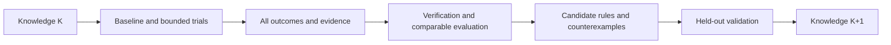

# ECC ICS55 User Manual for Testing Optimization Experience

[Simplified Chinese](ecc-experience-testing-guide.cn.md)

This manual helps users and AI language models test any ECC-supported design on
ICS55, preserve evidence, evaluate optimization experience, and build a versioned
knowledge store for ECC. Private benchmarks are external inputs; their layouts,
names, types, and size distributions do not define product behavior.

**The current CLI provides run, param, report, sweep, explore, signoff, and
reproducible for execution and evidence collection. ecc_experience now provides P0
collect/list/show/verify and P1 enable/status/disable, post-commit attempt outbox
recording, and drain recovery. Recommendation, bounded optimization, and knowledge
release management remain planned.**
Check the installed runtime's help and output contracts before using any capability.

This manual is not a completed test record. Example paths, names, and budgets explain
the procedure; they are not validated configurations. For design preparation and
candidate creation, use the [PPA/DSE manual](ecc-ppa-dse-guide.en.md).

## 1. Two operating modes

| Mode | Entry condition | Available work |
| --- | --- | --- |
| External ledger | Current ECC CLI is available | Execute, save reports, compare, and summarize; users/AI maintain external records |
| Native experience | Installed experience interfaces and their schemas/capabilities have been verified | P0 explicit collection, queries, and verification; other stages only within available scope |

When native interfaces are absent, continue with the external ledger and report
native experience unavailable. Handwritten JSON/Markdown is not an automatically
collected ECC case or a directly loadable knowledge package. Do not assume the
current `ecc doc` command has an experience topic; follow the documentation links.

## 2. AI execution contract

The AI autonomously completes a round within the supplied inputs, goals, parameters,
and budget, choosing each next action from evidence:

- Keep source inputs read-only and workspace/evidence output separate; preserve previous trials.
- Change managed state through public CLI commands; never edit flow, parameters, checklists, or reports to manufacture a pass.
- Freeze RTL, SDC, frequency, corners, activity, process, and acceptance conditions across optimization candidates.
- Search only schema-valid parameters connected to the actual tools; record evidence of their effect.
- Preserve failures, no-gain trials, cancellations, and reuse, not only winners.
- Distinguish unknown, missing, stale, and unparseable evidence; do not turn them into zero or passed.
- Candidate acceptance does not change flow execution policy or add a checklist-blocked execution gate.
- Do not describe existing DRC reports as GDS DRC or foundry signoff.
- Do not upload private designs, experience, or artifacts, or encode private input conventions in product code.
- Continue within budget; report specific missing requirements, unavailable capabilities, or exhausted budgets.

## 3. Required preparation

| Input | Required declaration |
| --- | --- |
| Design | Prepared ECC project, or WorkspaceSpec/Bindings validated through an available interface |
| Specification | Top, actual clocks, SDC/period and IO conditions, goals, hard constraints, allowed parameters |
| Process | Actual ICS55 library/LEF/RC/corner resources and content digests |
| Environment | ECC binary/version, EDA tools, CPU/RAM and GPU when applicable; use installed tools |
| Budget | Candidate count, total time, task timeout, concurrency, and resource limits |
| Output | New campaign/trial directories, ledger, and explicit store in native mode |
| Evaluation | Baseline, metrics/units, acceptance scope, optional external family groups, holdout policy |

A clock name is not a period. Do not assign every design the same frequency without
a specification. Mark missing required constraints as needs_constraints; distinguish
import/synthesis diagnostics from accepted PPA results.

Type and family may be absent; do not infer them from directory names. Measure size
after synthesis. Record register storage separately from mapped macros. Report unsupported
input capabilities instead of silently rewriting RTL.

A local converter can prepare projects and an external task list for private data.
The product does not require fixed metadata filenames, one directory per design, or
a predetermined type list.

## 4. Freeze conditions and discover capabilities

Record campaign ID, selected designs, input/constraint digests, effective configuration,
tools/process, hardware, seeds, concurrency, budget, and knowledge release. Changed
conditions create a new trial or comparison group; preserve earlier results.

Replace paths in the following Bash templates. Keep evidence outside workspaces and
source repositories, with a new directory for each trial. Execute snippets in stages,
inspect exit codes, and enter dependent stages only when their prerequisites hold.

```bash
ECC_TEST_BIN="ecc"
ECC_TEST_PROJECT="/absolute/path/to/prepared-project"
ECC_TEST_EVIDENCE="/absolute/path/to/test-output/campaign-001/baseline-001"
ECC_TEST_BASELINE="baseline-001"
mkdir -p "$ECC_TEST_EVIDENCE"
```

The optional function below preserves raw stdout/stderr, NUL-delimited argv, UTC
timestamps, and exit code. Successful recording returns the command's exit code
without deciding business acceptance. Diagnose a failed call before advancing to a
winner. Recording write failures return 1 and must be classified separately from
EDA failures. It refuses to overwrite evidence. Other recorders must preserve
equivalent information.

```bash
ecc_test_capture() {
  local test_label="$1"
  shift
  case "$test_label" in
    ""|*[!a-zA-Z0-9_.-]*) return 2 ;;
  esac
  local command_prefix="$ECC_TEST_EVIDENCE/$test_label"
  local command_exit=0
  local record_suffix
  for record_suffix in argv started finished stdout stderr exit; do
    if [ -e "$command_prefix.$record_suffix" ]; then
      printf '%s\n' "Refusing to overwrite command evidence: $command_prefix" >&2
      return 2
    fi
  done
  printf '%s\0' "$@" > "$command_prefix.argv" || return 1
  date -u '+%Y-%m-%dT%H:%M:%SZ' > "$command_prefix.started" || return 1
  if "$@" > "$command_prefix.stdout" 2> "$command_prefix.stderr"; then
    command_exit=0
  else
    command_exit=$?
  fi
  printf '%s\n' "$command_exit" > "$command_prefix.exit" || return 1
  date -u '+%Y-%m-%dT%H:%M:%SZ' > "$command_prefix.finished" || return 1
  return "$command_exit"
}
```

Discover existing capabilities:

```bash
ecc_test_capture root-help "$ECC_TEST_BIN" --help
ecc_test_capture version "$ECC_TEST_BIN" version --json
ecc_test_capture project "$ECC_TEST_BIN" project show --project "$ECC_TEST_PROJECT" --plain
ecc_test_capture config "$ECC_TEST_BIN" config --project "$ECC_TEST_PROJECT" --json
ecc_test_capture doctor "$ECC_TEST_BIN" doctor --project "$ECC_TEST_PROJECT" --json
ecc_test_capture inputs-check "$ECC_TEST_BIN" check --project "$ECC_TEST_PROJECT" --plain
ecc_test_capture parameter-catalog "$ECC_TEST_BIN" param list --all --project "$ECC_TEST_PROJECT" --json
```

If root help has no experience group, select external-ledger mode. If it exists,
verify actual subcommands, options, schemas, and versions; a matching name does not
prove every planned feature exists. Classify preflight failures. Do not automatically
install/upgrade tools, change process resources, or weaken acceptance to remove them.

## 5. Establish a real baseline

Confirm the baseline name is unused, project/spec is correct, and a full flow fits
the budget:

```bash
ecc_test_capture baseline-run "$ECC_TEST_BIN" run \
  --project "$ECC_TEST_PROJECT" --workspace "$ECC_TEST_BASELINE" --preset rtl2gds --plain
```

An exit code of zero is one execution observation. Check requested stages, skip/reuse,
checklists, checkers, and evidence coverage. The current syn_sta preset is not a
substitute for final routed STA.

Preserve and diagnose failed baselines for failure coverage; they are not accepted
winners. Distinguish infeasible goals from tool/environment failures. Use measured
costs to adjust subsequent trial budgets.

## 6. Evidence after each execution

### 6.1 Current CLI collection template

The workspace must be stable and terminal, with no other session executing or
modifying it. Save the original committed snapshot before reports, then another
snapshot after refresh, distinguishing analysis refresh from a new execution.

```bash
ecc_test_capture state "$ECC_TEST_BIN" status \
  --project "$ECC_TEST_PROJECT" --workspace "$ECC_TEST_BASELINE" --json
ecc_test_capture snapshot-before-refresh "$ECC_TEST_BIN" report snapshot \
  --project "$ECC_TEST_PROJECT" --workspace "$ECC_TEST_BASELINE" \
  --output "$ECC_TEST_EVIDENCE/committed-before-refresh.json" --json
ecc_test_capture step-overview "$ECC_TEST_BIN" report step \
  --project "$ECC_TEST_PROJECT" --workspace "$ECC_TEST_BASELINE" --json
ecc_test_capture placement-detail "$ECC_TEST_BIN" report step placement \
  --project "$ECC_TEST_PROJECT" --workspace "$ECC_TEST_BASELINE" \
  --section feature --section analysis --section checklist --section outputs --json
ecc_test_capture diagnosis "$ECC_TEST_BIN" diagnose run \
  --project "$ECC_TEST_PROJECT" --workspace "$ECC_TEST_BASELINE" --json
ecc_test_capture signoff-inspect "$ECC_TEST_BIN" signoff inspect \
  --project "$ECC_TEST_PROJECT" --workspace "$ECC_TEST_BASELINE" --json
ecc_test_capture qor "$ECC_TEST_BIN" report qor \
  --project "$ECC_TEST_PROJECT" --workspace "$ECC_TEST_BASELINE" \
  --output "$ECC_TEST_EVIDENCE/qor-report.txt" --json
ecc_test_capture checklist "$ECC_TEST_BIN" report checklist \
  --project "$ECC_TEST_PROJECT" --workspace "$ECC_TEST_BASELINE" \
  --output "$ECC_TEST_EVIDENCE/checklist-report.txt" --json
ecc_test_capture signoff-check "$ECC_TEST_BIN" signoff check \
  --project "$ECC_TEST_PROJECT" --workspace "$ECC_TEST_BASELINE" --json
ecc_test_capture snapshot-after-refresh "$ECC_TEST_BIN" report snapshot \
  --project "$ECC_TEST_PROJECT" --workspace "$ECC_TEST_BASELINE" \
  --output "$ECC_TEST_EVIDENCE/committed-after-refresh.json" --json
```

Placement is an example token from the current flow. Read the overview first; other
flows use their actual stages. Preserve feature/analysis/checklist/outputs for other
stages too. Missing/incompatible snapshots and failed reports retain their errors
and an unknown evidence status.

Signoff inspect refreshes analysis; report qor/checklist writes reports. Refresh is
not a new attempt or additional execution cost. Defer stable collection while a
task is running instead of treating partially updated files as complete evidence.

### 6.2 Minimum ledger fields

For every trial preserve input/constraint/process/tool identity, effective parameters,
requested/actual values and evidence level, seed/hardware/concurrency, executed stages,
reuse lineage, raw metrics/units/source/corner, QoR version, flow/checklist/checker
states, resource scope, failure reason, exit codes, and evidence digests.

Keep execution, quality, evidence, and collection statuses separate. Rerunning a
workspace creates a new attempt; copied prefixes are reuse; report refresh creates
a new observation. These are not multiple independent experiments.

Legacy peak_memory_mb does not uniformly mean absolute process-tree peak. Zero can
reflect missing measurement. Mark legacy/unknown without new facts. Summed stage
time is not parallel campaign wall time.

## 7. Bounded candidates and stage DSE

Use the [PPA/DSE manual](ecc-ppa-dse-guide.en.md) to create isolated candidates or a
small sweep. Preserve full configurations; a sweep does not automatically inherit
historical workspace overrides.

Validate schema, backend mapping, and effect before attributing a parameter change.
Without receipts, claim only configured or materialized, not effective. Parameters
unconnected to the actual tool are not search dimensions.

Collect an existing sweep:

```bash
ECC_TEST_SWEEP="sweep-001"
ecc_test_capture sweep-verify "$ECC_TEST_BIN" sweep verify \
  --project "$ECC_TEST_PROJECT" --name "$ECC_TEST_SWEEP" --json
ecc_test_capture sweep-compare "$ECC_TEST_BIN" sweep compare \
  --project "$ECC_TEST_PROJECT" --name "$ECC_TEST_SWEEP" --json
ecc_test_capture candidate-ranking "$ECC_TEST_BIN" explore rank \
  --project "$ECC_TEST_PROJECT" --name "$ECC_TEST_SWEEP" --json
ecc_test_capture candidate-matrix "$ECC_TEST_BIN" explore export \
  --project "$ECC_TEST_PROJECT" --name "$ECC_TEST_SWEEP" \
  --format json --output "$ECC_TEST_EVIDENCE/candidate-matrix.json" --json
```

Use the actual candidate project/workspace recorded in results to collect each
candidate. The original project's report project is not the sweep candidate list.
Give each candidate a separate command-evidence directory.

Stage DSE declares its boundary and local acceptance. Distinguish stage-validated
from full-flow-validated; advance only a shortlist. Better early HPWL/congestion
does not prove final PPA improvement. Compare run compares observations within one
workspace; it does not replace raw metric comparison across candidates.

## 8. Comparison and winner selection

1. Check comparable inputs, constraints, process, tools, analysis/units, stages, and goals.
2. Filter by this round's hard constraints; missing evidence cannot pass.
3. Compare raw PPA, QoR, and cost, retaining Pareto candidates and counterexamples.
4. Preserve complete configuration recipes; do not combine individual best values from unrelated trials.
5. Validate the winner fully in an unused fresh workspace with all effective parameters.
6. If fresh validation fails, report unvalidated/failed rather than only showing the original score.

Repeated seeds and related variants are not independent designs. Lower frequency,
changed activity/corners, or removed checks change the spec; they do not demonstrate
improvement under the original goal.

## 9. Negative and compatibility tests

Use isolated trials, disposable copies, or synthetic fixtures. Preserve baselines
and source inputs. Deliberate evidence corruption tests readers/verifiers; it is
not a real EDA parameter failure sample.

| Scenario | Allowed scope | Correct outcome |
| --- | --- | --- |
| DRC/LVS/STA violation | Real failed result or isolated failing design; declare checker coverage | Preserve violations, failed gates, and exit codes; exclude from accepted winners |
| Missing QoR | Remove a specific source in an isolated evidence fixture; check other copies | Missing/unknown, not a zero score |
| Corrupt checklist | Invalid format in an isolated fixture | Parse failure/unknown, not passed |
| Legacy workspace | Preserved old fixture, read-only inspection/import | Explicit compatibility/missing fields; no automatic migration |
| Stale evidence | Fixture inputs/config differ from result identity | Stale; excluded from strict recommendation |
| Recollection/rerun/reuse | Separate tests after native module availability | Idempotent collection, new rerun attempt, reuse of original cost |
| OOM/timeout/cancel | Explicitly authorized isolated budget test; confirm actual termination | Resource/cancelled/unknown; incomplete cost observation |
| Unwritable store/collector failure | Isolated native-mode fault test | Visible collection failure, no successful-step rollback or notification blockage |
| Source/wheel/frozen | Actual installed artifacts | Usable contract, explicit resource scope, no source/private-path dependency |

Do not force every design to fail for coverage. Report unavailable reproductions as
not_run with reasons. Report fixture validation separately from real EDA coverage.

Inspect both exit code and JSON business status. Quality queries may return 6
(failed) or 7 (unknown) while stdout remains valid JSON. Codes 20/21 indicate busy/
conflict. A timed execution record may contain 124; preserve actual codes and process
states rather than assuming all commands use the same timeout encoding.

## 10. Native experience acceptance when available

P0 explicit collection, queries, and verification are implemented. P1 automatic
recording writes only small committed facts to a project outbox; it does not change
parameters, block engineering commits, or write experience data into source or the
wheel. Other stages are future acceptance procedures. Discover each capability through
installed help.

```bash
EXPERIENCE_STORE=/absolute/path/to/experience-store
ecc experience --help
ecc experience collect --project "$PROJECT" --workspace baseline-001 \
  --store "$EXPERIENCE_STORE" --json
ecc experience list --store "$EXPERIENCE_STORE" --json
```

For continuous accumulation, explicitly configure a store outside the project:

```bash
ecc experience enable --project "$PROJECT" --store "$EXPERIENCE_STORE" --json
ecc experience status --project "$PROJECT" --json
ecc run --project "$PROJECT" --workspace baseline-001 --json
ecc experience drain --project "$PROJECT" --json
ecc experience disable --project "$PROJECT" --json
```

`enable` stores project-level recording configuration; ordinary `run`, single-step
runs, reruns, and failures keep the existing execution rules. Each real execution gets
an independent attempt ID. After each Engineering Snapshot commit, the recorder writes
one event with workspace revision, step terminal state, and the existing runtime/peak
memory facts with their source scope. Recorder errors are logged and do not change the
EDA exit code. `drain` processes only attempts with start, committed-step, and terminal
events, and checks the final snapshot digest. If the source workspace changed, events
remain pending and the reason is reported, preventing new reports from being attached
to an old attempt. Successful events move into the project processed directory and the
case source receives the attempt ID. Use `status` to monitor pending events; do not
delete pending events manually.

Validate a generic campaign manifest before batch testing:

```bash
ecc experience campaign validate --manifest campaign.json --json
```

The validator checks the schema, ICS55 profile field, baseline mode, budget bounds,
unique design IDs, existing input directories, and that store/output paths do not
overlap inputs or each other. Its fingerprint can be recorded in an external campaign
ledger. Validation does not run EDA, create workspaces, or create output/store
directories. Manifest paths are relative; private design discovery, label conversion,
and batch scheduling remain in the user environment.

Read the actual case_id from collect/list JSON, then run:

```bash
CASE_ID=case-id-returned-by-collect
ecc experience show "$CASE_ID" --store "$EXPERIENCE_STORE" --json
ecc experience verify "$CASE_ID" --store "$EXPERIENCE_STORE" --json
ecc experience verify --store "$EXPERIENCE_STORE" --json
```

collect reuses current-directory defaults for --project/--workspace. list/show/verify
need only an explicit store and work outside a project. Store and source workspace
must be separate. Recollecting the same observation returns already_present. Changed
revision or evidence produces another observation, not proof of an independent
execution. collect never runs EDA, refreshes reports, migrates legacy workspaces, or
repairs corrupt evidence.

Each cases/case_id/case.json holds its version, source revision, original snapshot,
metric units, parameters, and evidence references. Small JSON/TOML evidence is copied
under evidence/ by digest. Large reports, netlists, and layouts retain references and
digests only; source deletion prevents a complete reproducible delivery. report_text
is opaque evidence even with a .json suffix. Use reproducible export for full artifacts.

verify integrity describes copied evidence integrity. status additionally considers
changed, absent, or corrupt source files, missing QoR, and legacy provenance. Exit 6
means explicit failure; 7 means unknown; JSON remains available. Explicit P0 collect has
no attempt identity. Cases materialized by P1 drain have a stable attempt_id, but still
represent committed observations and do not prove parameter effectiveness by themselves.
EDA violations and evidence damage remain distinct.

Writes use a single collector and atomic publication from a temporary directory,
preserving existing cases. The store's .write-lock directory signals an active writer.
After a crash, confirm that the original collector has stopped before removing this
empty lock directory. Never delete cases or live temporary directories to manufacture
a pass.

| Stage | Test | Required evidence |
| --- | --- | --- |
| Explicit collection | Collect, show, verify | Traceable case, unchanged source workspace, idempotence |
| Continuous recording | Enable, run/step/rerun, then drain | Traceable attempt/revision/resource scope; source changes never mix into an old case |
| Recommendation | Unknown type, new design, empty store, incompatible version | Explained matches or insufficient_evidence, no invented configuration |
| Controlled optimization | Execute a plan with declared goals, parameters, and budget | Bounds enforced, feedback, stop reasons, fresh validation |
| Knowledge evaluation | Frozen K, held-out designs, default-policy comparison | Traceable same-budget gains/counterexamples, no evaluation leakage |
| Exchange/recovery | Round trip, repeated import, interrupted task recovery | Matching digests, idempotence, preserved earlier tasks/private inputs |

An empty store is a normal cold start. Collection can work while recommendation
reports insufficient evidence. It cannot claim a learned optimum. AI-written
summaries do not become validated rules without evidence and evaluation.

## 11. Creating the next knowledge release



1. Freeze K's cases/rules, feature and recommendation versions; record recommendation provenance.
2. Put new outcomes in staging; local design feedback can guide its next candidates.
3. Keep held-out outcomes out of K until global evaluation completes.
4. Verify parameter effect, comparable gains, failure classifications, and resource scope before deriving recipes.
5. Compare against default or fixed bounded search at the same budget, counting all attempts and collection overhead.
6. Evaluate first-feasible time, trial count, final raw PPA, early-to-final gain retention, and budget coverage.
7. Admit adequately supported rules to scoped K+1; keep unsupported rules provisional.
8. Preserve supporting cases, counterexamples, independent design counts, versions, validation methods, and retirement reasons.

Family groups come from external provenance or structural evidence, not private-name
branches. Report limits when grouping is absent. Until release management exists,
preserve staging/evaluation materials without manufacturing a loadable release.

New cases/releases generally update the external store. Generic collection,
matching, or tool-mapping improvements require an ECC code release. Private experience
does not enter source, wheels, or PyInstaller resources by default.

## 12. Reproduction, export, and retention

For a freshly validated workspace, preserve effective configuration, input/process/
tool digests, and an independent evidence package:

```bash
ecc_test_capture reproducible-export "$ECC_TEST_BIN" reproducible export \
  --project "$ECC_TEST_PROJECT" --workspace "$ECC_TEST_BASELINE" \
  --output "$ECC_TEST_EVIDENCE/reproducible-package"
ecc_test_capture reproducible-verify "$ECC_TEST_BIN" reproducible verify \
  --package "$ECC_TEST_EVIDENCE/reproducible-package" --json
```

Set ECC_TEST_BASELINE to the actual freshly validated workspace and use a new
evidence directory here. Successful export does not prove all external PDK/tool/
dependency resources are included; inspect the manifest and external requirements.
Signoff and reproducible packages have different purposes; follow available delivery
interfaces in the PPA/DSE manual.

Prioritize full evidence for baselines, winners, fresh validations, and critical
failures. Declare retention levels for other candidates. An index is rebuildable
and cannot replace raw cases. Update evidence availability after cleanup rather
than continuing to claim full reproducibility. Never delete source inputs or earlier
workspaces without authorization.

## 13. Mandatory round deliverables

- Campaign/resolved-spec, constraint coverage, capabilities, and environment.
- A matrix of every selected design and trial, including reasons for unexecuted work.
- Command argv, stdout/stderr, exit codes, stage reports, snapshots, and evidence digests.
- Baseline/candidate/winner/fresh raw metrics, full parameters, and comparability.
- Resource scope, failure classification, actual costs, and budget consumption.
- Recommendation effect, supporting cases, counterexamples, unknowns, and knowledge version; no unevaluated success claims.
- Consistent human summary.md and machine summary.json.

This is an external summary template, not a current native ECC schema. Fill it with
facts and preserve unknown values:

```json
{
  "schema": "ecc-experience-test-summary/1",
  "campaign_id": "example-campaign",
  "mode": "external-ledger",
  "native_experience_available": false,
  "knowledge_release_id": null,
  "selected_designs": [],
  "trials": [],
  "comparability": "unknown",
  "recommendation_effect": "not_evaluated",
  "winner": null,
  "fresh_validation": "not_run",
  "artifacts": [],
  "checks_run": [],
  "checks_not_run": [],
  "limitations": []
}
```

Do not deliver only a best configuration. Explain gains, costs, applicability,
failures, and unvalidated requirements. Document/fixture checks, EDA success, and
generalization of recommendations are separate conclusions.

## 14. Stopping, recovery, and acceptance

Stop scheduling new candidates when the budget is exhausted, required inputs/
constraints are missing, resources are insufficient, or capabilities are unavailable.
Preserve evidence and reasons. Confirm cancelled processes have stopped; do not delete
results and restart. Before resume, check frozen conditions and live tasks; retries
create new attempts.

Claim validated optimization for a design only when requested execution, hard
constraints, complete evidence, comparable metrics, and required fresh validation
all pass. Claim faster new-design convergence only with independent held-out
comparisons. List missing collection and unavailable native features explicitly.

## 15. Task template for an AI

```text
Read this manual and the PPA/DSE manual. Test only the selected inputs on ICS55.
Check actual ECC/tool versions, help, spec, and constraints; choose external-ledger mode or verified native experience capabilities.
Keep inputs read-only and outputs separate. Do not hardcode private layouts, names, or types, or upload private data.
Freeze goals, process, analysis conditions, allowed parameters, and budget; establish a baseline, run bounded trials, and preserve every outcome.
Verify parameter effect, metric units, stage coverage, and resource scope; retain failures and unknowns honestly.
If native releases are available, freeze K and link recommendations to feedback; do not feed held-out outcomes back before evaluation ends.
Freshly validate the winner and deliver a trial matrix, summary.json, summary.md, and evidence inventory.
Continue autonomously within budget. Explain required missing information or unavailable capabilities; do not invent commands or passing results.
```
