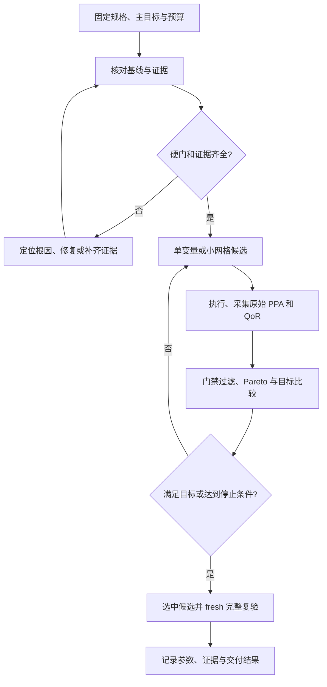

# ECC CLI PPA 调优与 DSE 用户手册

[English](ecc-ppa-dse-guide.en.md)

本手册面向芯片设计用户以及能够调用命令行工具的 AI 大模型，指导在 ECC 支持的设计、PDK 和 EDA 工具范围内，从设计规格（spec）配置项目，执行 RTL-to-GDS，开展 PPA/QoR 调优与前段 PNR 的 DSE，并交付可核验的结果总结。

PPA 指功耗（Power）、性能（Performance）和面积（Area）；QoR 是实现质量评分；DSE 是设计空间探索。本文以固定设计规格下的物理实现参数调优为主，适用于不同设计，不以某个已有项目的参数或成绩作为验收标准。

先阅读 [入门教程](ecc-tutorial.cn.md) 完成安装，再按本手册操作。所有命令以实际安装版本的 `--help`、`param list/show` 和实际报告为准；示例数值只解释方法。本文不是运行记录，不声明示例已达到优化目标。

阅读顺序：首次建项从 §3 开始；已有基线从 §8 开始；全流程参数搜索见 §9–§11；前段 PNR DSE 见 §17；每次任务结束必须按 §18 总结；委托 AI 自主操作使用 §19 的执行契约。

开展重复测试、负向场景和经验积累时，配合 [ICS55 调优经验测试手册](../../ecc_experience/docs/ecc-experience-testing-guide.cn.md) 保存证据、验证推荐效果并管理知识版本；其中未实现接口有明确标记。

## 1. 适用范围与能力

**用户或 AI 大模型可以用 ECC CLI 对支持的芯片设计开展有边界的 PPA / QoR 参数调优和 DSE。**
AI 大模型可以发现参数、读取证据、提出实验、创建隔离候选、运行 EDA、筛选结果、记录 winner，
再在 fresh workspace 中复验并导出交付。现有命令足以完成这条操作链，不需要先增加一个
`ecc optimize` 命令。

AI 大模型负责 spec、搜索范围和取舍，ECC 可负责预算内的确定性候选、阶段筛选、执行与证据。
不承诺全局最优；支持程度取决于约束、工艺资源、实际 EDA 工具与报告覆盖。

| 任务 | 当前支持情况 | 正确使用方式 |
| --- | --- | --- |
| 查询 project/workspace、运行状态与有效参数 | 支持 | project/workspace/status/config/param |
| 对 fresh workspace 设置候选参数 | 支持 | `ecc run --set KEY=VALUE` |
| 对已有候选原地小步迭代 | 支持 | workspace scope 的 param set/apply；重跑被失效的后缀 |
| 完整 RTL-to-GDS 执行、单步与范围重跑 | 支持 | run/preset/resume/from/to/only/force |
| rtl2gds 前段 PNR 的分阶段 DSE | experience dse v2 支持 | 声明式 spec、阶段指标、Pareto、逐级筛选与 full/fresh；详见 §17 |
| 获取阶段指标、时序/违例与总体 QoR | 支持 | report step、report qor、report project、signoff check |
| 小规模确定性网格搜索 | 支持 | sweep create/run/verify/compare |
| 排序、矩阵导出、记录选中候选 | 支持 | explore rank/export/promote |
| 同一 workspace 前后状态和指标比较 | 支持 | report snapshot + compare run |
| 不同 workspace 的独立 PPA 候选比较 | 可由 AI 大模型完成 | 从公开报告提取可比原始指标，维护外部实验表 |
| 独立可复现证据包、ECC 签核交付包 | 支持 | reproducible 与 signoff 两类 export |
| 自适应搜索、Pareto 与执行预算 | ECC 提供机制，用户/AI 定义策略 | experience dse v2；多目标显式选点，不自动应用参数 |
| 对任意 RTL 自动做架构改写并证明等价 | 不属于默认参数调优 | 另开 RTL 优化任务，补功能验证及必要 LEC |
| GDS 级 DRC、完整代工厂签核 | 当前不支持由 ECC 保证 | 当前 DRC 结论只对应已有 checker 证据 |

**推荐第一版使用范围：固定 RTL、PDK、SDC、频率与验收 corners，只优化已接入 EDA 的物理参数。**
用户未明确主目标时，先给出候选的可行性与 Pareto 集，不擅自决定面积、功耗、时序谁优先。

如果重点是 rtl2gds 前几个 PNR 步骤，优先用 §17 的分阶段 DSE：先运行便宜的前段，
只让短名单进入后段。当前不必为每个早期候选跑完整 flow，但最终改善仍需完整复验。

## 2. AI 大模型与 ECC 的职责

| 责任 | AI 大模型 | ECC CLI / EDA |
| --- | --- | --- |
| 确定目标与预算 | 解释用户要求、记录硬约束、控制候选数量 | 查询配置及合法参数 |
| 诊断 | 结合路径、指标、日志识别瓶颈 | 提供真实状态、报告、checklist 和工具输出 |
| 搜索 | 选择参数组、候选范围、下一轮方向和停止条件 | 按指定参数执行候选 |
| 数据解释 | 核对单位、来源、阶段、corner、是否可比 | 产生原始 PPA 与 QoR 分析 |
| 排名 | 硬门过滤、Pareto、用户目标和容差 | sweep 的固定状态/QoR 排序 |
| 复现与交付 | 保存输入摘要、完整参数、环境和选择理由 | fresh run、证据包、签核包 |

所有受管状态修改使用公开 CLI。AI 大模型不直接改 `project.json`、`home/params.toml`、
`home/flow.json`、分析/checklist JSON 或工具生成 Tcl 来制造通过结果。
可以只读这些文件补充诊断；台账、假设和对比结果写在 workspace 外的独立目录。



这里的硬门用于判断优化候选是否可接受。**不改变当前 flow 执行策略，也不让 checklist
blocked 自动阻止后续步骤运行。**运行策略与最终选优条件是两个独立契约。

## 3. 配置设计规格（spec）并建立项目

### 3.1 spec、ECC 配置与实验结果的关系

spec 是用户对芯片功能、输入、约束、验收、优化目标、允许改动和预算的声明。
先定义“什么结果可以接受”，再定义“哪些参数可以改变”，最后执行实验。
ECC 项目配置只承载已支持的执行字段；spec 还应包含用户目标和工具无法直接表达的验收条件。

推荐将以下用户文件放在独立的输入/实验目录，避开 workspace 的 origin/home/config 等受管目录：

- `design-spec.json`：本轮用户确认的设计规格。它是本手册建议的外部格式，不是 ECC 原生 schema。
- `spec-resolved.json`：将路径、输入摘要、实际 corners、工具/PDK 版本和支持参数补齐后的执行规格。
- `spec-coverage.md`：每个要求对应哪个配置/报告；标明支持、需外部验证或暂不可验证。
- `candidates.json` / `candidates.csv`：实验台账；任务结束生成 `optimization-summary.md`。

**ECC 不会自动加载上述 spec 文件，当前没有本文定义的 `ecc --spec` 导入接口。**
用户或 AI 大模型读取 spec，通过公开 project/param/PDK 命令配置，再用报告逐项验证。
外部 spec 不得替代有效 SDC，也不得替代 workspace 的实际参数和输入证据。

### 3.2 按需求填写 spec

| 类别 | 用户应说明 | 配置/验证方法 |
| --- | --- | --- |
| 功能 | 运算/协议、位宽、延迟/吞吐、reset、接口、参数化、测试验收 | RTL 与既有仿真/功能验证；ECC flow 成功不证明满足功能需求 |
| 设计入口 | RTL/filelist、top，或配套 DEF/网表/SPEF；来源与版本 | design.rtl/top/netlist/def/spef 等 project 字段；按入口步骤校验 |
| 工艺与 IP | 已支持 PDK、标准单元、宏模型/LEF/Liberty，必要 GDS | pdk.name/root、公开资源覆盖；宏声明与真实实例匹配 |
| 时序 | clock_port、频率、clock/generated clock、IO 预算、uncertainty、负载、例外路径 | design.clock_port/frequency_mhz/sdc；核对实际 SDC 和路径覆盖 |
| corner | 要求的 Liberty、RC、温度组合及 setup/hold 验收范围 | sta.liberty/signoff 查询与受支持配置；最终 RCX/STA 覆盖 |
| 外形/物理 | die/core 面积或固定尺寸、aspect、宏位置、通道、IO/PDN/层要求 | floorplan/macro/route 公开参数与阶段产物；不可随意削弱工艺规则 |
| 功耗 | total/dynamic/leakage 目标、单位、活动模型和 corner | 有效 power 报告；活动输入不受支持时说明缺口 |
| 优化目标 | 主目标、硬约束、权重/优先级、改善阈值和容差 | 外部 Pareto/目标选择；QoR 不替代用户 PPA 目标 |
| 允许改动 | 参数白名单及范围；是否允许改 RTL/SDC/频率/PDK/宏 | 固定条件核对；规格变化建立独立实验类别 |
| 执行预算 | 候选数、总时间、单次时间、CPU/RAM/磁盘、并行度、重试次数 | AI/外部编排；计入基线、复制、重试与 fresh 复验 |
| 交付 | 前段 DSE 或完整芯片结果、验收 profile、必需 checker、报告/导出范围 | 明确已执行/未验证；完整结果按最终验收契约判断 |

面积上限先明确是 die_area、core_area 还是 cell_area。性能先明确时钟频率、slack、吞吐还是延迟。
如果用户同时要求面积和功耗，而没有取舍，保留 Pareto 集；在不能唯一选择时不擅自设权重。
没有功耗证据时不能宣称满足功耗硬约束；用户可另行授权开展不承诺最终功耗通过的探索。

### 3.3 可供用户和 AI 阅读的 spec 示例

下例适用于一个已提供 RTL、单时钟、已支持 PDK 的教学设计。所有路径相对 spec 文件所在目录，
相应输入需真实存在；应用到其他设计时替换 top、频率、预算、范围及验收要求。
null 表示用户未设置上限，不表示测量值为零。这里的数值不是所有设计的建议参数。

```json
{
  "schema": "ecc-user-optimization-spec/1",
  "task": "ppa_and_pnr_dse",
  "design": {
    "name": "my_chip",
    "top": "chip_top",
    "rtl": ["inputs/rtl/chip_top.sv"],
    "clock_port": "clk_i",
    "frequency_mhz": 100.0,
    "sdc": "inputs/constraints/chip.sdc",
    "functional_verification": "use the supplied testbench and its acceptance criteria"
  },
  "pdk": {
    "name": "ics55",
    "root": "resources/icsprout55-pdk"
  },
  "timing": {
    "keep_all_supported_baseline_corners": true,
    "min_setup_ws_ns": 0.0,
    "min_hold_ws_ns": 0.0,
    "max_setup_violation_count": 0,
    "max_hold_violation_count": 0,
    "sdc_review_required": true
  },
  "objective": {
    "primary": "minimize_die_area",
    "keep_pareto": true,
    "improvement_goal_percent": 5.0,
    "comparison_tolerance_percent": 0.5,
    "max_die_area_um2": null,
    "max_total_power_uw": null,
    "power_comparison": "same activity model, source kind and corner"
  },
  "search": {
    "method": "staged_pnr_then_full_validation",
    "fixed_rtl": true,
    "fixed_sdc_frequency_pdk": true,
    "parameters": {
      "floorplan.core_util": [0.25, 0.30, 0.35],
      "place.target_density": [0.15, 0.20, 0.25]
    },
    "first_round_max_candidates": 3,
    "max_search_candidates": 8,
    "max_baseline_runs": 1,
    "max_fresh_validation_runs": 1,
    "max_failure_retries_per_candidate": 1,
    "max_total_hours": 8.0,
    "max_single_run_seconds": 3600,
    "max_concurrent_runs": 1,
    "max_threads": 4,
    "max_peak_memory_gib": 8,
    "max_workspace_storage_gib": 20
  },
  "acceptance": {
    "deliverable_scope": "full_rtl2gds",
    "signoff_profile": "rtl2gds",
    "required_checkers": ["drc", "lvs", "postRouteLec", "sta"],
    "required_artifacts": ["gds", "final_netlist", "spef"],
    "require_applicable_checklist_pass": true,
    "require_fresh_full_validation": true
  },
  "delivery": {
    "summary_required": true,
    "export_evidence": true,
    "export_signoff": true,
    "apply_project_defaults": false,
    "upload_or_publish": false
  }
}
```

本示例声明候选范围，但不要求把两个三点范围直接做成九点网格。
AI 按阶段与预算选点；参数范围仍须经过当前 schema 和物理容量检查。
八个 search candidates 不包含最多一次基线与一次最终复验，全部执行共同受总时间和资源上限限制。
预算耗尽或目标未达时如实总结，不自动再增加复验次数。

spec 的 required_checkers 是独立验收要求，不会自动开启被 flow 默认 skip 的检查。
若要求综合级 LEC，还需核对 flow 是否实际包含/启用及公开配置是否足够；
无法通过当前接口满足时报告能力缺口，不能把“已声明”当成“已验证”。
postRouteLec 要检查真实 proven 证据，不能仅看该步骤执行 success。
signoff profile 也不能替代用户要求的 checker、全部 checklist 和额外物理验收。

如果只要求前段 PNR DSE，将任务范围明确为检查点结果，例如到 place；
后段 checker/artifact 不作为已完成阶段的通过条件，但在最终总结保留“后段未验证”。
不能单方面把完整芯片任务降级成前段 DSE 来宣称达标。

### 3.4 将 spec 映射到公开 ECC CLI

先确认真实输入、目录和可用 PDK。下面仅用于新项目；已有项目跳过 init，先核对现状。
变量中的路径为通用示例，在执行前替换为当前任务的真实位置。

```bash
PPA_PROJECT=/absolute/path/to/new-project
DESIGN_INPUTS=/absolute/path/to/design-inputs
DESIGN_PDK=/absolute/path/to/supported-pdk
PPA_EVIDENCE=/absolute/path/to/optimization-results/session-001
mkdir -p "$PPA_EVIDENCE"

ecc --version
ecc version --json
ecc init "$PPA_PROJECT" --project-name my_chip --design-name my_chip --plain
ecc rtl import --project "$PPA_PROJECT" --verilog "$DESIGN_INPUTS/rtl/chip_top.sv" --plain
ecc project set design.top chip_top --project "$PPA_PROJECT" --plain
ecc project set design.clock_port clk_i --project "$PPA_PROJECT" --plain
ecc project set design.frequency_mhz 100 --project "$PPA_PROJECT" --plain
ecc project set design.sdc "$DESIGN_INPUTS/constraints/chip.sdc" --project "$PPA_PROJECT" --plain
ecc project set pdk.name ics55 --project "$PPA_PROJECT" --plain
ecc pdk set-root "$DESIGN_PDK" --project "$PPA_PROJECT" --plain
ecc project set flow.preset rtl2gds --project "$PPA_PROJECT" --plain
ecc param show sta.liberty --project "$PPA_PROJECT" --json
ecc param show sta.signoff --project "$PPA_PROJECT" --json
ecc project show --project "$PPA_PROJECT" --plain
ecc doctor --project "$PPA_PROJECT" --json
ecc check --project "$PPA_PROJECT" --plain
```

RTL/filelist 可用 rtl import 复制并登记，也可用 project set 声明已有输入；不要无意整表替换源列表。
具体 filelist/include/defines 语法按该版本指南核对。宏/IP 必须补齐同一实现的逻辑、物理与时序模型。
当前支持 PDK 的 corner 资源用 param/config 查询，写入 spec-resolved 的实际组合列表；
不能只保留“全部 corners”四个字而不检查实际报告的覆盖。

用户或 AI 大模型可以编写授权的原始 RTL、测试平台、独立 SDC 和宏输入，再用 CLI 注册；
所有受管参数/状态更新走公开 CLI，不手改 ecc.toml、project.json、workspace 的 origin/home、
生成 JSON/Tcl 或分析/checklist。缺少配置入口时在 spec-coverage 中标明未支持。

### 3.5 时序、corner、物理和功耗配置要点

- 时钟周期满足 `T(ns)=1000/frequency_mhz`；示例 100 MHz 对应 10 ns。
  单个 frequency_mhz 不是多时钟/generated clock 的完整约束；SDC 必须覆盖真实时钟与接口。
- 未提供 design.sdc 时，ECC 生成入门默认 SDC。真实任务应按 IO delay、uncertainty、transition、
  load、异步域和合法 exception 审查；不能默认零 IO delay 足够，也不能增添 false path 掩盖违例。
- 自定义 SDC 原样复制，频率/fanout 参数变化不保证改动用户 SDC；每轮核对实际周期与 spec 一致。
  本手册使用单个 SDC 输入，不依赖多 SDC 扩展。
- 库/RC/温度必须形成可用的验收组合，既查 sta.liberty/signoff，也查 RCX/SPEF/STA 实际覆盖。
  需要非默认组合时按 schema 设置 JSON，先验证资源，不能通过移除失败 corner 伪装改善。
- 外形固定时使用已支持 die_size 配置；利用率推导模式用 core_util/aspect/core_margin。
  工艺 tap/PDN/层规则保持合法；GDS DRC、IR/EM 等未接入的要求单独记录，不凭现有 DRC 结论代替。
- 功耗目标需固定活动模型、单位、corner 和 source_kind。若工具没有公开活动输入接口或报告覆盖
  不足，记录估算假设/未知项，不能按猜测的活动量宣称满足预算。
- 功能、SDC、PDK 或验收范围变化意味着 spec 变更：保存新版本，重新建立可比组和必要基线。

配置后逐项填写 spec-coverage：要求、对应命令/文件、实际值、验证证据、状态与缺口。
进入搜索前冻结 spec-resolved 和输入内容摘要；配置可解析、doctor/check 通过只证明执行准备，
不证明最终面积、时序、功耗或功能已经满足需求。

## 4. 调优前先定义目标、可比条件与预算

### 4.1 固定条件

一轮可比较的物理参数实验必须冻结以下条件：

- 同一 RTL/top/宏模型；输入文件内容有记录，不能只看文件名。
- 同一 PDK、标准单元/宏 LEF、Liberty、RC 资源与工具版本。
- 同一 SDC、目标频率、I/O 时序约束、setup/hold uncertainty 和验收 corners。
- 同一 flow 定义、skip 策略和功能/等价性要求。
- 功耗比较使用相同活动假设、分析 corner 与来源类别。
- 线程、设备、seed、环境变量等控制变量保持一致，或显式记录差异。

降低频率、删除 corner、关闭 checker、放宽 SDC 会改变问题定义，不能记为原规格下的改善。
RTL 架构、频率或 corner 的探索可以另做，但要新建实验类别和基线。

### 4.2 主目标与硬约束

| 目标类型 | 主要比较量 | 必须同时满足 |
| --- | --- | --- |
| 面积优先 | 最终 die_area 或 core_area，明确选哪一个 | setup/hold、checklist、DRC/LVS、必要 LEC、外形与宏要求 |
| 时序优先 | 同规格最差 setup/hold WS、TNS、违例数 | 面积/功耗上限与其他硬门 |
| 功耗优先 | 同来源、同活动假设的 total/dynamic/leakage power | 时序、面积、corner 和逻辑要求 |
| QoR 优先 | 同 profile、同证据覆盖的总体 score 与各维度 | 物理可行性及实际签核要求 |
| 综合 PPA | 面积、功耗、时序的 Pareto 非支配集 | 使用用户给定权重/优先级选择最终候选 |

未给 PPA 权重时不要直接乘 A×P×D：slack 不是 delay，正负 slack 也不适合这样乘。
例如用户可明确“满足 100 MHz 和全部 setup/hold 后，优先减少 die 面积，功耗不得增加超过 2%”。
该例是目标表达方式，不是所有设计的默认验收标准。

### 4.3 建议预算

第一轮建议串行，最多 3 个候选；用一次实际运行成本确定后续预算。
完整首轮项目可设为最多 8 个搜索候选、1 次必要基线运行、1 次 fresh 最终复验。
复用可信已有 baseline 时可省掉新的基线运行。候选上限、总时间、单次时间、CPU/RAM/磁盘
限额应在启动前写入台账。

当前 sweep 为串行执行，提供 `--max-candidates` 前缀限制。当前实现没有单候选 sweep 超时选项，
也没有超时环境变量钩子。如确有需要，应在外部施加 wall-clock 限制；之后核对运行状态并确认
当前任务启动的进程已退出，再恢复。总预算由 AI 大模型控制。线程/corner 并行参数用于资源管理，
不等于 PPA 改善。

## 5. PPA 与 QoR 怎么读

### 5.1 原始 PPA

| 指标 | 单位/来源要求 | 注意事项 |
| --- | --- | --- |
| die_area/core_area | µm²，最终相同阶段的布局统计 | 不用 synthesis cell area 代替最终占地 |
| synthesis_cell_area | µm²，综合结果 | 可用于早筛，不代表最终面积 |
| setup/hold WS | ns，所有要求 corner 的有符号最差 slack | 正值越大说明裕量越大；必须同时查看 TNS/NVP |
| setup/hold TNS、NVP | ns、count | 不只看一个 worst slack；缺失不能记成 0 |
| total/dynamic/leakage power | µW 或 W，注明活动、corner、source_kind | synthesis 与 powerAnalysis 的结果不可裸比 |
| HPWL/GRWL/route wirelength/vias | 相同阶段、网络群体与单位 | 只是优化解释量，不能替代最终时序/DRC |
| runtime/peak memory | s/MB，注明线程与设备 | 用于预算和收益判断 |

ECC 的 `sta_setup_wns` / `sta_hold_wns` 在 QoR 指标中携带 signed WS。
传统 WNS 是 `min(0, WS)`，不能将正裕量当作违例，也不能认为 WNS=0 的候选时序完全相同。

### 5.2 QoR 的三层语义

1. **Feasibility**：现有 DRC/LVS、setup/hold slack、setup/hold NVP、Harden 产物七条门禁。
2. **Evidence**：输入分析的完整性、覆盖和一致性；缺失或损坏保留 UNKNOWN/NOT_VERIFIED。
3. **Quality**：timing/interconnect/area/power/robustness 五维及总体 scalar score。

需要一起检查：`feasibility`、`evidence`、`scalar_summary`、`qor_record`、
`diagnoses`、`inflation`、`power`、`flow_steps`。不能只读取总体分数。
七条 QoR 门禁不包括所有 checklist 要求，也不等于 signoff package 的完整交付检查。

高 QoR 不一定是最小面积或最低功耗。当前面积质量偏好实际 core utilization 的目标区间；
时序质量在达到 guardband 后可能饱和。把已饱和时序再提高，未必继续增加总分。
无有效功耗预算时 power 维度为 null 并从总分权重分母中排除，即使实际功耗已经测得。

当前引擎有 balanced/timing_critical/low_power/area_optimized 等 profile 逻辑，
但当前公开 schema 不包含 `qor_profile` 与 `qor_power_budget_w`；调用前应查询实际版本，
未暴露时会返回 `unknown_parameter`。**当前不能通过公开 param 设置这两个项，也不手改受管文件。**
AI 大模型可以在外部台账按用户目标比较原始 PPA；外部权重/预算不能冒充 ECC 原生 QoR 分数。

### 5.3 当前结构化报告入口

当前 `report qor --json` 返回记录数组；QoR 记录包含 `overall_score`、`qor_status`、
`gate_status`、`dimensions`，并通过嵌套 `qor` 字段提供完整 v3 报告。
它同时生成文本报告文件，`status=written` 只表示文件写成功。
部署版本若只返回摘要，先用该版本的公开报告补齐证据，不能假定存在完整嵌套字段。

`report step STEP --section analysis --json` 返回记录数组，可从 `kind=metric` 的记录
读取 `metric/value/unit/source/direction`，结合 summary 的有效性和缺失指标判断是否可用。
`report project --json` 用于项目 workspace 的 QoR/flow/step 矩阵；它不是完整 PPA 排名器。

对 `report qor --json` 的 QoR 记录，AI 大模型可按以下字段读取，先检查记录成功与值是否有效：

| JSON 路径 | 用途 |
| --- | --- |
| `records[0].qor.scalar_summary.score` | 总分；null 不能作为 0 排名 |
| `records[0].qor.qor_record.<dimension>.value/state` | 维度瓶颈与是否饱和 |
| `records[0].qor.feasibility.status/gates` | 物理门禁与对应证据 |
| `records[0].qor.evidence` | 数据完整度与置信依据 |
| `records[0].qor.power.total_uw/source_kind/source_path/corner` | 原始功耗及来源，独立于功耗维度是否有分 |

路径中的 dimension 分别为 timing/interconnect/area/power/robustness。
面积、各 corner 时序等原始指标用 report step 的 metric 记录补齐。
并非每个步骤都会输出全部指标。某个 powerAnalysis 的 analysis 未提供功耗 metric 时，
可检查 QoR 的 power 观测是否有有效 total_uw；核对来源一致性后使用，不能补零或推断功耗未测。

## 6. 当前可以使用的调优旋钮

先运行 param list/show。下表标出已核对的公开 key，列出的步名是常见重跑边界；实际以
workspace param 修改输出的 `from_step/invalidated_steps` 及持久化 flow 为准。

| 参数 | 当前含义/类型 | 使用场景 | 常见最早受影响阶段 |
| --- | --- | --- | --- |
| `floorplan.core_util` | float；die_util 模式下的规划利用率 | 面积与可布性折中 | preFloorplan |
| `floorplan.aspect_ratio` | float；宽高比 | 长线、通道、外形 | preFloorplan |
| `floorplan.core_margin` | JSON 二元整数列表，µm | 边缘/IO/PDN空间 | floorplan |
| `floorplan.die_builder.mode`、die_size 的 width/height_micron | 模式与固定尺寸 | 固定 die 外形实验 | floorplan |
| `place.target_density` | float，当前范围 0.1–0.95 | 布局紧凑程度与拥塞 | place |
| `place.target_overflow` | float，0–1 | 布局收敛阈值 | place |
| `place.routability_opt` | int，0/1 | 拥塞驱动布局 | place |
| `place.cell_padding_x` | int，数据库单位 dbu | pin access/拥塞折中 | place |
| `place.overflow_reference_mode` | 枚举 `initial`/`ordinary` | overflow 归一化口径 | place |
| `place.timing_placement_carrier` | 枚举 `direct_loss`/`pin2pin`/`gradient_net_weight` | 时序驱动布局计算通道 | place |
| `place.timing_topology_refresh_interval` | int，DSE 审核范围 0–100 | 时序拓扑刷新频率 | place |
| `place.timing_topology_enable_overflow_threshold` | float，0–1 | 时序拓扑更新启用阈值 | place |
| `place.timing_aggregation_mode` | 枚举 `hard`/`smooth` | AAT/RAT 聚合方式 | place |
| `place.random_seed`、`place.deterministic_flag` | 需按 schema 查看类型与条件 | 复现控制，必要时 seed 复验 | place |
| `cts.skew_bound` | 当前 schema 为 str，物理量 ns | CTS skew/面积/功耗折中 | CTS |
| `cts.max_fanout` | int，当前范围 1–200 | 时钟树结构 | CTS；还可能影响自动 SDC，需要看 invalidation |
| `cts.routing_layer`、`cts.buffer_type` | JSON 列表 | 工艺允许的时钟层与缓冲单元 | CTS |
| `timing_opt.hold_margin` | float，当前默认 0.04 ns；工具拒绝负值 | Sizer hold-only 预留裕量 | Timing optimization |
| `timing_opt.hold_rc_mode` | 枚举 `global_routing`/`placement` | Sizer hold pass 的寄生模型 | Timing optimization |
| `timing_opt.placement_wire_resistance_ohm_per_um`、`timing_opt.placement_wire_capacitance_pf_per_um` | float | placement RC 模式下单位线 RC | Timing optimization |
| `route.bottom_layer`、`route.top_layer` | 工艺层字符串 | 路由容量、RC、via/线长 | 可能影响布局路由代理和 Sizer；以 invalidation 为准 |
| `macro.placements` / `ecc macro` | 合法宏位置/方向 | 宏通道和关键线长 | macroPlacement |

`place.timing_placement_carrier=pin2pin` 必须同时显式设置
`place.timing_aggregation_mode=hard`；critical-path 提取不支持 smooth 聚合。DSE 会在
冻结搜索空间时拒绝该不兼容组合。`gradient_net_weight` 不能与基线已经启用的
`buffering_segment_strategy=discrete_net_gradient`（或 candidate 模式下的对应策略）
组合；DSE 同样在规划期拒绝，避免 trial 启动后才报错。

floorplan.core_util、place.target_density 与最终 core_utilization 是三个不同概念。
密度不直接决定 die 面积；提高 target_density 不能被直接记为面积减少。
die_size 模式下改变 core_util 可能不是控制尺寸的有效途径，应查看真正生效的配置。

暂不作为 PPA 搜索变量：

- `place.global_right_padding` 目前未接入实际工具字段，不以其数值变化作为有效实验。
- `place.num_threads`、`sta.max_parallel_corners` 等主要用于资源管理。
- PDK 工艺规则、PDN、验收 corners 不作为可随意削弱的“优化旋钮”。
- `cts.target_skew`、任意猜测的 sizing/DRC 参数不能替代 schema 中的真实 key。
- Sizer 当前已公开 hold_margin；没有因此获得任意 setup sizing/recovery 旋钮。

综合策略有一个进阶可选项：当前 Yosys 脚本读取 `YOSYS_SYNTH_STRATEGY` 环境变量，
缺省 `DELAY 4`，支持 DELAY/AREA/BALANCE 家族。这不是 `ecc param` key，不能直接作为
`--param synthesis.strategy` 放入 sweep。只有核对当前 runtime 的合法策略索引后，才在
独立 fresh 实验中改变环境并记录它；最终仍按原始 SDC/频率和 LEC 要求验收。
第一轮推荐先保持综合策略不变。

## 7. 推荐搜索策略

### 7.1 三种可行方式

| 方式 | 优点 | 成本/限制 | 建议用途 |
| --- | --- | --- | --- |
| AI 大模型自适应 fresh workspace 实验 | 每轮依据根因改少量参数；项目矩阵直观 | AI 大模型维护台账和完整参数向量 | 推荐默认方式，非均匀搜索、宏/数组配置 |
| ECC sweep 小网格 | 计划确定、结果管理与导出已有 | 全流程串行、候选复制项目、固定 QoR 排序 | 2–3 个标量参数范围已明确的小批量 |
| 单个实验 workspace 局部迭代 | 可复用未失效前缀，省运行成本 | 旧结果会被替换，须保存前后证据 | 验证一个具体根因，不替代独立最终候选 |

**推荐组合：先 AI 大模型诊断与单变量试验，再小 sweep 验证局部区域，最后 fresh 完整复验。**
不用把十个参数同时做笛卡尔积；每轮增加一个有证据支持的参数组。

前段 PNR 是这一策略的低成本入口：可用 `workspace derive --from` 保留有效前缀，
再用 `run --from --to` 控制检查点。现有 sweep 没有范围选项，不能直接充当分阶段 DSE 调度器；
早期阶段排名也不能依赖完整 QoR。具体复用条件、指标和命令见 §17。

### 7.2 根因驱动的旋钮选择

| 现象 | 优先行动 | 必查副作用 |
| --- | --- | --- |
| flow 失败、文件缺失、checker 无法解析 | 先修工具/输入/证据问题；从真正产生产物的步骤恢复 | 不通过密度随机搜索绕过问题 |
| 最终面积大而可布性充足 | die_util 下小步增加 core_util，必要时调整 aspect | setup/hold、拥塞、合法性、DRC/LVS |
| 拥塞、长线或 route 不收敛 | 先定位宏/通道/pin 热点；探索密度/padding/routability | 面积、RC、功耗与 hold |
| setup 不满足 | 区分 cell delay、data net、clock skew、约束错误 | hold、buffer/面积/功耗与 LEC |
| hold 不满足 | 检查 fast/MIN 库、Sizer hold pass、CTS；有依据再调 hold_margin | setup、面积、功耗；最终 RCX/STA 必须复验 |
| 时钟功耗或缓冲过多 | 检查 fanout/skew/buffer/layer 的合法组合 | setup/hold、transition/cap、时钟树结构 |
| 功耗超预算 | 先区分 dynamic/leakage/clock 和分析来源 | 不靠降低目标频率或不一致活动模型赢得比较 |
| QoR 低但硬门通过 | 查看哪个有效维度及 diagnoses 限制分数 | 不能牺牲真正 PPA 只追评分阈值 |
| LVS/LEC 不通过 | 修连接、模型或逻辑变换根因 | 参数网格不能替代逻辑正确性 |

### 7.3 粗筛 → 局部细化 → Pareto → 复验

1. baseline 成本和根因明确后，用 3 个邻近合法值试一个变量。
2. 保留原始 PPA 和失败候选，不把失败数据删掉。
3. 找到可行区后缩小步长，或只对最好两个区域加入第二变量，通常做 2×2 小网格。
4. 若收益来自随机性，对短名单做必要的相同控制条件复验；不要只挑幸运 seed。
5. 对满足门禁、证据完整且可比的候选做 Pareto 过滤。
6. 根据用户主目标及容差选中候选，fresh 完整重跑验证可复现性。

存在面积、功耗、时序权衡时，候选 A 只有在所有选定原始目标上不差于 B，且至少一个
有超出容差的改善，才可支配 B。多个非支配候选可以同时保留，不能强称唯一最优。

## 8. 可执行流程：基线与候选准备

以下是 Bash 命令模板，按已确认的 spec 替换路径、输入和实验名称后使用。
每个执行命令后检查退出码与业务状态，再决定后续动作；这些片段不是遇到失败仍直接跑到底的脚本。snapshot 目标必须在 workspace 外、父目录存在且文件未占用。
业务命令显式选择 project/workspace，降低 AI 大模型工作目录变化造成的误选风险。

```bash
PPA_PROJECT=/absolute/path/to/project
PPA_BASELINE=baseline-001
PPA_EVIDENCE=/absolute/path/to/optimization-results/session-001
mkdir -p "$PPA_EVIDENCE"

ecc --version
ecc version --json
ecc project show --project "$PPA_PROJECT" --plain
ecc config --project "$PPA_PROJECT" --json
ecc doctor --project "$PPA_PROJECT" --json
ecc check --project "$PPA_PROJECT" --plain
ecc param list --all --project "$PPA_PROJECT" --json
ecc status --project "$PPA_PROJECT" --workspace "$PPA_BASELINE" --json
ecc report step --project "$PPA_PROJECT" --workspace "$PPA_BASELINE" --json
ecc param diff --project "$PPA_PROJECT" --workspace "$PPA_BASELINE" --plain
ecc param show floorplan.core_util --project "$PPA_PROJECT" --workspace "$PPA_BASELINE" --json
ecc param show place.target_density --project "$PPA_PROJECT" --workspace "$PPA_BASELINE" --json
```

如果没有可信 baseline，使用未占用名称创建完整 baseline：

```bash
ecc run --project "$PPA_PROJECT" --workspace "$PPA_BASELINE" --preset rtl2gds --plain
```

完整 baseline 要与下一轮实验同规格。`syn_sta` 当前 preset 只运行综合，不是最终 routed STA；
可以观察综合代理，不能把它当作完整 PPA 验收结果。

采集并保存 baseline：

```bash
ecc diagnose run --project "$PPA_PROJECT" --workspace "$PPA_BASELINE" --json
ecc signoff inspect --project "$PPA_PROJECT" --workspace "$PPA_BASELINE" --json
ecc report qor --project "$PPA_PROJECT" --workspace "$PPA_BASELINE" \
  -o "$PPA_EVIDENCE/baseline-qor.txt" --json > "$PPA_EVIDENCE/baseline-qor.json"
ecc report checklist --project "$PPA_PROJECT" --workspace "$PPA_BASELINE" \
  -o "$PPA_EVIDENCE/baseline-checklist.txt" --json
ecc report step sta --project "$PPA_PROJECT" --workspace "$PPA_BASELINE" \
  --section analysis --json > "$PPA_EVIDENCE/baseline-sta.json"
ecc report step poweranalysis --project "$PPA_PROJECT" --workspace "$PPA_BASELINE" \
  --section feature --section analysis --json > "$PPA_EVIDENCE/baseline-power.json"
ecc report snapshot --project "$PPA_PROJECT" --workspace "$PPA_BASELINE" \
  -o "$PPA_EVIDENCE/baseline.snapshot.json" --json
ecc signoff check --project "$PPA_PROJECT" --workspace "$PPA_BASELINE" --json
```

`signoff inspect` 会刷新分析；report qor/checklist 会写报告。
`signoff check`、diagnose、status/report step 等用于查询已有结果。
读取期间先确保 workspace 没有被另一任务运行或修改。
诊断 blocked 时进入根因分支，不把非零质量码当作 JSON 解析失败，也不无条件停止所有调查。

基线冻结特别注意：project 默认与历史 workspace 的有效参数可能不同。
`param diff --workspace` 只反映本地覆盖，不保证包含创建时 `run --set` 的所有项。
需要结合 param show、已保存 snapshot 的 parameters、创建覆盖记录与实际派生配置，
得到完整参数向量。新候选必须显式覆盖所有必要差异，否则不能称为只改变一个变量。

## 9. 可执行流程 A：AI 大模型创建独立候选

例子只演示命令，不把数值当作所有 design 的推荐最优值。
假设有效基线 core_util=0.30、target_density=0.20，其他输入和参数已冻结：

```bash
PPA_CANDIDATE=ppa-density-015-001
ecc run --project "$PPA_PROJECT" --workspace "$PPA_CANDIDATE" --preset rtl2gds \
  --set floorplan.core_util=0.30 --set place.target_density=0.15 --plain

ecc status --project "$PPA_PROJECT" --workspace "$PPA_CANDIDATE" --json
ecc report step placement --project "$PPA_PROJECT" --workspace "$PPA_CANDIDATE" --json
ecc report step sta --project "$PPA_PROJECT" --workspace "$PPA_CANDIDATE" --section analysis --json
ecc report qor --project "$PPA_PROJECT" --workspace "$PPA_CANDIDATE" \
  -o "$PPA_EVIDENCE/$PPA_CANDIDATE-qor.txt" --json \
  > "$PPA_EVIDENCE/$PPA_CANDIDATE-qor.json"
ecc diagnose run --project "$PPA_PROJECT" --workspace "$PPA_CANDIDATE" --json
ecc signoff check --project "$PPA_PROJECT" --workspace "$PPA_CANDIDATE" --json
ecc report snapshot --project "$PPA_PROJECT" --workspace "$PPA_CANDIDATE" \
  -o "$PPA_EVIDENCE/$PPA_CANDIDATE.snapshot.json" --json
ecc report project --project "$PPA_PROJECT" --json
```

候选名未占用，才可创建；已经存在时不要使用 `--overwrite` 继续冒充 fresh。
`--set` 只在创建时生效，不能用它修改已有 workspace。

每个候选立即更新台账；检查所有请求 steps 的完成情况、checklist 和 signoff，而不只看 run
是否返回 0。下一轮选择依据是原始指标变化和失败根因，不是继续无界地扩大搜索空间。

## 10. 可执行流程 B：小规模 sweep

### 10.1 创建与执行

仍以上述已核对基线为例，固定 core_util，仅搜索布局密度：

```bash
PPA_SWEEP=ppa-density-r1
ecc sweep create --project "$PPA_PROJECT" --name "$PPA_SWEEP" \
  --param floorplan.core_util=0.30 \
  --param place.target_density=0.15,0.20,0.25
ecc sweep show --project "$PPA_PROJECT" --name "$PPA_SWEEP" --json
ecc sweep run --project "$PPA_PROJECT" --name "$PPA_SWEEP" --max-candidates 3
ecc sweep verify --project "$PPA_PROJECT" --name "$PPA_SWEEP"
ecc sweep compare --project "$PPA_PROJECT" --name "$PPA_SWEEP" --json
ecc explore rank --project "$PPA_PROJECT" --name "$PPA_SWEEP"
ecc explore export --project "$PPA_PROJECT" --name "$PPA_SWEEP" \
  --format csv --output "$PPA_EVIDENCE/$PPA_SWEEP.csv"
ecc explore export --project "$PPA_PROJECT" --name "$PPA_SWEEP" \
  --format json --output "$PPA_EVIDENCE/$PPA_SWEEP.json"
```

候选数和外部时间预算应根据 baseline 成本确定。参数值与物理合理性在执行前校验。
当前 sweep create 主要解析 `KEY=VALUE[,VALUE]` 并生成计划，**不等于逐项参数 schema
和物理条件已验证**；真正 run 仍会对覆盖做校验。
逗号用于分割取值，JSON 数组/对象含逗号时不适合该入口；使用流程 A 的 quoted
`run --set` 或 workspace param apply，不猜测数组 sweep 语法。

### 10.2 路径与作用域

候选按以下路径创建，不直接修改原 project 的 manifest 或 baseline：

```text
<project>/experiments/<name>/
  sweep.json
  results.json
  winner.json                  # 仅 promote 后出现
  candidates/candidate_0001/project/
    ecc.toml
    project.json
    candidate_0001/            # 候选 workspace
```

sweep 的候选 project 继承项目配置，不自动继承历史 workspace 的局部参数。
查询候选时同时使用候选 project 和 workspace；原 project 的 report project 不是 sweep
候选清单。以结果记录的 workspace 路径核对实际候选目录。
当前复制逻辑会排除 experiments/.git/ws_* 等目录，其他历史目录仍可能被复制，需预估磁盘成本。

```bash
PPA_CAND_PROJECT="$PPA_PROJECT/experiments/$PPA_SWEEP/candidates/candidate_0001/project"
ecc report step sta --project "$PPA_CAND_PROJECT" --workspace candidate_0001 --section analysis --json
ecc report qor --project "$PPA_CAND_PROJECT" --workspace candidate_0001 \
  -o "$PPA_EVIDENCE/candidate_0001-qor.txt" --json
```

### 10.3 sweep 状态与审计

- 记录为 `passed` 表示没有 step/checklist 处于 blocked，`ecc run` 退出 0，signoff 探测
  退出 `0` 或 `7`，且存在 step 证据或 `ecc status` 成功；它本身不证明完整 flow、有效 QoR、
  checklist 通过或完整 signoff。
- signoff 退出 `7` 是证据而非自动失败；缺失分数保持 null。blocked/failed/unknown 不能在
  候选模式下 promote。
- `sweep verify` 通过只检查 plan fingerprint、结果成员唯一、候选参数完全一致、workspace
  目录存在和缺失结果，不审计 step 状态、QoR、signoff、checklist 内容或字段类型，也不表示
  所有候选都通过。合法的 blocked/failed/unknown 记录可以通过完整性校验。
- `--max-candidates N` 是计划前 N 个候选，不是每次新增 N 个；运行 2/3 后 verify 报缺结果
  是预期现象。完成计划后再用完整性审计收尾。
- 只要候选已有任一记录状态且 workspace 存在，就会复用记录，不重跑 EDA，也不重新采集证据。
  恢复不会改写缓存行；应对候选 workspace 使用公开 run/resume，或新建候选/sweep。
- 候选模式 `explore promote` 只检查缓存行及 `passed` 状态。Pareto promote 才会重新核验当前
  提交参数、完整 flow/checklist/signoff、零 checker 计数、metric registry 数值和 snapshot
  稳定性。
- sweep 的排序是 passed 优先，其后 blocked、failed、unknown，各类内 QoR 降序。
  它不实现面积/功耗/时序 Pareto，也不自动保证同一目标下的全局最优。

## 11. 可执行流程 C：已有候选的局部迭代

在非 baseline 的专用实验 workspace 上，先保存快照和报告，再修改参数。
批量同组参数推荐 apply，它先验证整批再写入：

```bash
PPA_ITER=ppa-iter-001
ecc report snapshot --project "$PPA_PROJECT" --workspace "$PPA_ITER" \
  -o "$PPA_EVIDENCE/iter-before.snapshot.json" --json
ecc param apply --project "$PPA_PROJECT" --workspace "$PPA_ITER" \
  --set place.target_density=0.25 --set place.target_overflow=0.08 --plain
ecc param show place.target_density --project "$PPA_PROJECT" --workspace "$PPA_ITER" --json
ecc run --project "$PPA_PROJECT" --workspace "$PPA_ITER" --resume --plain
ecc report snapshot --project "$PPA_PROJECT" --workspace "$PPA_ITER" \
  -o "$PPA_EVIDENCE/iter-after.snapshot.json" --json
ecc compare run --baseline "$PPA_EVIDENCE/iter-before.snapshot.json" \
  --current "$PPA_EVIDENCE/iter-after.snapshot.json" --json
```

这一例需要先创建并运行好 ppa-iter-001，不适用于未知 workspace。
只有输出的失效范围覆盖真实配置变化，且上游前缀仍有效，才可复用前缀。
`--only place --force` 会使下游失效；只跑 place 或 place→route 范围后必须恢复完整后缀，
不能用残留 STA/power/Harden 报告当作当前最终结果。

### 11.1 compare 的当前边界

正确命令是 `ecc compare run`，快照保存是 `ecc report snapshot -o FILE`。
当前没有顶层 `ecc snapshot`，也不是 `ecc run compare`。
compare 是离线命令，只接收保存的文件，不再传 project/workspace 选项。

**当前 compare 会将不同 workspaceId 标记为 `different_workspace`，数值 trend 降为 unknown。**
它适合相同 workspace 的前后迭代；独立候选或 baseline/final 跨 workspace 比较时，
不能宣称 compare 已自动给出可信的 improved。

独立候选由 AI 大模型根据公开 report/saved snapshot 的 metric id、scope、corner、analysis_group
和 unit 对齐原始值，另行核对输入内容和版本一致性，维护外部 PPA 表。
不修改 snapshot 的 workspaceId 去绕过检查。
compare 的 `overall=improved` 也只是数值趋势摘要，不是 signoff/winner 判定。

## 12. 结果台账与选优规则

每个候选至少保存以下字段，缺失用 null/UNKNOWN，不补零：

| 分类 | 必须记录 |
| --- | --- |
| 身份与假设 | experiment/candidate、project/workspace、相对基线改变什么、预期作用 |
| 可比条件 | RTL/SDC/PDK/tool 内容或版本摘要、frequency、corners、flow/skip/LEC 策略 |
| 实际参数 | 完整创建覆盖、workspace local 覆盖、宏输入、环境变量、seed/threads/device |
| 原始 PPA | die/core/synthesis area；setup/hold WS/TNS/NVP；power total/components/source/activity |
| 可行性 | step 状态、checklist blocker、DRC/LVS/LEC、Harden、STA/RCX覆盖 |
| QoR | feasibility、evidence、profile、五维及 scalar score、diagnoses |
| 运行成本 | 退出码、失败步骤、耗时、峰值内存、是否超时 |
| 结论 | 可比/不可比原因、可行/不可行、支配关系、入围或淘汰理由 |

建议最终矩阵包含：

```text
candidate | flow | checklist | signoff | area_um2 | power_uw | power_source
          | setup_ws_ns | hold_ws_ns | setup_nvp | hold_nvp
          | drc | lvs | lec | qor | evidence | runtime_s | decision
```

优选顺序：先保证规格与数据可比 → 排除硬门失败/必要证据不全 → Pareto →
用户主目标/容差 → 改动少且可复现的候选。
低 QoR 的可行候选仍可能更符合用户 PPA 目标；高 QoR 的 blocked 候选不能成为完整交付 winner。

面积/功耗改善比例可用 `(baseline-current)/baseline`，前提是基线有效且大于零。
slack 改善使用 ns 差值，不对负 slack 用普通百分比掩盖仍未通过的事实。
小于重复试验波动的差异不宣称已证明改善。

## 13. winner、fresh 复验与交付

### 13.1 记录选择

对 sweep 候选，候选模式 promote 只检查缓存的 `passed` 行；需要重新核验当前完整流程证据时，
应使用 Pareto promote。两种显式选择前都要确认符合用户 PPA 目标：

```bash
ecc explore promote --project "$PPA_PROJECT" --name "$PPA_SWEEP" --candidate candidate_0002
```

candidate_0002 只是选择语法示例，不是本文已选出的 winner。
promote 记录 winner，不把候选复制回 baseline，也不自动改变项目默认参数。
对于流程 A 的候选，选择理由与参数向量记录在独立台账。

### 13.2 推荐的 fresh 复验

先收集 winner 的完整参数、宏与环境条件；在原 project 中用未占用 workspace 和明确覆盖复验。
以下只是一个两参数示例，真实 winner 有其他差异时必须全部携带：

```bash
PPA_FINAL=ppa-final-001
ecc run --project "$PPA_PROJECT" --workspace "$PPA_FINAL" --preset rtl2gds \
  --set floorplan.core_util=0.30 --set place.target_density=0.25 --plain
ecc signoff inspect --project "$PPA_PROJECT" --workspace "$PPA_FINAL" --json
ecc report qor --project "$PPA_PROJECT" --workspace "$PPA_FINAL" \
  -o "$PPA_EVIDENCE/final-qor.txt" --json > "$PPA_EVIDENCE/final-qor.json"
ecc signoff check --project "$PPA_PROJECT" --workspace "$PPA_FINAL" --json
ecc report snapshot --project "$PPA_PROJECT" --workspace "$PPA_FINAL" \
  -o "$PPA_EVIDENCE/final.snapshot.json" --json
```

重新比较原始 PPA、全部请求 corners、checklist/LEC 与目标容差。
复验不满足时保留原 winner 为“候选结果”，调查差异，不把它升级成已复现的最终改善。
如果目标包含项目默认推广，可在验证后用 project scope `param apply` 原子应用完整的已选参数；
其影响是后续 fresh workspace，旧 workspace 不会因此自动更新。参数推广与环境变量/宏推广
要分别记录，不能只抄 param diff。

### 13.3 两类导出

```bash
ecc reproducible export --project "$PPA_PROJECT" --workspace "$PPA_FINAL" \
  --output "$PPA_EVIDENCE/final-evidence.tar.gz"
ecc reproducible verify --package "$PPA_EVIDENCE/final-evidence.tar.gz" --json
ecc reproducible report --package "$PPA_EVIDENCE/final-evidence.tar.gz" --json
ecc signoff export --project "$PPA_PROJECT" --workspace "$PPA_FINAL" \
  -o "$PPA_EVIDENCE/final-signoff.tar.gz" --plain
```

reproducible 包用于保留已收集证据及 manifest/hash 审计；verify 通过只证明包内完整性，
不证明 design 已签核通过，也不表示自动包含全部 RTL、EDA binaries、PDK 或功耗活动输入。
当前导出主要收集 project 配置及 workspace home/config/reports/results 等目录，
不应当作能在任意机器直接重跑的完整工具链镜像。
signoff export 是另一套交付检查和设计产物打包；缺必需证据时可能被阻断。
外部台账补充输入/环境/版本与原始 PPA 对比，输出明确的未验证项。

## 14. 退出码与异常处理

| 情形 | 当前常见返回 | AI 大模型的处理 |
| --- | --- | --- |
| 查询/执行命令正常 | 0 | 继续看业务状态、门禁和证据，不仅看返回码 |
| diagnose failed/blocked | 6 | 保留 JSON，定位原因；不是 passed |
| signoff check 硬门失败 | 6 | 修复根因，不 promote |
| signoff check 必需证据无法评级 | 7 | UNKNOWN；补真实证据，不当 passed |
| sweep verify 完整性失败 | 6 | 区分计划指纹、候选隶属/参数、workspace 与结果缺失 |
| Pareto promote 没有经核验的前沿 | 7 | 检查 `excluded`；不要臆造 winner |
| 参数/usage 错误 | 通常 1 或 2，按命令契约 | 修改请求参数；不计为已成功运行的候选 |
| 超时 | 非零 timeout 码 | 核对当前任务子进程、预算与恢复边界 |

不要把命令放入“任何非零即退出整个优化”的脚本中而丢失质量失败证据。
也不要把 `|| true` 作为统一处理，吞掉无效参数/运行错误。
每次保存 command、exit code、stdout/stderr、业务 status 和根因。
同一 workspace 不被多个对话同时调参、运行、刷新或导出。

## 15. GCD 教学示例：将方法应用到具体设计

本节用最大公约数计算单元 GCD 演示决策方法。它是小型设计示例，不能代表含宏、多时钟、
高利用率或大规模设计的运行成本、参数可行区和 PPA；其他设计按各自 spec 重新配置和验收。

假设用户已确认以下示例条件：GCD 的真实 top/clock、目标频率 100 MHz、支持的 PDK、
单个有效 SDC、完整目标 corners；可信 baseline 的有效 core_util=0.30、target_density=0.20。
这些数值是教学假设，不是 ECC 通用推荐默认值，也不是已验证的最优解。

1. 用 §3 的 spec 模板声明“保持 100 MHz 与原有时序/验证范围，优先减小 die_area”，
   填入该设计的功耗约束或明确不以功耗作为选优目标。100 MHz 对应 10 ns 时钟周期。
2. 检查 baseline 的 flow、输入/参数新鲜度、checklist、signoff、各 corner setup/hold 与功耗来源。
   缺少必需产物/LEC 或有 blocker 时先定位；不删除 requirement 或改状态绕过验证。
3. 如果 setup 裕量已充分，先看面积、互连/拥塞与 hold 风险，不仅为增加 setup 裕量收紧 CTS。
   若 QoR timing 已饱和，继续提高裕量也不保证提高总分。
4. 密度试验可取 0.15/0.20/0.25，先核对实际容量、padding 与拥塞；不可放的点直接记录失败。
   面积目标还需探索真正影响尺寸的 core_util/die_size，而非声称提高 placement density 必然缩 die。
5. 参数改变的收益按相同阶段、corner 和来源测量；先做三个候选，再依据结果缩小邻域。
6. 将短名单完整复验，按 §18 输出基线/候选/最终的 PPA、QoR、状态和停止原因。

初学者可先按入门教程建立 GCD，再使用 §9 的全流程候选或 §17 的分阶段候选。
同样方法用于其他设计时，替换 RTL/top/SDC、PDK、参数范围、预算和硬约束；含宏设计先核对
宏模型、LEF/Liberty/GDS 与布局通道，不套用无宏 GCD 的可行性结论。

## 16. 停止条件与能力边界

停止条件：达到用户目标并 fresh 复现；候选/时间/资源预算用完；连续两轮没有超容差改善；
剩余瓶颈不在公开参数或现有工具能力内；必要证据无法得到；输入或测量条件不再可比。
结果称为“预算内最佳已验证候选”，不称全局最优。无有效改善时保留 baseline，也必须总结。

| 当前边界 | 用户或 AI 大模型的操作 |
| --- | --- |
| 跨 workspace compare 不自动确认可比 | 外部台账核对输入内容、阶段、corner、来源和单位 |
| sweep 仍是固定网格；阶段 DSE 有独立入口 | explore 支持经签核核验的 Pareto；experience dse v2 负责自适应与逐级筛选 |
| QoR profile/功耗预算无公开参数 | 保持已有 profile；用户预算在外部判定，不伪造原生评分 |
| sweep 标量逗号语法、缓存恢复有限 | 数组用公开 run/param；失败后诊断，必要时建新候选 |
| 证据包不是完整运行环境镜像 | 补输入内容摘要、PDK/工具版本、约束与环境说明 |
| 总预算/资源需外部管理 | 默认串行；计入基线、复制、失败重试与最终复验 |
| 其他 PDK、GDS DRC、IR/EM 等覆盖有限或未接入 | 先发现真实工具能力；未支持项写入总结，不称通过 |

当前项目校验支持的 PDK 名称是 ics55；本文的操作方法可推广到其他设计，
不等于任意工艺修改名称后即可运行。其他 PDK 要以部署版本实际接入与资源校验为准。
本手册不依赖新增多 SDC、EDA lint 或 GDS DRC 命令；输入功能验证和真实约束审查仍必需。

## 17. rtl2gds 前段 PNR 的 DSE

### 17.1 能支持到什么程度

**可以。AI 大模型负责 spec、目标、空间与预算，`experience dse` v2 负责确定性候选、
多目标和逐级筛选；公开 derive/range 仍可用于人工控制。**
新入口的 spec、恢复、历史种子及 full/fresh 契约见
[经验测试手册 §20](../../ecc_experience/docs/ecc-experience-testing-guide.cn.md#20-dse-v2自适应多目标与逐级筛选)。

这里的 DSE（Design Space Exploration，设计空间探索）是在固定设计规格下，探索
floorplan、placement、CTS 等参数组合，比较面积、互连、拥塞与时钟树质量，逐步缩小候选集合。
第一版属于物理实现参数探索，不包含自动重写 RTL 架构。

| 基础能力 | 当前状态 | 在前段 DSE 中的用途 |
| --- | --- | --- |
| fresh workspace 的 `run --from A --to B --set …` | 已有 | 创建独立候选，只执行指定范围 |
| `workspace create --from A --to B --set …` | 已有 | 将创建与执行分开，先登记候选，再运行 |
| `workspace derive SOURCE TARGET --from STEP` | 已有 | 保留指定步骤之前的状态/产物，重置该步骤及其后缀 |
| workspace scope 的 `param set/apply` | 已有 | 修改分叉候选的参数，重生成配置并失效受影响后缀 |
| `report step` 的 feature/analysis/checklist/outputs | 已有 | 收集阶段指标、执行证据与中间 DEF/Verilog |
| `report snapshot`、同 workspace 的 `compare run` | 已有 | 固定检查点证据，核对原地迭代前后变化 |
| sweep 的 `--from/--to`、早停与逐级晋级 | 尚无 | 用 AI 大模型 + 公开 CLI 编排，不能假定 sweep 已支持 |
| 阶段多目标/Pareto | experience dse v2 已有 | 比较同口径实测指标；不冒充 ECC 总体 QoR |

`derive --from place` 的含义是“place 及以后重新执行”，不是“从 place 开始复制文件”。
当前实现复制源 workspace，再清除目标中选定后缀的状态、产物与 checklist，保留更早步骤。
源保持不变，目标获得新工程身份与分叉登记。它不是硬链接缓存或零复制操作，需预算磁盘和复制时间。
**不带 `--from` 的 derive 会准备整个 flow 重跑，不能节省综合/前段执行。**

derive 要求源是受管 workspace 且已有 Engineering Snapshot；旧 workspace 没有对应证据时
不能强行复制或补造 snapshot。先按公开兼容/迁移流程处理，或使用下文的 fresh 范围入口。
derive 也不会证明保留前缀的有效性，调用者仍需核对输入、参数、成功状态及产物完整性。

### 17.2 阶段边界与值得探索的变量

rtl2gds 的前段常见链路是：

```text
Synthesis → lec（按现有 skip 策略）→ preFloorplan → macroPlacement
→ postFloorplan → place → CTS → legalization → Timing optimization → route → …
```

建议先覆盖到 place，随后只给短名单执行 CTS/legalization；如 hold 确实是瓶颈，
再探索已有 Sizer 的 `timing_opt.hold_margin`。阶段名以该 workspace 的持久化 flow 为准。

| 阶段 | 第一批可用变量 | 阶段结果与筛选重点 | 改变参数后的复用边界 |
| --- | --- | --- | --- |
| preFloorplan / postFloorplan | `floorplan.core_util`、`floorplan.aspect_ratio`；必要时 core_margin / 已支持 die_size | die 外形、面积、有效 core utilization、可用放置空间；宏/通道/PDN 证据 | 可复用固定综合；floorplan 及之后重跑 |
| macroPlacement | 已公开的 `macro.placements` / macro 命令；合法方向与坐标 | 宏合法性、通道、pin 可达性及后续可布性 | 只能复用宏摆放之前未变更的前缀 |
| place | `place.target_density`、`place.cell_padding_x`、`place.routability_opt` | HPWL、GRWL、EGR overflow、RUDY；收敛、产物与相关 checklist | 可复用同一候选有效的 postFloorplan；place 及之后重跑 |
| CTS / legalization | `cts.skew_bound`；有明确证据再加入 max_fanout、buffer_type、routing_layer | skew、clock wirelength、buffer count/area、时钟树深度、合法化结果 | 可复用有效 placement，但以 param 实际失效范围为准 |
| Timing optimization | `timing_opt.hold_margin` | 当前 hold pass 的真实输出、插入代价；后续 setup/hold 风险 | 复用未失效的前缀；完整 RCX/STA 最后验证 |

不要第一轮同时探索以上所有变量。先固定宏和 CTS，用一个 floorplan 变量与一个 placement
变量找到可行区；含宏设计则先处理宏/通道，再调标准单元密度。GCD 没有对应硬宏搜索收益时
不用为 macroPlacement 人为增加搜索维度。

`core_util` 是 floorplan 容量/尺寸相关变量，`target_density` 是 placement 的目标密度，
两者不能当作同一个量或假定数值必须相等。变化前需核对工具对可放置面积、宏/blockage、padding
的实际定义；schema 合法不代表物理容量可行。固定 die_size 时也不能期待 core_util 自动缩小 die。

`place.target_overflow` 是 placement 的停止目标；EGR overflow 是另一种拥塞观测。
降低停止阈值不是已经消除了布线违例，更不能通过放宽停止条件来记录“质量改善”。
随机 seed、线程和设备第一轮固定；随机鲁棒性可在短名单阶段单独重复测量，不能混入主变量搜索。

### 17.3 前段指标可用性与阶段验收

当前源码已注册并提取以下阶段指标；**注册存在不等于每次运行一定有值**，需要检查当前
report 的有效值、来源、单位和缺失说明。不同版本/设计/工具的覆盖可能不同。

| 输出阶段 | 当前可查询的指标示例 | 解释边界 |
| --- | --- | --- |
| postFloorplan | `die_area`、`die_width`、`die_height`、`die_utilization`、`core_utilization` | 当前外形/利用率；固定 floorplan 下调整 placement 不必减少 die_area |
| place | `place_hpwl`、`place_grwl`、`place_flute_wirelength` | 互连代理，通常越小越好；不等于最终 route wirelength 或时序 |
| place | `place_congestion_egr_overflow_total/max`、`place_rudy_utilization_max`、`place_lutrudy_utilization_max` | 拥塞代理；需结合热点、图层和网络群体，不替代 routed DRC |
| CTS | `cts_buffer_count`、`cts_buffer_area`、`clock_wirelength`、`clock_path_max_buffer` | 时钟树代价与结构代理，不等于完整时钟功耗 |
| CTS | `cts_worst_optimized_skew_ns`、`cts_worst_max_insertion_latency_ns`、`cts_skew_target_unmet_count`、`cts_clock_tree_max_level` | 当前 CTS timing_quality 证据；不等于最终全部 corners 的 setup/hold |
| legalization / Timing optimization | 当前运行实际 feature/analysis/checklist 提供的结果 | 没有报告的合法性或中间 STA 不能自动记为通过 |

power、最终多 corner setup/hold、RC、route DRC/LVS 在前段一般没有最终证据。
只在工具确实提供相应结果时记录其代理值，并标注估算阶段/模型。当前无需接入新 EDA 工具，
也不把尚未支持的 GDS DRC 放入 DSE 前置要求。

外部台账将候选区分为以下状态，避免混淆执行、阶段筛选和完整签核：

- `stage_completed`：选定范围执行结束，预期步骤状态成功；仍需检查产物和 checklist。
- `stage_eligible`：上述条件成立，当前阶段的必需证据齐全，并满足预先约定的阶段约束。
- `stage_rejected`：运行失败、阶段硬约束失败或已确认的 checklist blocker；保留原因。
- `stage_unknown`：必需指标/产物缺失、来源不明或不可比；不因缺项获得更高排名。
- `final_verified`：短名单完整复验满足原规格 PPA、必要 checklist 与实际签核要求。

这些是外部实验标签，不是向 ECC 的 flow/checklist JSON 写入的新状态。
阶段筛选只评估已执行阶段所要求的真实条件；尚未执行的后段门禁保持未验证。
前段完成后总体 QoR 可能 NOT_RATED/null，signoff 可能为 7，或因已有 blocker 返回 6；
它们不表示前段 DSE 一定不能开展，但也不表示候选已完整 passed。
候选模式的 `passed` 行并不要求有效总体 QoR 或完整 signoff。不要把它当作完整交付 winner；
需要按当前完整流程和 signoff 重新核验时，使用 Pareto promote。

所有阶段约束在运行前记录，例如是否要求可用 DEF/Verilog、拥塞指标上限、宏合法性证据。
阈值依据设计/工艺和实际 baseline 制定，本文不将“overflow=0”或某个 RUDY 数值设为所有
设计的默认通过标准。必需指标不稳定或缺失时先缩小评价目标/补报告，不能补零或删门伪装通过。

### 17.4 推荐的逐级探索流程

1. **准备固定前缀。** 核对 RTL、top、综合策略、SDC、PDK、工具、完整参数与输入内容。
   已有可信综合结果可复用；没有则生成一次。选择现有完整受管 baseline 做 derive 时，
   必须明确保留哪些步骤，以及其证据为何仍有效。
2. **floorplan 粗筛。** 先用 core_util 的三个邻近值，aspect_ratio 固定。可先跑到
   postFloorplan，排除容量/宏/产物问题，保留面积与利用率不同的可行区域。
3. **placement 筛选。** 将可行 floorplan 配置跑到 place，比较 HPWL、GRWL、拥塞与成本。
   只在最有希望的一两个 floorplan 上做 target_density 的局部变化，避免盲目全网格。
4. **CTS 短名单。** 保留两个或三个非支配候选，执行 CTS/legalization；根据已发现的时钟树
   瓶颈再探索 skew_bound 等少量变量。核对合法化、skew、buffer 代价和来源一致性。
5. **后段验证。** 对一到两个候选执行完整后段，观察早期代理能否预测真实 PPA；
   再让 winner 在原 RTL project 的 fresh workspace 完整 rtl2gds 复验。
6. **反校准与结束。** 如果早期 HPWL/拥塞排名与最终时序/route 不一致，保留更多 Pareto 区域，
   修正阶段优先级。预算内没有可信改善就保持 baseline，并输出原因。

建议首轮预算示例：三个 floorplan 候选；其中两个各探索两个 placement 值；
保留两个进入 CTS；一到两个完整验证，winner 再做一次独立 fresh 复验。
这是阶段执行数量，不是所有候选都从综合跑到底；复制、报告采集和复验也计入总预算。
只有一轮测得 GCD 真实成本后，才扩大到例如六个 floorplan 点。


### 17.5 命令方式 A：fresh 前段范围，最容易开始

在已有有效 RTL project 上直接创建前段候选。下面假定候选名称未占用，项目的其他有效
参数与固定基线一致；若历史 workspace 有 override，需要在创建时补齐整个固定参数向量。

```bash
DSE_PROJECT=/absolute/path/to/rtl-project
DSE_EVIDENCE=/absolute/path/to/dse-results/session-001
mkdir -p "$DSE_EVIDENCE"

ecc run --project "$DSE_PROJECT" --workspace dse-place-001 \
  --from synthesis --to placement \
  --set floorplan.core_util=0.30 --set place.target_density=0.20 --plain

ecc report step postFloorplan --project "$DSE_PROJECT" --workspace dse-place-001 \
  --section analysis --section checklist --section outputs --json \
  > "$DSE_EVIDENCE/dse-place-001.floorplan.json"
ecc report step place --project "$DSE_PROJECT" --workspace dse-place-001 \
  --section feature --section analysis --section checklist --section outputs --json \
  > "$DSE_EVIDENCE/dse-place-001.place.json"
ecc report snapshot --project "$DSE_PROJECT" --workspace dse-place-001 \
  -o "$DSE_EVIDENCE/dse-place-001.snapshot.json" --json
```

fresh 范围的两个端点必须一起给出，允许新建范围别名；不能同时带 `--preset`、
`--resume`、`--only`、`--force` 或 `--overwrite`。`--to` 是包含式终点。
`run` 没有 `--json`，用 `--plain` 保存执行记录，报告命令再用 JSON。
候选完成只说明请求范围的执行情况，不说明完整 rtl2gds 已完成。

本方式会重复综合，优点是输入简单、候选清晰。想降低成本，优先使用方式 B 的受管分叉。
如果只想预登记，再执行，可用 `workspace create` 的同类范围/覆盖选项，后续 run 不再带
`--set`；先检查持久化目标，阶段筛选时明确指定端点，不假定任意 `--resume` 会推进到完整流程。

### 17.6 命令方式 B：从可信 workspace 分叉，推荐用于 PNR DSE

源 workspace 必须包含拟探索步骤，前缀成功且产物可用。源若是完整 baseline，
其结构已有后续步骤，适合按检查点逐级运行；源若是仅到 place 的范围 workspace，
不能假定 derive 自动增加 CTS/route。应先检查持久化目标，再采用对应的公开入口创建后段。

**placement 候选：复用同一 floorplan。** 下例在完整受管 baseline 上分叉。

```bash
DSE_SOURCE=baseline-001
DSE_CANDIDATE=dse-density-025
ecc workspace derive "$DSE_SOURCE" "$DSE_CANDIDATE" \
  --project "$DSE_PROJECT" --from place --plain
ecc param set place.target_density 0.25 \
  --project "$DSE_PROJECT" --workspace "$DSE_CANDIDATE" --plain
ecc param diff --project "$DSE_PROJECT" --workspace "$DSE_CANDIDATE" --json
ecc status --project "$DSE_PROJECT" --workspace "$DSE_CANDIDATE" --json
```

读取 param 输出的失效边界和状态，再执行：如果参数修改返回 `from_step=place` 且仅 place 后缀失效，
可以使用以下命令；如失效更早，改为实际最早步骤，不能跳过它。

```bash
ecc run --project "$DSE_PROJECT" --workspace "$DSE_CANDIDATE" \
  --from place --to place --plain
ecc report step place --project "$DSE_PROJECT" --workspace "$DSE_CANDIDATE" \
  --section analysis --section checklist --section outputs --json \
  > "$DSE_EVIDENCE/$DSE_CANDIDATE.place.json"
```

**floorplan 候选：复用综合，重跑前段 PNR。** 从源分叉时用 `--from preFloorplan`；
在新候选设置 floorplan 参数，按实际失效边界跑到 postFloorplan 或 place。
如果 workspace 参数应用要求更早失效/完整 refresh，遵循其返回，不强制保留错误前缀。
改变宏布局时也不能保留旧宏摆放后的 postFloorplan。

**推进 placement 短名单到 CTS/legalization。** 对前一步的实际候选操作：

```bash
ecc run --project "$DSE_PROJECT" --workspace "$DSE_CANDIDATE" \
  --from CTS --to legalization --plain
ecc report step CTS --project "$DSE_PROJECT" --workspace "$DSE_CANDIDATE" \
  --section analysis --section checklist --section outputs --json \
  > "$DSE_EVIDENCE/$DSE_CANDIDATE.cts.json"
```

已有 workspace 的范围端点使用持久化名称，例如 `place`、`CTS`、`legalization`、
`Timing optimization`；不要把新建范围的所有别名都套用到已有 workspace。
CTS 变体可以从可信 placement 候选再 derive，`--from CTS`，再设置公开 CTS 参数。
`cts.max_fanout` 还影响自动 SDC，涉及更多依赖时必须检查 param 实际失效范围；
不能按参数名字断言一定只重跑 CTS。

分叉保留源 workspace 的有效参数，解决 project 默认与历史 workspace override 不一致的问题，
但仍须记录完整参数而不只记录本轮 diff。snapshot 不复制产物内容，也不自动证明输入 hash；
在 workspace 外保存输入/关键产物内容摘要与来源。

### 17.7 命令方式 C：固定中间输入，新建范围候选

适用于不方便 derive、需要独立物理入口，或将已选检查点提供给后续阶段的情况。
**准备独立 DSE project，避免用 `project set` 改掉正在使用的原 RTL project 输入。**
通过 `ecc init PATH` 和公开 project/param 命令声明与 baseline 相同的 top、时钟、频率、
PDK/资源/override、SDC 及完整固定参数；这里不把新项目的默认值当作原基线。

| 新范围入口 | 必需设计输入 | 可复用的来源 |
| --- | --- | --- |
| synthesis | `design.rtl` | 固定 RTL，不省综合 |
| preFloorplan | `design.netlist` | 已核对综合网表，省综合 |
| macroPlacement / postFloorplan / preplace / place / diff_sizing | `design.def` + `design.netlist` | 相应前一步的配套物理检查点 |
| CTS / legalization / Timing optimization / route / filler / lvs / drc / Harden | `design.def` + `design.netlist` | 相应前一步完成的配套检查点 |
| sta | 上述两项 + `design.spef` | 真实 RCX 与对应设计；不是早期 placement 的替代输入 |
| antennaCheck / powerAnalysis / emir | 无入口输入契约 | 从更早的有效检查点开始；依赖上游链式产物 |

SDC 显式声明时也会校验；其他宏模型/物理库资源同样需完整。不能把任意 DEF 与另一候选
网表拼在一起，或给 CTS 输入仅综合网表。输入应对应同一个 owner step、候选和完成状态。
不猜文件夹序号；先用 `report step … --section outputs --json` 查询已登记输出，核对存在性、
类型与配套关系。该入口不扫描任意目录，旧 workspace 未登记输出时不能假装已经查到。

下例假定独立物理 project 已按上述要求准备，输入为同一 postFloorplan 的配套输出，
可直接做不同 placement density 的 fresh 范围实验：

```bash
DSE_PHYSICAL_PROJECT=/absolute/path/to/prepared-dse-physical-project
DSE_INPUT_DEF=/absolute/path/to/verified-postfloorplan.def.gz
DSE_INPUT_NETLIST=/absolute/path/to/verified-postfloorplan.v.gz
ecc project set design.def "$DSE_INPUT_DEF" --project "$DSE_PHYSICAL_PROJECT" --plain
ecc project set design.netlist "$DSE_INPUT_NETLIST" --project "$DSE_PHYSICAL_PROJECT" --plain
ecc run --project "$DSE_PHYSICAL_PROJECT" --workspace dse-place-025 \
  --from placement --to placement --set place.target_density=0.25 --plain
```

要探索 floorplan，改用固定综合网表的 `preFloorplan → place` 范围，并重新生成 floorplan；
不能输入旧 postFloorplan DEF 后只改 core_util 跑 place，就认为测试了新的 floorplan 尺寸。
改变入口输入不更新已有候选快照，新候选用 fresh 名称；避免误用 refresh 清掉已保存实验。

### 17.8 阶段排名、台账与最终晋级

早期排名建议使用“阶段约束过滤 + Pareto + 主目标”，不用总体 QoR 从高到低代替：

1. 排除 stage_rejected，stage_unknown 单独列出待补证据。
2. 在相同阶段、输入前缀、corner/模型、单位和完整度下比较。
3. floorplan 以目标面积和可布性筛选；place 同时保留面积、HPWL/GRWL 与拥塞的非支配候选。
4. CTS 先满足本轮时钟树要求，再比较 buffer area/count、wirelength 与 skew 的权衡。
5. 在前段非支配候选中留少量不同区域进入后段，避免代理误差导致过早删除真正最优候选。

如确需单一阶段分数，必须另行声明名称、目标、权重、归一化基线和必需字段，所有数据有效才计算；
它只能叫外部 `stage_score`，不能写回 `qor_score` 或与完整 ECC QoR 混排。
固定 floorplan 的 placement 候选 die_area 相同是正常现象，其改善主要来自互连/可布性；
若主目标是最终面积，需要探索真正影响尺寸的变量并完整验证。

| 台账字段 | 内容 |
| --- | --- |
| candidate_id / parent_id / stage | 完整候选谱系、分叉源与当前检查点 |
| project / workspace / revision | 公开身份和工程版本；不用改 ID 绕过比较限制 |
| reused_prefix / invalidated_steps | 复用前缀、param 实际失效后缀、已执行范围 |
| fixed_inputs / parameters / environment | 内容摘要、完整参数向量、工具/PDK/SDC/seed/线程 |
| metrics / source / unit / missing | 原始阶段值、来源、缺失项；不补零 |
| run_state / checklist / stage_decision | 执行状态、阶段真实检查、筛选状态与原因 |
| cost / promotion_reason / final_result | 复制与 EDA 成本、晋级理由、最终 PPA/checker/signoff |

不同 derive 候选仍是不同 workspaceId，当前 `compare run` 可能返回 different_workspace。
跨候选外部台账比较按 §12 对齐内容和条件；同一 workspace 前后迭代可以用 snapshot compare。
`report project` 可观察各候选 steps 矩阵，但早期 QoR null 不参与“当作零分”的排名。

从完整 baseline 分叉的短名单已保留完整 flow，可在确认前段有效后跑剩余阶段；
纯范围候选的后段则按持久化目标/公开中间输入入口处理，不假定裸 run 一定补齐完整 rtl2gds。
最终 winner 必须回到原 RTL project，用完整候选参数与固定环境在 fresh workspace 跑
`--preset rtl2gds`，采集原始 PPA、QoR、checker/checklist、signoff，再按 §13 导出。
这一步能检查中间输入复用造成的遗漏，不能用 early stage_score 代替。

### 17.9 首轮安排与阶段总结

任意设计先测量一次可信前缀的实际运行和复制成本，再定义阶段预算。
默认用一个 floorplan 与少量 placement 值找可行区；含宏设计先处理宏/通道；
有明显时钟树瓶颈才增加 CTS 变量。每一轮根据真实 evidence 决定下一轮，而非固定套用网格。

阶段小结必须记录已运行范围、复用前缀、未知后段、阶段 Pareto 与晋级原因。
仅做到 place 的候选写“完成 placement DSE、后段未验证”，不能写“芯片 PPA 已优化通过”。
用户只要求前段 DSE 时，交付阶段结果并明确后段待验；用户要求最终芯片调优时继续后段与
原 RTL fresh 完整复验，完成后按 §18 总结。GCD 参数试验可参考 §15，但不替代该设计的 spec。

## 18. 每次调优或 DSE 都必须总结结果

结果总结是交付的一部分。达到目标、预算耗尽、候选全部失败、必要证据缺失或只完成前段时，
都生成总结；不只输出“运行成功”“QoR 最高”或一个 winner 名称。
ECC 的 report summary 是单个 workspace 的设计报告，不能自动替代跨候选优化总结。

### 18.1 输出文件与总结内容

在独立证据目录保存 `optimization-summary.md`、候选矩阵 CSV/JSON、
已确认 spec/spec-resolved、完整 winner 参数、原始报告/日志和导出清单。
每个引用能定位到真实文件及其任务身份；不可比/未测字段写 UNKNOWN/null，不补零。

总结至少回答：

1. **目标和边界是什么？** design/top、输入版本、PDK/工具、SDC、频率/corners、PPA 目标、
   硬约束、允许改动、任务范围与预算。哪些要求属于外部验证、暂不支持？
2. **实际做了什么？** baseline、候选谱系、改变的参数、复用前缀、范围、失败/重试、成本。
   列出已完成、未执行和失效步骤；DSE 区分阶段入围与完整验证。
3. **结果改善多少？** 原始面积/功耗/时序与 QoR 分别比较；单位、corner、阶段、source_kind、
   测量容差与缺失原因完整。优化目标是否达成，哪些硬约束仍失败/未知？
4. **为什么选这个候选？** 阶段/最终 Pareto 集、淘汰原因、主目标和取舍；
   若仅阶段完成，说明无法选出完整 winner 的原因。无可信改善时保留 baseline。
5. **是否复现和可以交付？** fresh 完整验证的 workspace、checker/checklist/signoff、
   artifact/SPEF/覆盖与导出状态。已有结果与 fresh 不一致时写“尚未复现”。
6. **为什么停止，下一步是什么？** 达标、收益收敛、预算或能力缺口；给出可执行建议，
   但不未经授权扩大范围、改规格、推广默认值或上传产物。

面积/功耗下降率使用 `100 × (baseline-final)/baseline`，基线必须有效且大于零；
clock frequency 固定时用 setup/hold WS 的 ns 差值，保持符号，不对负 slack 计算普通改善百分比。
QoR 用分值差，并列 profile、feasibility 和 evidence；比较容差内差异不称确定改善。
预算内非支配候选可能不止一个，若规格未给唯一取舍就报告 Pareto 集。

### 18.2 可复用的总结模板

下面是需填入真实证据的 Markdown 模板，不是已完成的实验结果。

```markdown
# PPA / DSE 结果总结

- 任务结论：目标达成 / 部分达成 / 未达成 / 证据不足
- 交付范围：完整 rtl2gds / 仅到指定 PNR 检查点
- 设计、spec 版本及输入摘要：
- ECC/EDA/PDK 版本、频率、SDC 和要求 corners：
- 主目标、硬约束、容差、允许变量：
- baseline / 最终候选 / fresh 复验 workspace：

| 候选 | 父候选/范围 | 参数差异 | flow/checklist | 阶段决定 | signoff | Pareto/选择原因 |
| --- | --- | --- | --- | --- | --- | --- |
| baseline | 原基线 | 完整参数另附 | 实际状态 | 不适用或阶段状态 | 实际状态 | 比较基准 |
| candidate | 实际来源与检查点 | 实际变更 | 实际状态 | 入围/拒绝/未知 | 实际状态 | 证据和取舍 |
| final | fresh 完整复验或未执行 | 完整最终参数另附 | 实际状态 | 完整结果或仅阶段 | 实际状态 | 已复现或未复现 |

| 指标（阶段/corner/来源） | baseline | 最终 | 差值或改善率 | 是否满足要求 |
| --- | --- | --- | --- | --- |
| die/core area（um²，明确目标） | 实测或 UNKNOWN | 实测或 UNKNOWN | 有效时计算 | pass/fail/unknown |
| total power（uW，活动模型一致） | 实测或 UNKNOWN | 实测或 UNKNOWN | 有效时计算 | pass/fail/unknown |
| setup/hold WS（ns，最差要求 corner） | 有符号值 | 有符号值 | ns 差值 | pass/fail/unknown |
| setup/hold TNS/NVP | 实测或 UNKNOWN | 实测或 UNKNOWN | 分项比较 | pass/fail/unknown |
| HPWL/GRWL/拥塞（同 PNR 阶段） | 实测或 UNKNOWN | 实测或 UNKNOWN | 阶段代理变化 | 仅阶段判定 |
| QoR（同 profile/证据） | 分数或 null | 分数或 null | 分值差 | 独立于签核 |

## 验证与交付
DRC/LVS/LEC、corners、SPEF、checklist、signoff 和产物的实际结论。
证据/签核包位置和 verify 结果；没有导出时说明未请求、未就绪或失败原因。
未完成步骤、缺失指标、尚未支持验证及外部功能验证范围。

## 成本、停止原因与建议
候选数/失败数/重试数、总耗时、资源与磁盘成本、剩余预算。
停止原因、下一步建议、是否推广项目默认值。
```

模板的“最后一行”可以是未执行的 fresh 复验，不为填满表格自动启动额外实验。
如果用户只要求前段 DSE，总结前段成果并列出完整 PPA/签核尚未知；
如果要求完整结果而未复验成功，明确任务尚未满足验收。

## 19. AI 大模型自主执行契约与任务模板

AI 大模型需要具备 shell/文件读取能力以及当前任务的执行授权。
只有文本推理能力时可生成计划，不能声称已经运行 ECC。完整芯片设计任务可以包含授权范围内
的 RTL/测试平台/SDC 编写与验证；纯 PPA/DSE 任务默认固定已有 RTL、PDK、频率和验收约束。

### 19.1 自主执行的顺序

1. 读取本手册与 spec，区分“新建并跑通”“已有设计调优”“仅前段 DSE”“完整交付”。
   核对输入与关键功能/约束；只有缺失且无法从项目或证据推导的关键信息才向用户澄清。
2. 发现真实 ECC/EDA/PDK 版本、CLI help、支持参数和现有 project/workspace。
   将 spec 解析为 spec-resolved，逐项做覆盖表；不执行尚未存在的选项或私有接口。
3. 新任务按 §3 配置/登记设计输入，运行授权功能验证、doctor/check；已有任务核对快照与有效参数。
   参数/输入/环境错误先诊断，不用无目的参数搜索修复安装或连接问题。
4. 没有可信 baseline 时在预算内生成；保存输入摘要、完整有效参数与基线证据。
   原 project 默认与旧 workspace 不一致时，显式携带固定项或从可信 workspace derive。
5. 按主目标选择少量合法变量和候选；记录假设、预算和范围，使用未占用名称。
   默认串行，阶段任务用 §17 的检查点；完整 sweep 不作为前段调度器。
6. 每个候选运行后保存退出码、日志、step/metric/checklist/signoff 证据，更新台账。
   首个根因明确时在限定重试预算内修复并从正确边界恢复；不无限重试，不让 UNKNOWN 变成零。
7. 自动进行下一轮：阶段约束过滤、Pareto、主目标/容差、下一检查点或局部细化。
   用户已授权的预算和参数范围内继续执行，不每个候选都再次询问。
8. 达标或触及停止条件时结束搜索。完整任务在预算内 fresh 复验；前段任务如实交付检查点。
   规格改变、扩大范围或超预算时不能将其当成已授权的普通迭代。
9. 按 §18 必须输出总结与完整参数；仅按 delivery 执行导出/默认参数推广。
   保留失败和不可比结果；不自动提交、上传、发布，也不覆盖/清除其他任务 workspace。

每次执行前明确 project/workspace 和范围；创建/分叉检查目标未占用。
不带 step 的 config 是项目视图，不能代替 workspace 的有效参数；结合 workspace param list/show、
创建覆盖来源和真实 step 证据。报告写文件或刷新分析时也避免与其他任务争用同一 workspace。

优先用有 `--json` 的命令收集结构化记录；不支持 JSON 的 project show/check/run/param 修改等
用 `--plain`，保存 key=value 记录边界，不用 eval/source 执行输出。
JSON 可能是记录数组，逐条核对 kind/status/gate，保留 stderr 和实际 exit code。
signoff inspect 即使 blocked 也可能返回 0；必须看业务状态和风险清单。
不能仅因为 shell 返回非零就丢弃实验报告，也不能用统一 `|| true` 吞掉参数/执行错误。

### 19.2 交给 AI 的任务模板

先填好真实 spec 与预算，随后可以使用：

```text
阅读 ECC CLI PPA 调优与 DSE 用户手册，并使用公开 ECC CLI 完成以下任务。
spec：<已确认 design-spec.json>
输入与工作目录：<真实目录>
project：<已有项目或已授权新项目目录>
baseline：<已有 workspace 或允许生成一次>
任务范围：<新建完整设计 / 完整 PPA 调优 / 前段 DSE 到指定步骤>
证据与总结目录：<workspace 外的真实目录>

先核对关键规格、输入、工具与命令支持，写 spec-resolved 和 spec-coverage。
允许在 spec 明确授权时编写原始 RTL/测试平台/独立 SDC，并通过 CLI 登记；
纯调优保持 RTL、SDC、频率、PDK、corners 与活动模型固定。
按参数白名单、容差和预算开展串行实验，完整记录有效参数与来源。
先诊断必要 blocker；每个候选保存原始指标、步骤/checklist、退出码和成本。
前段 DSE 用范围/derive 与阶段筛选，完整调优用原始 PPA/Pareto 和实际验收。
在已授权范围内自主连续迭代，不为每轮重复询问；预算与范围不可擅自扩大。
缺失写 UNKNOWN/null，不降低频率、移除 corner、禁用 checker 或改状态伪装改善。
完整任务按预算 fresh 复验，前段任务明确后段未验证。
无论是否改善都生成 optimization-summary.md 与候选矩阵，
报告目标达成情况、PPA/QoR 差异、选择理由、复现情况、成本、停止原因与未知项。
导出、推广默认值或上传按 spec.delivery 执行，不默认增加权限。
```

用户未提供全部路径/资源时，先发现已有项目配置；关键歧义仍存在才澄清。
预算或必需验收无法满足时输出具体缺口与当前成果，不声称任务已经通过。

## 20. 相关用户文档

### Sweep 的 Pareto 选择

完成 sweep 后先导出经验证的前沿，不自动选 winner：

```bash
ecc explore promote --project ./project --name ppa-grid --pareto \
  --objective postFloorplan/core_area:um^2:minimize \
  --objective sta/sta_frequency_mhz:MHz:maximize
```

写出 `experiments/ppa-grid/pareto.json`。候选必须重新核验当前已提交参数、完整 flow、
checklist、完整 signoff 和零 checker 计数；缺失或不唯一的指标保留排除原因。报告记录当前
指标文件和 snapshot 的哈希，不代表完整不可变交付或独立 fresh 验证。指标 ID、单位、方向
必须匹配 ECC registry；总体 QoR 使用 `qor_score:score:maximize`。无有效前沿返回 7。
多个 step 都提供同名指标时，用 `STEP/METRIC` 明确选择。

添加 `--candidate candidate_0001` 明确选择前沿成员，或按目标顺序提供
`--weights 0.6,0.4`。权重先在当前前沿内做 min/max 归一化，同分按 candidate ID 确定顺序。
只有显式选择才写 `winner.json`；不应用参数、不执行 flow。仍须遵守本文的 full/fresh
复验与结果总结要求。

- [ECC CLI 用户指南](ecc-user-guide.cn.md)：命令、运行选择器、当前目录默认选择、JSON 与退出码。
- [入门教程](ecc-tutorial.cn.md)：安装、RTL 建项、完整流程与 GCD 入门。
- [参数配置参考](ecc-config-ref.cn.md)：参数类型、映射、SDC/corner、物理配置与单位。
- [参数生命周期](ecc-parameter-lifecycle.cn.md)：scope、覆盖、失效范围和配置刷新。
- [Sweep 参考](ecc-sweep-ref.cn.md)：计划、候选、审计、矩阵与导出。
- [QoR 参考](ecc-qor-ref.cn.md)：可行性、证据、五维评分与原始 PPA。
- [Floorplan 流程](floorplan-flow.cn.md)：前段物理实现与宏布局检查点。

本文件可以由用户直接阅读，或连同已确认的 spec 一起交给 AI 大模型。
终端内已有指南可分别通过 `ecc doc ug --lang cn --plain`、`ecc doc config --lang cn --plain` 和
`ecc doc tutorial --lang cn --plain` 查询；
本文不是新增的 `ecc doc` topic，不使用尚未提供的命令名。
