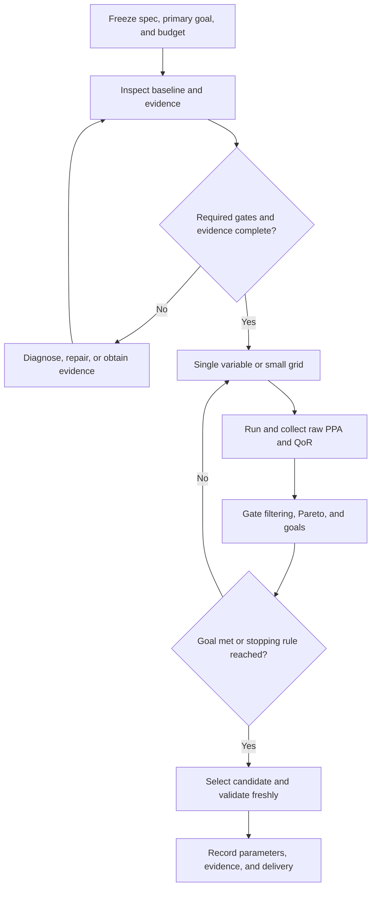

# ECC CLI User Manual for PPA Optimization and DSE

[Simplified Chinese](ecc-ppa-dse-guide.cn.md)

This manual helps chip designers and AI language models with CLI access configure an
ECC project from a design specification (spec), run RTL-to-GDS, optimize PPA/QoR,
explore early PNR stages, and deliver a result summary supported by evidence. It applies
to designs, PDKs, and EDA tools supported by the installed ECC runtime.

PPA means power, performance, and area; QoR measures implementation quality; DSE means
design space exploration. The main focus is physical implementation parameter tuning
under a fixed specification. Parameters or scores from one existing project are not
acceptance criteria for other designs.

Start with the [Tutorial](ecc-tutorial.en.md) for installation. Use the installed
version's `--help`, `param list/show`, and actual reports as the execution contract.
Example values explain the method; this manual is not an experiment log and does not
claim that its examples have met an optimization target.

Reading order: start at §3 for a new project or §8 for an existing baseline. Full-flow
parameter searches are in §9–§11, early PNR DSE in §17, mandatory result summaries in
§18, and the autonomous AI execution contract in §19.

For repeated tests, negative scenarios, and experience accumulation, use the
[ICS55 experience testing manual](../../ecc_experience/docs/ecc-experience-testing-guide.en.md) to preserve
evidence, evaluate recommendations, and manage knowledge versions. Unimplemented
interfaces are explicitly identified there.

## 1. Scope and capabilities

**Users and AI language models can use ECC CLI for bounded PPA/QoR parameter tuning
and DSE on supported chip designs.** An AI can discover parameters, read evidence,
propose experiments, create isolated candidates, run EDA, screen results, record a
winner, validate it in a fresh workspace, and export deliverables. Existing commands
provide this operation chain without requiring a new `ecc optimize` command.

The AI supplies decisions and orchestration. ECC supplies deterministic execution,
states, parameters, analyses, gates, and evidence. Neither guarantees a global optimum.
Coverage depends on constraints, process resources, installed EDA tools, and reports.

| Task | Current support | Usage |
| --- | --- | --- |
| Query projects/workspaces, run states, and effective parameters | Supported | project/workspace/status/config/param |
| Set candidate parameters in a fresh workspace | Supported | `ecc run --set KEY=VALUE` |
| Make small local changes to an existing candidate | Supported | Workspace-scoped param set/apply; rerun the invalidated suffix |
| Run full RTL-to-GDS, individual steps, or ranges | Supported | run/preset/resume/from/to/only/force |
| Explore early rtl2gds PNR stages | Supported with AI orchestration | Ranges, workspace derive, stage metrics, and external Pareto analysis; see §17 |
| Read stage metrics, timing/violations, and overall QoR | Supported | report step, report qor, report project, signoff check |
| Run a small deterministic parameter grid | Supported | sweep create/run/verify/compare |
| Rank, export matrices, and record a selected candidate | Supported | explore rank/export/promote |
| Compare before/after evidence within one workspace | Supported | report snapshot + compare run |
| Compare independent PPA candidates across workspaces | AI responsibility | Align comparable raw metrics from public reports in an external ledger |
| Export reproducible evidence and ECC signoff deliverables | Supported | reproducible and signoff export |
| Adaptive search, Pareto selection, and user budgets | AI responsibility | Small rounds and an external ledger; no built-in multi-objective optimizer |
| Automatically rewrite arbitrary RTL architectures and prove equivalence | Outside default parameter tuning | Separate RTL optimization task with functional validation and required LEC |
| GDS-level DRC and complete foundry signoff | Not guaranteed by current ECC | Current DRC conclusions cover the available checker evidence only |

**Recommended initial scope: freeze RTL, PDK, SDC, frequency, and acceptance corners;
tune only physical parameters connected to the actual EDA tools.** If no primary goal
is specified, report feasibility and the Pareto set instead of choosing an implicit
area/power/timing priority.

For the first few rtl2gds PNR steps, use staged DSE (§17): run inexpensive early stages,
then advance only a shortlist. Every early candidate need not run the full flow, but
a final improvement still requires full validation.

## 2. Responsibilities of the AI and ECC

| Responsibility | AI language model | ECC CLI / EDA |
| --- | --- | --- |
| Goals and budget | Interpret requirements, record hard constraints, limit candidates | Discover configuration and legal parameters |
| Diagnosis | Use paths, metrics, and logs to identify bottlenecks | Supply actual states, reports, checklists, and tool output |
| Search | Choose parameter groups, ranges, direction, and stopping rules | Execute the specified candidates |
| Interpretation | Check units, sources, stages, corners, and comparability | Produce raw PPA and QoR analyses |
| Ranking | Apply hard gates, Pareto analysis, user goals, and tolerances | Provide sweep's fixed status/QoR ranking |
| Reproduction and delivery | Record input digests, full parameters, environment, and selection reasons | Fresh runs, evidence packages, and signoff packages |

Change managed state through public CLI commands. Do not edit `project.json`,
`home/params.toml`, `home/flow.json`, analysis/checklist JSON, or generated Tcl to
manufacture a passing result. Read them when needed for diagnosis. Store the ledger,
hypotheses, and comparisons in a separate directory outside the workspace.



These hard gates determine whether an optimization candidate is acceptable.
**They do not change the current flow execution policy or make a blocked checklist
automatically prevent subsequent steps from running.** Execution policy and final
candidate acceptance are separate contracts.

## 3. Configure the design specification and create a project

### 3.1 How the spec, ECC configuration, and results relate

The spec declares function, inputs, constraints, acceptance, optimization goals,
allowed changes, and budget. Define acceptable results first, then allowed variables,
then execute experiments. ECC configuration carries supported execution fields;
the spec also carries user goals and requirements that the tools cannot directly express.

Keep these user-owned files in an independent input/experiment directory, outside
managed workspace directories such as origin/home/config:

- `design-spec.json`: the confirmed specification for this iteration. This manual
  proposes an external format; it is not a native ECC schema.
- `spec-resolved.json`: the execution specification with resolved paths, input
  digests, actual corners, tool/PDK versions, and supported parameters.
- `spec-coverage.md`: map each requirement to configuration/reports and mark it
  supported, requiring external verification, or currently unverifiable.
- `candidates.json` / `candidates.csv`: the experiment ledger; produce
  `optimization-summary.md` when the task ends.

**ECC does not automatically load these spec files. There is no `ecc --spec`
import interface for the format defined here.** Users or an AI read the spec,
configure through public project/param/PDK commands, and validate each requirement
with reports. An external spec cannot replace a valid SDC or actual workspace
parameter/input evidence.

### 3.2 Fill in the spec from requirements

| Category | What to specify | Configuration and verification |
| --- | --- | --- |
| Function | Operation/protocol, widths, latency/throughput, reset, interfaces, parameters, test acceptance | RTL and existing simulation/functional verification; flow success does not establish functionality |
| Design entry | RTL/filelist/top or matching DEF/netlist/SPEF; source and revision | Project fields such as design.rtl/top/netlist/def/spef; validate the entry step |
| Process and IP | Supported PDK, cells, macro models/LEF/Liberty, GDS when required | pdk.name/root and public resource overrides; match macros to actual instances |
| Timing | clock_port, frequency, clocks/generated clocks, IO budgets, uncertainty, loads, exceptions | design.clock_port/frequency_mhz/sdc; check actual SDC and path coverage |
| Corners | Required Liberty/RC/temperature combinations and setup/hold scope | Query/configure sta.liberty/signoff; validate final RCX/STA coverage |
| Physical requirements | Die/core area or fixed dimensions, aspect, macros, channels, IO/PDN/layers | Public floorplan/macro/route parameters and artifacts; preserve process rules |
| Power | Total/dynamic/leakage targets, units, activity model, corner | Valid power reports; disclose unsupported activity inputs |
| Optimization goal | Primary goal, hard constraints, weights/priorities, improvement threshold, tolerance | External Pareto/goal selection; QoR does not replace PPA goals |
| Allowed changes | Parameter allowlist/ranges; permission to change RTL/SDC/frequency/PDK/macros | Check fixed conditions; classify specification changes separately |
| Execution budget | Candidates, total/per-run time, CPU/RAM/storage, concurrency, retries | AI/external orchestration; include baseline, copies, retries, and fresh validation |
| Delivery | Stage DSE or a complete chip result, profile, required checkers, reports/exports | Distinguish executed/unverified work; apply final acceptance to complete results |

Specify whether an area limit refers to die_area, core_area, or cell_area. Define
whether performance means clock frequency, slack, throughput, or latency.
If area and power both matter without a stated tradeoff, retain the Pareto set;
do not invent weights when a unique selection is impossible.
Without power evidence, do not claim a power hard constraint is met. A user may
separately authorize exploration that does not promise final power acceptance.

### 3.3 Example spec for users and AI

This example assumes supplied RTL, one clock, and a supported PDK. Paths are relative
to the spec file and must point to real inputs. Adapt the top, frequency, budget,
ranges, and acceptance to the design. null means no user-set limit, not a zero
measurement. The example values are not universal recommendations.

```json
{
  "schema": "ecc-user-optimization-spec/1",
  "task": "ppa_and_pnr_dse",
  "design": {
    "name": "my_chip",
    "top": "chip_top",
    "rtl": ["inputs/rtl/chip_top.sv"],
    "clock_port": "clk_i",
    "frequency_mhz": 100.0,
    "sdc": "inputs/constraints/chip.sdc",
    "functional_verification": "use the supplied testbench and its acceptance criteria"
  },
  "pdk": {
    "name": "ics55",
    "root": "resources/icsprout55-pdk"
  },
  "timing": {
    "keep_all_supported_baseline_corners": true,
    "min_setup_ws_ns": 0.0,
    "min_hold_ws_ns": 0.0,
    "max_setup_violation_count": 0,
    "max_hold_violation_count": 0,
    "sdc_review_required": true
  },
  "objective": {
    "primary": "minimize_die_area",
    "keep_pareto": true,
    "improvement_goal_percent": 5.0,
    "comparison_tolerance_percent": 0.5,
    "max_die_area_um2": null,
    "max_total_power_uw": null,
    "power_comparison": "same activity model, source kind and corner"
  },
  "search": {
    "method": "staged_pnr_then_full_validation",
    "fixed_rtl": true,
    "fixed_sdc_frequency_pdk": true,
    "parameters": {
      "floorplan.core_util": [0.25, 0.30, 0.35],
      "place.target_density": [0.15, 0.20, 0.25]
    },
    "first_round_max_candidates": 3,
    "max_search_candidates": 8,
    "max_baseline_runs": 1,
    "max_fresh_validation_runs": 1,
    "max_failure_retries_per_candidate": 1,
    "max_total_hours": 8.0,
    "max_single_run_seconds": 3600,
    "max_concurrent_runs": 1,
    "max_threads": 4,
    "max_peak_memory_gib": 8,
    "max_workspace_storage_gib": 20
  },
  "acceptance": {
    "deliverable_scope": "full_rtl2gds",
    "signoff_profile": "rtl2gds",
    "required_checkers": ["drc", "lvs", "postRouteLec", "sta"],
    "required_artifacts": ["gds", "final_netlist", "spef"],
    "require_applicable_checklist_pass": true,
    "require_fresh_full_validation": true
  },
  "delivery": {
    "summary_required": true,
    "export_evidence": true,
    "export_signoff": true,
    "apply_project_defaults": false,
    "upload_or_publish": false
  }
}
```

The spec defines candidate ranges; it does not require a nine-point grid from the
two three-value ranges. The AI chooses points by stage and budget. Validate each
range against the current schema and physical capacity.
The eight search candidates exclude at most one baseline run and one fresh final
validation run. All executions share the total time and resource limits.
Report exhausted budgets or unmet goals; do not automatically add validation runs.

required_checkers is an independent acceptance requirement. It does not enable checks
skipped by the flow policy. For synthesis-level LEC, verify that the flow actually
includes/enables it and that public configuration is sufficient. If not, disclose the
gap instead of equating declaration with verification. Inspect real postRouteLec
proven evidence rather than only execution success. The signoff profile does not
replace required checkers, all checklist items, or additional physical acceptance.

For early PNR DSE only, explicitly scope delivery to a checkpoint such as place.
Later checkers/artifacts are not acceptance conditions for the completed early
stage, but remain unverified in the final summary. Do not downgrade a complete-chip
task to early DSE without authorization to claim success.

### 3.4 Map the spec to public ECC CLI commands

Confirm real inputs, directories, and a usable PDK first. The following is for a new
project. For an existing project, skip init and inspect its current state.
Replace generic paths with the actual task locations before execution.

```bash
PPA_PROJECT=/absolute/path/to/new-project
DESIGN_INPUTS=/absolute/path/to/design-inputs
DESIGN_PDK=/absolute/path/to/supported-pdk
PPA_EVIDENCE=/absolute/path/to/optimization-results/session-001
mkdir -p "$PPA_EVIDENCE"

ecc --version
ecc version --json
ecc init "$PPA_PROJECT" --project-name my_chip --design-name my_chip --plain
ecc rtl import --project "$PPA_PROJECT" --verilog "$DESIGN_INPUTS/rtl/chip_top.sv" --plain
ecc project set design.top chip_top --project "$PPA_PROJECT" --plain
ecc project set design.clock_port clk_i --project "$PPA_PROJECT" --plain
ecc project set design.frequency_mhz 100 --project "$PPA_PROJECT" --plain
ecc project set design.sdc "$DESIGN_INPUTS/constraints/chip.sdc" --project "$PPA_PROJECT" --plain
ecc project set pdk.name ics55 --project "$PPA_PROJECT" --plain
ecc pdk set-root "$DESIGN_PDK" --project "$PPA_PROJECT" --plain
ecc project set flow.preset rtl2gds --project "$PPA_PROJECT" --plain
ecc param show sta.liberty --project "$PPA_PROJECT" --json
ecc param show sta.signoff --project "$PPA_PROJECT" --json
ecc project show --project "$PPA_PROJECT" --plain
ecc doctor --project "$PPA_PROJECT" --json
ecc check --project "$PPA_PROJECT" --plain
```

rtl import copies and registers RTL/filelists; project set can declare existing
inputs. Avoid unintentionally replacing the entire source list. Check the installed
version's filelist/include/defines syntax. Macros/IP need matching logical, physical,
and timing models. Discover supported PDK corners through param/config and record
the actual combinations in spec-resolved. A phrase such as “all corners” is not a
substitute for checking actual report coverage.

Within authorization, users or an AI may write original RTL, testbenches, independent
SDC, and macro inputs, then register them through CLI. Use public commands for managed
parameters/state; do not hand-edit ecc.toml, project.json, workspace origin/home,
generated JSON/Tcl, or analysis/checklists. Mark missing configuration interfaces
unsupported in spec-coverage.

### 3.5 Timing, corners, physical constraints, and power

- Clock period is `T(ns)=1000/frequency_mhz`; 100 MHz means 10 ns. One frequency_mhz
  field does not fully constrain multiple/generated clocks. SDC must cover real clocks and interfaces.
- Without design.sdc, ECC generates a starter SDC. Review real IO delays, uncertainty,
  transition, loads, asynchronous domains, and valid exceptions. Zero IO delay is not
  automatically sufficient; do not add false paths to hide violations.
- Custom SDC is copied as supplied. Frequency/fanout parameter changes do not guarantee
  changes to user SDC; check the actual period against the spec every round. This
  manual uses one SDC input and does not require multi-SDC extensions.
- Library/RC/temperature combinations must form usable acceptance corners. Check both
  sta.liberty/signoff and actual RCX/SPEF/STA coverage. Configure supported JSON for
  nondefault combinations after checking resources; never remove failing corners to fake improvement.
- Use supported die_size configuration for fixed dimensions, or core_util/aspect/core_margin
  for utilization-based dimensions. Preserve tap/PDN/layer rules. Record unavailable
  GDS DRC or IR/EM verification separately; current DRC cannot establish those results.
- Freeze activity model, units, corner, and source_kind for power goals. If activity
  configuration or reports are insufficient, record assumptions/unknowns; guessed
  activity cannot establish power-budget compliance.
- Function, SDC, PDK, or acceptance changes are spec revisions. Save a new version,
  establish a separate comparable group, and generate a new baseline when necessary.

After configuration, fill spec-coverage with each requirement, command/file, actual
value, evidence, status, and gap. Freeze spec-resolved and input content digests
before searching. Parseable configuration and successful doctor/check establish
execution readiness, not final area, timing, power, or functional acceptance.

## 4. Define goals, comparability, and budget before tuning

### 4.1 Fixed conditions

Freeze these conditions within a comparable physical-parameter experiment:

- The same RTL/top/macro models; record file content, not just names.
- The same PDK, cell/macro LEF, Liberty, RC resources, and tool versions.
- The same SDC, frequency, IO timing, setup/hold uncertainty, and acceptance corners.
- The same flow, skip policy, and functional/equivalence requirements.
- The same activity assumptions, analysis corner, and source category for power.
- The same threads, device, seed, and environment, or explicitly record differences.

Lowering frequency, removing corners, disabling checkers, or relaxing SDC changes the
problem definition. It is not improvement under the original spec. Explore RTL
architecture, frequency, or corner changes in a separate experiment category with
its own baseline.

### 4.2 Primary goals and hard constraints

| Goal | Main comparison | Requirements that must still hold |
| --- | --- | --- |
| Area first | Final die_area or core_area; choose explicitly | Setup/hold, checklist, DRC/LVS, required LEC, outline, and macros |
| Timing first | Worst signed setup/hold WS, TNS, violation counts under the same spec | Area/power limits and other hard gates |
| Power first | Total/dynamic/leakage with identical source and activity assumptions | Timing, area, corners, and logic requirements |
| QoR first | Overall score and dimensions with the same profile/evidence coverage | Physical feasibility and actual signoff requirements |
| Combined PPA | Nondominated area/power/timing candidates | Select using the user's weights or priority |

Without PPA weights, do not simply multiply A×P×D: slack is not delay, and signed slack
does not fit that product. A user might request: “Meet 100 MHz and all setup/hold
requirements, then minimize die area without increasing power by more than 2%.”
This illustrates a goal statement, not default acceptance for every design.

### 4.3 Suggested budget

Start serially with at most three candidates. Use measured execution cost to plan
later rounds. An initial task may allow eight search candidates, one necessary
baseline, and one fresh final validation. Reuse a trustworthy existing baseline
when possible. Record candidate, total-time, per-run-time, CPU/RAM/storage limits
before launching.

Current sweep execution is serial with a `--max-candidates` prefix limit.
`ECC_SWEEP_TIMEOUT_SECONDS` defaults to 86400 seconds per subprocess. It is not a
total-project budget, memory limit, or guarantee of complete EDA child-process cleanup.
After a timeout, inspect states and confirm this task's processes have exited before
recovery. The AI manages total budget. Thread/corner parallelism controls resources;
it is not inherently a PPA improvement.

## 5. Interpret PPA and QoR

### 5.1 Raw PPA

| Metric | Required units/source | Interpretation |
| --- | --- | --- |
| die_area/core_area | µm²; same final layout stage | Synthesis cell area cannot replace final footprint |
| synthesis_cell_area | µm²; synthesis output | Early screening only, not final area |
| Setup/hold WS | ns; signed worst slack across all required corners | Larger positive values indicate margin; also inspect TNS/NVP |
| Setup/hold TNS and NVP | ns and count | One worst path is insufficient; missing is not zero |
| Total/dynamic/leakage power | µW or W; activity, corner, source_kind | Do not directly compare synthesis and powerAnalysis values |
| HPWL/GRWL/route wirelength/vias | Same stage, net population, and units | Diagnostic proxies, not final timing/DRC acceptance |
| Runtime/peak memory | s/MB; threads and device | Budget and benefit assessment |

In QoR metrics, `sta_setup_wns` / `sta_hold_wns` carry signed worst slack (WS).
Conventional WNS is `min(0, WS)`. Positive margin is not a violation, and candidates
with WNS=0 do not necessarily have identical timing.

### 5.2 Three layers of QoR

1. **Feasibility:** seven gates covering existing DRC/LVS, setup/hold slack,
   setup/hold NVP, and Harden artifacts.
2. **Evidence:** completeness, coverage, and consistency of analysis inputs.
   Missing/corrupt evidence remains UNKNOWN/NOT_VERIFIED.
3. **Quality:** timing/interconnect/area/power/robustness dimensions and scalar score.

Read `feasibility`, `evidence`, `scalar_summary`, `qor_record`, `diagnoses`,
`inflation`, `power`, and `flow_steps` together. The overall score alone is
insufficient. The seven QoR gates do not cover every checklist requirement or all
signoff-package delivery checks.

High QoR does not necessarily mean minimum area or power. Current area quality
prefers an actual core-utilization target range; timing quality can saturate after
its guardband. Increasing saturated timing margin may not increase overall score.
Without a valid power budget, power quality is null and excluded from the weight
denominator even when raw power was measured.

The engine has balanced/timing_critical/low_power/area_optimized profile logic, but
the current public schema does not include `qor_profile` or `qor_power_budget_w`.
Query the installed version first; unavailable keys return `unknown_parameter`.
**Do not set these through unsupported param interfaces or hand-edit managed files.**
Use an external ledger to compare raw PPA against user goals. External weights/budgets
are not native ECC QoR scores.

### 5.3 Structured report interfaces

Current `report qor --json` returns a record array. The QoR record includes
`overall_score`, `qor_status`, `gate_status`, and `dimensions`, with a full
v3 report under `qor`. It also writes a text report. `status=written` only means
the file was written. If the deployed version returns a summary only, use its public
reports to complete evidence rather than assuming nested fields exist.

`report step STEP --section analysis --json` returns a record array.
Read `metric/value/unit/source/direction` from `kind=metric` records and check
summary validity/missing metrics. `report project --json` provides a workspace
QoR/flow/step matrix, not a complete PPA ranking.

Check record success and valid values before using these QoR paths:

| JSON path | Purpose |
| --- | --- |
| `records[0].qor.scalar_summary.score` | Overall score; do not rank null as zero |
| `records[0].qor.qor_record.<dimension>.value/state` | Dimension bottlenecks and saturation |
| `records[0].qor.feasibility.status/gates` | Physical gates and their evidence |
| `records[0].qor.evidence` | Completeness and confidence |
| `records[0].qor.power.total_uw/source_kind/source_path/corner` | Raw power and provenance, independent of power quality scoring |

dimension is timing/interconnect/area/power/robustness. Supplement raw area and
per-corner timing with report step metrics. Not every step emits all metrics.
If a powerAnalysis analysis lacks a power metric, check whether QoR power provides
a valid total_uw with consistent provenance. Do not substitute zero or infer that
power was never measured from one missing interface.

## 6. Available tuning parameters

Run param list/show first. The table lists verified public keys and usual rerun
boundaries. Actual `from_step/invalidated_steps` from workspace parameter changes
and the persisted flow determine execution.

| Parameter | Meaning/type | Use | Usual earliest affected stage |
| --- | --- | --- | --- |
| `floorplan.core_util` | float; planned utilization in die_util mode | Area/routability tradeoff | preFloorplan |
| `floorplan.aspect_ratio` | float; width/height | Wirelength, channels, outline | preFloorplan |
| `floorplan.core_margin` | JSON pair of integers, µm | Edge/IO/PDN space | floorplan |
| `floorplan.die_builder.mode`, die_size width/height_micron | Mode and fixed dimensions | Fixed-die experiments | floorplan |
| `place.target_density` | float; current range 0.1–0.95 | Placement compactness/congestion | place |
| `place.target_overflow` | float; 0–1 | Placement stopping threshold | place |
| `place.routability_opt` | int; 0/1 | Congestion-driven placement | place |
| `place.cell_padding_x` | int; database units (dbu) | Pin access/congestion tradeoff | place |
| `place.random_seed`, `place.deterministic_flag` | Check schema types and conditions | Reproduction; seed validation when needed | place |
| `cts.skew_bound` | Current schema: str; physical quantity: ns | CTS skew/area/power tradeoff | CTS |
| `cts.max_fanout` | int; current range 1–200 | Clock-tree structure | CTS; may also affect generated SDC, so inspect invalidation |
| `cts.routing_layer`, `cts.buffer_type` | JSON lists | Supported clock layers/buffer cells | CTS |
| `timing_opt.hold_margin` | float; current default 0.1 ns; negatives rejected by tool | Sizer hold-only margin | Timing optimization |
| `route.bottom_layer`, `route.top_layer` | Process-layer strings | Routing capacity, RC, vias/wirelength | May affect placement routing proxies and Sizer; inspect invalidation |
| `macro.placements` / `ecc macro` | Legal macro positions/orientations | Macro channels and critical wires | macroPlacement |

floorplan.core_util, place.target_density, and final core_utilization are distinct.
Density does not directly determine die area. A higher target_density is not itself
area reduction. In die_size mode, changing core_util may not control dimensions;
inspect the effective configuration.

Do not initially use these as PPA search variables:

- `place.global_right_padding` currently has no actual tool-field mapping.
- `place.num_threads` and `sta.max_parallel_corners` mainly manage resources.
- Process rules, PDN, and acceptance corners cannot be weakened as optimization knobs.
- Invented keys such as `cts.target_skew` or guessed sizing/DRC fields do not replace schema keys.
- Public Sizer hold_margin does not provide arbitrary setup sizing/recovery controls.

For advanced synthesis experiments, current Yosys scripts read `YOSYS_SYNTH_STRATEGY`,
defaulting to `DELAY 4`, with DELAY/AREA/BALANCE families. This is not an `ecc param`
key and cannot be supplied as `--param synthesis.strategy` in a sweep.
Only change it in a separate fresh experiment after checking valid strategy indices
for the runtime. Record the environment and retain original SDC/frequency/LEC
acceptance. Keep synthesis strategy fixed in the first round.

## 7. Recommended search strategy

### 7.1 Three workable approaches

| Approach | Benefit | Cost/limit | Recommended use |
| --- | --- | --- | --- |
| AI-guided fresh workspace experiments | Change a few parameters based on each round's diagnosis; clear project matrix | AI maintains the ledger and full parameter vectors | Default for adaptive searches and macro/array configuration |
| Small ECC sweep grid | Deterministic plan with result management/export | Serial full flows, copied candidate projects, fixed QoR ranking | Small batches with two or three scalar ranges already justified |
| Local iteration in one experiment workspace | Reuse a valid prefix to save execution | Prior results are replaced; save before/after evidence | Test a specific cause, then validate the final candidate independently |

**Recommended sequence: diagnosis and single-variable experiments, a small sweep
to check the local region, then fresh full validation.** Avoid the Cartesian product
of ten parameters; add a parameter group only when evidence supports it.

Early PNR provides a lower-cost entry. `workspace derive --from` preserves a
valid prefix, and `run --from --to` controls checkpoints. Current sweep has no range
options and is not a staged DSE scheduler. Early rankings cannot depend on final
overall QoR. See §17 for reuse conditions, metrics, and commands.

### 7.2 Choose parameters from the root cause

| Observation | First action | Side effects to check |
| --- | --- | --- |
| Failed flow, missing files, unreadable checker evidence | Fix tools/inputs/evidence; resume at the producing step | Density searches cannot bypass input/tool failures |
| Large final area with adequate routability | Increase core_util slightly in die_util mode; consider aspect | Setup/hold, congestion, legality, DRC/LVS |
| Congestion, long wires, routing nonconvergence | Locate macro/channel/pin hotspots; explore density/padding/routability | Area, RC, power, hold |
| Setup failure | Separate cell delay, data nets, clock skew, and constraint errors | Hold, buffers/area/power, LEC |
| Hold failure | Check fast/MIN libraries, Sizer hold pass, CTS; tune hold_margin with evidence | Setup, area, power; final RCX/STA validation remains required |
| Excessive clock power/buffers | Check legal fanout/skew/buffer/layer combinations | Setup/hold, transition/capacitance, tree structure |
| Power over budget | Separate dynamic/leakage/clock power and source | Do not win by reducing frequency or changing activity assumptions |
| Low QoR with passing hard gates | Inspect valid limiting dimensions and diagnoses | Do not sacrifice real PPA for scoring thresholds |
| LVS/LEC failure | Fix connectivity, models, or logic transformations | A parameter grid does not establish logical correctness |

### 7.3 Coarse screening, refinement, Pareto, and validation

1. Establish baseline cost and root cause, then try three nearby legal values of one variable.
2. Preserve raw PPA and failed candidates.
3. Once a feasible region exists, reduce the step size or add one variable in the
   best two regions, usually a 2×2 grid.
4. If the gain depends on randomness, repeat shortlisted candidates under consistent
   controls. Do not select only a lucky seed.
5. Apply Pareto filtering to feasible candidates with complete, comparable evidence.
6. Select using the user's primary goal/tolerance and reproduce with a fresh full run.

For area/power/timing tradeoffs, A dominates B only when A is no worse on every
selected raw objective and improves at least one beyond tolerance.
Retain multiple nondominated candidates when appropriate rather than declaring
a unique optimum.

## 8. Prepare the baseline and candidates

These Bash templates require real paths, inputs, and unused experiment names from
the confirmed spec. After each execution, check the exit code and business state
before proceeding; the snippets are not scripts to run blindly through failures.
Snapshot destinations must be outside the workspace, have an existing parent
directory, and not already exist. Select project/workspace explicitly to avoid
errors when an AI changes working directory.

```bash
PPA_PROJECT=/absolute/path/to/project
PPA_BASELINE=baseline-001
PPA_EVIDENCE=/absolute/path/to/optimization-results/session-001
mkdir -p "$PPA_EVIDENCE"

ecc --version
ecc version --json
ecc project show --project "$PPA_PROJECT" --plain
ecc config --project "$PPA_PROJECT" --json
ecc doctor --project "$PPA_PROJECT" --json
ecc check --project "$PPA_PROJECT" --plain
ecc param list --all --project "$PPA_PROJECT" --json
ecc status --project "$PPA_PROJECT" --workspace "$PPA_BASELINE" --json
ecc report step --project "$PPA_PROJECT" --workspace "$PPA_BASELINE" --json
ecc param diff --project "$PPA_PROJECT" --workspace "$PPA_BASELINE" --plain
ecc param show floorplan.core_util --project "$PPA_PROJECT" --workspace "$PPA_BASELINE" --json
ecc param show place.target_density --project "$PPA_PROJECT" --workspace "$PPA_BASELINE" --json
```

If there is no trustworthy baseline, create a full baseline using an unused name:

```bash
ecc run --project "$PPA_PROJECT" --workspace "$PPA_BASELINE" --preset rtl2gds --plain
```

Use the same spec as subsequent experiments. The current `syn_sta` preset runs
synthesis only; it is not final routed STA. Synthesis proxies may support early
screening but cannot establish complete PPA acceptance.

Collect and save baseline evidence:

```bash
ecc diagnose run --project "$PPA_PROJECT" --workspace "$PPA_BASELINE" --json
ecc signoff inspect --project "$PPA_PROJECT" --workspace "$PPA_BASELINE" --json
ecc report qor --project "$PPA_PROJECT" --workspace "$PPA_BASELINE" \
  -o "$PPA_EVIDENCE/baseline-qor.txt" --json > "$PPA_EVIDENCE/baseline-qor.json"
ecc report checklist --project "$PPA_PROJECT" --workspace "$PPA_BASELINE" \
  -o "$PPA_EVIDENCE/baseline-checklist.txt" --json
ecc report step sta --project "$PPA_PROJECT" --workspace "$PPA_BASELINE" \
  --section analysis --json > "$PPA_EVIDENCE/baseline-sta.json"
ecc report step poweranalysis --project "$PPA_PROJECT" --workspace "$PPA_BASELINE" \
  --section feature --section analysis --json > "$PPA_EVIDENCE/baseline-power.json"
ecc report snapshot --project "$PPA_PROJECT" --workspace "$PPA_BASELINE" \
  -o "$PPA_EVIDENCE/baseline.snapshot.json" --json
ecc signoff check --project "$PPA_PROJECT" --workspace "$PPA_BASELINE" --json
```

`signoff inspect` refreshes analysis; report qor/checklist write reports.
`signoff check`, diagnose, status, and report step inspect existing results.
Ensure no other task is running or changing the workspace while reading.
A blocked diagnosis leads to root-cause investigation: a nonzero quality exit
code is not a JSON parsing failure or an unconditional end to all investigation.

Project defaults may differ from an existing workspace's effective parameters.
`param diff --workspace` shows local overrides but may omit creation-time
`run --set` values. Combine param show, saved snapshot parameters, creation
override records, and derived configuration into a complete parameter vector.
Explicitly carry all required differences into fresh candidates; otherwise the
experiment is not a single-variable change.

## 9. Procedure A: independent candidates created by an AI

Values demonstrate syntax, not universal optima. Assume a frozen baseline with
core_util=0.30, target_density=0.20, and all other inputs/parameters fixed:

```bash
PPA_CANDIDATE=ppa-density-015-001
ecc run --project "$PPA_PROJECT" --workspace "$PPA_CANDIDATE" --preset rtl2gds \
  --set floorplan.core_util=0.30 --set place.target_density=0.15 --plain

ecc status --project "$PPA_PROJECT" --workspace "$PPA_CANDIDATE" --json
ecc report step placement --project "$PPA_PROJECT" --workspace "$PPA_CANDIDATE" --json
ecc report step sta --project "$PPA_PROJECT" --workspace "$PPA_CANDIDATE" --section analysis --json
ecc report qor --project "$PPA_PROJECT" --workspace "$PPA_CANDIDATE" \
  -o "$PPA_EVIDENCE/$PPA_CANDIDATE-qor.txt" --json \
  > "$PPA_EVIDENCE/$PPA_CANDIDATE-qor.json"
ecc diagnose run --project "$PPA_PROJECT" --workspace "$PPA_CANDIDATE" --json
ecc signoff check --project "$PPA_PROJECT" --workspace "$PPA_CANDIDATE" --json
ecc report snapshot --project "$PPA_PROJECT" --workspace "$PPA_CANDIDATE" \
  -o "$PPA_EVIDENCE/$PPA_CANDIDATE.snapshot.json" --json
ecc report project --project "$PPA_PROJECT" --json
```

Create only if the candidate name is unused. Do not use `--overwrite` to pretend
an existing candidate is fresh. `--set` applies at creation, not to an existing workspace.

Update the ledger after every candidate. Inspect completion of all requested steps,
checklists, and signoff rather than only run's exit code.
Choose the next round from metric changes and failure causes, not unbounded expansion.

## 10. Procedure B: a small sweep

### 10.1 Create and execute

For the same verified baseline, hold core_util constant and search placement density:

```bash
PPA_SWEEP=ppa-density-r1
ecc sweep create --project "$PPA_PROJECT" --name "$PPA_SWEEP" \
  --param floorplan.core_util=0.30 \
  --param place.target_density=0.15,0.20,0.25
ecc sweep show --project "$PPA_PROJECT" --name "$PPA_SWEEP" --json
ECC_SWEEP_TIMEOUT_SECONDS=3600 ecc sweep run --project "$PPA_PROJECT" \
  --name "$PPA_SWEEP" --max-candidates 3 --json
ecc sweep verify --project "$PPA_PROJECT" --name "$PPA_SWEEP"
ecc sweep compare --project "$PPA_PROJECT" --name "$PPA_SWEEP" --json
ecc explore rank --project "$PPA_PROJECT" --name "$PPA_SWEEP" --json
ecc explore export --project "$PPA_PROJECT" --name "$PPA_SWEEP" \
  --format csv --output "$PPA_EVIDENCE/$PPA_SWEEP.csv"
ecc explore export --project "$PPA_PROJECT" --name "$PPA_SWEEP" \
  --format json --output "$PPA_EVIDENCE/$PPA_SWEEP.json"
```

The 3600-second per-run limit is illustrative; derive it from baseline cost.
Validate parameters and physical plausibility before execution.
sweep create parses `KEY=VALUE[,VALUE]` and creates a plan; **it does not establish
schema validity or physical feasibility for every value**. Actual run validates overrides.

Commas separate values. JSON arrays/objects containing commas do not fit this
interface. Use quoted `run --set` in Procedure A or workspace param apply;
do not guess an array sweep syntax.

### 10.2 Paths and scope

Candidates use this layout without directly changing the original project manifest
or baseline:

```text
<project>/experiments/<name>/
  sweep.json
  results.json
  winner.json                  # present only after promote
  candidates/candidate_0001/project/
    ecc.toml
    project.json
    candidate_0001/            # candidate workspace
```

Candidate projects inherit project configuration, not historical workspace-local
parameters. Query both the candidate project and its workspace. The original
project's report project is not the sweep candidate list.
Confirm actual directories from recorded workspace paths. Current copying excludes
experiments/.git/ws_* directories; other historical directories may be copied.
Budget the storage cost.

```bash
PPA_CAND_PROJECT="$PPA_PROJECT/experiments/$PPA_SWEEP/candidates/candidate_0001/project"
ecc report step sta --project "$PPA_CAND_PROJECT" --workspace candidate_0001 --section analysis --json
ecc report qor --project "$PPA_CAND_PROJECT" --workspace candidate_0001 \
  -o "$PPA_EVIDENCE/candidate_0001-qor.txt" --json
```

### 10.3 Sweep states and integrity checks

- A `passed` candidate requires a successful complete flow, passing checklist,
  valid overall QoR, and explicitly passing signoff.
- Signoff exit 7 cannot yield passed; missing scores stay null.
  blocked/failed/unknown candidates cannot be promoted.
- Passing `sweep verify` establishes consistency of plan/results, parameters,
  states, exit codes, and evidence. It does not mean all candidates passed.
  Legitimate blocked/failed/unknown records can pass integrity validation.
- `--max-candidates N` limits execution to the first N planned candidates,
  not N additional candidates per invocation. After running two of three,
  verification reports a missing result as expected. Audit after completing the plan.
- Candidates with existing results and workspaces have evidence recollected,
  without automatically rerunning EDA. Recover a failure through its public
  run/resume or create a new experiment; repeated sweep run does not fix a design.
- Current caching preserves the original candidate run's exit_code. External
  recovery followed by evidence recollection does not rewrite the failed execution
  record. Prefer a new candidate/sweep and retain the recovery ledger.
- Ranking orders passed, blocked, failed, unknown, then descending QoR within
  each class. It is not area/power/timing Pareto ranking or a global optimum guarantee.

## 11. Procedure C: local iteration on an existing candidate

Use a dedicated experiment workspace, not the baseline. Save snapshots/reports before
changing parameters. Prefer apply for a related batch: it validates the whole batch
before writing.

```bash
PPA_ITER=ppa-iter-001
ecc report snapshot --project "$PPA_PROJECT" --workspace "$PPA_ITER" \
  -o "$PPA_EVIDENCE/iter-before.snapshot.json" --json
ecc param apply --project "$PPA_PROJECT" --workspace "$PPA_ITER" \
  --set place.target_density=0.25 --set place.target_overflow=0.08 --plain
ecc param show place.target_density --project "$PPA_PROJECT" --workspace "$PPA_ITER" --json
ecc run --project "$PPA_PROJECT" --workspace "$PPA_ITER" --resume --plain
ecc report snapshot --project "$PPA_PROJECT" --workspace "$PPA_ITER" \
  -o "$PPA_EVIDENCE/iter-after.snapshot.json" --json
ecc compare run --baseline "$PPA_EVIDENCE/iter-before.snapshot.json" \
  --current "$PPA_EVIDENCE/iter-after.snapshot.json" --json
```

Create and run ppa-iter-001 beforehand; the example does not apply to an unknown
workspace. Reuse only when the reported invalidation covers the real changes and
the upstream prefix remains valid. `--only place --force` invalidates downstream
steps. After running just place or place→route, restore the full suffix before
using STA/power/Harden as current final evidence.

### 11.1 Current compare boundaries

Use `ecc compare run` and `ecc report snapshot -o FILE`.
There is no top-level `ecc snapshot`, and `ecc run compare` is not the interface.
compare is offline and takes saved files, without project/workspace options.

**Current compare marks different workspaceId values `different_workspace` and
numeric trends unknown.** It supports before/after iteration in the same workspace.
Do not claim automatic trustworthy improvement for independent candidates or a
baseline/final pair across workspaces.

Align metric id, scope, corner, analysis_group, and unit from public reports/saved
snapshots in an external PPA table. Independently verify input content and versions.
Do not edit snapshot workspaceId to bypass comparability checks.
Even `overall=improved` is a numeric trend summary, not signoff or winner acceptance.

## 12. Experiment ledger and selection rules

Record at least these fields for every candidate. Use null/UNKNOWN for missing values:

| Category | Required records |
| --- | --- |
| Identity and hypothesis | Experiment/candidate, project/workspace, changes from baseline, expected effect |
| Comparability | RTL/SDC/PDK/tool content or version digests, frequency, corners, flow/skip/LEC policy |
| Effective parameters | Full creation overrides, workspace overrides, macros, environment, seed/threads/device |
| Raw PPA | Die/core/synthesis area; setup/hold WS/TNS/NVP; power total/components/source/activity |
| Feasibility | Step states, checklist blockers, DRC/LVS/LEC, Harden, STA/RCX coverage |
| QoR | Feasibility, evidence, profile, five dimensions, scalar score, diagnoses |
| Cost | Exit codes, failing step, runtime, peak memory, timeout |
| Decision | Comparability reasons, feasibility, dominance, shortlist/rejection reasons |

Suggested final matrix:

```text
candidate | flow | checklist | signoff | area_um2 | power_uw | power_source
          | setup_ws_ns | hold_ws_ns | setup_nvp | hold_nvp
          | drc | lvs | lec | qor | evidence | runtime_s | decision
```

Selection order: comparable specs/data → exclude hard-gate failures and incomplete
required evidence → Pareto → primary goal/tolerance → prefer fewer changes and reproduction.
A feasible lower-QoR candidate may better match the user's PPA goal.
A high-QoR blocked candidate cannot be a complete-delivery winner.

Area/power reduction is `(baseline-current)/baseline` for a valid positive baseline.
Report slack improvement as an ns difference, not an ordinary percentage on negative
slack that hides remaining failure. Differences below repeat-run variation are not
proven improvements.

## 13. Winner selection, fresh validation, and delivery

### 13.1 Record the selection

For a sweep candidate, promote only after confirming passed and the user's PPA goal:

```bash
ecc explore promote --project "$PPA_PROJECT" --name "$PPA_SWEEP" --candidate candidate_0002 --json
```

candidate_0002 illustrates syntax, not a winner already selected by this manual.
promote records the winner; it neither copies it over the baseline nor changes project
defaults. For Procedure A, record the selection reason and parameter vector externally.

### 13.2 Fresh validation

Collect all winner parameters, macro conditions, and environment. Validate in an unused
workspace of the original project with explicit overrides.
This is a two-parameter example; carry every actual winner difference:

```bash
PPA_FINAL=ppa-final-001
ecc run --project "$PPA_PROJECT" --workspace "$PPA_FINAL" --preset rtl2gds \
  --set floorplan.core_util=0.30 --set place.target_density=0.25 --plain
ecc signoff inspect --project "$PPA_PROJECT" --workspace "$PPA_FINAL" --json
ecc report qor --project "$PPA_PROJECT" --workspace "$PPA_FINAL" \
  -o "$PPA_EVIDENCE/final-qor.txt" --json > "$PPA_EVIDENCE/final-qor.json"
ecc signoff check --project "$PPA_PROJECT" --workspace "$PPA_FINAL" --json
ecc report snapshot --project "$PPA_PROJECT" --workspace "$PPA_FINAL" \
  -o "$PPA_EVIDENCE/final.snapshot.json" --json
```

Compare raw PPA, all required corners, checklist/LEC, and target tolerances again.
If validation fails, retain the winner as a candidate result and investigate.
Do not report a reproduced final improvement.

If project-default promotion is authorized, use project-scoped `param apply` to
atomically apply the full selected parameters after validation. This affects future
fresh workspaces, not existing ones. Record parameter, environment, and macro promotion
separately; param diff alone is insufficient.

### 13.3 Two export types

```bash
ecc reproducible export --project "$PPA_PROJECT" --workspace "$PPA_FINAL" \
  --output "$PPA_EVIDENCE/final-evidence.tar.gz"
ecc reproducible verify --package "$PPA_EVIDENCE/final-evidence.tar.gz" --json
ecc reproducible report --package "$PPA_EVIDENCE/final-evidence.tar.gz" --json
ecc signoff export --project "$PPA_PROJECT" --workspace "$PPA_FINAL" \
  -o "$PPA_EVIDENCE/final-signoff.tar.gz" --plain
```

A reproducible package retains collected evidence and manifest/hash audit data.
Passing verify proves package integrity, not design signoff or automatic inclusion
of all RTL, EDA binaries, PDK, and power activity inputs.
Current export mainly collects project configuration and workspace home/config/reports/results.
It is not a complete toolchain image that can rerun on any machine.

signoff export performs separate delivery checks and design artifact packaging,
and may block on missing required evidence. Supplement the ledger with inputs,
environment/versions, raw PPA comparisons, and explicit unverified items.

## 14. Exit codes and exception handling

| Situation | Common current return | AI action |
| --- | --- | --- |
| Normal query/execution | 0 | Also read business state, gates, and evidence |
| diagnose failed/blocked | 6 | Save JSON and investigate; not passed |
| signoff check hard-gate failure | 6 | Fix the cause; do not promote |
| signoff check cannot rate required evidence | 7 | UNKNOWN; obtain real evidence |
| sweep verify integrity failure | 6 | Distinguish incomplete plans, corrupt fields, stale passed, and missing files |
| Parameter/usage error | Usually 1 or 2, per command | Correct the request; do not count a successful candidate |
| Timeout | Nonzero timeout code | Inspect this task's processes, budget, and recovery boundary |

A script that abandons optimization on every nonzero code can discard useful quality
failure evidence. A blanket `|| true` can hide invalid parameters or execution errors.
Record the command, exit code, stdout/stderr, business status, and root cause.
Do not let multiple tasks tune, run, refresh, or export the same workspace concurrently.

## 15. GCD teaching example: applying the method

A greatest-common-divisor (GCD) unit illustrates the decision process. This small
example does not represent cost, parameter feasibility, or PPA for designs with
macros, multiple clocks, high utilization, or large scale.
Configure and accept every other design against its own spec.

Assume confirmed GCD top/clock, 100 MHz, a supported PDK, one valid SDC, all required
corners, and a trustworthy baseline with core_util=0.30 and target_density=0.20.
These are teaching assumptions, not universal ECC defaults or a validated optimum.

1. Use §3 to specify “retain 100 MHz and original timing/verification scope, prioritize
   die_area reduction.” Supply power constraints or explicitly exclude power from
   selection. A 100 MHz clock has a 10 ns period.
2. Inspect baseline flow, fresh input/parameter evidence, checklist/signoff,
   per-corner setup/hold, and power provenance. Diagnose missing artifacts/LEC or
   blockers; do not delete requirements or change state to bypass verification.
3. If setup margin is sufficient, prioritize area, interconnect/congestion, and hold
   risk rather than tightening CTS merely to increase setup margin. Saturated timing
   quality may not improve overall QoR with more margin.
4. Density values 0.15/0.20/0.25 can illustrate a trial. Check capacity, padding,
   and congestion first; record unplaceable points as failures. For area, also
   explore actual size controls such as core_util/die_size.
5. Measure gains at the same stage, corner, and source. Start with three candidates
   and refine the neighborhood from the evidence.
6. Fully validate the shortlist and report baseline/candidate/final PPA, QoR,
   states, and stopping reasons using §18.

A new user can build GCD with the tutorial, then use §9 for full-flow candidates
or §17 for staged candidates. For another design, replace RTL/top/SDC, PDK,
ranges, budget, and constraints. Check macro models, LEF/Liberty/GDS, and channels
before applying the method to a macro design; macro-free GCD does not prove its feasibility.

## 16. Stopping rules and capability limits

Stop when the target is met and reproduced; candidate/time/resource budget is exhausted;
two successive rounds have no improvement beyond tolerance; the remaining bottleneck
is outside public parameters/tool coverage; required evidence is unobtainable; or
inputs/measurements are no longer comparable. Report “best validated candidate within
budget,” not global optimum. Without a valid gain, retain the baseline and still summarize.

| Current limit | User/AI action |
| --- | --- |
| Cross-workspace compare does not automatically establish comparability | Check input content, stage, corner, source, and units externally |
| Sweep has fixed status/QoR ranking and no early ranges or staged advancement | Select raw PPA/Pareto externally; orchestrate derive/ranges for early stages |
| No public QoR profile/power-budget parameter | Retain the profile; apply user budgets externally without faking native scores |
| Scalar comma sweep syntax and limited cached recovery | Use public run/param for arrays; diagnose and create fresh candidates when needed |
| Evidence package is not a complete execution environment image | Supplement input digests, PDK/tool versions, constraints, and environment |
| Total budgets/resources need external management | Default to serial; count baselines, copies, failed retries, and fresh validation |
| Other PDK, GDS DRC, IR/EM coverage may be limited/unavailable | Discover real capabilities; summarize unsupported verification instead of claiming pass |

Current project validation supports the PDK name ics55. The method generalizes to
other designs; renaming a PDK does not port a process. Other PDKs require actual
integration and resource validation in the deployed version.
This manual does not depend on new multi-SDC, EDA lint, or GDS DRC commands.
Input functional verification and real constraint review remain required.

## 17. DSE for early rtl2gds PNR stages

### 17.1 Current support

**ECC already provides the execution primitives for early PNR DSE. An AI can choose
experiments, screen stage results, and advance candidates. Current sweep/explore
does not provide complete staged DSE orchestration.**

Here, DSE explores floorplan, placement, and CTS parameter combinations under a fixed
design spec, compares area/interconnect/congestion/clock-tree quality, and narrows
the candidate set. Initial exploration covers physical implementation parameters,
not automatic RTL architecture rewrites.

| Primitive | Current status | Role in early DSE |
| --- | --- | --- |
| Fresh `run --from A --to B --set …` | Available | Create an independent candidate and execute only its range |
| `workspace create --from A --to B --set …` | Available | Register a candidate before executing it |
| `workspace derive SOURCE TARGET --from STEP` | Available | Preserve earlier state/artifacts, reset the named step and its suffix |
| Workspace `param set/apply` | Available | Modify a branch, regenerate configuration, invalidate affected suffix |
| report step feature/analysis/checklist/outputs | Available | Read metrics, execution evidence, intermediate DEF/Verilog |
| report snapshot and same-workspace compare run | Available | Save checkpoints and inspect before/after iteration |
| Sweep range options, early stopping, staged advancement | Unavailable | Orchestrate public CLI calls through an AI |
| Built-in early-stage score and cross-candidate Pareto | Unavailable | Maintain an external stage ledger, separate from overall ECC QoR |

`derive --from place` means rerun place and subsequent steps. It does not mean
copy only files starting at place. Current implementation copies the source workspace,
clears the selected suffix's states/artifacts/checklists in the target, and preserves
earlier steps. The source remains unchanged; the target receives a new engineering
identity and branch registration. This is not a hard-link cache or zero-copy operation;
budget disk space and copying time.
**Without `--from`, derive prepares the entire flow for rerun and does not save
synthesis/early-stage execution.**

The source must be managed and have an Engineering Snapshot. Do not forcibly copy
an old workspace or manufacture a missing snapshot. Use public compatibility/migration
procedures or a fresh range entry below. Derivation does not prove prefix validity;
verify inputs, parameters, successful states, and complete artifacts.

### 17.2 Stage boundaries and useful variables

The usual early rtl2gds sequence is:

```text
Synthesis → lec (subject to the existing skip policy) → preFloorplan → macroPlacement
→ postFloorplan → place → CTS → legalization → Timing optimization → route → …
```

Start by covering through place. Execute CTS/legalization only for a shortlist.
If hold is a real bottleneck, then explore the existing Sizer's
`timing_opt.hold_margin`. Use the workspace's persisted step names.

| Stage | Initial variables | Results to screen | Reuse boundary after changes |
| --- | --- | --- | --- |
| preFloorplan / postFloorplan | `floorplan.core_util`, `floorplan.aspect_ratio`; core_margin/supported die_size when needed | Outline, area, actual core utilization, available capacity, macro/channel/PDN evidence | Reuse fixed synthesis; rerun floorplan and later stages |
| macroPlacement | Public `macro.placements` / macro commands; legal coordinates/orientations | Macro legality, channels, pin access, later routability | Reuse only the unchanged prefix before macro placement |
| place | `place.target_density`, `place.cell_padding_x`, `place.routability_opt` | HPWL, GRWL, EGR overflow, RUDY; convergence, artifacts, applicable checklist | Reuse the candidate's valid postFloorplan; rerun place and later stages |
| CTS / legalization | `cts.skew_bound`; add max_fanout/buffer_type/routing_layer with evidence | Skew, clock wirelength, buffer count/area, tree depth, legalization | Reuse valid placement subject to actual param invalidation |
| Timing optimization | `timing_opt.hold_margin` | Real hold-pass output, insertion cost, later setup/hold risks | Reuse the valid prefix; validate full RCX/STA last |

Do not explore every variable in round one. Hold macros/CTS fixed and find a feasible
region with one floorplan and one placement variable. In macro designs, resolve
macros/channels before cell density. If GCD has no relevant hard-macro search benefit,
do not invent a macroPlacement dimension.

core_util controls floorplan capacity/dimensions; target_density is a placement
objective. They are not interchangeable and need not be equal. Check the tool's
definitions of placeable area, macros/blockages, and padding before changing them.
Schema validity does not establish capacity. Fixed die_size also does not imply
core_util changes shrink the die.

place.target_overflow is a placement stopping objective; EGR overflow is a different
congestion observation. Lowering the stopping threshold does not prove routing
violations are eliminated. Relaxing the stopping condition is not quality improvement.
Freeze seed, threads, and device in round one. Measure random robustness separately
on shortlisted candidates rather than mixing it into the main search variables.

### 17.3 Stage metrics and acceptance

The current code registers and extracts these metrics. **Registration does not
guarantee a value in every run.** Check valid values, source, units, and missing-data
explanations. Coverage varies by version, design, and tools.

| Reporting stage | Example metrics | Interpretation limits |
| --- | --- | --- |
| postFloorplan | `die_area`, `die_width`, `die_height`, `die_utilization`, `core_utilization` | Current outline/utilization; placement changes on a fixed floorplan need not reduce die_area |
| place | `place_hpwl`, `place_grwl`, `place_flute_wirelength` | Interconnect proxies, generally lower is better; not final routed length/timing |
| place | `place_congestion_egr_overflow_total/max`, `place_rudy_utilization_max`, `place_lutrudy_utilization_max` | Congestion proxies; interpret hotspots/layers/net population, not routed DRC |
| CTS | `cts_buffer_count`, `cts_buffer_area`, `clock_wirelength`, `clock_path_max_buffer` | Clock-tree cost/structure proxies, not full clock power |
| CTS | `cts_worst_optimized_skew_ns`, `cts_worst_max_insertion_latency_ns`, `cts_skew_target_unmet_count`, `cts_clock_tree_max_level` | Current CTS timing_quality evidence, not final setup/hold across all corners |
| legalization / Timing optimization | Actual feature/analysis/checklist results from this run | Unreported legality or intermediate STA cannot be marked passed |

Early stages generally lack final power, multi-corner setup/hold, RC, and routed
DRC/LVS evidence. Record proxies only when tools actually provide them and identify
the estimation stage/model. This workflow requires no new EDA tool integration and
does not make unavailable GDS DRC a prerequisite.

Use distinct external ledger states for execution, screening, and final acceptance:

- `stage_completed`: the range finished with successful expected steps;
  artifacts/checklists still need inspection.
- `stage_eligible`: required stage evidence is complete and predefined stage
  constraints pass.
- `stage_rejected`: execution failure, stage hard-constraint failure, or a confirmed
  checklist blocker; preserve the reason.
- `stage_unknown`: missing required metrics/artifacts, unclear sources, or
  incomparable evidence; missing data earns no ranking advantage.
- `final_verified`: full shortlist validation meets original PPA, required
  checklists, and actual signoff requirements.

These are external experiment labels, not new states written into ECC flow/checklist JSON.
Stage acceptance evaluates real requirements of executed stages. Later gates remain
unverified. Early completion may leave overall QoR NOT_RATED/null, signoff exit 7,
or exit 6 for an existing blocker. Such results do not automatically prohibit
early DSE and do not establish complete passed status.
Current sweep candidates require valid overall QoR and full signoff pass; do not
force-promote early candidates.

Record stage constraints before running, such as usable DEF/Verilog, congestion
limits, and macro-legality evidence. Derive thresholds from the design/process
and actual baseline; overflow=0 or one RUDY number is not a universal pass threshold.
If required metrics are missing/unstable, first narrow the declared evaluation
scope or obtain reports. Do not substitute zero or delete gates to fake acceptance.

### 17.4 Recommended staged search

1. **Prepare a fixed prefix.** Check RTL/top, synthesis strategy, SDC, PDK,
   tools, full parameters, and input content. Reuse trusted synthesis or generate
   it once. When deriving from a full managed baseline, identify preserved steps
   and why their evidence remains valid.
2. **Screen floorplans.** Try three neighboring core_util values with aspect_ratio
   fixed. Run through postFloorplan first if useful, reject capacity/macro/artifact
   problems, and retain feasible regions with different area/utilization.
3. **Screen placement.** Run feasible floorplans through place and compare
   HPWL/GRWL/congestion/cost. Explore target_density locally on only one or two
   promising floorplans rather than a blind full grid.
4. **Shortlist for CTS.** Keep two or three nondominated candidates, execute
   CTS/legalization, and explore a few clock variables such as skew_bound only
   after identifying a bottleneck. Check legalization, skew, buffer cost, and provenance.
5. **Validate later stages.** Run the complete suffix for one or two candidates
   to test whether early proxies predict real PPA. Then reproduce the winner
   with fresh full rtl2gds in the original RTL project.
6. **Calibrate and stop.** If early HPWL/congestion rankings disagree with final
   timing/routing, retain more Pareto regions and revise stage priorities.
   Without a trustworthy gain within budget, keep the baseline and report why.

An illustrative first-round budget is three floorplans, two placement values
on each of two selected floorplans, two CTS candidates, one or two full validations,
and one independent fresh winner validation.
These are stage execution counts; not every candidate restarts synthesis.
Count copying, report collection, and validation toward budget.
For example, expand GCD to six floorplan points only after measuring an actual round's cost.


### 17.5 Method A: fresh early-stage ranges

Create early candidates directly in a valid RTL project. Names must be unused.
Other effective parameters must match the frozen baseline. Carry its entire fixed
parameter vector if the historical workspace contains overrides.

```bash
DSE_PROJECT=/absolute/path/to/rtl-project
DSE_EVIDENCE=/absolute/path/to/dse-results/session-001
mkdir -p "$DSE_EVIDENCE"

ecc run --project "$DSE_PROJECT" --workspace dse-place-001 \
  --from synthesis --to placement \
  --set floorplan.core_util=0.30 --set place.target_density=0.20 --plain

ecc report step postFloorplan --project "$DSE_PROJECT" --workspace dse-place-001 \
  --section analysis --section checklist --section outputs --json \
  > "$DSE_EVIDENCE/dse-place-001.floorplan.json"
ecc report step place --project "$DSE_PROJECT" --workspace dse-place-001 \
  --section feature --section analysis --section checklist --section outputs --json \
  > "$DSE_EVIDENCE/dse-place-001.place.json"
ecc report snapshot --project "$DSE_PROJECT" --workspace dse-place-001 \
  -o "$DSE_EVIDENCE/dse-place-001.snapshot.json" --json
```

A fresh range needs both endpoints and accepts creation-time aliases.
Do not combine the range with `--preset`, `--resume`, `--only`, `--force`,
or `--overwrite`. `--to` is inclusive.
run has no `--json`; save `--plain` execution records and use JSON report commands.
Completion establishes execution of the requested range, not full rtl2gds completion.

This method repeats synthesis but offers simple inputs and independent candidates.
Use Method B to reduce execution cost. To preregister separately, workspace create
accepts analogous range/override options; subsequent run must not use `--set`.
Check the persisted target and specify checkpoints explicitly. Do not assume an
arbitrary `--resume` advances a range workspace to the full flow.

### 17.6 Method B: derive from a trusted workspace

The source must include the explored steps, with a successful prefix and usable artifacts.
A full baseline already contains later steps and supports checkpoint execution.
A source range ending at place does not automatically acquire CTS/route through
derive. Inspect the persisted target and use the corresponding public entry for later stages.

**Placement candidates: reuse the same floorplan.** Derive from a full managed baseline:

```bash
DSE_SOURCE=baseline-001
DSE_CANDIDATE=dse-density-025
ecc workspace derive "$DSE_SOURCE" "$DSE_CANDIDATE" \
  --project "$DSE_PROJECT" --from place --plain
ecc param set place.target_density 0.25 \
  --project "$DSE_PROJECT" --workspace "$DSE_CANDIDATE" --plain
ecc param diff --project "$DSE_PROJECT" --workspace "$DSE_CANDIDATE" --json
ecc status --project "$DSE_PROJECT" --workspace "$DSE_CANDIDATE" --json
```

Read parameter invalidation and states before execution. If the change returns
`from_step=place` and invalidates only its suffix, use this range.
If invalidation starts earlier, rerun from that actual earliest step:

```bash
ecc run --project "$DSE_PROJECT" --workspace "$DSE_CANDIDATE" \
  --from place --to place --plain
ecc report step place --project "$DSE_PROJECT" --workspace "$DSE_CANDIDATE" \
  --section analysis --section checklist --section outputs --json \
  > "$DSE_EVIDENCE/$DSE_CANDIDATE.place.json"
```

**Floorplan candidates: reuse synthesis and rerun early PNR.**
Derive with `--from preFloorplan`, set the candidate's floorplan parameters,
then run from actual invalidation through postFloorplan or place.
If parameter application requires earlier invalidation/full refresh, follow that
contract instead of retaining an invalid prefix. Macro changes cannot preserve
postFloorplan from the old macro placement.

**Advance a placement shortlist to CTS/legalization.** Operate on the actual candidate:

```bash
ecc run --project "$DSE_PROJECT" --workspace "$DSE_CANDIDATE" \
  --from CTS --to legalization --plain
ecc report step CTS --project "$DSE_PROJECT" --workspace "$DSE_CANDIDATE" \
  --section analysis --section checklist --section outputs --json \
  > "$DSE_EVIDENCE/$DSE_CANDIDATE.cts.json"
```

Existing workspace endpoints use persisted names such as `place`, `CTS`,
`legalization`, and `Timing optimization`. Creation-time aliases do not all
apply to existing workspaces. For CTS variants, derive from trusted placement
with `--from CTS`, then set public CTS parameters.
cts.max_fanout also affects generated SDC. Inspect actual invalidation when dependencies
span stages; the parameter name does not prove CTS is the only affected stage.

Derivation retains source effective parameters and avoids silently substituting
project defaults for workspace overrides. Still record the complete vector, not
just the current diff. A snapshot neither copies artifact contents nor automatically
proves input hashes. Save content digests and provenance for inputs/key artifacts externally.

### 17.7 Method C: fixed intermediate inputs and fresh ranges

Use this when derivation is inconvenient, an independent physical entry is needed,
or a selected checkpoint feeds later stages.
**Prepare a separate DSE project; do not change the active original RTL project's
inputs with project set.** Use `ecc init PATH` and public project/param commands
to match baseline top, clock/frequency, PDK/resources/overrides, SDC, and all fixed
parameters. New-project defaults are not the baseline.

| Fresh range entry | Required inputs | Reusable source |
| --- | --- | --- |
| synthesis | `design.rtl` | Fixed RTL; synthesis still runs |
| preFloorplan | `design.netlist` | Verified synthesized netlist; skip synthesis |
| macroPlacement / postFloorplan / place | `design.def` + `design.netlist` | Matching checkpoint from the preceding stage |
| CTS / legalization / Timing optimization / route | `design.def` + `design.netlist` | Matching completed preceding checkpoint |
| sta | Both above + `design.spef` | Real RCX and matching design; early placement is not equivalent |

An explicitly declared SDC is also validated. Macro models and physical libraries
must remain complete. Do not combine an arbitrary DEF with another candidate's
netlist or feed only a synthesized netlist into CTS. Match owner step, candidate,
and completed state. Do not guess numbered directories: use
`report step … --section outputs --json` to locate registered outputs, then
check existence, types, and pairing. The interface does not scan arbitrary directories;
an old workspace with no registered output does not establish discovery.

Assume a prepared independent physical project and paired output from one
postFloorplan. Fresh placement density experiments can then use:

```bash
DSE_PHYSICAL_PROJECT=/absolute/path/to/prepared-dse-physical-project
DSE_INPUT_DEF=/absolute/path/to/verified-postfloorplan.def.gz
DSE_INPUT_NETLIST=/absolute/path/to/verified-postfloorplan.v.gz
ecc project set design.def "$DSE_INPUT_DEF" --project "$DSE_PHYSICAL_PROJECT" --plain
ecc project set design.netlist "$DSE_INPUT_NETLIST" --project "$DSE_PHYSICAL_PROJECT" --plain
ecc run --project "$DSE_PHYSICAL_PROJECT" --workspace dse-place-025 \
  --from placement --to placement --set place.target_density=0.25 --plain
```

For floorplan exploration, use a fixed synthesized netlist with a preFloorplan→place
range and regenerate the floorplan. Supplying an old postFloorplan DEF, changing
core_util, and running only place does not test new floorplan dimensions.
Input changes do not update existing candidate snapshots. Use fresh names;
avoid accidentally erasing saved experiments with refresh.

### 17.8 Stage ranking, ledger, and final advancement

Use stage constraint filtering + Pareto + the primary goal rather than overall QoR:

1. Exclude stage_rejected; list stage_unknown separately for missing evidence.
2. Compare the same stage, input prefix, corner/model, units, and completeness.
3. Screen floorplans for target area and routability; retain placement candidates
   nondominated in area, HPWL/GRWL, and congestion.
4. Meet this round's clock-tree requirements before comparing CTS buffer area/count,
   wirelength, and skew tradeoffs.
5. Keep a few distinct nondominated early regions for later verification so proxy
   error does not prematurely eliminate the best final candidate.

If a scalar stage score is necessary, separately declare its name, objective,
weights, normalization baseline, and required fields. Compute it only with valid data.
Call it an external `stage_score`; do not write it into `qor_score` or mix it
with complete ECC QoR ranking.
Equal die_area for placement candidates on a fixed floorplan is normal:
their main gains concern interconnect/routability. Final-area goals require exploring
variables that actually control dimensions and validating fully.

| Ledger fields | Contents |
| --- | --- |
| candidate_id / parent_id / stage | Candidate lineage, branch source, current checkpoint |
| project / workspace / revision | Public identities and engineering revision; never change IDs to bypass comparison |
| reused_prefix / invalidated_steps | Preserved prefix, actual param invalidation, executed range |
| fixed_inputs / parameters / environment | Content digests, full vector, tool/PDK/SDC/seed/threads |
| metrics / source / unit / missing | Raw values, sources, missing fields; no zero substitution |
| run_state / checklist / stage_decision | Execution, real stage checks, screening state/reason |
| cost / promotion_reason / final_result | Copy/EDA cost, advancement reason, final PPA/checker/signoff |

Derived candidates have different workspaceId values, so compare run may return
different_workspace. Align external comparisons as described in §12.
Use snapshot compare for before/after changes within one workspace.
report project can display candidate step matrices, but early null QoR must not
be ranked as zero.

A shortlist derived from a full baseline retains the complete flow and can run
remaining steps once its prefix is valid. For pure range candidates, use the
persisted target/public intermediate-input entry; a bare run does not necessarily
complete rtl2gds. The final winner must return to the original RTL project for a
fresh `--preset rtl2gds` run with the full candidate vector and fixed environment.
Collect raw PPA, QoR, checker/checklist, and signoff; export using §13.
This checks omissions introduced by input reuse. Early stage_score cannot replace it.

### 17.9 First-round planning and stage summaries

Measure trusted-prefix execution and copying cost before defining stage budgets
for any design. Start with one floorplan and a few placement values to locate
feasibility. Resolve macros/channels first when present. Add CTS variables only
for an observed clock-tree bottleneck. Choose subsequent rounds from real evidence,
not a fixed grid recipe.

Stage summaries must identify the executed range, reused prefix, unverified later
stages, Pareto set, and advancement reasons.
A candidate ending at place is “placement DSE completed; later stages unverified,”
not “chip PPA optimization passed.”
For early DSE only, deliver checkpoint results with later stages pending.
For final chip tuning, continue the suffix and fresh full original-RTL validation,
then summarize using §18. GCD trials (§15) do not replace the design's own spec.

## 18. Every optimization or DSE task must produce a summary

The result summary is part of delivery. Produce it when goals are met, budgets
expire, all candidates fail, evidence is missing, or only early stages finish.
A run-success statement, highest QoR, or winner name is insufficient.
ECC report summary describes one workspace; it does not automatically summarize
optimization across candidates.

### 18.1 Output files and required conclusions

Save `optimization-summary.md`, candidate CSV/JSON matrices, confirmed spec/spec-resolved,
full winner parameters, raw reports/logs, and the export inventory in the independent
evidence directory. Every reference must resolve to real evidence with task identity.
Use UNKNOWN/null for incomparable/unmeasured fields.

The summary must answer:

1. **What were the goals and boundaries?** Design/top, input revision, PDK/tools,
   SDC, frequency/corners, PPA goals, constraints, allowed changes, scope, and budget.
   Which requirements need external or unsupported verification?
2. **What actually ran?** Baseline, lineage, parameter changes, reused prefix,
   ranges, failures/retries, and cost. List completed, unexecuted, and invalidated
   steps. Separate stage advancement from complete DSE validation.
3. **What improved and by how much?** Compare raw area/power/timing and QoR separately,
   including units, corner, stage, source_kind, tolerance, and missing-data reasons.
   Identify achieved targets and failed/unknown hard constraints.
4. **Why this candidate?** Stage/final Pareto sets, rejection reasons, primary goal,
   and tradeoffs. Explain why a full winner cannot yet be chosen if only a stage
   finished. Keep the baseline when there is no credible improvement.
5. **Was it reproduced and is it deliverable?** Fresh full-validation workspace,
   checkers/checklists/signoff, artifacts/SPEF/coverage, and exports.
   If fresh results disagree, state that reproduction is not established.
6. **Why stop, and what next?** Target achievement, convergence, budget, or capability
   gaps. Give actionable next steps without unauthorized scope/specification changes,
   default promotion, or upload.

Area/power reduction percentage is `100 × (baseline-final)/baseline` for a valid
positive baseline. At fixed frequency, report signed setup/hold WS changes in ns,
not ordinary percentage improvements on negative slack.
Report QoR point changes with profile, feasibility, and evidence.
A difference within tolerance is not definite improvement.
There may be multiple nondominated candidates within budget; report the Pareto set
when the spec does not provide a unique tradeoff.

### 18.2 Reusable summary template

Fill this Markdown template with actual evidence. It is not an experiment result.

```markdown
# PPA / DSE Result Summary

- Outcome: goal met / partially met / not met / insufficient evidence
- Delivery scope: full rtl2gds / specified PNR checkpoint only
- Design, spec revision, and input digests:
- ECC/EDA/PDK versions, frequency, SDC, and required corners:
- Primary goal, hard constraints, tolerance, and allowed variables:
- Baseline / final candidate / fresh-validation workspace:

| Candidate | Parent/range | Parameter changes | Flow/checklist | Stage decision | Signoff | Pareto/selection reason |
| --- | --- | --- | --- | --- | --- | --- |
| baseline | Original baseline | Full vector attached | Actual state | Not applicable or stage state | Actual state | Comparison reference |
| candidate | Actual source/checkpoint | Actual changes | Actual state | Eligible/rejected/unknown | Actual state | Evidence and tradeoff |
| final | Fresh full validation or not executed | Full final vector attached | Actual state | Full result or stage only | Actual state | Reproduced or not reproduced |

| Metric (stage/corner/source) | Baseline | Final | Delta or reduction | Requirement met? |
| --- | --- | --- | --- | --- |
| Die/core area (um²; specify objective) | Measured or UNKNOWN | Measured or UNKNOWN | Compute when valid | pass/fail/unknown |
| Total power (uW; same activity model) | Measured or UNKNOWN | Measured or UNKNOWN | Compute when valid | pass/fail/unknown |
| Setup/hold WS (ns; worst required corner) | Signed value | Signed value | Difference in ns | pass/fail/unknown |
| Setup/hold TNS/NVP | Measured or UNKNOWN | Measured or UNKNOWN | Compare separately | pass/fail/unknown |
| HPWL/GRWL/congestion (same PNR stage) | Measured or UNKNOWN | Measured or UNKNOWN | Stage proxy changes | Stage decision only |
| QoR (same profile/evidence) | Score or null | Score or null | Point difference | Separate from signoff |

## Verification and delivery
Actual DRC/LVS/LEC, corner, SPEF, checklist, signoff, and artifact conclusions.
Evidence/signoff package locations and verify results. If not exported, identify
whether export was unrequested, blocked by readiness, or failed.
Unfinished steps, missing metrics, unsupported verification, and external functional coverage.

## Cost, stopping reason, and next steps
Candidate/failure/retry counts, total time, resource/storage cost, remaining budget.
Stopping reason, recommended next steps, and whether project defaults were promoted.
```

The final row may state that fresh validation was not executed. Do not launch extra
experiments merely to fill the table.
For early DSE only, summarize early results and mark full PPA/signoff unknown.
For a complete-result request without successful reproduction, state that acceptance
has not yet been met.

## 19. Autonomous AI execution contract and task template

An AI language model needs shell/file access and authorization for the task.
A text-only model may propose a plan but cannot claim to have run ECC.
A full chip-design task may include authorized RTL/testbench/SDC creation and validation.
Pure PPA/DSE normally freezes existing RTL, PDK, frequency, and acceptance constraints.

### 19.1 Autonomous execution order

1. Read this manual and spec. Distinguish new design execution, existing-design
   optimization, early DSE only, and complete delivery. Check inputs and critical
   function/constraints; ask only for essential information that cannot be inferred.
2. Discover actual ECC/EDA/PDK versions, CLI help, parameters, and project/workspaces.
   Produce spec-resolved and coverage records. Do not invoke nonexistent options
   or private interfaces.
3. For new work, register/configure inputs using §3 and run authorized functional
   validation plus doctor/check. For existing work, verify snapshots/effective parameters.
   Diagnose configuration/input/environment failures instead of searching blindly.
4. Generate a baseline within budget if none is trustworthy. Save input digests,
   full effective parameters, and evidence. If project defaults differ from an
   old workspace, explicitly carry fixed values or derive from the trusted workspace.
5. Select a few legal variables/candidates for the goal. Record hypotheses, budget,
   and range; use unused names. Default to serial. Use §17 checkpoints for staged
   tasks; full sweep is not an early-stage scheduler.
6. Save exit codes, logs, and step/metric/checklist/signoff evidence after each candidate;
   update the ledger. Fix an identified cause within the retry limit and recover
   at the correct boundary. Do not retry indefinitely or convert UNKNOWN to zero.
7. Continue autonomously with stage constraints, Pareto, goals/tolerances, the next
   checkpoint, or refinement. Do not seek permission for every candidate already
   covered by the user's scope and budget.
8. Stop searching when a goal or stopping rule is reached. Validate full tasks
   freshly within budget; deliver stage checkpoints honestly for early tasks.
   Specification changes, expanded scope, or excess budgets are not ordinary
   authorized iterations.
9. Always summarize and record complete parameters using §18. Export/promote
   defaults only as specified in delivery. Preserve failed/incomparable results.
   Do not automatically commit, upload, publish, or replace/delete other tasks' workspaces.

Select project/workspace/range before every execution and check creation/branch
targets are unused. config without a step is a project view, not effective workspace
parameters. Combine workspace param list/show, creation provenance, and actual
step evidence. Avoid workspace contention even when writing reports or refreshing analysis.

Prefer supported `--json` interfaces for structured records.
project show/check/run/parameter mutations without JSON use `--plain`.
Preserve key=value record boundaries; never eval/source command output.
JSON may be a record array: inspect kind/status/gate individually and preserve stderr
and actual exit codes. signoff inspect can return 0 while blocked; read business
states and risks. Do not discard reports merely because a command returned nonzero,
or hide parameter/execution errors with blanket `|| true`.

### 19.2 Task template for an AI

Fill in the real spec and budget first:

```text
Read the ECC CLI User Manual for PPA Optimization and DSE.
Use public ECC CLI commands to complete this task.
Spec: <confirmed design-spec.json>
Inputs and working directory: <real directory>
Project: <existing project or authorized new-project directory>
Baseline: <existing workspace or permission for one baseline run>
Scope: <new complete design / complete PPA optimization / early DSE through a named step>
Evidence and summary directory: <real location outside workspaces>

Check critical requirements, inputs, tools, and command support first.
Write spec-resolved and spec-coverage.
Create original RTL/testbenches/independent SDC only if explicitly authorized by the spec;
register them through CLI. For pure tuning, freeze RTL, SDC, frequency, PDK,
corners, and activity model.
Run serial experiments within parameter allowlists, tolerances, and budget.
Record the complete effective parameter vector and provenance.
Diagnose required blockers first. Preserve raw metrics, step/checklist states,
exit codes, and costs for every candidate.
Use ranges/derive and stage screening for early DSE; use raw PPA/Pareto and actual
acceptance for complete optimization.
Iterate autonomously within authorization without repeatedly asking for each round.
Do not expand scope or budgets without authorization.
Use UNKNOWN/null for missing evidence. Do not lower frequency, remove corners,
disable checkers, or alter state to fake improvement.
Validate complete tasks with a fresh full run within budget.
For early tasks, mark later stages unverified.
Always produce optimization-summary.md and a candidate matrix, even without improvement.
Report target attainment, PPA/QoR changes, selection reasons, reproduction,
cost, stopping reason, and unknowns.
Export, default promotion, or upload must follow spec.delivery; do not assume extra authority.
```

If some paths/resources are unspecified, inspect existing project configuration first.
Clarify only remaining critical ambiguity.
If budget or required acceptance cannot be satisfied, report the specific gap and
current results rather than claiming success.

## 20. Related user documentation

- [CLI User Guide](ecc-user-guide.en.md): commands, selectors, current-directory
  defaults, JSON, and exit codes.
- [Tutorial](ecc-tutorial.en.md): installation, RTL project creation, complete flow,
  and GCD introduction.
- [Configuration Reference](ecc-config-ref.en.md): parameter types/mappings,
  SDC/corners, physical configuration, and units.
- [Parameter Lifecycle](ecc-parameter-lifecycle.en.md): scope, overrides,
  invalidation, and configuration refresh.
- [Sweep Reference](ecc-sweep-ref.en.md): plans, candidates, integrity checks,
  matrices, and export.
- [QoR Reference](ecc-qor-ref.en.md): feasibility, evidence, dimensions, and raw PPA.
- [Floorplan Flow](floorplan-flow.en.md): early physical stages and macro checkpoints.

Read this manual directly or supply it with a confirmed spec to an AI language model.
Existing terminal guides are available through `ecc doc ug --lang en --plain`,
`ecc doc config --lang en --plain`, and `ecc doc tutorial --lang en --plain`.
This manual does not add an `ecc doc` topic; do not invent one.
