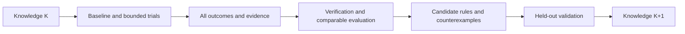

# ECC ICS55 调优经验测试用户手册

[English](ecc-experience-testing-guide.en.md)

本手册指导用户与 AI 大模型对任意 ECC 支持的设计开展 ICS55 调优测试，保存真实
证据，验证经验是否有效，并逐步形成可供 ECC 使用的版本化知识库。内部测试集
只作为外部输入，不定义产品的目录、设计名称、类型或规模标准。

**当前版本可用 run、param、report、sweep、explore、signoff 和 reproducible 完成
运行与证据采集。ecc_experience 已提供 P0 的 collect/list/show/verify/summary，以及 P1 的
enable/status/disable、提交后 attempt outbox 和 drain 恢复，以及 campaign 台账、
recommend、plan、evaluate、release 和受预算约束的 optimize。campaign quality/recover、
独立 step 资源观测、阶段 features、冻结 release 匹配 match、有界阶段 dse 以及
study evaluate/publish 留出评价闭环已实现。P4 的 dataset build、可解释 ridge 基线模型、
留出泄漏检查、evaluate/publish、predict 和 advise 已实现。当前版本还提供 identity v2、
输入闭包与参数回执、跨设计 experimental 匹配、资源预算、DSE v2 并行/连续轴/模型预筛、
dataset/feature schema v2、D4 四策略评价和派生 store index；共享训练服务仍不在交付范围。
经验包 export/import 提供显式选择、
离线完整性检查和幂等导入。**执行前必须以安装版本的
帮助和输出契约确认能力，不能照猜测调用。

本手册不是测试完成记录。示例路径、名称和预算仅演示操作，不能视为已验证配置。
具体设计配置与候选创建方法参见 [PPA/DSE 用户手册](../../chipcompiler/docs/ecc-ppa-dse-guide.cn.md)。

## 1. 两种使用模式

| 模式 | 进入条件 | 能完成什么 |
| --- | --- | --- |
| 外部台账模式 | 当前 ECC CLI 可用 | 运行、保存报告、对照、总结；经验由用户/AI 保存在外部 |
| 原生经验模式 | 安装版本实际提供经验接口，且其 schema/能力已核对 | P0 显式采集、查询、校验；其他阶段按实际可用范围执行 |

缺少原生接口时继续使用外部台账，结果标记 native experience unavailable。
不能把手写 JSON/Markdown 描述为 ECC 已自动收集的案例或可直接加载的知识包。
不要假定当前 `ecc doc` 已有 experience 主题；通过文档链接阅读本文。

## 2. AI 的执行契约

AI 在用户给定的输入、目标、参数和预算范围内自主完成一轮测试，每次操作后按
证据选择下一步。必须遵守：

- 原始输入只读，workspace 和证据输出隔离；不覆盖历史 trial。
- 受管状态通过公开 CLI 修改，不手改 flow、参数、checklist 或报告制造通过。
- 优化候选冻结 RTL、SDC、频率、corner、activity、工艺和验收条件。
- 只搜索当前 schema 合法且实际工具支持的参数；记录实际生效证据等级。
- 保存失败、无收益、取消和复用记录，不只保留 winner。
- unknown、缺失、陈旧和不可解析分别记录，不转成零或 passed。
- 选优条件不改变当前 flow 执行策略，不增加 checklist blocked 的运行门槛。
- 不将现有 DRC 报告描述成 GDS DRC 或 foundry 签核。
- 不上传内部设计、经验或产物，不将私有输入约定写入产品代码。
- 预算内自主推进；缺失必需规格、能力不足或预算耗尽时报告具体原因。

## 3. 测试开始前准备什么

| 输入 | 必须说明 |
| --- | --- |
| 设计 | 已准备的 ECC project，或经实际支持接口验证的 WorkspaceSpec/Bindings |
| 规格 | top、真实 clock、SDC/周期和 IO 条件、目标、硬约束、允许参数 |
| 工艺 | 实际 ICS55 库/LEF/RC/corner 资源及内容摘要 |
| 环境 | ECC binary/版本、EDA 工具、CPU/RAM，适用时 GPU；使用已安装工具 |
| 预算 | 候选数量、总时间、单任务限时、并发和资源上限 |
| 输出 | 新的 campaign/trial 目录、台账位置，原生模式下明确的 store |
| 评价 | baseline、指标/单位、验收范围、可选外部设计族分组、留出策略 |

时钟名称不是周期。没有设计目标时不能擅自设定所有设计为同一频率。缺少必需
约束的设计标 needs_constraints；导入/综合诊断与合格 PPA 结果分开。

类型和家族可缺省，不能从目录名推断；规模以综合后的实际指标为主。寄存器
存储与真实 macro 实现分开记录。超出当前 ECC 输入能力时列明缺口，不静默改写 RTL。

内部数据的本地转换器可以生成准备好的项目和外部任务清单。产品不要求该数据
具有固定元数据文件名、每设计一个目录或固定类型列表。

## 4. 冻结本轮条件并发现能力

记录 campaign ID、选定设计、输入/约束摘要、有效配置、工具/工艺、硬件、seed、
并发、预算和知识版本。条件变化创建新 trial 或新可比组；旧结果保持不变。

以下变量供后续 Bash 模板使用，必须替换路径。证据目录在 workspace 和源码仓库外，
每个 trial 使用新目录。所有片段分步执行，检查退出码后再进入依赖步骤。

```bash
ECC_TEST_BIN="ecc"
ECC_TEST_PROJECT="/absolute/path/to/prepared-project"
ECC_TEST_EVIDENCE="/absolute/path/to/test-output/campaign-001/baseline-001"
ECC_TEST_BASELINE="baseline-001"
mkdir -p "$ECC_TEST_EVIDENCE"
```

下面的可选记录函数保存原始 stdout/stderr、NUL 分隔 argv、UTC 起止时间和退出码。
正常记录时函数返回原命令退出码，不负责判断业务通过；调用失败后应诊断，不盲目运行 winner。
记录写入失败返回 1，应另记采集故障，不直接归因为 EDA 失败。它拒绝覆盖已有命令文件。
其他记录方式也可以，但必须保留同等信息。

```bash
ecc_test_capture() {
  local test_label="$1"
  shift
  case "$test_label" in
    ""|*[!a-zA-Z0-9_.-]*) return 2 ;;
  esac
  local command_prefix="$ECC_TEST_EVIDENCE/$test_label"
  local command_exit=0
  local record_suffix
  for record_suffix in argv started finished stdout stderr exit; do
    if [ -e "$command_prefix.$record_suffix" ]; then
      printf '%s\n' "Refusing to overwrite command evidence: $command_prefix" >&2
      return 2
    fi
  done
  printf '%s\0' "$@" > "$command_prefix.argv" || return 1
  date -u '+%Y-%m-%dT%H:%M:%SZ' > "$command_prefix.started" || return 1
  if "$@" > "$command_prefix.stdout" 2> "$command_prefix.stderr"; then
    command_exit=0
  else
    command_exit=$?
  fi
  printf '%s\n' "$command_exit" > "$command_prefix.exit" || return 1
  date -u '+%Y-%m-%dT%H:%M:%SZ' > "$command_prefix.finished" || return 1
  return "$command_exit"
}
```

预检已有能力：

```bash
ecc_test_capture root-help "$ECC_TEST_BIN" --help
ecc_test_capture version "$ECC_TEST_BIN" version --json
ecc_test_capture project "$ECC_TEST_BIN" project show --project "$ECC_TEST_PROJECT" --plain
ecc_test_capture config "$ECC_TEST_BIN" config --project "$ECC_TEST_PROJECT" --json
ecc_test_capture doctor "$ECC_TEST_BIN" doctor --project "$ECC_TEST_PROJECT" --json
ecc_test_capture inputs-check "$ECC_TEST_BIN" check --project "$ECC_TEST_PROJECT" --plain
ecc_test_capture parameter-catalog "$ECC_TEST_BIN" param list --all --project "$ECC_TEST_PROJECT" --json
```

根帮助没有 experience 时直接选择外部台账模式。存在该组时，再核对实际子命令、
选项、schema 和适用版本；有同名命令不等于本文全部规划已实现。预检失败先分类，
不能自动安装/升级工具、改变工艺或降低验收来消除问题。

## 5. 建立真实 baseline

确认 baseline 名称未占用、项目/spec 正确、预算可承担完整流程后执行：

```bash
ecc_test_capture baseline-run "$ECC_TEST_BIN" run \
  --project "$ECC_TEST_PROJECT" --workspace "$ECC_TEST_BASELINE" --preset rtl2gds --plain
```

run 返回 0 只是执行结果之一。检查实际请求阶段、skip/reuse、checklist、checker
和证据覆盖。当前 syn_sta preset 不能当作最终 routed STA 的替代。

baseline 失败也要保存证据并诊断，可用于失败覆盖；它不能作为已合格 winner。
目标不可行与工具/环境故障分开。将实际成本用于调整后续候选预算。

## 6. 每次运行后保存什么

### 6.1 现有 CLI 的采集模板

workspace 必须处于稳定终态，没有其他会话运行或修改它。先保存原始 committed
snapshot，再获取报告；报告刷新后另存 snapshot，以区分分析刷新与新执行。

```bash
ecc_test_capture state "$ECC_TEST_BIN" status \
  --project "$ECC_TEST_PROJECT" --workspace "$ECC_TEST_BASELINE" --json
ecc_test_capture snapshot-before-refresh "$ECC_TEST_BIN" report snapshot \
  --project "$ECC_TEST_PROJECT" --workspace "$ECC_TEST_BASELINE" \
  --output "$ECC_TEST_EVIDENCE/committed-before-refresh.json" --json
ecc_test_capture step-overview "$ECC_TEST_BIN" report step \
  --project "$ECC_TEST_PROJECT" --workspace "$ECC_TEST_BASELINE" --json
ecc_test_capture placement-detail "$ECC_TEST_BIN" report step placement \
  --project "$ECC_TEST_PROJECT" --workspace "$ECC_TEST_BASELINE" \
  --section feature --section analysis --section checklist --section outputs --json
ecc_test_capture diagnosis "$ECC_TEST_BIN" diagnose run \
  --project "$ECC_TEST_PROJECT" --workspace "$ECC_TEST_BASELINE" --json
ecc_test_capture signoff-inspect "$ECC_TEST_BIN" signoff inspect \
  --project "$ECC_TEST_PROJECT" --workspace "$ECC_TEST_BASELINE" --json
ecc_test_capture qor "$ECC_TEST_BIN" report qor \
  --project "$ECC_TEST_PROJECT" --workspace "$ECC_TEST_BASELINE" \
  --output "$ECC_TEST_EVIDENCE/qor-report.txt" --json
ecc_test_capture checklist "$ECC_TEST_BIN" report checklist \
  --project "$ECC_TEST_PROJECT" --workspace "$ECC_TEST_BASELINE" \
  --output "$ECC_TEST_EVIDENCE/checklist-report.txt" --json
ecc_test_capture signoff-check "$ECC_TEST_BIN" signoff check \
  --project "$ECC_TEST_PROJECT" --workspace "$ECC_TEST_BASELINE" --json
ecc_test_capture snapshot-after-refresh "$ECC_TEST_BIN" report snapshot \
  --project "$ECC_TEST_PROJECT" --workspace "$ECC_TEST_BASELINE" \
  --output "$ECC_TEST_EVIDENCE/committed-after-refresh.json" --json
```

placement 只是当前流程的示例 token；先查询 overview，其他流程使用实际存在的
阶段。其他阶段同样保存 feature/analysis/checklist/outputs，不只采集 placement。
snapshot 不存在、版本不兼容或报告失败时保留原错误，记录 evidence unknown。

signoff inspect 会刷新分析，report qor/checklist 会写报告。刷新不是新 attempt，
不能增加执行样本或重记运行成本。若任务正在运行则推迟稳定采集，而非读取一半。

### 6.2 台账的最少字段

每个 trial 保存输入/约束/工艺/工具身份、有效参数、请求/实际值与证据等级、
seed/硬件/并发、执行阶段、复用来源、原始指标/单位/source/corner、QoR 版本、
flow/checklist/checker 状态、资源 scope、失败原因、命令退出码和证据摘要。

执行、质量、证据、采集四个状态分开。同一 workspace 重跑是新 attempt；复制
前缀是 reuse；重新查询/分析是新 observation，三者不能混为多次独立实验。

旧 peak_memory_mb 不统一代表绝对进程树峰值，零也可能是采集缺口。没有新的
测量事实时标 legacy/unknown；耗时求和不能冒充并行整轮墙钟时间。

## 7. 小预算候选与阶段 DSE

先按 [PPA/DSE 手册](../../chipcompiler/docs/ecc-ppa-dse-guide.cn.md) 创建独立候选或小 sweep。每个候选
都保存完整参数，不能假定 sweep 自动继承历史 workspace 的 override。

参数改变先验证 schema、工具映射和实际生效。没有回执时只能声明 configured 或
materialized，不能宣称 effective。当前未接入实际工具的参数不作为搜索维度。

对已有 sweep 查询并保存证据：

```bash
ECC_TEST_SWEEP="sweep-001"
ecc_test_capture sweep-verify "$ECC_TEST_BIN" sweep verify \
  --project "$ECC_TEST_PROJECT" --name "$ECC_TEST_SWEEP" --json
ecc_test_capture sweep-compare "$ECC_TEST_BIN" sweep compare \
  --project "$ECC_TEST_PROJECT" --name "$ECC_TEST_SWEEP" --json
ecc_test_capture candidate-ranking "$ECC_TEST_BIN" explore rank \
  --project "$ECC_TEST_PROJECT" --name "$ECC_TEST_SWEEP" --json
ecc_test_capture candidate-matrix "$ECC_TEST_BIN" explore export \
  --project "$ECC_TEST_PROJECT" --name "$ECC_TEST_SWEEP" \
  --format json --output "$ECC_TEST_EVIDENCE/candidate-matrix.json" --json
```

先使用 results 中的真实 candidate project/workspace 采集各候选，不能用原项目
的 report project 代替 sweep 清单。每个候选使用独立的命令证据目录。

前段 DSE 明确运行边界和局部验收；stage-validated 与 full-flow-validated 分开。
只有 shortlist 继续完整流程。前段 HPWL/拥塞改善不自动证明最终 PPA 改善。
compare run 用于同 workspace 的前后观察，不代替跨候选的原始指标对照。

## 8. 正确比较和选择 winner

1. 先检查输入、约束、工艺、工具、分析/指标单位、阶段和目标是否可比。
2. 根据本轮硬约束筛选候选；缺证据不能判定通过。
3. 同时比较原始 PPA、QoR 和成本，保留 Pareto 候选及反例。
4. 记录完整配置组合，不能拼接不同实验的单项最佳值。
5. 从未占用的 fresh workspace 完整复验 winner，携带所有有效参数。
6. 复验不满足则保留结论为未验证/失败，不能只展示原 winner 成绩。

重复 seed 和同设计变体不能当成多个独立设计。降低频率、换 activity/corner 或
取消检查属于规格变化，不是原目标下的优化收益。

## 9. 负向与兼容性测试

在隔离 trial、可删除副本或合成 fixture 中执行，不污染 baseline 或用户原输入。
故意损坏证据仅属于读入/校验测试，不能记成真实 EDA 参数失败经验。

| 场景 | 操作边界 | 正确结果 |
| --- | --- | --- |
| DRC/LVS/STA 不满足 | 使用真实失败结果或独立失败设计；注明 checker 范围 | 保留违例、失败 gate 和退出码，不能入选合格 winner |
| QoR 缺失 | 独立证据 fixture 中移除指定来源，并核对其他副本 | missing/unknown，不把缺失分数写成 0 |
| checklist 损坏 | 独立 fixture 中制造非法格式 | 解析错误/unknown，不是 passed |
| 旧 workspace | 使用保留的旧版 fixture，只读查询/导入 | 明确兼容范围、缺失字段，不自动迁移 |
| 证据陈旧 | 独立 fixture 的输入/参数与结果身份不一致 | stale，不参与严格推荐 |
| 重复收集/重跑/复用 | 原生模块可用后分别测试 | 重复幂等、重跑新 attempt、复用引用原成本 |
| OOM/timeout/取消 | 明确授权的独立预算测试，确认任务实际停止 | resource/cancelled/unknown，成本为不完整观测 |
| store 不可写/采集失败 | 原生模式的独立故障测试 | 采集失败可见，成功 step 不回滚，通知不受阻 |
| source/wheel/frozen | 测试实际安装的对应 artifact | 契约可用、资源 scope 清楚、不依赖源码/内部路径 |

不要为了覆盖而强行使所有设计失败。无法真实复现的场景列为 not_run，说明
原因；fixture 通过与真实 EDA 场景通过分别报告。

检查退出码和 JSON 业务结果。当前质量查询可返回 6（失败）或 7（未知），其
stdout 仍可能是有效 JSON。20/21 表示忙/冲突，应处理实际原因。124 可出现在
限时执行记录中；保留实际返回值和进程状态，不假定所有命令同样编码。

## 10. 原生经验模块可用后的测试

P0 显式采集、查询和校验已经实现。P1 的自动记录只保存提交后的小型事实到项目
outbox；它不修改参数、不阻塞工程提交，也不把经验写进源码或 wheel。只读推荐、
计划、比较、release、有预算的完整流程优化及串行 baseline campaign 已实现；
阶段特征、严格匹配、有界阶段 DSE、留出评价和隔离反馈发布也已实现，详见本手册末尾。
跨设计迁移仍未证明；v2 提供有界并行调度和显式实验性跨设计开关，默认检索仍保守。
P4 模型可对明确记录的资源字段建模，但不等于独立进程树测量或已校准的 RAM/CPU 预测。
逐项按安装版本帮助确认能力。

```bash
EXPERIENCE_STORE=/absolute/path/to/experience-store
ecc experience --help
ecc experience collect --project "$PROJECT" --workspace baseline-001 \
  --store "$EXPERIENCE_STORE" --json
ecc experience list --store "$EXPERIENCE_STORE" --json
```

对需要持续积累的项目，先显式指定项目外的 store：

```bash
ecc experience enable --project "$PROJECT" --store "$EXPERIENCE_STORE" --json
ecc experience status --project "$PROJECT" --json
ecc run --project "$PROJECT" --workspace baseline-001 --json
ecc experience drain --project "$PROJECT" --json
ecc experience disable --project "$PROJECT" --json
```

`enable` 只保存项目级记录配置；普通 `run`、单 step、rerun 和失败流程仍使用
原有执行规则。每次实际执行得到独立 attempt ID；每个已完成 step 在 Engineering
Snapshot 提交成功后产生一个事件，包含 workspace revision、step 终态以及已有
runtime/peak-memory 的来源 scope。记录器异常只报告到运行日志，不改变 EDA 退出码。
`drain` 只处理同时存在开始、step 提交和终态事件的 attempt，并核对最终 snapshot
摘要；源 workspace 在此期间变化时保留 outbox，返回失败原因，避免把新报告装进旧
attempt。成功后事件移动到项目 outbox 外的 processed 目录，并以 attempt_id 写入
案例 source。`status` 的 pending 数量可用于恢复检查；不要手动删除 pending 事件。

批量测试先用通用 campaign manifest 做只读校验：

```bash
ecc experience campaign validate --manifest campaign.json --json
```

当前校验确认 schema、ICS55 profile 字段、baseline 模式、预算边界、设计 ID 唯一、
输入目录存在，以及 store/output 不覆盖输入或互相覆盖；返回的 fingerprint 可写入
外部 campaign ledger。校验不会运行 EDA、创建 workspace 或创建 output/store 目录。
manifest 使用相对路径，设计清单与标签转换由用户环境负责；ECC 不扫描私有数据集。

### 批量测试目录组织

每批测试使用独立目录，将大体积运行数据、用户报告、命令审计和可复用知识产物分开。
以下是调用方的组织约定，适用于任意设计；不是 benchmark 类型或输入布局的硬编码要求：

```text
experience-root/
  README.md
  campaigns/
    batch-001/
      campaign.json
      inputs/                 # 显式准备的 ECC 项目
      store/                  # 本批案例，由 ECC 管理内部结构
      runs/                   # 原生台账、结果、attempt 项目和命令收据
      reports/                # summary.md、矩阵、质量审计、划分结果
      logs/                   # 外层 CLI stdout/stderr/退出码
      artifacts/
        releases/
        datasets/
        models/
        packages/
  library/                    # 显式选择、验证后跨批次积累
    store/
    releases/
    datasets/
    models/
  archives/                   # 静态交付归档
```

**campaign.json 放在 batch 根目录。** 当前校验器要求输入项目、store、output_root
均位于 manifest 所在目录内；例如输入路径使用 `inputs/design-001`，`store` 使用
`store`，`output_root` 使用 `runs`。不要将 manifest 移到 config/ 后使用 `../store`，
也不能通过逃逸根目录的软链访问共享库。跨批次通过现有 `experience export/import`
显式汇入 `library/store`，不修改路径校验。用公开项目/workspace 命令准备输入项目，
不能移动已注册 workspace 后只修改 manifest 路径。

原生命令负责 runs/、store/ 的内部结构。reports/、logs/、artifacts/ 需要调用方通过
重定向和已有 `--output` 参数组织；`campaign init` 仅初始化台账，不是目录生成命令。
例如，在已准备好输入和完整 manifest 后：

```bash
BATCH=/path/to/experience-root/campaigns/batch-001
mkdir -p "$BATCH/reports" "$BATCH/logs"
ecc experience campaign validate --manifest "$BATCH/campaign.json" --json
ecc experience campaign run --manifest "$BATCH/campaign.json" --json \
  > "$BATCH/logs/campaign-run.stdout.json" 2> "$BATCH/logs/campaign-run.stderr.log"
run_exit=$?
printf '%s\n' "$run_exit" > "$BATCH/logs/campaign-run.exit"
ecc experience campaign quality --manifest "$BATCH/campaign.json" --json \
  > "$BATCH/reports/quality.json" 2> "$BATCH/logs/quality.stderr.log"
ecc experience campaign summary --manifest "$BATCH/campaign.json" --json \
  > "$BATCH/reports/summary.json" 2> "$BATCH/logs/summary.stderr.log"
```

这段示例假设调用 shell 未启用 `set -e`；AI 或脚本必须分别记录并检查每条命令的退出码，
不能以最后一个 summary 命令的成功覆盖 run 或 quality 的失败。`summary.md` 应另外总结
每个设计的参数、flow/checklist/signoff、QoR、资源口径、失败、未执行项及下一步。

运行中的路径属于冻结证据，不要为了美观搬动 runs/、store/、输入项目或改写收据。
需要新路径时创建新批次。静态交付归档可以采用 README.md、summary.md、config/、
reports/、artifacts/、audit/、docs/ 分层，但必须说明是否包含可续跑工作区。仅含日志、
release、dataset 和经验包的归档不能当成完整 campaign；原 manifest 应标为审计副本。
归档移动文件时保留内容哈希与路径映射；有指纹的 release、dataset 和案例不重写，
经验包在新位置 import/verify 后再交付。保留失败与 unknown 结果，避免只归档成功样本。

### 串行 baseline 批次

已准备好的 project 可直接执行：

```bash
ecc experience campaign run --manifest campaign.json --json
ecc experience campaign run --manifest campaign.json --retry-failed --json
```

第一版要求 `mode=baseline`、`max_concurrent_flows=1`，且不设置
`knowledge_release_id`。每项 `designs[].workspace` 是输入项目中已注册、有
Engineering Snapshot、声明输入可读且 PDK 与 `process_profile` 一致的源 workspace。
`validate` 做通用清单校验；`run` 进一步核对这些可执行条件。

执行器通过公开 `init → workspace import → workspace derive → run` 命令，在
`output_root/attempts/trial-<id>/project/baseline` 创建独立项目与全流程重跑的
workspace。派生复用源配置、约束、skip 策略和输入；不修改源项目的注册信息、
源配置和报告。派生过程可能复制源 workspace 的已有文件，请预留磁盘空间。

请求参数在执行前校验；执行后只允许与 ECC-Tools 几何报告一致的实际 die 长宽比/
尺寸回写，并在 `runtime_parameter_updates` 保存请求值、观测值和报告摘要。
其他参数变化仍返回 21。案例保存执行后真实参数，不将几何回写当作新的调优策略。

`output_root/campaign-run.json` 保存冻结输入、可观测工具版本、attempt/run ID、
命令 argv、日志路径、原始退出码、`execution_status`、`acceptance`、
`collection_status` 和案例 verification；EDA 输出在每个 attempt 的命令 stdout/
stderr 中，运行标记日志遵循 workspace 内 `log/<run-id>.log` 规范。
完整校验明细单独保存在 attempt 的 `case-verification.json`，结果索引只保存摘要。
冻结版 CLI 额外保存自身可执行文件摘要，避免同版本号的不同构建被视为同一运行时。
`campaign status` 额外通过 `execution` 报告执行器状态、结果路径与 active trials；
原有 ledger 的 counts 仍统计不可变 trial 记录，执行器只在 attempt 终态后登记一次。

再次运行默认跳过已登记的终态设计；`--retry-failed` 对失败、blocked 或取消的设计
创建新 attempt，每次调用每个设计至多尝试一次，累计不超过
`max_trials_per_design`。成功设计不会重复运行。终态结果已落盘但尚未登记时，
续跑幂等补写 ledger，不重跑 EDA。每次续跑均核对 manifest、源配置/声明输入摘要
以及 ECC/可观测工具版本；变化返回 21。不要修改冻结条件后沿用原 output_root。

只有实际进入 run 的 attempt 才会以真实 run ID 采集证据；执行成功、验收通过与
采集成功是独立事实。全部 flow/checklist/signoff/QoR 和案例验证通过才记为 pass；
未知证据记为 blocked；保留失败与取消记录。续跑也会重新验证已有案例，不能只相信
ledger 中的 pass。退出码：0 全部通过，2 输入错误/不支持模式，6 失败或 blocked，
7 已登记案例证据缺失/未知，20 执行锁忙或存在未完成 intent，21 冻结条件变化，
124 超时，130 取消。某个设计失败后仍继续其他设计；取消或条件变化则停止调度。

正常取消和超时会清理受管理的进程树。若强制杀死调度器，留下 running intent，
执行器返回20，拒绝盲目接管。新运行的持久化命令 worker 会等待实际子进程退出并
生成完成收据；使用 `ecc experience campaign recover --manifest <manifest> --trial-id <trial>`
核验收据、冻结输入和工具条件后收尾，再 run 继续批次。worker 仍活跃、收据缺失、
旧版本或无法证明退出时保持20。不要删除锁或伪造终态；结合 campaign-run.json 的
项目路径和 `ecc process list` 诊断残留。阶段 DSE 使用单独 dse 接口；并发调度未实现，
P4 资源 target 仅使用明确记录且 scope 一致的观测值。

声明输入摘要不覆盖完整 include/PDK 内容闭包；工具版本也不等于所有可执行文件
内容摘要。本命令建立基线、保留经验，不声明 PPA 已改善或经验已跨设计泛化。

### 批次数据质量审计

批次结束后，在生成知识 release 前审计全部试验历史：

```bash
ecc experience campaign quality --manifest campaign.json --json
```

可选 `--ledger PATH` 与 status/summary 保持一致。quality 是只读查询，不运行 EDA，
不改写源 workspace、store 或 ledger。summary 只看每个设计的最新试验；quality
保留所有失败、重试、取消记录，分别报告 `execution_status` 和 `quality_status`。
执行失败的完整案例仍可作为反例，不能因为被重试就消失。

报告的 `coverage` 展示提交身份、attempt、声明输入指纹、参数、工艺和有限 QoR
的完整性；`trials` 关联案例、当前 verification、异常 findings、QoR 和 step 状态。
核心证据缺失、旧 workspace、无 attempt 或无 QoR 返回 unknown；损坏/陈旧证据、
非数字/非有限 QoR、PDK family 与 manifest 不符返回 fail。可选报告未生成只计入
`artifact_counts`，不会当作必需文件丢失。零/缺失内存显示 null，step 的 runtime/
memory 明确标为 `legacy_flow_step_ledger`，不表示独立进程树测量或资源预测。

`diversity` 对存储完整的案例统计唯一 case、执行身份和声明输入指纹，标出重复引用；
coverage 的分母是 trial 引用数，不是独立样本数。重复采集同一次执行不会增加
`unique_execution_identities`。不同输入指纹不能证明设计家族独立，
`evaluation_groups_provided` 仅采用用户显式提供的分组，不根据设计名推断。

退出码：0 采集检查通过，6 至少一项失败，7 存在未知/缺失或 pending/running，
2 输入错误，21 manifest 改变。quality pass 不等于 flow/signoff 通过，也不证明
参数生效、跨设计收益或完整 include/PDK 闭包；生成 release 前仍需相应验收。
已有 wheel/PyInstaller 和 design matrix 经验 smoke 会检查本命令的 unknown 与
损坏案例退出码，不伪造独立执行身份来获得 pass。

### 外部执行与 ledger

新执行的 flow step 可选保存 `resource_observation`，并随 Engineering Snapshot 和
经验案例冻结。其 `attempt_id` 只在真正执行工具时生成，skip 保留原身份；重跑/
失效/reset 清除旧引用。旧 workspace 无此字段仍可正常读取，不补造历史测量。

`peak_rss_bytes` 是 Linux `/proc` 对当时进程树的绝对 RSS 采样峰值；原
`peak memory (mb)` 保持旧口径。`isolated_worker_process_tree` 测量独立 worker
及其后代；`shared_process_tree` 用于 in-process/frozen，共享进程中其他工作也可能
计入，因此标 partial。`status` 为 available/partial/unavailable；读取失败/没有
样本时峰值为 null，不用零替代。记录包含 UTC 时间、monotonic 耗时、采样周期、
次数、PID/start ID、host/boot 身份和原因。RSS 可能重复共享页并漏掉短峰，不等同
cgroup/PSS 或工具独占内存，也不能据此直接产生经过校准的资源预测。
`campaign quality` 的每个 step 同时展示该新字段，缺省不改变旧案例的质量门槛。

校验通过后，可以让 ECC 创建一个可恢复的 campaign ledger。初始化只创建
`output_root/campaign-ledger.json`，保存 manifest fingerprint、设计清单和空的试验
记录，不启动 EDA：

```bash
ecc experience campaign init --manifest campaign.json --json
```

每完成一个外部试验后登记一次结果。`--trial-id` 应由调度器稳定生成，重复提交同一
内容会返回 `already_present`；同一个 ID 提交不同内容会返回 revision conflict：

```bash
ecc experience campaign record \
  --ledger output/campaign-ledger.json \
  --design design-001 \
  --workspace baseline-001 \
  --status pass \
  --trial-id trial-001 \
  --case-id "$CASE_ID" \
  --json
```

允许的试验状态为 `running`、`pass`、`fail`、`blocked`、`cancelled`。`case_id` 可选，
但推荐先用 `experience collect` 或 `drain` 生成案例，再写入台账以保留证据关联。
用下面的命令恢复批次进度；它会重新校验 manifest fingerprint，发现 manifest 被
修改时拒绝继续：

```bash
ecc experience campaign status --manifest campaign.json --json
```

批次结束或中断恢复前，用 summary 同时查看最新试验、关联案例校验状态和 QoR 摘要：

```bash
ecc experience campaign summary --manifest campaign.json --json
```

`campaign_status` 只表示调度状态；`campaign_summary` 额外报告
`evidence_status`、`integrity` 和 `evidence_counts`。没有 `case_id` 或案例缺失时会
明确报告 evidence missing，不会把 trial 的 `pass` 误认为 QoR 或 signoff 通过。

ledger 是调度和恢复记录，不等于 ECC 的 QoR 结论。QoR、step 报告、工具版本和参数
仍必须通过 workspace 证据与 experience case 保存；只有完成验证的案例才可用于经验
总结或后续推荐。

对已有经验做初步检索时使用只读推荐命令：

```bash
ecc experience recommend \
  --project "$PROJECT" \
  --workspace "$WORKSPACE" \
  --store "$EXPERIENCE_STORE" \
  --limit 10 \
  --json
```

如果已经形成并校验了 release，推荐必须显式绑定它：

```bash
ecc experience recommend \
  --project "$PROJECT" \
  --workspace "$WORKSPACE" \
  --store "$EXPERIENCE_STORE" \
  --release "$OUTPUT_ROOT/experience-release.json" \
  --json
```

带 `--release` 时，ECC 先执行 release 校验，只从其中列出的案例检索；release
缺失、被篡改、案例缺失或重新校验失败时，返回空 recommendations，并保留
`release_verification` 结果。省略 `--release` 仍保持现有兼容行为，只从当前 store
检索，适合尚未发布知识版本的本地探索。

当前推荐只匹配完整的输入内容指纹，返回历史案例中的已观察参数，并将
`safe_to_apply` 固定为 `false`。输出中的绝对环境路径会替换为
`<path-redacted>`，不会把本机 PDK 路径当作可迁移参数。这不是自动调参，也不证明参数对 QoR 有因果作用；
AI 必须检查 verification、QoR、参数回执和适用工艺后，另建 workspace 验证。没有
完整输入指纹、经验库不存在或没有可验证案例时，命令返回
`status=insufficient_evidence` 和空 recommendations，不猜测参数。

需要把推荐结果交给后续人工或 AI 审阅时，可生成 plan 文件：

```bash
ecc experience plan \
  --project "$PROJECT" \
  --workspace "$WORKSPACE" \
  --store "$EXPERIENCE_STORE" \
  --release "$OUTPUT_ROOT/experience-release.json" \
  --output "$OUTPUT_ROOT/optimization-plan.json" \
  --json
```

plan 绑定查询 workspace、输入指纹、案例和 fingerprint，并固定声明
release（如果提供）、`manual_review`、`requires_new_workspace=true`、`auto_apply=false`。它是可审阅的
执行建议，不会修改参数、复制 workspace 或启动 flow。没有显式优化预算和参数
白名单的旧计划继续只用于人工审阅，不能直接交给 optimize 执行。

需要显式消费跨设计证据时，plan 必须绑定已校验 release，并显式开启实验开关：

```bash
ecc experience plan \
  --project "$PROJECT" --workspace "$WORKSPACE" \
  --store "$EXPERIENCE_STORE" --release "$OUTPUT_ROOT/experience-release.json" \
  --experimental-cross-design --through-step Synthesis \
  --groups "$OUTPUT_ROOT/families.json" \
  --output "$OUTPUT_ROOT/cross-design-plan.json" --json
```

plan 会从 store 选择与当前输入内容指纹一致的已提交 query case；也可用
`--query-case-id` 明确指定。输出新增 `cross_design`，保留 match 的 release、case、
distance、feature coverage、confidence、排除原因和 provenance。只有参数证据为
`applied` 的跨设计匹配进入可审阅 `candidates`；`configured` 匹配只进入 `clues`，
表示待验证线索，不能被 optimize 当作可执行配置。没有校准证据时 status 保持
experimental、`safe_to_apply=false`；任何 candidate 仍必须从当前 baseline 派生新
workspace，并完成 full+fresh，不自动放宽工艺、工具、SDC 或频率过滤。

### 10.1 受控执行经验计划

仅在希望启动真实流程时，生成带执行范围的计划，审阅后显式调用 optimize：

```bash
ecc experience plan \
  --project "$PROJECT" --workspace "$WORKSPACE" \
  --store "$EXPERIENCE_STORE" \
  --allow-param floorplan.core_util \
  --allow-param place.target_density \
  --max-trials 4 --max-seconds 3600 --trial-timeout 900 \
  --patience 2 --target-score 95 \
  --output "$OUTPUT_ROOT/bounded-plan.json" --json

ecc experience optimize \
  --project "$PROJECT" --store "$EXPERIENCE_STORE" \
  --plan "$OUTPUT_ROOT/bounded-plan.json" \
  --output "$OUTPUT_ROOT/optimization-001" --json
```

`--release` 可继续用于生成计划；执行前重新验证 release ID 与案例。默认 plan
仍然只读；`--allow-param` 使计划包含明确的执行限制，生成计划本身不会启动 EDA。
optimize 的 `--project` 可在 project 或 workspace 目录内省略，基线由计划指定。
输出目录必须全新，经验 store 与基线 workspace 不得重叠。

| 限制 | 当前行为 |
| --- | --- |
| 候选来源 | 同输入内容指纹的真实已观察配置；证据失败或非白名单参数不同的候选不执行，重复配置去重；不自行发明搜索空间 |
| 参数范围 | 仅显式允许的 core_util/core_margin/aspect_ratio、placement density/overflow/padding/routability 和 CTS fanout/skew/transition/cap 参数；名称、类型和范围由现有 ECC catalog 校验 |
| 固定条件 | 校验基线快照及直接绑定输入内容；保持 design、工艺声明、flow 和其他配置；只允许旧快照缺失字段补齐为当前 catalog 默认值 |
| 次数预算 | `max_trials` 为新 workspace 总上限，包含最佳候选的独立复跑，至少 2；串行执行，不修改基线 |
| 时间预算 | 校验后开始计算总时间；每次 trial 的派生、参数应用、flow 与报告检查共享单次限时；到时停止子进程，不只停止等待；清理可额外使用短暂宽限时间 |
| 提前停止 | 候选耗尽、次数上限、目标分数、连续无改进/失败次数、超时或用户取消；达到搜索停止条件后仍须独立复跑最佳候选 |
| 验证范围 | optimize 验证基线定义的完整 flow；阶段筛选可用 experience dse，必须另行完整及 fresh 验证 |

底层复用 `workspace derive`、`param apply`、`run`、`status` 与 `signoff check`，使用
系统中已安装的工具。基线已 blocked 不会阻止调优，基线状态原样进入结果；新候选
及复跑必须满足现有 flow/checklist/signoff 判据、有限 QoR 和案例证据校验，才会被
接受。此处 signoff 仍限 ECC 已支持的检查，不包含 GDS DRC/foundry 签核。

`result.json` 在执行过程中原子更新，记录每个 workspace、run ID、配置变化、命令
日志路径、退出码、case ID、验证状态、分数、失败与停止原因。运行完成的新快照
会关联实际 run ID 采集进 store；运行或采集失败也保留试验结果与日志，不伪造通过。
只有独立复跑通过才能返回 `status=complete`。`improved=false` 允许表示完整验证
成功但没有 QoR 收益；基线缺少分数时 `improved=null`，比较证据不足。

| 退出码 | 含义 |
| --- | --- |
| 0 | 有候选且独立复跑完成验收；不保证分数提高 |
| 2 | 计划、指纹、预算、参数或输出目录无效 |
| 6 | 无合格候选或独立复跑验收失败 |
| 7 | 没有可执行的观察配置 |
| 21 | 基线输入/快照发生变化 |
| 124 / 130 | 超时 / 用户取消 |
| 1 | I/O 或其他执行故障 |

当前控制器要求 Linux，支持 Ctrl-C/SIGTERM 取消并清理独立会话中的 step 子进程。
它不会自动恢复中断运行、自动删除失败 workspace、发布 release、放宽 SDC/频率/
corner 或执行 RTL 修改。再次运行使用新输出目录和新预算。参数证据仍标为
`configured`，不宣称每个参数都被工具消费；输入闭包、PDK 文件内容和外部工具升级
的完整冻结尚未实现。当前不强制 RAM/CPU 配额；P4 可选地建模已记录资源字段，但不
提供独立进程树测量或校准后的资源预测。实际总结
必须同时给出基线验收状态、最佳候选及复跑分数、收益或无收益、成本和这些限制。

### 10.2 比较与发布案例

比较两个已采集案例的 QoR 时使用只读命令：

```bash
ecc experience evaluate \
  --store "$EXPERIENCE_STORE" \
  --baseline "$BASELINE_CASE_ID" \
  --candidate "$CANDIDATE_CASE_ID" \
  --json
```

该命令要求两个案例具有相同且完整的输入内容指纹，并且证据校验没有失败、QoR
分数是有限数值。案例缺少稳定 attempt 身份时，验证状态可以是 `unknown`，但不会
隐藏任何 unknown finding。输出包含两侧验证结果、分数、差值和差值百分比，当前
约定 QoR 分数越高越好。输入指纹不一致返回 `status=incompatible`，证据或分数
不足返回 `status=insufficient_evidence`，不会启动 EDA、修改 workspace 或自动接受
优化结论。只有在同一设计、同一工艺和相同约束下，AI 才能把 `improved` 作为候选
结果，并继续检查 checklist、signoff 和原始报告。

确认一组案例可以作为可审计知识版本时，先创建 release：

```bash
ecc experience release create \
  --store "$EXPERIENCE_STORE" \
  --case-id "$CASE_ID_1" \
  --case-id "$CASE_ID_2" \
  --output "$OUTPUT_ROOT/experience-release.json" \
  --json

ecc experience release verify \
  --store "$EXPERIENCE_STORE" \
  --release "$OUTPUT_ROOT/experience-release.json" \
  --json
```

release 只接受证据校验为 `pass`、完整输入指纹存在的案例，记录案例 ID、输入/工艺
指纹、workspace revision 和 QoR 摘要，不复制私有 workspace 路径和大型产物，也不
自动修改参数或启用经验。输出文件是原子写入且内容地址可核验；同一内容重复创建
幂等，覆盖不同内容会失败。`release verify` 会重新读取 store 并核对案例摘要，
适合在 CI、备份恢复或交给 AI 前执行。没有稳定 attempt、QoR 不可用、证据损坏或
旧 workspace 来源不完整的案例不能进入 release。

从 collect/list 的 JSON 取得实际 case_id 后执行：

```bash
CASE_ID=case-id-returned-by-collect
ecc experience show "$CASE_ID" --store "$EXPERIENCE_STORE" --json
ecc experience verify "$CASE_ID" --store "$EXPERIENCE_STORE" --json
ecc experience verify --store "$EXPERIENCE_STORE" --json
```

collect 复用 --project/--workspace 的当前目录默认规则；list/show/verify 只需要
显式 store，可以在项目外执行。store 与源 workspace 必须分离。重复采集同一
观察返回 already_present；revision 或证据改变产生另一个观察，不能据此计数独立
执行。collect 不启动 EDA、不刷新报告、不迁移旧 workspace，也不校正损坏文件。

store 中每个 cases/case_id/case.json 保存版本、源 revision、原始快照、指标单位、
参数与证据引用。小型 JSON/TOML 证据按摘要复制到该案例的 evidence/；大型报告、
网表和版图只保存来源与摘要，源文件删除后不能当作完整可重现交付。report_text
按文本证据保留，不能仅凭 .json 后缀认定格式。完整产物仍通过 reproducible 导出。

verify 的 integrity 表示已复制证据的完整性；status 同时考虑源文件是否变化、
遗失或损坏，以及缺失 QoR、旧版来源等限制。退出 6 表示明确失败，7 表示未知，
JSON 始终保留。P0 的显式 collect 没有 attempt 身份；P1 通过 drain 生成的案例有
稳定 attempt_id，但仍只代表已提交观察，不能单独证明参数有效。EDA 违例和证据
损坏分开。

正常写入采用单 collector 与临时目录原子发布，不覆盖既有案例。store 内的
.write-lock 表示写入占用。并发 collector 会先在 store 目录 flock 上等待短暂写入，
超时才返回 experience_store_busy；崩溃遗留 `.write-lock` 时仍先确认原 collector
已停止，再移除这个空锁目录。不要删除案例或正在写入的临时目录来制造通过。

### 10.3 汇总经验库质量与资源数据

在多个 design 或多个模型完成测试后，使用只读的 `summary` 生成统一质量报告：

```bash
ecc experience summary \
  --store "$EXPERIENCE_STORE" \
  --output "$OUTPUT_ROOT/experience-summary" \
  --json
```

命令会按 case 输出 `verified_pass`、`verified_observation`、`blocked`、
`qor_unknown`、`incomplete` 和 `evidence_invalid` 六类结果，并统计输入/工艺/参数
配置去重（还要求 runtime 和 flow 身份一致）、ICS55 与设计规模分布、QoR 范围、
每个 step 的运行时间和峰值 RSS。只有输入指纹存在、
flow 成功、checklist 通过、signoff ready、QoR 有效且 evidence verify 通过的
`verified_pass` case 会列入 `release_eligible_case_ids`。

`blocked` 表示有效的负向经验，可以用于分析布局不收敛、signoff 或 checklist
失败；它不是经验库损坏。`evidence_invalid` 表示文件被改写、缺失或摘要不匹配，
必须隔离并重新采集。使用 `--json` 输出结构化报告，不修改 store；指定 `--output` 时写入
`summary.json` 和 `summary.md`。状态为 `unknown` 返回退出码 7，存在证据损坏或
读取失败返回退出码 6，JSON 仍然保留完整报告。

汇总报告可以直接作为下一轮 dataset/DSE 的输入审计材料，但不等于参数因果模型。
在生成正式 release 前，应等待所有 writer 停止后重新运行 `summary` 和全库
`experience verify`，再去重、固定工具/PDK 版本并选择 release-eligible cases。

| 阶段 | 测试 | 必须证明 |
| --- | --- | --- |
| 显式采集 | collect、show、verify | 案例可追溯、源 workspace 不变、重复收集幂等 |
| 持续记录 | enable 后执行 run/step/rerun，再 drain | attempt、提交 revision、资源 scope 可追溯；源变化不混入旧案例 |
| 推荐 | 无类型、新设计、无案例、版本不兼容 | 可解释匹配或 insufficient_evidence，无虚构配置 |
| 受控优化 | 明确 plan 的目标、参数和预算后执行 | 不扩大范围，真实反馈、停止原因和 fresh 复验 |
| 知识评价 | 固定 K、留出设计、默认策略对照 | 同预算收益和反例可追溯，无评价泄漏 |
| 交换/恢复 | round trip、重复导入、进程中断后恢复 | 摘要一致、幂等、不覆盖旧任务或私有输入 |

知识库为空是正常冷启动场景。收集可以工作，推荐需要说明不足；不能返回
“已学习的最佳配置”。AI 自己的文字总结不能升级为 validated rule。

### 10.4 多经验库归一化

多个模型或多轮测试产生不同 store 时，可生成统一清单：

```bash
ecc experience normalize \
  --store "$STORE_A" --store "$STORE_B" \
  --output "$OUTPUT_ROOT/normalized" --json
```

`--store` 可以重复，`--output` 必须是所有源 store 以外的新目录。命令只读取
案例及证据，生成 `normalized-manifest.json` 和 `normalized-manifest.md`；不移动
案例、不修复源文件、不修改配置，也不启动 EDA。重复指定同一个 store 只读取一次。

相同 `case_id` 合为一条案例，`provenance` 保留每份来源、attempt、revision、
完整性及源文件校验结果。不同案例仅在输入、工艺、参数、工具/runtime 和有序 flow
身份完整且相同时组成一个配置组；不删除重复配置的历史观察。缺少工具版本等身份
信息时，各案例独立分组，避免把未知配置误认为等价。重复观察不等于独立实验。

`selections.positive` 为完整通过的候选，`negative` 为有可靠证据的失败/blocked
观察，`qor_missing` 为其余 QoR 不完整案例，`other` 为其他未满足准入的观察。
`quarantine` 按来源保存校验失败或不可读取的记录。同一案例若一份副本损坏而另一
份有效，仍可引用有效副本；损坏来源继续隔离，整个报告仍返回 6。`integrity=pass`
但 `verification=fail` 可以表示归档副本完好、实时源文件已改变，不能直接认定归档
损坏或将历史观察自动升级为当前有效证据。负向观察允许缺少 QoR，但其余校验必须
通过，旧 workspace 或缺失 attempt 的观察不会直接成为负向训练样本。

观察到 `.write-lock` 或扫描期间案例列表变化时，该 store 标记
`changed_during_read`，不选入正向或负向候选。该检测不是跨 store 事务；正式发布
前仍应等待所有 writer 停止，并重新执行 normalize/verify。空库或证据不足返回 7，
校验/读取失败返回 6，路径参数错误返回 2，输出冲突返回 21，完整通过返回 0。
诊断状态为 6 或 7 时仍生成清单；它们属于用户测试的质量提示，不新增 CI 阻断节点。

只将正向选择重新复核并固化为正式 release：

```bash
ecc experience release from-manifest \
  --manifest "$OUTPUT_ROOT/normalized/normalized-manifest.json" \
  --store "$OUTPUT_ROOT/reviewed-release-store" \
  --output "$OUTPUT_ROOT/experience-release.json" --json
```

命令会校验 manifest 身份，只读取 `selections.positive`，重新检查案例及实时证据，
把通过复核的案例复制到独立 store，然后调用已有的 release 创建契约。源 store 和
manifest 都只读。normalize 后发生变化的案例会出现在 `excluded`；如果其余案例仍
成功生成 release，选择状态为 `partial`，命令返回 7。negative、qor_missing、
quarantine、损坏或不满足 release 准入条件的案例不会被固化。生成后仍应针对目标
store 执行 `release verify`，再用于 dataset 或 DSE。

清单属于审核交接材料，不能把负向或隔离案例当作成功候选，也不能仅凭配置相同
推断参数有效。AI 可以先检查排除项和资源 scope，再执行上述命令。
资源记录保留原始 scope；不得混算旧记录、复用步骤与不同测量范围的成本。
详细开发契约见 [归一化开发说明](ecc-experience-normalization.en.md)。

#### 10.4.1 为新案例记录执行身份

启用 `experience enable` 后，普通 `ecc run` 的 recorder 会在 attempt 开始和结束
时记录 ECC 源码/冻结二进制、工具版本及所选 PDK 文件摘要，并在各 step 提交时
检查所选 PDK。`experience drain` 将已记录的上下文绑定到同一个 attempt 和最后
提交的 snapshot digest。运行前后身份一致时，案例具有 runtime 和 process
fingerprint，后续 normalize 可以按完整配置分组。LEC 版本采用内部工具键
`kepler_formal`，与 flow step 一致，使用实际解析的命令和隔离后的环境查询。

上下文的 `checks.runtime` / `checks.process` 为 `available`、`changed` 或
`unknown`。源码、工具或 PDK 变化会保留前后观察，同时清空不再可靠的主 runtime
或 process fingerprint；不得把这些案例强行归入完整配置组。版本不可查询、PDK
绑定不完整或采集异常均降级为未知，不会改变 flow 的通过/失败结果。关闭经验记录
时不会执行额外的身份探测；探测只在启用记录的 attempt 中发生，不新增 CI 工作流。

旧 outbox 没有此字段仍可 drain；旧案例和旧 outbox 都不会用当前安装环境回填
历史版本。`drain` 校验事件的 attempt、snapshot 和上下文字段，损坏事件保留在
outbox 并报告失败；不会悄悄生成身份完整的案例。版本一致仍不等于所有可执行文件
内容一致，PDK 摘要也只覆盖已选择的文件，不证明完整工艺闭包或工具确实消耗了参数。
实际工具执行、step skip/复用与资源成本仍应结合 step 的执行记录单独判断。

长期 benchmark 建议每个 trial 使用独立派生的 workspace。重复使用同一 workspace
会改变实时源文件，旧案例的归档副本虽然仍完整，但旧案例的 verify 可能失效；
这不会删除历史记录，也不能通过回填身份或忽略摘要变化来恢复通过。仅运行综合等
前缀阶段可以验证采集和配置归组，不代表完整 flow/signoff 或 PPA 优化已通过。

### 10.5 备份和交换经验案例

选择需要分享的案例，不会默认导出整个 store：

```bash
ecc experience export \
  --store "$EXPERIENCE_STORE" \
  --case-id "$CASE_ID_1" \
  --case-id "$CASE_ID_2" \
  --output "$OUTPUT_ROOT/experience.tar.gz" --json

ecc experience import \
  --package "$OUTPUT_ROOT/experience.tar.gz" \
  --store "$OUTPUT_ROOT/imported-store" --json
```

也可以用 `--release "$OUTPUT_ROOT/experience-release.json"` 替代全部 `--case-id`；
两种选择不能同时使用。包包含该 release、其中所有案例，以及案例已复制到 store 的
小型证据。导入结果的 `release.path` 是目标 store 内可供 `release verify`、
`recommend --release`、`plan --release` 使用的实际路径。

这两条命令只需要显式 store，可以在项目外运行；输出包必须位于源 store 外，输入包
必须位于目标 store 外。同一内容重复导出/导入返回 `already_present`；不同内容不能
覆盖已有包、案例或 release。混合导入会分别报告 `created_count` 和
`already_present_count`。完整校验先于目标 store 创建，发布前检查既有内容；本次
发布途中发生可捕获的写入错误会回滚本次新增内容。写锁仍遵循单 collector 规则，
不保证进程被强制杀死或掉电时多个目录能作为一个原子事务同时可见。

包 manifest 记录 schema、案例集合、每个文件的 SHA-256/大小和内容地址 package ID。
拒绝路径越界、符号/硬链接、重复或未声明文件、损坏摘要、无效案例身份和 release
元数据不匹配。第一版限制压缩包 128 MiB、完整解压归档 256 MiB、单文件 32 MiB、
20000 个数据文件和 10000 个案例；超限时拆分案例选择，不能通过关闭校验继续。
相同输入产生字节一致的 gzip tar 包。内容摘要用于完整性检查，不是发布者身份签名。

导入的 `integrity=pass` 和 `source_verification=not_performed` 只说明包内证据完整。
原案例身份、source、失败和未知事实保持不变。包不会沿来源路径复制 RTL、PDK、大型
产物或工具，也不重跑 EDA、自动启用经验或修改参数；案例与小型报告中仍可能包含
设计名、路径和设计数据，分享前应审查实际内容。

源 workspace 不在当前机器时，原 `experience verify`/`release verify` 仍可返回
`unknown`；源文件变化时仍可失败。release 绑定推荐仍要求原验证条件通过，导入不会
豁免新鲜度检查。无 release 的 observed-only 查询保留现有不自动应用的行为。
需要完整设计交付时继续使用 `ecc reproducible export`。

| 情况 | 退出码 |
| --- | --- |
| 成功、重复同内容 | 0 |
| 选择缺失/冲突、非法命令参数 | 2 |
| 包损坏、schema/成员/案例/release 不一致、超限 | 6 |
| store 正在写入 | 20 |
| 既有内容冲突 | 21 |
| 文件系统 I/O 错误 | 1 |

已有 PyInstaller 与 design matrix 的经验 smoke 同时执行导出、导入、重复导入、
案例内容一致性检查与损坏包拒绝，不为此再跑一次 EDA flow。

## 11. 如何从测试生成下一知识版本



1. 固定 K 的案例/规则、特征与推荐策略版本，记录每次推荐来源。
2. 新结果进入 staging；本 design 的局部反馈可以指导其后续候选。
3. 全局评价结束前，留出设计的结果不进入 K。
4. 先验证参数生效、可比收益、失败分类和资源 scope，再归纳配置条件。
5. 与默认或固定受限策略进行同预算对照，统计所有尝试和采集开销。
6. 评价首次可行时间、候选数、最终原始 PPA、前段优势保持率和预算覆盖。
7. 证据足够的规则进入限定 scope 的 K+1；不足的保持候选状态。
8. 保存支持案例、反例、独立设计数、版本条件、验证方法和退役原因。

家族来自外部来源或结构证据，不依赖私有名字分支。分组信息缺失时报告泛化
限制。知识发布能力未实现时只保存 staging/评价材料，不手造可加载 release。

新案例/知识版本通常更新外部 store；采集、匹配或工具映射的通用改进需要修改
并发布 ECC。内部经验默认不进入源码、wheel 或 PyInstaller 资源。

## 12. 复现、导出和保留

对 fresh 复验后的 workspace，保存完整有效配置、输入/工艺/工具摘要及独立证据包：

```bash
ecc_test_capture reproducible-export "$ECC_TEST_BIN" reproducible export \
  --project "$ECC_TEST_PROJECT" --workspace "$ECC_TEST_BASELINE" \
  --output "$ECC_TEST_EVIDENCE/reproducible-package"
ecc_test_capture reproducible-verify "$ECC_TEST_BIN" reproducible verify \
  --package "$ECC_TEST_EVIDENCE/reproducible-package" --json
```

此时 ECC_TEST_BASELINE 必须改成实际 fresh 复验 workspace，并使用新的证据目录。
导出成功不证明所有外部 PDK、工具和依赖已经打包；核对 manifest 与未包含资源。
signoff 包与 reproducible 包用途不同，按 PPA/DSE 手册执行真实可用的交付接口。

baseline、winner、fresh 和关键失败优先保留完整证据；其他候选的保留等级明确
记录。索引可重建，原始案例不能用索引替代。清理后重新标记证据可用性，不
继续宣称完整可复现；未经授权不删除源输入或历史 workspace。

## 13. 每轮必需交付物

- campaign/spec-resolved 与约束覆盖说明、能力/环境记录。
- 全部 selected designs 和 trials 的矩阵，包括未运行原因。
- 命令 argv、stdout/stderr、退出码、阶段报告、snapshot 和证据摘要。
- baseline/candidate/winner/fresh 的原始指标、完整参数与可比性。
- 资源 scope、失败分类、实际耗时/成本和预算消耗。
- 推荐有效性、支持案例、反例、未知项与知识版本；未评价不得宣称有效。
- 人类 summary.md 和机器 summary.json，内容一致。

下面是外部测试总结模板，不是当前 ECC 原生 schema；按事实填充，未知保留：

```json
{
  "schema": "ecc-experience-test-summary/1",
  "campaign_id": "example-campaign",
  "mode": "external-ledger",
  "native_experience_available": false,
  "knowledge_release_id": null,
  "selected_designs": [],
  "trials": [],
  "comparability": "unknown",
  "recommendation_effect": "not_evaluated",
  "winner": null,
  "fresh_validation": "not_run",
  "artifacts": [],
  "checks_run": [],
  "checks_not_run": [],
  "limitations": []
}
```

不能只给“最佳参数是 X”。说明收益、成本、适用范围、失败和未验证内容。
文档/fixture 检查通过、EDA flow 通过、推荐泛化通过是不同结论。

## 14. 停止、恢复与结论标准

预算耗尽、必需输入/约束缺失、资源不可承担或能力不足时停止调度新的候选，
保存已有证据和停止原因。确认取消的进程实际停止；不要删除结果后重新开始。
恢复前核对冻结条件和旧任务存活情况，重试生成新 attempt。

只有请求范围执行完成、硬约束满足、证据完整、指标可比且必要 fresh 复验通过，
才能声明本 design 的调优结果验证成功。只有独立留出对照支持，才能声明经验
提高新设计收敛。采集未完成或原生能力不可用的部分必须明确列出。

## 15. 可交给 AI 的任务模板

```text
阅读本手册与 PPA/DSE 用户手册。只对我指定的输入开展 ICS55 测试。
先核对实际 ECC/工具版本、帮助、spec 和约束，选择外部台账或真实可用的原生经验模式。
原始输入只读，输出隔离；不硬编码内部目录、设计名或类型，不上传内部数据。
固定目标、工艺、分析条件、允许参数和预算后，建立 baseline，小预算试验并采集全部结果。
验证参数生效、指标单位、阶段范围和资源 scope，失败与未知如实保留。
若原生知识版本可用，固定 K，关联推荐和反馈；评价结束前不回流留出结果。
对 winner 做 fresh 验证，输出 trial 矩阵、summary.json、summary.md 和证据清单。
预算内自主继续；必需信息缺失或能力不足时说明具体缺口，不编造命令或通过结果。
```
### Campaign 中断后的显式恢复

新启动的串行 campaign 会为每个公开 CLI 命令保留独立的请求和完成记录。
协调进程意外退出时，当前命令可能仍在执行；不要再次运行同一 attempt。

```bash
ecc experience campaign status --manifest campaign.json --json
ecc experience campaign recover --manifest campaign.json --trial-id TRIAL_ID --json
ecc experience campaign run --manifest campaign.json --retry-failed --json
```

`recover` 不启动或取消 EDA。Linux command worker 等待 CLI 及被收养的后代
全部退出后才提交完成记录；仍在运行、缺失记录、旧版命令、不同 host/boot、
workspace 锁繁忙时返回 20，不提供强制接管。输入、运行时或请求变化返回 21。
若完整 run 已结束，则重新查询和验证 committed checklist、signoff、QoR 和案例；
若只完成准备命令，则保留旧 attempt 为 interrupted/blocked。随后显式 retry 在
原预算内新建 attempt。恢复成功返回 0 仅表示登记完成，实际通过与否看 trial.status；
重复恢复已终结的 attempt 不会重跑。记录不是签名执行证明，不用于信任不明文件。

### 按阶段读取经验特征

```bash
ecc experience features CASE_ID --store ./experience-store --through-step postFloorplan --json
```

命令仅使用案例中已保存且摘要校验通过的小 JSON，不读取可变 workspace 补指标。
`--through-step` 按实际 flow 顺序截断；不指定时读取完整观察。阶段名称必须精确
匹配案例，未知名称报输入错误。输出每步指标的 value/unit/scope/corner、源文件
reference/SHA256 和原 selector；有效的零值与缺失值分别保留。较早阶段不会带上
后续 route 或最终 QoR；部分 step 尚无报告时明确为 partial/unknown。
旧案例可查询，缺失字段不补零。配置单独标 configured，不代表工具已实际消费，
也不是该历史阶段当时的配置快照。资源观测保留原 scope/attempt，复用阶段不另
计运行成本。存储证据损坏返回 6；这些采集摘要不证明原始执行或完整 PDK 闭包。

### 冻结知识集中的阶段匹配

```bash
ecc experience match QUERY_CASE_ID --store ./experience-store --release ./release-K.json --through-step postFloorplan --json
```

只有冻结 release 内的案例参与。先核验案例，再按阶段工艺 profile、所选 tech/
LEF/Liberty/mapping 内容摘要、工具观测版本和 ECC 源身份、报告分析版本、SDC
分析上下文过滤；缺失或不一致逐项列在 excluded。通过后按共同结构指标的
log1p 距离排序，保留共同值/单位，最多 `--limit` 条。检索是只读查询，0 只表示
查询成功；没有匹配时返回 insufficient_evidence，不会应用参数。

新 campaign 在执行前后核对运行时及所选 PDK 内容，将 attempt 绑定的上下文
存入不可变案例。手动 collect 和旧 case 不会事后推断工具版本或冒充执行身份；
缺少上下文时匹配保守回退。这仍不覆盖完整 include/PDK/工具二进制依赖闭包。

默认只匹配相同输入。显式 `--experimental-cross-design` 可查看跨输入候选，
confidence=experimental，没有校准过的收益置信度。可用 `--groups groups.json`
排除同一家族；文件格式为 `{"schema_version":1,"cases":{"CASE_ID":"FAMILY"}}`。
指定 groups 后，未知组也排除；没有分组时明确 not_checked，不能宣称家族留出。
配置仍为 configured；相似度不证明参数生效、因果关系或新设计收益，必须新建
workspace 实测并完成完整验收。

### 有预算的阶段 DSE

先用 features 找到基线边界处真实存在的指标及单位，再配置网格和方向：

```bash
ecc experience dse plan --project ./project --workspace baseline --store ./experience-store \
  --param floorplan.core_util=0.30,0.35 --through-step postFloorplan \
  --metric core_area --unit 'um^2' --direction minimize \
  --max-trials 4 --max-seconds 3600 --trial-timeout 1200 --output ./dse-plan.json --json
ecc experience dse run --plan ./dse-plan.json --output ./dse-output --json
```

以上值和预算只是通用命令示例，需要按设计要求设置。计划冻结 source revision、
声明输入、project/ecc.toml 配置、所选 PDK 内容及运行时；可选 --release 绑定知识K。
只接受已审核 floorplan/place/CTS 参数及其已包含的阶段边界，沿用 sweep 的标量
--param KEY=A,B 语法。重复键、超范围、后续参数、缺失或单位不符的目标会被拒绝。
max-trials 至少3，包含所有新 flow，并预留两次完整验证；网格必须放进剩余名额。

每个筛选候选从源独立 derive，应用参数，从 flow 首步运行至边界，当前不复用
前序产物加速。stage_passed 只证明前缀执行/checklist/指标通过，full_signoff 为
not_evaluated。按相同 metric/unit/scope/corner 比较阶段值。阶段胜者再新建
workspace 跑完整 flow，之后在另一个新 workspace 完整 fresh 复跑；两次都须
通过实际 checklist/signoff/QoR/case 验证。proxy 更好不保证最终 QoR 更好。

result.json 保留所有已尝试 trial、日志、collection 状态、阶段胜者、full/fresh
结果和未运行候选。patience 控制筛选停滞。0 表示 full/fresh 均验收成功，仍需看
improved/score_delta 才能判断收益。失败6、未知7、超时124、取消130、输入变化21。
输出必须新建；中断不会自动重跑，先看保留的 trial/log，再用新计划/输出执行。
原 optimizer 行为不变。

## 留出评价与 K+1 经验发布

先冻结已验证训练案例为 release K，再执行留出设计的 baseline 与 candidate。
留出案例采集时间必须晚于 K 创建时间；这只是采集顺序证据，不能证明模型训练过程。
显式配置家族分组，不从目录、名称或设计类型推断。相同输入的别名和相同家族均
不能同时进入 K 与留出集合。重复 trial 不增加独立设计数量。

```json
{
  "schema_version": 1,
  "release": "./K.json",
  "groups": {
    "<training-case-id>": "training-family",
    "<baseline-case-id>": "heldout-family",
    "<candidate-case-id>": "heldout-family",
    "<feedback-case-id>": "training-family"
  },
  "pairs": [{
    "pair_id": "heldout-comparison",
    "baseline_case_id": "<baseline-case-id>",
    "candidate_case_id": "<candidate-case-id>",
    "baseline_result": "./baseline/result.json",
    "candidate_result": "./candidate/result.json"
  }],
  "feedback_case_ids": ["<feedback-case-id>"]
}
```

用实际 case ID 替换占位符。result 路径可省略；提供时必须来自实际 optimizer/DSE，
绑定 fresh case、run ID 和 workspace。只有完整实验预算相同才报告成本对照；总耗时
包含搜索失败与独立复跑，不把单 step 耗时或 RSS 相加当作实验成本。

```bash
ecc experience study evaluate --spec ./study.json --store ./experience-store \
  --output ./evaluation.json --json
ecc experience study publish --evaluation ./evaluation.json --store ./experience-store \
  --output ./K-plus-1.json --json
```

评价要求同输入、所选工艺、运行时、分析/SDC 及评分配置可比，且为不同执行 attempt；
完整 flow、checklist、当前 ECC 支持的 signoff、QoR、案例验证均通过才计为有效通过。
失败和未知保留在分母；按设计和家族汇总，正 score_delta 表示 QoR 更好。
0 为评价通过、6 为失败、7 为证据不足；输出重用/无效 spec 为2，发布时证据变化为21。

publish 重新检查 spec、K、案例、源证据和实验收据，只把明确 feedback 列表中通过验证且
与留出输入/家族隔离的案例加入 K+1；不会扫描整个 store，也不修改 K。反馈为空或评价
未通过时拒绝发布。新 release 仍然是 verified observations，不是学习到的规则或模型。
generalization_status 保持 unproven；单个 GCD 只能验证机制，不能证明多设计泛化。

## 16. P4：数据集、可解释模型与建议闭环

P4 将已验证的 experience case 转换为不可变 dataset，再训练一个确定性的 ridge
基线模型，使用独立留出 dataset 检查泛化范围，只有通过检查才发布 model release。
模型提供系数和方向作为解释信息，并可对 case 或 dataset 候选给出预测/排序。它只
产生报告，`safe_to_apply` 永远为 `false`；AI 必须把建议转换为新的有界 DSE 计划，
运行真实 flow，并用完整 flow、checklist、QoR 和现有 signoff 重新验证。

### 16.1 构建 dataset

先创建并验证训练 release K。dataset 只能来自 `release verify` 可通过的案例，且
`--through-step` 必须早于 `final_qor` 所依据的最后 step；这样 target 不会泄漏到
特征前缀。`--groups` 是显式的 case 到设计族映射，不从目录名或 design 名推断：

```bash
ecc experience release verify --release ./release-K.json --store ./experience-store --json
ecc experience dataset build \
  --release ./release-K.json --store ./experience-store \
  --target final_qor --through-step postFloorplan \
  --groups ./training-groups.json --output ./training-dataset.json --json
```

支持的 target 是 `final_qor`、`feasibility`、`metric:<id>` 和
`resource:<step>:<field>`。resource/metric 必须在 prefix 边界后仍有可核验的目标
证据。dataset 保存 release digest、feature schema、每个 case 的 input fingerprint、
attempt、family、process/runtime fingerprint、参数和数值特征；构建时不能覆盖旧文件。
被排除的案例保存在 `excluded` 中，不能把排除项当成失败样本或零分样本。

为独立设计准备留出 release，使用同样的 target、prefix、process 和 runtime：

```bash
ecc experience dataset build \
  --release ./release-heldout.json --store ./experience-store \
  --target final_qor --through-step postFloorplan \
  --groups ./heldout-groups.json --output ./heldout-dataset.json --json
```

训练与留出 dataset 的 input fingerprint 不能重叠。family 也应按设计族隔离；重复
attempt 不增加独立设计数量。ICS55 可以作为 process scope，但仍须把实际 PDK、工具和
分析上下文写入 case 的证据，不能用 `ics55` 字符串替代真实 fingerprint。

### 16.2 训练和检查模型

训练模型只使用 dataset 中已声明的 prefix 特征：

```bash
ecc experience model train \
  --dataset ./training-dataset.json --ridge 1.0 \
  --output ./model.json --json

ecc experience model evaluate \
  --model ./model.json --dataset ./heldout-dataset.json \
  --min-independent-designs 3 --min-families 2 \
  --max-mae 10 --min-interval-coverage 0.5 \
  --output ./model-evaluation.json --json
```

模型文件保存 feature columns、标准化均值/尺度、ridge 系数、每个特征的方向、训练
dataset/release、输入 fingerprint、family、process/runtime scope 和训练误差。评价
文件保存 MAE、RMSE、排序准确度、区间覆盖率、独立设计数、family 数和退出码：

| 状态 | 含义 | CLI 退出码 |
| --- | --- | ---: |
| `pass` | 达到独立设计/family 数量和误差、区间覆盖阈值 | 0 |
| `fail` | 样本范围足够，但误差或区间覆盖未达标 | 6 |
| `unknown` | 样本或 family 证据不足，不能宣称泛化 | 7 |
| leakage/error | input 重叠、scope 不兼容、文件损坏或 schema 错误 | 6/7/2，按错误类型 |

`evaluate` 会拒绝训练/留出 input fingerprint 重叠，并拒绝 process/runtime scope 不兼容。
`unknown` 不能发布。`--min-independent-designs` 和 `--min-families` 是泛化门槛，不是
模型训练所需的最小行数；单个 GCD 只能验证命令和证据链，不能证明模型适用于其他设计。

### 16.3 发布、预测和候选建议

只有独立留出评价为 `pass` 时才能发布。publish 会重新读取 model、dataset 和 evaluation，
重新计算 fingerprint，并拒绝任何证据变化：

```bash
ecc experience model publish \
  --model ./model.json --evaluation ./model-evaluation.json \
  --output ./model-release.json --json
```

对已采集并验证的 case 预测：

```bash
ecc experience model predict \
  --model-release ./model-release.json \
  --case-id '<case-id>' --store ./experience-store --json
```

对候选 dataset 排序：

```bash
ecc experience model advise \
  --model-release ./model-release.json --dataset ./heldout-dataset.json \
  --limit 10 --output ./model-advice.json --json
```

`predict` 输出目标、prefix、预测值、上下界和 confidence；`advise` 输出 case、参数、
预测值和排名。QoR/feasibility 默认从高到低，resource target 从低到高。两个命令都
保留 process/runtime scope 检查，输出 `safe_to_apply=false`，不会写 workspace、修改
project 配置或启动 flow。模型建议的正确后续流程是：

1. 读取 `feature_effects`、评价限制和候选参数，检查是否仍满足用户 spec。
2. 只选择允许的一个或少数参数，创建新的 workspace 或冻结新的 `dse plan`。
3. 按既有 DSE 流程运行 prefix；候选通过后跑完整 flow 和独立 fresh full-flow。
4. 采集新的 case，验证报告和 checklist，并在确认独立性后加入下一轮 dataset/release。
5. 总结 baseline、候选、模型预测、真实 QoR、资源、失败/unknown、scope 和结论；不把
   预测值当成真实测量值。

### 16.4 P4 验证矩阵

开发或升级 P4 时至少验证以下情形：

| 场景 | 预期 |
| --- | --- |
| 合成 dataset → train → evaluate → publish → advise | 成功，发布物可独立校验 |
| 训练/留出 input fingerprint 重叠 | 拒绝为 leakage，不能 publish |
| process/runtime 不一致 | 返回 unknown/incompatible，不能 publish |
| 独立 design 或 family 数不足 | evaluation 为 `unknown`，不能 publish |
| QoR 缺失、特征/目标非有限 | dataset 排除或拒绝，并保留原因 |
| 损坏 dataset/model/evaluation/release | 拒绝，不产生覆盖性输出 |
| predict/advise | 只读，`safe_to_apply=false`，不写 workspace |
| 旧 experience case/workspace | 仍走已有兼容读取路径；缺失新证据时保守返回 unknown |

真实 GCD 可用于验证构建、CLI、退出码和与既有 store 的兼容性；要声明模型泛化，
必须另有独立 design/family 的留出证据。P4 不增加 GDS DRC 能力，也不把当前 DRC
报告扩展为 foundry DRC signoff。

## 打包版本与 CI 验证范围

普通 push、pull request 和 nightly design matrix 默认不运行 experience smoke，避免
面向 benchmark 的经验采集增加产品 CI 时间或成为 flow 门禁。手动运行 CI 时可将
`run-experience` workflow 输入设为 true，才会在每个真实 flow 后调用
`packaging/experience_cli_smoke.py` 并汇总观测。该检查包含采集幂等、列表/详情、经验包往返、损坏检测、campaign quality、阶段前缀
features、P4 model train/evaluate/publish/advise，以及 match/DSE/study 对无效
release/计划/spec/评价报告的退出码。它不会
额外启动 DSE 搜索，也不会伪造 attempt 或独立家族来让未知证据通过。

```bash
python3 packaging/experience_cli_smoke.py --binary ./dist/ecc/ecc \
  --project ./project --workspace baseline --output ./evidence/packaged-smoke
```

可选的 DSE contract 检查还必须显式传入 `--include-dse-contract`；它只生成 plan，不执行
任何 EDA trial。

输出必须是新目录；测试产物放在源码、输入 workspace 和知识 store 外。需要验证
真实 DSE 时，另用本手册的 dse plan/run 完成筛选、完整 flow 和独立 fresh；针对
source/wheel/frozen 各自创建计划，因为它们的执行身份可能不同。并行查询同一个
workspace 可能返回20，保持现有锁语义，不删除其他运行的锁。

当前已实现经验采集、资源观测、恢复、解释性检索、阶段 DSE、留出评价、观察案例
发布以及 P4 预测模型闭环。模型只在显式声明的 process/runtime/feature/target 范围内
有效，并且默认 `auto_apply=false`；它不能替代真实 DSE 或 fresh full-flow 验证。
复杂搜索、并发调度和团队共享服务仍未提供；多 SDC 和 lint 功能继续暂缓。现有 DRC
判据也不代表 GDS DRC 能力。

## 17. P5：多设计验证、模型晋级与 sweep 闭环

P5 将 P4 扩展为可审计的多设计验证和可回退发布。推荐顺序是：收集不同 design、family
和独立运行的 verified case；创建 held-out 验证矩阵；运行 `model validate`；通过后运行
`model publish`；再用 `model promote`、`model registry` 和 `model rollback` 管理发布；最后
用 `model advise` 和 `model seed-sweep` 接入原生 `sweep`/`explore`。

先通过 `dataset build` 生成包含显式 family 映射的完整数据集，再划分数据：

```bash
ecc experience dataset split --dataset all-designs.json --output split \
  --by family --seed campaign-v1 --validation-fraction 0.2 --test-fraction 0.2 --json
ecc experience model train --dataset split/training.json --output model.json --json
ecc experience model validate --model model.json \
  --matrix split/validation-matrix.json --output validation.json --family-holdout --json
```

`--by design` 按输入内容指纹划分，`--by family` 按人工确认的家族划分。同一个输入的重复
workspace、attempt、参数扫描记录始终在同一分区；不能用改名制造独立 design。family
必须显式配置，不能从文件名推断。少于三个独立划分组返回 7，不创建输出。输出包括
training/validation/test.json、两个验证矩阵及 split.json；矩阵的指纹自动生成，无需手算。
仅使用 validation 选择模型和阈值，冻结选择后用 test-matrix.json 做一次最终评价，再发布。
测试失败时不能反复修改模型并继续把同一个 test 集声称为独立最终评价。

验证矩阵格式如下，路径可以相对矩阵文件所在目录：

```json
{
  "schema": "ecc-experience-model-validation-matrix/1",
  "datasets": [
    {"path": "heldout-design-a.json", "design": "design-a", "family": "family-a"},
    {"path": "heldout-design-b.json", "design": "design-b", "family": "family-b"}
  ],
  "matrix_id": "matrix-<sha256(schema+datasets)>"
}
```

每个 dataset 必须与模型使用相同的 feature schema、target、through-step、process 和
runtime；input fingerprint 不能与训练集或其他矩阵 dataset 重复，design 必须唯一。独立
design 或 family 数量不足时返回 `unknown`（退出码 7），不能宣称泛化：

```bash
ecc experience model validate --model model.json \
  --matrix validation-matrix.json --output matrix-evaluation.json \
  --min-independent-designs 3 --min-families 2 --json
ecc experience model publish --model model.json \
  --evaluation matrix-evaluation.json --output model-release.json --json
```

每个矩阵条目只允许一个独立输入，可包含该输入的多次参数实验；条目的 family 必须与
dataset 中的 group 一致。`--family-holdout` 还拒绝训练家族与留出家族交叉。报告包含整体和
逐设计 MAE、RMSE、区间覆盖率，以及同一 design 内候选两两排序正确率和有效比较对数。
默认排序正确率门槛为 0.5，可通过 `--min-rank-accuracy` 设置；没有可比较候选时默认为
unknown。显式设为 0 可关闭排序门槛，但这不能说明候选排序有效。门槛未达标返回 6；
输入泄漏返回 6，process/runtime 不兼容返回 7，格式或参数错误返回 2。

publish 会重新读取矩阵和模型并比较 evaluation fingerprint；文件变化时拒绝发布。矩阵
通过只说明声明范围内的统计验证，仍要用真实 ECC DSE、新 workspace 和 fresh full-flow
验证确认候选。

registry 保存不可覆盖的 release 副本和 active 指针，不修改 project、workspace 或默认参数：

```bash
ecc experience model promote --model-release model-release.json \
  --registry experience-registry --json
ecc experience model registry --registry experience-registry --json
ecc experience model rollback --registry experience-registry --json
```

`rollback` 默认回到上一个 active release，也可以用 `--release-id` 指定已有 release；激活
前仍会校验 release 指纹，策略保持 `auto_apply=false`。

`model advise` 只生成排序，不应用参数。审核候选后，可以生成原生 sweep：

```bash
ecc experience model advise --model-release model-release.json \
  --dataset candidate-dataset.json --output advice.json --limit 8 --json
ecc experience model seed-sweep --project /path/to/project \
  --advice advice.json --model-release model-release.json --name model-seeded-001 --json
ecc sweep run --project /path/to/project --name model-seeded-001
ecc sweep verify --project /path/to/project --name model-seeded-001
ecc explore rank --project /path/to/project --name model-seeded-001
ecc explore export --project /path/to/project --name model-seeded-001 \
  --format markdown --output model-seeded-001.md
```

seed-sweep 只创建计划并保留 advice、model release 和候选参数来源；实际运行由原生 sweep
完成。advice 指纹、绑定的模型 release 和参数值会重新校验；只保留当前已审核支持的
floorplan/place/CTS 参数，排除项记录在 provenance 中，相同参数配置去重。不会自动运行
或修改原 workspace。原生 sweep 运行完整 flow；阶段式筛选使用下面的 DSE 命令。

### 17.1 模型辅助 DSE 与经验反馈

```bash
ecc experience dse run --plan dse-plan.json --model-release model-release.json \
  --output dse-run --json
ecc experience dse report --plan dse-plan.json --result dse-run/result.json \
  --output dse-summary --json
ecc experience dataset build --release dse-summary/feedback-release.json \
  --store experience-store --target final_qor --through-step postFloorplan \
  --groups groups.json --output next-dataset.json --json
```

先按前文创建 bounded DSE plan。`--model-release` 可选，当前仅支持 final_qor 模型，必须
精确匹配 plan 的 stage、process 和 runtime；不会自动跟随注册表 active 指针。模型在每个
候选完成阶段检查后读取实际前缀特征，预测最终 QoR，并选择预测最高者晋级，保留全部
阶段结果与预测。未传模型时保持原来的实测阶段目标排序；两种模式都必须通过独立的
完整 flow 和 fresh 验证。预测更高不代表实际 QoR 改善，最终改善只看实测对比。

report 写 summary.json、summary.md 和有可用证据时的 feedback-release.json，包含参数、
阶段结果、预测与实际 QoR/误差、资源观测及其口径、失败原因、筛选数量、验证用时和停止
原因。报告生成成功退出 0，原 DSE 运行的退出码保留在报告中；生成报告不会重跑 flow。
它重新核对 case 的输入、attempt、process/runtime、参数、QoR 和证据完整性。只有验证通过
的 case 才进入反馈 release；缺失或 unknown 不自动变成训练样本。生成新数据集后应汇入
版本化总语料并保持原来的 design/family 隔离；单个 design 的反馈不能形成泛化模型。

### 17.2 CI 与验证边界

packaged smoke 覆盖 split、模型评价/泄漏拒绝、矩阵发布、注册表晋级/回滚及 advice-to-sweep。
这部分使用明确标识的合成数据，只证明命令契约。现有公开 design matrix 每个真实 flow
完成后上传实际 case/verify/features，独立 job 汇总真实输入数量、重复输入、QoR 和各 step
资源。缺失或损坏的观测使汇总失败；家族、历史运行身份或候选变化不足时汇总保留
unknown，退出 7 并上传报告。CI 允许此证据不足状态，但不会把它标记成模型泛化通过。
本地 GCD 用于验证执行闭环；跨设计统计效果、加速收敛和 PPA 收益需要后续独立 campaign
的实测数据，不能由 synthetic smoke 或单个 GCD design 得出。

矩阵聚合器可以接收人工维护的 family 映射：

```bash
python3 packaging/experience_matrix_report.py \
  --inputs observations \
  --expected-designs-json '["design-a","design-b"]' \
  --families-json family-labels.json \
  --output matrix-report
```

family 不会从名称或目录结构推断。JSON 报告保留三份观测文件的摘要、输入重复状态、实测
QoR、候选配置变化、runtime 指纹，以及带原始 scope 的每 step 资源观测。每个输入只有一个
baseline 时，候选变化保持 unknown；不同 scope 的资源不会求平均或合并。runtime 指纹混用
时保持 unknown。缺失或格式损坏返回 6 并拒绝聚合；格式有效但证据不足返回 7，同时保留
审计报告。

相同的基准准备能力也可以通过 ECC CLI 使用。大规模 benchmark 开始前，建议先使用这些
命令生成矩阵、检查证据是否足够、比较候选效果并归档结果，使整个过程遵循统一且可审计的
契约：

```bash
ecc experience campaign matrix \
  --inputs ./observations \
  --expected-designs ./expected-designs.json \
  --families ./family-labels.json \
  --output ./matrix-report \
  --json

ecc experience campaign readiness \
  --matrix ./matrix-report \
  --output ./readiness \
  --min-independent-designs 3 \
  --min-families 2 \
  --min-candidate-configurations 2 \
  --json

ecc experience campaign effect \
  --report ./campaign-report \
  --output ./effect-report \
  --json

ecc experience campaign archive \
  --manifest ./campaign/campaign.json \
  --report ./campaign-report \
  --output ./campaign-evidence.tar.gz \
  --json

ecc experience campaign benchmark plan \
  --spec ./benchmark.json \
  --output ./prepared-benchmark \
  --json

ecc experience campaign benchmark validate \
  --spec ./benchmark.json \
  --json

ecc experience campaign benchmark summary \
  --plan ./prepared-benchmark \
  --matrix ./matrix-report \
  --readiness ./readiness \
  --effect ./effect-report \
  --output ./benchmark-summary \
  --json
```

`campaign matrix` 是只读操作，写出 JSON 和 Markdown 报告；观测缺失或损坏返回 6，证据格式
有效但数量不足返回 7。`campaign readiness` 检查声明的 design、family、候选配置、QoR、
runtime 和工艺范围；它不会启动 EDA，也不会启用模型自动应用。`campaign effect` 只比较同一
design 的 trial，报告实测 QoR 差值、参数变化、signoff，以及 scope 一致时的资源差值。
`campaign archive` 生成确定性的 gzip tar 包，将 JSON 值中的绝对路径替换为
`<path-redacted>`，并拒绝覆盖已有归档。`campaign benchmark validate` 只校验串行、与执行
无关的 benchmark 计划契约，不会运行 EDA。`campaign benchmark plan` 会将已校验的 spec
物化到一个新的目录，生成 `benchmark-plan.json`、声明 baseline 时生成
`baseline-sources.json`，以及 `expected-designs.json`、family 映射和可审查的命令模板。
非 baseline 策略缺少计划文件时，输出保留 `pending` 状态并返回 7。该命令不会复制 design
数据、创建 workspace 或启动 EDA。`campaign benchmark summary` 会校验计划指纹，按 SHA-256
关联 plan/matrix/readiness/effect 报告，保留聚合后的 6/7 状态并生成确定性的下一步动作。
它始终保持 `safe_to_apply=false`，不会发布模型或启动 EDA。

## 18. 扩大测试前先建立可比基线

完整 flow 只有在 `signoff check` 无阻塞失败、QoR 可用且已提交 snapshot 与持久化配置
一致时，才可作为调优基线。若 signoff 退出 7，但全部非通过项都是显式非阻塞 advisory
（`policy=warn`、`blocked=false`）且所有必需物理 gate 通过，DSE 才可接受该案例；记录中
必须保留 `signoff_status=unknown`、`signoff_exit_code=7` 与 `advisory_only=true`，不得把它
表述为物理签核通过。blocked 基线保留为失败证据，比较字段保持 unknown，不能据此计算收益。

step worker 可能将实际几何写回 `home/params.toml`；父进程在分析和发布 snapshot 前重新
读取这些参数，已结束但报告失败的 worker 也执行同步。参数文件缺失或损坏会阻止该 step
被报告为成功，使后续派生和 DSE 的严格配置检查使用一致的数据；未授权参数变化仍被拒绝。

旧 workspace 的 snapshot 如果生成于这项同步之前，应保留原件，在当前 runtime 下重新
跑出基线。不要手工修改 snapshot 或参数文件来制造可比结果：

```bash
ecc workspace derive completed baseline_current --project ./project --plain
ecc run --project ./project --workspace baseline_current --plain
ecc signoff check --project ./project --workspace baseline_current --json
```

代码、工具和工艺配置准备完成后冻结 runtime，再以上述通过的基线执行阶段 DSE，保留完整
flow 与独立 fresh 验证。总结 baseline、全部候选、完整及 fresh 的分数、signoff 退出码、实际
成本、失败和证据指纹。实测 delta 为零就报告零，不将非回归验证描述为调优收益。

小批量多设计 campaign 显式选择外部项目，清单、输入副本、store 和输出均位于 ECC 源码外。
记录输入来源、约束覆盖、实测规模、各 step 参数、资源观测口径和失败分类。family 使用明确
提供的标签；缺失时保持 unknown，不从目录名猜测。在默认、普通 DSE、模型辅助 DSE 的
等预算对照前先建立通过的基线，调参前冻结 train/validation/test 归属，失败和未执行候选
也保留在统计分母中。

未提供 DEF 的 RTL workspace 创建后声明 RTL 模式，仅绑定实际输入，不把不存在的 DEF
声明为物理入口必需输入，因此可以作为尚未执行的 campaign seed。明确提供的物理入口
输入仍按其配置保留。

flow 持久化时同步内存中的 schema 元数据，使新派生且尚未执行的 workspace 的 snapshot
与 `home/flow.json` 一致。采集时只容忍执行期字段（state、runtime、checklist gate、
info、resource observation）在 snapshot 提交后继续推进；step 列表、tool、category 或
其他流结构不一致仍返回版本冲突 21。准备 campaign seed 时不要绕过校验。

软件回归、packaged smoke 和真实 design matrix 分别验收。逐项记录远端 job 状态和 artifact，
本地通过不等于远端 CI 通过；矩阵证据不足仍为 unknown。只有独立质量与效果门槛通过后
才晋级模型，否则保留原 active release。

## 19. 创建批次目录与导出矩阵

`campaign create` 只准备项目，不运行 EDA。显式提供源项目和 workspace，路径相对
spec 文件解析；不会扫描设计目录、猜测 design 类型或移动源工程。示例 `sources.json`：

```json
{
  "schema_version": 1,
  "campaign_id": "batch-001",
  "process_profile": "ics55",
  "budget": {
    "max_concurrent_flows": 1,
    "max_trials_per_design": 2,
    "timeout_seconds_per_trial": 1800
  },
  "designs": [
    {"id": "example", "project": "./project", "workspace": "completed",
     "labels": [], "evaluation_group": "explicit-family-label"}
  ]
}
```

```bash
ecc experience campaign create --spec sources.json --output ./batch-001 --json
ecc experience campaign validate --manifest ./batch-001/campaign.json --json
ecc experience campaign run --manifest ./batch-001/campaign.json --json
ecc experience campaign report --manifest ./batch-001/campaign.json \
  --output ./batch-001/reports/matrix-001 --json
```

目录固定分为 `inputs/`（派生输入项目）、`runs/`（台账、试验和命令证据）、`store/`
（不可变案例）、`reports/`、`logs/` 及 `artifacts/{releases,datasets,models,packages}/`。
根目录保存 `campaign.json` 和 README。使用新目录；失败准备保留 `logs/create.json`
及已完成命令的 stdout/stderr，但不发布 manifest。修正问题后选择新的输出目录重试。
已有手写 manifest 及 `campaign init` 的台账初始化语义不变。

矩阵导出 `matrix.json`、`matrix.csv`、`matrix.md`，每次尝试单独一行，保留失败、重试和
尚未执行的设计，包含参数、QoR、step/checklist、checker 计数和资源观测及其 scope。
缺失、损坏或不唯一的指标保持 unknown，不补零；STA setup/hold 分开显示，不相加。
DRC 指当前工具已有的 checker 指标，不代表新增 GDS DRC 能力。不同设计的 QoR 不作全局
排名。退出码沿用 quality：0 证据完整、6 证据校验失败、7 证据不足；报告仍在 6/7 时写出。

report 只读取台账和冻结案例，不刷新源 workspace；输入、runs、store 内禁止写报告。
每次导出使用新目录。准备后的工程仍可能引用外部 RTL/PDK，批次目录不是完整输入归档；
可复现交付请另用现有 export 功能。活动批次不要移动目录或手工修改受管路径。

## 20. DSE v2：自适应、多目标与逐级筛选

旧版 `dse plan --param ...` 继续生成 schema v1，既有单目标、网格、模型辅助行为保留。
新能力使用显式 JSON spec；不要将 `--spec` 和旧网格选项混用。先建立通过完整 flow、
checklist、signoff、QoR 的基线，再从冻结案例检查阶段指标。参数与指标来自 ECC 公开目录，
不是按设计名称或内部测试集选择。示例 `dse-spec.json`：

```json
{
  "schema_version": 2,
  "strategy": "adaptive",
  "seed": 42,
  "space": {
    "floorplan.core_util": {"range": [0.30, 0.40], "step": 0.05},
    "place.target_density": {"values": [0.20, 0.25, 0.30]}
  },
  "objectives": [
    {"metric": "place_hpwl", "unit": "um", "direction": "minimize"},
    {"metric": "core_area", "unit": "um^2", "direction": "minimize", "step": "postFloorplan"}
  ],
  "rungs": [
    {"through_step": "postFloorplan", "promote_count": 2,
     "objectives": [{"metric": "core_area", "unit": "um^2", "direction": "minimize"}]},
    {"through_step": "place", "promote_count": 1}
  ],
  "limits": {"max_trials": 13, "max_seconds": 7200,
             "trial_timeout_seconds": 1800, "patience": "auto"},
  "warm_start": null,
  "warm_start_limit": 3
}
```

这些范围和预算仅演示语法，必须按设计 spec、基线容量和工具能力选择。`patience` 可以是正整数或
`"auto"`。自动策略基于冻结的离散候选域：grid 解析为完整筛选次数，adaptive 解析为不小于
六次启动样本和筛选次数一半的较大值，并且不超过筛选次数。解析后的值、规则和输入会写入
`patience_resolution`；显式整数始终覆盖自动策略。该规则按候选配置数量计算，不按 benchmark
批次中的 design 数量计算。每个参数轴采用 `values` 或含正 `step` 的闭区间 `range`；上界不在格点时不额外补点。数组参数可在
values 中逐项给完整数组。总空间不超过 100000 个离散配置。目标为 1–3 个不同 ID，必须
匹配受支持的 DSE 目标 registry 的单位和方向；用 step/scope/corner 消除歧义。除通用
QoR registry 外，DSE 还接受 Sizer `Timing optimization` 产出的 `std_cell_area`
（`um^2`，minimize）作为阶段目标；它只用于 DSE 排序，不改变 QoR 评分或模型晋级，最终
仍由独立 full/fresh QoR 决定。每个 rung 的第一目标来自该 rung 的最后一步；其余目标可
来自其前缀。末级目标等于计划 objectives。

```bash
ecc experience dse plan --project ./project --workspace baseline_current \
  --store ./batch-001/store --spec ./dse-spec.json --output ./dse-plan-v2.json --json
ecc experience dse run --plan ./dse-plan-v2.json --output ./dse-v2 --json
ecc experience dse report --plan ./dse-plan-v2.json --result ./dse-v2/result.json \
  --output ./dse-v2-report --json
```

`strategy=grid` 按参数名和配置顺序枚举；`adaptive` 使用版本化的离散 categorical TPE：
先中心点和均匀探索，再以可行候选的好/坏配置频率提出新点。失败、blocked、未知配置也
保留在历史中，不能晋级。相同算法/seed/观测历史产生相同候选与 history_sha256，不依赖
随机 workspace ID、时间戳或耗时。算法适用于离散空间，不是连续 GP 或深度 RL。

每个 trial 从基线独立派生，按首步至 rung 边界重跑，不复用旧前缀。较晚生效的参数在早期
rung 只是 configured，不声称已被工具消费。前缀 checklist、证据及全部目标有效后，才按
非支配排序与拥挤距离进入下一 rung。支持 postFloorplan、place、CTS、legalization 和
Timing optimization，按实际 flow 名称与顺序配置。每个后续 rung 的执行和独立 full/fresh
均占 trial 名额；总上限还受时间、单次超时和 patience 约束。预算保守预留后续晋级数和两次
最终验证，不能用复验槽继续探索。

单目标会选实测最优点；多目标默认停在 `selection_required`，退出 7，先阅读报告中的
Pareto 前沿，再显式选择一个点：

```bash
ecc experience dse run --plan ./dse-plan-v2.json --output ./dse-v2 \
  --resume --select candidate-0001 --json
```

仅能选最终前沿成员。随后在两个独立 workspace 运行完整 flow 和 fresh 复验；0 才表示
完整验收成功，score_delta/improved 另行表示实测收益。参数始终不会自动应用到源工程。
最终选择一旦开始验证，同一预算内不能切换点或重跑已失败的验证。

v2 的 `--resume` 重放已保存的决策与案例；已完成的 trial 不重跑。若进程意外中断，只有
命令收据证明同主机/boot、命令一致且进程树已结束时才能继续；未完成或无法确认的收据
返回 busy（20），不能推测已成功，也不重复启动可能仍在运行的 EDA。取消、超时和失败
记录仍计入预算；恢复不补回已用时间或名额。已完成结果的 resume 为只读验证。

历史种子须显式给 `warm_start` 为冻结知识 release JSON 的路径（相对 spec 文件），沿用
match 的工艺、工具、analysis/SDC 兼容检查和默认同输入过滤，只采用空间内且其他参数
不变的配置。计划保存 release/case/distance/configuration 来源，种子同样占名额；没有匹配
时保留 insufficient_evidence，并回退中心点。默认不放宽到跨设计；显式开启实验开关后仍
执行相同兼容过滤，并要求 applied 或 materialized 回执，configured 仅作为线索。模型预测不替代实测；
v2 可用 `--model-release` 记录预测并在实测目标平局时辅助排序。

`dse report` 导出 summary.json/summary.md、pareto.json，包含全部尝试、决策、rung 晋级、
参数、目标、实测 QoR、失败原因和每步资源口径。只有完整且验收通过的 full/fresh 案例进入
feedback-release.json，前缀案例不进入完整训练反馈。报告和 resume 都核验配置/输入/
runtime/attempt 绑定与目标证据，修改结果文件不能制造有效前沿。

使用完全相同的 source、环境、空间、rung 和预算，分别运行 grid/adaptive 或 cold/warm 后：

```bash
ecc experience dse compare --plan ./grid-plan.json --result ./grid/result.json \
  --other-plan ./adaptive-plan.json --other-result ./adaptive/result.json \
  --output ./paired-receipt.json --json
```

收据包含失败分母、实际执行数、时间、前沿和实测分数，不把相同预算上限当作相同实际成本，
不重复使用同一执行证据，也不从单个设计推断泛化收益。D4 的多家族留出与效果门槛保留。
并行 trial 受冻结的 `execution.max_concurrent` 约束，每个 batch 只基于已完成历史提议；
连续轴量化到可重放网格；v2 模型只记录预测并用于实测目标平局。跨设计 seed 默认不启用，
只有显式 experiment 开关、冻结 release 和 applied 回执同时满足时才会冻结，并可附带
family groups 隔离。
项目的动态 runtime_processes 不参与静态配置指纹，基线输入和实际项目配置仍受冻结源校验
保护。对照时仍应控制共享主机负载；并行 batch 中的每个 trial 使用独立 workspace 和 run_id，
不在两个进程中同时恢复同一个 DSE 输出目录。

v2 spec 可显式设置 `baseline_case_id`，绑定 store 中已验证的受控执行案例。该 case 必须
对应 `--workspace` 的同一目录、当前 snapshot、参数和输入指纹；不能用另一个 workspace 的
成功案例替代。可以从已完成 campaign/DSE 的 full 或 fresh 报告获取 case_id 与 workspace，
以该 workspace 作为下一轮基线，并在 spec 中填写其 case_id。

普通导入或直接 collect 的旧基线没有稳定 attempt 身份时，仍可进行阶段搜索，但不会宣称
QoR 改进，也不会生成经验种子。可信 baseline case 的运行时身份必须与当前冻结运行时一致，
才参与改进比较和 warm_start；更新 ECC、工具或 PDK 后应重新执行基线并验证，再引用其
case_id。修改 Experience 自身源码也会改变冻结运行时身份，因此不能用旧运行时产生的
fresh case 证明新构建的 QoR 改进。此时先按普通 DSE 流程显式完成一轮 full 与 fresh，
再把该轮 fresh 的 workspace 作为下一轮 `--workspace`、case_id 作为
`baseline_case_id`；这是显式串联，不会在 `dse run` 中偷偷追加 EDA，也不要求所有 ECC
用户启用 Experience。结果和报告中的 `baseline_comparison` 会列出
`baseline_runtime_mismatch`、`baseline_execution_context_unknown`、
`baseline_acceptance_not_pass` 或 `baseline_qor_unavailable` 等原因；只要基线不合格，
`score_delta` 保持 `null`、`comparison_status` 保持 `insufficient_evidence`，阶段搜索
和 full/fresh 验收仍可独立完成。用
`jq '.baseline_comparison' ./runs/<run>/result.json` 可在不重跑 EDA 的情况下审查原因。
历史 release 只提供有来源的候选，不能替代本轮的阶段、full 与 fresh 验证。
已审核的 place.density_weight 可用于阶段 DSE；route.bottom_layer/top_layer 仅用于现有
完整流程优化，限 ics55 公开层目录且 bottom≤top，不能用于尚未包含 route 的前段 DSE。

## 21. grid、adaptive、warm-start 与 model-assisted 的实测对照

本节指导用户和 AI 使用现有命令完成策略对照。先验证机制、证据与成本口径，再进行
多设计效果评估。一个设计的一次成功运行不能证明策略更优。

### 21.1 冻结对照条件

先完成一份当前版本的可信完整基线，保留 workspace、case_id、QoR、签核结果及资源。
四个计划必须引用同一基线；只有观察记录、没有可验证 attempt 的旧案例不能作为收益基线。
固定 ECC、工具、PDK、RTL/SDC、参数默认值、目标单位、搜索域、rung、预算和随机种子。
在启动任何一组试验之前生成全部 plan，并冻结 warm 组的知识 release。

| 组 | spec 的 strategy | spec 的 warm_start |
| --- | --- | --- |
| grid | grid | 不设置 |
| adaptive | adaptive | 不设置 |
| warm | adaptive | 显式冻结的 release JSON 路径 |
| model | adaptive | 显式冻结的 release JSON 路径，运行 plan 时追加 `--model-release` |

四组共用 space/objectives/rungs/limits/seed/baseline_case_id；每组使用不同的 plan 文件和
run 输出目录。目录组织沿用第 19 节：inputs/specs、inputs/plans、store、runs、reports、
logs、artifacts/releases。知识包使用公开 `experience export/import` 迁移，不手改案例。
本轮新案例不加入 frozen release，避免将先执行组的结果泄漏给后执行组。

当前 grid 需要为整个离散搜索域预留名额，还必须预留后续 rung 以及 full/fresh 各一次。
例如单 rung 的 7 点搜索域，每组 max_trials=9；使用 `patience: "auto"` 时 grid 会解析为
7 次筛选。只有在实验明确需要提前停止时才设置显式整数，避免
把提前停止与完整枚举混为一谈。categorical TPE 前 6 次属于启动阶段，第 7 次才可能使用
density ratio；7 点全枚举时该次也只剩一个可选点，不能据此证明学习提议的选择优势。
要评估选择质量，需要更丰富的搜索域、重复试验及预先规定的评估协议。

目标与搜索域来自设计 spec，不将 GCD 的利用率或面积阈值作为其他设计默认值。单目标可
复用 CLI 的确定性最优点规则。多目标必须在看到结果前规定前沿选点策略，再显式
`--resume --select`，且四组采用相同策略，不能事后挑选有利点。model 组必须通过
`dse run --model-release` 记录 prediction、置信区间、模型 ID 和 fallback；模型只用于
同目标平局排序，不能替代实测目标、跳过 stage gate 或 full/fresh。

### 21.2 每组执行到相同验收阶段

先分别运行第 20 节的 `experience dse plan --spec`，再顺序执行四组 `dse run`，等待每组
full 和 fresh 结束；最后分别执行 `dse report`。阶段成功与 selection_required 都不能计作
全流程成功。四组必须使用独立派生 workspace 与 run_id，不能共用一次 full/fresh 来节省
对照成本。失败、超时和未知也进入分母，不删除失败组后重新计算成功率。

对完整结果执行两两比较，示例：

```bash
ecc experience dse compare --plan ./inputs/plans/grid.json \
  --result ./runs/grid/result.json --other-plan ./inputs/plans/adaptive.json \
  --other-result ./runs/adaptive/result.json --output ./reports/grid-vs-adaptive.json --json
```

同样生成 grid-vs-warm、grid-vs-model 及其他必要两两收据。比较命令只验证和输出观测结果，不能将
observed_only / benefit_not_established 改写为已证明收益。

### 21.3 必须汇总的结果

每组汇总实际 screen/full/fresh 次数、有效候选比例、选点参数、阶段目标、full/fresh 的
QoR 与签核、失败原因、预算和总耗时。另设预先冻结且含单位的目标阈值，报告首次达到
阈值的阶段 trial 序号与累计耗时；它与首次通过完整签核的时间分开统计。
未达标、未签核、缺少指标分别保留状态和 null，不能填零。

内存列保留每 step 的测量 scope，跨 step 的峰值取最大观测值，不能相加。不同资源 scope
不直接比较；未测到的短峰与共享页重复计数仍是采样限制。总 elapsed_seconds 与各 step
耗时是不同口径，不能把各 step 耗时之和称为协调器 wall time。

warm 结果需披露 release 来源、种子实际命中、首条提议来源及种子是否仍需本轮复验。
分别报告使用既有经验的在线成本和历史案例的生成、验证成本。同设计历史种子只验证
同设计复用；若已知基线恰好位于搜索域最优端，只能分析恢复已知目标的顺序与成本，不能
据此声称发现了未知最优配置。相同最终 QoR、score_delta=0 时，不应声称 PPA 提升。

最后记录共享主机负载、运行顺序、缓存及随机种子的影响。单设计、单次、固定顺序的
耗时差异仅是观测；正式效果评估需要多 seed 重复、平衡运行顺序、设计/家族留出，分别
报告成功率、达到目标的成本分布及不确定性。完成这些验收前，保留 generalization_status
为 unproven，不自动发布更强的推荐策略。

### 21.4 patience 与提前停止

v2 DSE 的 `limits.patience` 是单个设计在第一个 rung 连续未改善的筛选次数，默认 3，
必须是正整数；它不表示 design 数量，也不表示最多执行多少个候选。不同设计各自计数。
`max_trials` 约束整个运行的执行次数，包括阶段、full 和 fresh；两者不能互相替代。

单目标下，新的可行最优目标值将停滞计数归零；多目标下，当前实现要求新观测进入
Pareto 第一前沿，且目标值向量没有在此前出现。否则计数加一，包括失败、证据未知、
相同目标值或没有改善的观测。该计数由已有筛选历史重放，resume 不会重新获得一份
patience。比如最小化时依次得到 100、95、96、97、98，patience=3 会在第五次之后停止。

达到 patience 只结束初始筛选，不代表签核通过。已有合法候选仍按原计划晋级；最终选择
仍须独立 full 和 fresh。若没有合法候选，或后续验证失败，不能将提前停止记为成功。
汇总时保留 result.json 中的 stop_reason、报告中的实际执行数、失败与未知状态，并按
冻结搜索域减去实测候选列出未运行组合。当前 grid 的计划校验仍要求为整个搜索域及后续
验证预留预算，即使运行时可能因 patience 提前停止。

比较提前停止效果时，三组必须使用相同的 patience 和预算。与完整枚举试验分别报告，
统计实际减少的筛选数、总执行数、总耗时以及最终 QoR/签核，不能仅比较首个好结果。
patience=3 可能在 adaptive 的六次启动观测完成前停止，因此不能把这种结果归因为 TPE
密度比选点的收益。较早停止也可能错过后面的更优点，单个 GCD 实例不足以选定通用值。

ECC 不按 design 数量推导 patience。v2 spec 可以使用 `patience: "auto"`：grid 解析为
完整筛选次数，adaptive 解析为不小于六次启动样本和筛选次数一半的较大值，并且不超过
筛选次数。冻结 plan 会在 `patience_resolution` 中记录输入、规则和最终整数。显式整数
覆盖自动策略；省略该字段时默认值仍为 3。该策略本身不证明跨设计收益，改变默认值或
发布更强推荐前仍需报告真实 benchmark 证据。

### 21.5 GCD 提前停止示例

一次固定版本的 GCD 对照采用 7 个 floorplan.core_util 候选、单 postFloorplan rung，
最小化 core_area；三组 seed=20261015，max_trials=9、max_seconds=3600、
trial_timeout_seconds=900、patience=3，warm 只使用试验前冻结的同设计历史。结果如下：

| 策略 | 筛选次数 | full + fresh | 总执行数 | 相对 grid 少执行 | 总耗时（秒） |
| --- | ---: | ---: | ---: | ---: | ---: |
| grid | 7 | 2 | 9 | 0 | 682.478 |
| adaptive | 6 | 2 | 8 | 1（11.1%） | 647.203 |
| adaptive + warm-start | 4 | 2 | 6 | 3（33.3%） | 581.278 |

grid 每次都改善，未触发早停；adaptive 的停滞计数为 [0,1,0,1,2,3]，warm 为 [0,1,2,3]。
两组 stop_reason=patience，仍各自完成独立 full/fresh。六次完整验证各 17 步 Success、
违例数 0、QoR=94.12176470588234，与可信基线相同，score_delta=0。23 个独立运行的
391 个 step 状态及基线 973 个文件哈希已核对；仅六个完整验收案例进入反馈 release。

这证明该次运行的早停机制减少了实际执行数，没有证明 PPA 提升或跨设计收益。两组
adaptive 均未执行 density-ratio 提议，因此也没有验证 TPE 学习选点的效果。共享主机、
并发软件测试、固定运行顺序和单 seed 限制了耗时结论。GCD 的候选、预算和结果仅为示例；
本次只验证早停机制，不证明跨设计收益或自动策略的统计选择质量。

## 22. Experience v2：身份、留出验证、D4 与索引

本节是新采集、模型评价和较大 store 的验收基线。v1 case 仍可读取和 verify；不得原地
改写为 v2。新采集写 schema v2，字段只追加，旧字段和退出码语义保持不变。

### 22.1 身份与检索证据

新 case 至少检查 `design/constraints/process/toolchain` 四项状态。`design.closure=complete`
要求真实输入闭包；只有顶层 RTL 或不可读 include 不能标 complete。`constraints` 记录 SDC、
clock 和 corner；`process` 只声明实际选中的 tech/LEF/liberty/mapping/RC 内容；
`toolchain` 绑定本次运行的 source、工具和 native package。参数只有在原生 receipt 明确
证明工具消费时才为 `applied`；`materialized` 表示冻结的 DSE 迭代配置回执已证明数值到达
工具 JSON，但不证明运行时消费；其余保持 `configured/unknown`。

```bash
ecc experience collect --workspace "$ECC_TEST_BASELINE" --store "$ECC_TEST_STORE" --json
ecc experience verify "$ECC_TEST_CASE_ID" --store "$ECC_TEST_STORE" --json
ecc experience features "$ECC_TEST_CASE_ID" --store "$ECC_TEST_STORE" \
  --through-step Synthesis --json
ecc experience match "$ECC_TEST_CASE_ID" --store "$ECC_TEST_STORE" \
  --release "$ECC_TEST_RELEASE" --through-step Synthesis \
  --experimental-cross-design --json
ecc experience budget "$ECC_TEST_CASE_ID" --store "$ECC_TEST_STORE" \
  --through-step Synthesis --min-samples 8 --json
```

`match` 输出固定为 `ecc-experience-similar-designs/1`，必须同时展示 `confidence`、
`feature_coverage`、排除原因和 `safe_to_apply=false`。跨设计匹配没有校准收益时只能是
`experimental`；同输入匹配也只能是 `observed_only`。`budget` 输出
`resource-budget/1`，区分 host/concurrency/scope；样本不足时返回 unknown，不把 p90 填零。

### 22.2 DSE v2 并行、连续轴与模型回退

v2 spec 可冻结 `execution.max_concurrent`，运行时可下调但不能上调：

```json
{"execution": {"max_concurrent": 2}}
```

```bash
ecc experience dse run --plan ./inputs/plans/model.json --output ./runs/model \
  --max-concurrent 2 --model-release ./inputs/releases/model.json --json
```

每个 trial 必须有独立 workspace、run_id 和 command receipt。并行 batch 只能基于已完成历史
提议候选，批内候选互不可见；预算按已启动 trial 计数。resume 不得改变并发数或模型 release。
共享源 workspace 的 derive 阶段由协调器串行化，并保留公开 CLI 的锁等待；derive
全程持有 source lock，避免其他 trial 的基线读取与源 workspace 写入发生非阻塞锁
竞态；只有 `param apply` 与 `run` 在不同 trial 间重叠执行。
实际 batch 并发数写入该次运行的资源观测；只有 scope 与 outcome 均匹配的成功 held-out 样本
才能参与预算覆盖率验证。
连续轴使用 `kind=range`、`min/max`、`scale=linear|log`，内部量化到可重放网格；int 轴只接受
可表示整数。模型预筛只用于记录 prediction/CI/model ID 和同目标平局，缺失或不兼容时回退
`measured_objective`；`status=complete` 仍只表示 full+fresh 通过，不表示收益。

v2 spec 可在冻结 release 上显式启用跨设计 warm-start：

```json
{
  "warm_start": "releases/experience-release.json",
  "warm_start_experimental_cross_design": true,
  "warm_start_groups": "families.json",
  "warm_start_limit": 3
}
```

未开启 `warm_start_experimental_cross_design` 时仍只接受同输入 seed。开启后只接受真正的
跨设计 seed：同输入匹配会被排除，`compatible_design` 还必须由参数回执证明
`applied`（原生工具消费）或 `materialized`（DSE 配置物化）；configured 匹配不会消耗 trial 预算。
每个 seed 的 provenance 固定记录 release、release ID、case、distance、
feature coverage 和 confidence；`warm_start_groups` 的路径与 SHA256 一并冻结，执行前重算，
分组文件变化会使计划拒绝执行。跨设计 seed 仍占 trial 预算，仍需完整 full+fresh，且不证明
跨设计收益；resume 不得改变该开关或分组。

D4 在 `summary.resource_coverage` 和逐 run 结果中记录实际 case 的 host load、峰值 RSS、
measurement scope 与覆盖率；`summary.resource_acceptance` 区分覆盖完整、部分和完全缺失，
`summary.warm_start_modes` 区分 `not_requested`、`same_input`、`mixed` 和 `cross_design`。
资源缺失或 shared process-tree 观测必须保持 `unknown/partial`，不得填零，也不得把
`partial` 当作隔离的逐步资源归因。plan 声明了 store 却没有任何 trial 观测或 host load 时，
D4 会产生 `resource_evidence_unavailable:<design>` /
`host_load_evidence_unavailable:<design>` 并拒绝 pass；覆盖完整但 scope 为
`shared_process_tree` 时仍可继续评价，但报告必须保留 partial scope，不能把它表述为硬内存上限。

`summary.model_calibration` 用每个 run 的 selected candidate 模型预测与 fresh QoR 计算
条件性残差和预测区间覆盖率，并在少于 3 个独立设计时保持 `insufficient_evidence`。重复
seed 只增加观测对，不增加独立设计数；该字段不评价未选候选，也不是候选排序准确率或策略
收益证明，不能替代模型 release 的 held-out validation。

### 22.3 Dataset v2、family 留出和模型晋级

新建 dataset 使用 `ecc-experience-model-dataset/2` 和
`ecc-experience-model-features/2`。每行携带 design/constraints/process/toolchain 指纹、
parameter evidence、resource scope 和 feature coverage；重复 input 只算重复观测，不增加独立
设计数。v2 评价、validation matrix 和 split 都拒绝 training 与 held-out 的 input 或 family
重叠。模型 release v2 内嵌 validation status、MAE/RMSE、排序正确率、区间覆盖、独立设计数、
family 数和阈值；`safe_to_apply=false`、`auto_apply=false` 不得放宽。评价报告和 release
同时携带 `validation.calibration`：按 held-out input 分组，用其他组的绝对误差分位数拟合
校准区间宽度，并报告交叉验证覆盖率。DSE/advice 的预测区间优先使用该校准；单个 held-out
组不足以校准时保持 `insufficient_evidence`，回退训练残差并显式标注区间依据。校准得到的
`interval_half_width` 已经是目标覆盖率分位数，预测时必须直接使用，不能再乘以 2。

只有至少 3 个独立设计、2 个 family 且指标达到冻结阈值才可能
`validated_for_declared_scope`。该状态仍只适用于声明 scope，后续必须真实 DSE + full/fresh。
没有独立多设计证据时保持 `unproven`，不得发布更强推荐或自动晋级模型。

### 22.4 D4 四策略报告与派生索引

D4 消费已完成的四组 plan/result，不负责补跑缺失实验。spec 至少包含 design、family、
strategy、seed、order、host 信息以及 plan/result 路径；strategy 必须是
grid/adaptive/adaptive_warm/model_assisted。报告强制等预算、同 input/process/runtime/目标、
匹配 seed、平衡顺序和完整 full/fresh；建议门槛为 6 个 design、3 个 family、每组 2 个 seed。
等预算由 `max_trials`、`max_seconds`、并发和 rung 定义；`patience` 是算法停止规则，
`trial_timeout_seconds` 是防止单个 trial 挂死的安全阀，均可按策略或设计规模不同，不计入
等预算签名，但超时 run 仍失败。

只有所有冻结 seed 都是跨设计 seed（`warm_start.status=cross_design`）且 release 使用显式
family 隔离（`family_isolation=explicit_groups`）时，`adaptive_warm` 才是独立策略。
同输入 seed 会标记为 `same_input` 并产生 `warm_start_not_cross_design:<design>`；缺少
分组会产生 `warm_start_family_isolation_missing:<design>`。报告还会从冻结 release 读取
baseline 与 seed 的真实 `design_fingerprint`，并核对显式 groups；无法证明或发现同一设计时
产生 `warm_start_cross_design_unverified:<design>`，不能仅凭 plan 中的布尔标记通过。
报告同时给出
`config_file_counts` 和 `config_files_by_strategy`，用于确认各策略确实探索了预期的工具
配置文件，而不是只重复一个参数。`summary.strategy_separation` 会先在每个
`design+seed` 内比较四策略最终选中的参数，再聚合到设计；`unstable_designs` 表示不同
seed 的结论不一致。本轮标记为 `separated`、`converged` 或 `unknown`。`converged` 仍是
有效证据，但不能证明策略优势；下一轮应扩大或更换经过审核的搜索轴，而不是降低验收门槛。
`summary.search_space_coverage` 会按数值轴记录最终取值、下界/上界命中次数和内部命中
次数。`boundary_limited` 表示冻结范围没有包围观测到的最优区域；应移动或扩大审核过的轴并
重新生成全部 plan，不能把新旧空间混在同一等预算对照中。
`cartesian_coverage.status=budget_limited` 表示声明的 Cartesian 网格加上 rung 晋级和两次
独立 full/fresh 验证后不能放入 `max_trials`；此时不能把部分网格描述成完整空间，必须减少
组合或冻结更大的等额预算。

```bash
ecc experience dse d4 --spec ./inputs/d4.json --output ./reports/d4.json --json
ecc experience index build --store "$ECC_TEST_STORE" --json
ecc experience index status --store "$ECC_TEST_STORE" --json
```

样本、预算、顺序或运行完整性不足时，D4 返回 `unknown`、`generalization_status=unproven`，
保留完整结果和原因。任一 run 的 full/fresh 未通过，或 fresh 没有有限 QoR 时分别产生
`full_validation_not_passed:<design>`、`fresh_validation_not_passed:<design>`、
`final_qor_unavailable:<design>`，不得把 `status=complete` 当作验证通过。只有证据通过且
相对 grid 有统计显著正收益时才设置
`promotion_allowed=true`，仍不会自动 apply 或晋级。

`index/cases.json` 是可重建的派生缓存，不属于 case 身份，也不是事实源。`recommend/match`
可用它保守排除 process/stage 明确不兼容的候选，但仍逐条读取并 verify 入选 case；索引缺失、
损坏或条目不全时回退全量扫描，安全过滤和 `safe_to_apply=false` 不得放宽。GUI/Agent 只能
通过公开 CLI/API 读取这些结果，不直接读取 store 私有文件，也不自动把建议写入工程参数。

### 22.5 DreamPlace/Sizer 配置搜索面

DSE 不直接、任意地编辑迭代 workspace 的 `config/dreamplace_ecc.json` 和
`config/sizer_ecc.json`。直接改文件无法进入参数回执、case fingerprint 或 refresh 后的
可重放校验。搜索配置时必须使用公开参数键，由 `params.toml` 的
`workspace_param_overrides` / `config_overrides` 原子写入，并在每个 trial 记录应用回执：

每个冻结的 v2 plan 和 report 都嵌入 `config_surface`，逐轴记录目标文件、JSON 路径，
以及数值通过 `workspace_param_apply` 和 `params.toml` 回执进入的事实。它只是 provenance，
不是第二条写入路径：DSE 命令不会直接写 workspace JSON。`floorplan.core_util` 映射到
`floorplan_ecc.json:die_builder.die_util.utilization`；`place.target_density` 等旧式
扁平键映射到对应 DreamPlace JSON 字段。没有已知工具文件目标的参数会被拒绝，避免把
no-op 参数当成有效实验轴。
因此 `place.global_right_padding` 不是 DSE 轴：当前版本只把它保留为兼容参数，它没有对应
的 DreamPlace JSON 字段。
执行 `param apply` 后，durable trial 会读取目标文件/路径并在 trial 证据中记录
`config_receipt`。数值不一致会使 trial 失败；文件缺失或不可读则记录为 `unavailable`，
D4 会把该状态列为原因，而不是静默认为参数已生效。
当回执为 `applied` 时，收集到的 case 记录 `materialized` 参数证据、回执摘要和明确限制：
JSON 物化不等于运行时消费或 QoR 效果。DSE 不会把该证据写成更强的 `applied`；原生工具
回执仍是独立的更强证明。
写入同一工具字段的别名（`place.stop_overflow` 与 `place.target_overflow`、
`place.routability_opt_flag` 与 `place.routability_opt`，以及 `inflation_s5b1_*`
时序别名）在配置比较和 warm-start 匹配前会归一化，避免合法回读被误判为越权修改。

- `floorplan.core_util`：floorplan core 利用率。
- `place.target_density`、`place.target_overflow`、`place.density_weight`、
  `place.cell_padding_x`、`place.routability_opt`：DreamPlace 基础放置配置。
- `place.num_bins_x`、`place.num_bins_y`、`place.timing_rc_mode`、
  `place.diff_timing_driven_placement`、`place.with_sta`、
  `place.max_pin_opt_adjust_rate`、`place.max_route_opt_adjust_rate`、
  `place.pin_stretch_ratio`：写入 `dreamplace_ecc.json` 的放置分辨率、时序和
  routability 调整旋钮。
- `place.gamma`、`place.gp_noise_ratio`、`place.node_area_adjust_overflow`、
  `place.max_num_area_adjust`、`place.two_stage_density_scaler`、
  `place.l_shape_overflow_threshold`、`place.timing_aggregation_tau_ps`、
  `place.timing_grad_balance_target_ratio`、`place.timing_opt_max_windows`：经审核的
  DreamPlace 标量旋钮。
- `place.overflow_reference_mode`（`initial`/`ordinary`）、
  `place.timing_placement_carrier`（`direct_loss`/`pin2pin`/
  `gradient_net_weight`）、`place.timing_aggregation_mode`（`hard`/`smooth`）：经
  DreamPlace 参数与 flow 测试覆盖的枚举轴；`place.timing_topology_refresh_interval`
  的 DSE 审核范围是 `[0, 100]`，`place.timing_topology_enable_overflow_threshold`
  是 `[0, 1]`。它们都物化到 `dreamplace_ecc.json`，不得跳过参数与回执直接改文件。
  `pin2pin` carrier 必须显式搭配 `place.timing_aggregation_mode=hard`，因为
  DreamPlace critical-path 提取不支持 smooth 聚合；包含 `pin2pin` 的空间会被规划期
  校验拒绝，除非 aggregation 轴被限定为 `hard`。`gradient_net_weight` 不能与基线
  已启用的 `discrete_net_gradient` buffering 策略共存，规划期会按基线策略拒绝。
  显式 `direct_loss`/`pin2pin` 派生的 timing 与 net-weighting 控制项会进入 trial
  expected configuration；若同时显式覆盖为冲突值，规划期直接拒绝。
- `timing_opt.hold_margin`、`timing_opt.hold_rc_mode`、
  `timing_opt.placement_wire_resistance_ohm_per_um`、
  `timing_opt.placement_wire_capacitance_pf_per_um`：Sizer `hold_stage` 配置，只能在
  `Timing optimization` 边界或其后的 rung 搜索，不能混入 `postFloorplan`/`place` 早期 rung。

首批 pilot 空间为 `floorplan.core_util × place.target_density × place.target_overflow ×
place.density_weight`，边界使用 `place`；需要区分放置策略时，可再加入已审核的
`place.overflow_reference_mode`、`place.timing_placement_carrier`、
`place.timing_aggregation_mode`、`place.timing_topology_refresh_interval` 或
`place.timing_topology_enable_overflow_threshold`。每轴限制 3–5 个量化值，至少使用
2 个 design 和 2 个 seed，并保留 2 个 full/fresh 验证预算。第二个 rung 可以增加一个放置分辨率或时序轴
（例如 `place.num_bins_x × place.gamma`），前提是配置确实不同且目标仍可测。只有目标在所选
边界可测、参数在此前已经生效时才允许进入 rung。Sizer `timing_opt.*` 轴只能在
`Timing optimization` 或其后的 rung 评估。JSON 对象型字段（如
`place.diff_sizing_coefficients`、`place.global_place_stages`、完整 Sizer
`global_routing_rc`）暂不直接作为搜索轴，必须走显式 schema、范围和回执评审。

### 22.6 将每轮 benchmark 转为候选知识

knowledge 命令是可选的。它们只消费冻结证据，不启动 EDA、不改写 case、不 apply 参数，
也不自动发布模型。每轮 benchmark 或 D4 先生成 `campaign-manifest/1` candidate；同一轮
数据不能同时充当训练集和泛化证据。

```bash
ecc experience knowledge manifest \
  --report ./reports/d4.json --output ./reports/campaign-manifest.json --json
ecc experience knowledge delta \
  --manifest ./reports/campaign-manifest.json \
  --previous-release ./releases/champion.json \
  --heldout ./inputs/heldout.json \
  --active-cohort "$ECC_ACTIVE_COHORT" \
  --output ./reports/knowledge-delta.json --json
ecc experience knowledge advice \
  --manifest ./reports/campaign-manifest.json \
  --output ./reports/strategy-advice.json --json
ecc experience knowledge next \
  --manifest ./reports/campaign-manifest.json \
  --output ./reports/next-round.json --json
```

`knowledge delta` 将 run 分到 `reuse`、`rebridge`、`reobserve` 和 `retire`。只有
`reuse` 可以进入 candidate dataset；runtime cohort 变化或 step contract 不完整时必须
`rebridge`，质量证据、验证或回执不完整时必须 `reobserve`。`retire` 只是基于保留历史
证据的建议。默认策略固定为 `training_allowed=false`、`promotion_allowed=false` 和
`safe_to_apply=false`。

campaign 的 run quality 是 **候选就绪度**，不能替代 W7 的 `step-quality/1`。候选要求
full/fresh 通过、trial feature 为 `available/partial`、配置回执为 `applied/matched` 且
`mismatches`/`unmapped` 为空，并且 trial 资源覆盖率完整（record/RSS/host-load ratio
均为 1）。RSS 和 host load 覆盖完整但 scope 为 `shared_process_tree` 时，仍可进入 QoR
候选，同时保留 `resource_attribution_isolated=false` 和
`resource_attribution_shared` 限制；feature 只有部分 step 报告时保留
`feature_complete=false` 和 `feature_step_coverage_partial`。这些字段不能被解释为可用于
资源模型或 active warm-start；缺少覆盖则保持 `medium`/`rebridge`。

`campaign-manifest/1` 的 `model_evidence` 会冻结 D4 的 selected-candidate 校准摘要和
各策略的模型证据计数；`knowledge-delta/1` 将它解码为 `model.campaign_calibration`。
该摘要只用于跨轮次比较候选模型质量，仍要求独立 held-out 和 champion/challenger 门槛，
不能直接触发训练、发布或 apply。

工具链或 step contract 升级时，使用 bridge spec 和 drift observation 评估可比性。
bridge 至少需要 3 个独立 design 和 2 个 family；指标缺失保持 `unknown`，即使通过也只
得到 `compatible_experimental`。

```bash
ecc experience knowledge bridge \
  --spec ./inputs/bridge.json --output ./reports/bridge.json --json
ecc experience knowledge drift \
  --observation ./inputs/drift.json --output ./reports/drift.json --json
ecc experience knowledge champion \
  --spec ./inputs/champion.json --output ./reports/champion.json --json
```

`strategy advice` 只使用等预算、按 design/seed 配对的 grid 对照。少于 6 对或符号检验
不显著时回退到 `grid`。`champion` 在独立 held-out 证据上比较 champion 和 challenger，
但最强结论也只是 `promote_candidate`，仍需人工审阅后的 release 命令。每轮都要保留
manifest、delta 和源报告 SHA256，不覆盖上一版 release。

`knowledge next` 是只读的下一轮计划器。它按设计列出缺失策略、失败验证、质量/资源缺口、
模型证据和策略是否收敛。策略比较先在每个 `design+seed` 内完成；seed 间结论不一致时
报告为 `unstable`，不会把 seed 差异误判成策略差异。它同时给出需要扩张的搜索轴、
独立 design/family/seed 缺口，以及
探索轮的最低补跑数和确认轮的最低新设计/run 数。输出固定
`planning_only=true`、`safe_to_apply=false`、`promotion_allowed=false`；确认预算必须使用
新的独立设计和 family，不能把探索轮本身当成 held-out。
若上游报告标记 `cartesian_coverage=budget_limited`，planner 会输出高优先级的
`search_space_budget` 动作，要求先减少组合或提高等额 trial 预算。
当搜索轴命中边界时，planner 还会在 `search_plan` 中给出待人工审核的下一轮提案：按
现有步长外扩边界，列出每个轴对应的 `floorplan_ecc.json`、`dreamplace_ecc.json` 或
`sizer_ecc.json` 映射，并计算新 Cartesian 组合数。预算判断还会计入已观测的 rung 晋级
和两次验证槽；若总需求超过当前统一 `max_trials`，
`search_plan.budget.decision=increase_equal_max_trials`，同时用
`required_trials`/`reserved_trials` 展示计算，并给出 `minimum_equal_max_trials`。该提案
固定 `safe_to_apply=false` 且要求全部策略、seed 和验证槽重新冻结；不能只跑部分网格后
宣称覆盖完整空间。
`adaptive_warm` 若缺少 `cross_design`、显式 family isolation 或已验证的 release，
planner 会报告 `cross_design_warm_evidence_invalid` 并给出
`refresh_cross_design_warm_start`，不会让该设计进入 confirmation-ready。修复时需从独立
seed design 重新生成 release、重冻计划，并在同一预算下重跑。
