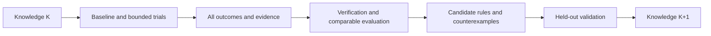

# ECC ICS55 User Manual for Testing Optimization Experience

[Simplified Chinese](ecc-experience-testing-guide.cn.md)

This manual helps users and AI language models test any ECC-supported design on
ICS55, preserve evidence, evaluate optimization experience, and build a versioned
knowledge store for ECC. Private benchmarks are external inputs; their layouts,
names, types, and size distributions do not define product behavior.

**The current CLI provides run, param, report, sweep, explore, signoff, and
reproducible for execution and evidence collection. ecc_experience now provides P0
collect/list/show/verify and P1 enable/status/disable, post-commit attempt outbox
recording, and drain recovery, plus campaign ledgers, recommend, plan, evaluate,
release, and budgeted optimize. campaign quality/recover, neutral step resource
observations, stage features, frozen-release match, bounded stage dse and isolated
study evaluate/publish are implemented. P4 dataset build, an explainable ridge
baseline, held-out leakage checks, evaluate/publish, predict and advise are
implemented. Complex search, parallel scheduling and shared services remain
outside this delivery. Experience export/import supports explicit selection,
offline integrity checks, and idempotent merging.**
Check the installed runtime's help and output contracts before using any capability.

This manual is not a completed test record. Example paths, names, and budgets explain
the procedure; they are not validated configurations. For design preparation and
candidate creation, use the [PPA/DSE manual](../../chipcompiler/docs/ecc-ppa-dse-guide.en.md).

## 1. Two operating modes

| Mode | Entry condition | Available work |
| --- | --- | --- |
| External ledger | Current ECC CLI is available | Execute, save reports, compare, and summarize; users/AI maintain external records |
| Native experience | Installed experience interfaces and their schemas/capabilities have been verified | P0 explicit collection, queries, and verification; other stages only within available scope |

When native interfaces are absent, continue with the external ledger and report
native experience unavailable. Handwritten JSON/Markdown is not an automatically
collected ECC case or a directly loadable knowledge package. Do not assume the
current `ecc doc` command has an experience topic; follow the documentation links.

## 2. AI execution contract

The AI autonomously completes a round within the supplied inputs, goals, parameters,
and budget, choosing each next action from evidence:

- Keep source inputs read-only and workspace/evidence output separate; preserve previous trials.
- Change managed state through public CLI commands; never edit flow, parameters, checklists, or reports to manufacture a pass.
- Freeze RTL, SDC, frequency, corners, activity, process, and acceptance conditions across optimization candidates.
- Search only schema-valid parameters connected to the actual tools; record evidence of their effect.
- Preserve failures, no-gain trials, cancellations, and reuse, not only winners.
- Distinguish unknown, missing, stale, and unparseable evidence; do not turn them into zero or passed.
- Candidate acceptance does not change flow execution policy or add a checklist-blocked execution gate.
- Do not describe existing DRC reports as GDS DRC or foundry signoff.
- Do not upload private designs, experience, or artifacts, or encode private input conventions in product code.
- Continue within budget; report specific missing requirements, unavailable capabilities, or exhausted budgets.

## 3. Required preparation

| Input | Required declaration |
| --- | --- |
| Design | Prepared ECC project, or WorkspaceSpec/Bindings validated through an available interface |
| Specification | Top, actual clocks, SDC/period and IO conditions, goals, hard constraints, allowed parameters |
| Process | Actual ICS55 library/LEF/RC/corner resources and content digests |
| Environment | ECC binary/version, EDA tools, CPU/RAM and GPU when applicable; use installed tools |
| Budget | Candidate count, total time, task timeout, concurrency, and resource limits |
| Output | New campaign/trial directories, ledger, and explicit store in native mode |
| Evaluation | Baseline, metrics/units, acceptance scope, optional external family groups, holdout policy |

A clock name is not a period. Do not assign every design the same frequency without
a specification. Mark missing required constraints as needs_constraints; distinguish
import/synthesis diagnostics from accepted PPA results.

Type and family may be absent; do not infer them from directory names. Measure size
after synthesis. Record register storage separately from mapped macros. Report unsupported
input capabilities instead of silently rewriting RTL.

A local converter can prepare projects and an external task list for private data.
The product does not require fixed metadata filenames, one directory per design, or
a predetermined type list.

## 4. Freeze conditions and discover capabilities

Record campaign ID, selected designs, input/constraint digests, effective configuration,
tools/process, hardware, seeds, concurrency, budget, and knowledge release. Changed
conditions create a new trial or comparison group; preserve earlier results.

Replace paths in the following Bash templates. Keep evidence outside workspaces and
source repositories, with a new directory for each trial. Execute snippets in stages,
inspect exit codes, and enter dependent stages only when their prerequisites hold.

```bash
ECC_TEST_BIN="ecc"
ECC_TEST_PROJECT="/absolute/path/to/prepared-project"
ECC_TEST_EVIDENCE="/absolute/path/to/test-output/campaign-001/baseline-001"
ECC_TEST_BASELINE="baseline-001"
mkdir -p "$ECC_TEST_EVIDENCE"
```

The optional function below preserves raw stdout/stderr, NUL-delimited argv, UTC
timestamps, and exit code. Successful recording returns the command's exit code
without deciding business acceptance. Diagnose a failed call before advancing to a
winner. Recording write failures return 1 and must be classified separately from
EDA failures. It refuses to overwrite evidence. Other recorders must preserve
equivalent information.

```bash
ecc_test_capture() {
  local test_label="$1"
  shift
  case "$test_label" in
    ""|*[!a-zA-Z0-9_.-]*) return 2 ;;
  esac
  local command_prefix="$ECC_TEST_EVIDENCE/$test_label"
  local command_exit=0
  local record_suffix
  for record_suffix in argv started finished stdout stderr exit; do
    if [ -e "$command_prefix.$record_suffix" ]; then
      printf '%s\n' "Refusing to overwrite command evidence: $command_prefix" >&2
      return 2
    fi
  done
  printf '%s\0' "$@" > "$command_prefix.argv" || return 1
  date -u '+%Y-%m-%dT%H:%M:%SZ' > "$command_prefix.started" || return 1
  if "$@" > "$command_prefix.stdout" 2> "$command_prefix.stderr"; then
    command_exit=0
  else
    command_exit=$?
  fi
  printf '%s\n' "$command_exit" > "$command_prefix.exit" || return 1
  date -u '+%Y-%m-%dT%H:%M:%SZ' > "$command_prefix.finished" || return 1
  return "$command_exit"
}
```

Discover existing capabilities:

```bash
ecc_test_capture root-help "$ECC_TEST_BIN" --help
ecc_test_capture version "$ECC_TEST_BIN" version --json
ecc_test_capture project "$ECC_TEST_BIN" project show --project "$ECC_TEST_PROJECT" --plain
ecc_test_capture config "$ECC_TEST_BIN" config --project "$ECC_TEST_PROJECT" --json
ecc_test_capture doctor "$ECC_TEST_BIN" doctor --project "$ECC_TEST_PROJECT" --json
ecc_test_capture inputs-check "$ECC_TEST_BIN" check --project "$ECC_TEST_PROJECT" --plain
ecc_test_capture parameter-catalog "$ECC_TEST_BIN" param list --all --project "$ECC_TEST_PROJECT" --json
```

If root help has no experience group, select external-ledger mode. If it exists,
verify actual subcommands, options, schemas, and versions; a matching name does not
prove every planned feature exists. Classify preflight failures. Do not automatically
install/upgrade tools, change process resources, or weaken acceptance to remove them.

## 5. Establish a real baseline

Confirm the baseline name is unused, project/spec is correct, and a full flow fits
the budget:

```bash
ecc_test_capture baseline-run "$ECC_TEST_BIN" run \
  --project "$ECC_TEST_PROJECT" --workspace "$ECC_TEST_BASELINE" --preset rtl2gds --plain
```

An exit code of zero is one execution observation. Check requested stages, skip/reuse,
checklists, checkers, and evidence coverage. The current syn_sta preset is not a
substitute for final routed STA.

Preserve and diagnose failed baselines for failure coverage; they are not accepted
winners. Distinguish infeasible goals from tool/environment failures. Use measured
costs to adjust subsequent trial budgets.

## 6. Evidence after each execution

### 6.1 Current CLI collection template

The workspace must be stable and terminal, with no other session executing or
modifying it. Save the original committed snapshot before reports, then another
snapshot after refresh, distinguishing analysis refresh from a new execution.

```bash
ecc_test_capture state "$ECC_TEST_BIN" status \
  --project "$ECC_TEST_PROJECT" --workspace "$ECC_TEST_BASELINE" --json
ecc_test_capture snapshot-before-refresh "$ECC_TEST_BIN" report snapshot \
  --project "$ECC_TEST_PROJECT" --workspace "$ECC_TEST_BASELINE" \
  --output "$ECC_TEST_EVIDENCE/committed-before-refresh.json" --json
ecc_test_capture step-overview "$ECC_TEST_BIN" report step \
  --project "$ECC_TEST_PROJECT" --workspace "$ECC_TEST_BASELINE" --json
ecc_test_capture placement-detail "$ECC_TEST_BIN" report step placement \
  --project "$ECC_TEST_PROJECT" --workspace "$ECC_TEST_BASELINE" \
  --section feature --section analysis --section checklist --section outputs --json
ecc_test_capture diagnosis "$ECC_TEST_BIN" diagnose run \
  --project "$ECC_TEST_PROJECT" --workspace "$ECC_TEST_BASELINE" --json
ecc_test_capture signoff-inspect "$ECC_TEST_BIN" signoff inspect \
  --project "$ECC_TEST_PROJECT" --workspace "$ECC_TEST_BASELINE" --json
ecc_test_capture qor "$ECC_TEST_BIN" report qor \
  --project "$ECC_TEST_PROJECT" --workspace "$ECC_TEST_BASELINE" \
  --output "$ECC_TEST_EVIDENCE/qor-report.txt" --json
ecc_test_capture checklist "$ECC_TEST_BIN" report checklist \
  --project "$ECC_TEST_PROJECT" --workspace "$ECC_TEST_BASELINE" \
  --output "$ECC_TEST_EVIDENCE/checklist-report.txt" --json
ecc_test_capture signoff-check "$ECC_TEST_BIN" signoff check \
  --project "$ECC_TEST_PROJECT" --workspace "$ECC_TEST_BASELINE" --json
ecc_test_capture snapshot-after-refresh "$ECC_TEST_BIN" report snapshot \
  --project "$ECC_TEST_PROJECT" --workspace "$ECC_TEST_BASELINE" \
  --output "$ECC_TEST_EVIDENCE/committed-after-refresh.json" --json
```

Placement is an example token from the current flow. Read the overview first; other
flows use their actual stages. Preserve feature/analysis/checklist/outputs for other
stages too. Missing/incompatible snapshots and failed reports retain their errors
and an unknown evidence status.

Signoff inspect refreshes analysis; report qor/checklist writes reports. Refresh is
not a new attempt or additional execution cost. Defer stable collection while a
task is running instead of treating partially updated files as complete evidence.

### 6.2 Minimum ledger fields

For every trial preserve input/constraint/process/tool identity, effective parameters,
requested/actual values and evidence level, seed/hardware/concurrency, executed stages,
reuse lineage, raw metrics/units/source/corner, QoR version, flow/checklist/checker
states, resource scope, failure reason, exit codes, and evidence digests.

Keep execution, quality, evidence, and collection statuses separate. Rerunning a
workspace creates a new attempt; copied prefixes are reuse; report refresh creates
a new observation. These are not multiple independent experiments.

Legacy peak_memory_mb does not uniformly mean absolute process-tree peak. Zero can
reflect missing measurement. Mark legacy/unknown without new facts. Summed stage
time is not parallel campaign wall time.

## 7. Bounded candidates and stage DSE

Use the [PPA/DSE manual](../../chipcompiler/docs/ecc-ppa-dse-guide.en.md) to create isolated candidates or a
small sweep. Preserve full configurations; a sweep does not automatically inherit
historical workspace overrides.

Validate schema, backend mapping, and effect before attributing a parameter change.
Without receipts, claim only configured or materialized, not effective. Parameters
unconnected to the actual tool are not search dimensions.

Collect an existing sweep:

```bash
ECC_TEST_SWEEP="sweep-001"
ecc_test_capture sweep-verify "$ECC_TEST_BIN" sweep verify \
  --project "$ECC_TEST_PROJECT" --name "$ECC_TEST_SWEEP" --json
ecc_test_capture sweep-compare "$ECC_TEST_BIN" sweep compare \
  --project "$ECC_TEST_PROJECT" --name "$ECC_TEST_SWEEP" --json
ecc_test_capture candidate-ranking "$ECC_TEST_BIN" explore rank \
  --project "$ECC_TEST_PROJECT" --name "$ECC_TEST_SWEEP" --json
ecc_test_capture candidate-matrix "$ECC_TEST_BIN" explore export \
  --project "$ECC_TEST_PROJECT" --name "$ECC_TEST_SWEEP" \
  --format json --output "$ECC_TEST_EVIDENCE/candidate-matrix.json" --json
```

Use the actual candidate project/workspace recorded in results to collect each
candidate. The original project's report project is not the sweep candidate list.
Give each candidate a separate command-evidence directory.

Stage DSE declares its boundary and local acceptance. Distinguish stage-validated
from full-flow-validated; advance only a shortlist. Better early HPWL/congestion
does not prove final PPA improvement. Compare run compares observations within one
workspace; it does not replace raw metric comparison across candidates.

## 8. Comparison and winner selection

1. Check comparable inputs, constraints, process, tools, analysis/units, stages, and goals.
2. Filter by this round's hard constraints; missing evidence cannot pass.
3. Compare raw PPA, QoR, and cost, retaining Pareto candidates and counterexamples.
4. Preserve complete configuration recipes; do not combine individual best values from unrelated trials.
5. Validate the winner fully in an unused fresh workspace with all effective parameters.
6. If fresh validation fails, report unvalidated/failed rather than only showing the original score.

Repeated seeds and related variants are not independent designs. Lower frequency,
changed activity/corners, or removed checks change the spec; they do not demonstrate
improvement under the original goal.

## 9. Negative and compatibility tests

Use isolated trials, disposable copies, or synthetic fixtures. Preserve baselines
and source inputs. Deliberate evidence corruption tests readers/verifiers; it is
not a real EDA parameter failure sample.

| Scenario | Allowed scope | Correct outcome |
| --- | --- | --- |
| DRC/LVS/STA violation | Real failed result or isolated failing design; declare checker coverage | Preserve violations, failed gates, and exit codes; exclude from accepted winners |
| Missing QoR | Remove a specific source in an isolated evidence fixture; check other copies | Missing/unknown, not a zero score |
| Corrupt checklist | Invalid format in an isolated fixture | Parse failure/unknown, not passed |
| Legacy workspace | Preserved old fixture, read-only inspection/import | Explicit compatibility/missing fields; no automatic migration |
| Stale evidence | Fixture inputs/config differ from result identity | Stale; excluded from strict recommendation |
| Recollection/rerun/reuse | Separate tests after native module availability | Idempotent collection, new rerun attempt, reuse of original cost |
| OOM/timeout/cancel | Explicitly authorized isolated budget test; confirm actual termination | Resource/cancelled/unknown; incomplete cost observation |
| Unwritable store/collector failure | Isolated native-mode fault test | Visible collection failure, no successful-step rollback or notification blockage |
| Source/wheel/frozen | Actual installed artifacts | Usable contract, explicit resource scope, no source/private-path dependency |

Do not force every design to fail for coverage. Report unavailable reproductions as
not_run with reasons. Report fixture validation separately from real EDA coverage.

Inspect both exit code and JSON business status. Quality queries may return 6
(failed) or 7 (unknown) while stdout remains valid JSON. Codes 20/21 indicate busy/
conflict. A timed execution record may contain 124; preserve actual codes and process
states rather than assuming all commands use the same timeout encoding.

## 10. Native experience acceptance when available

P0 explicit collection, queries, and verification are implemented. P1 automatic
recording writes only small committed facts to a project outbox; it does not change
parameters, block engineering commits, or write experience data into source or the
wheel. Read-only recommendation, reviewable plans, comparison, releases, and bounded
full-flow optimization and serial baseline campaigns are also implemented. Stage
features, strict matching, bounded stage DSE, held-out evaluation and isolated
feedback publication are available in the final sections of this manual.
Cross-design transfer is unproven and parallel scheduling remains unavailable. P4 can
model explicitly recorded resource fields, but that is not an independent process-tree
measurement or a calibrated RAM/CPU prediction. Check installed help.

```bash
EXPERIENCE_STORE=/absolute/path/to/experience-store
ecc experience --help
ecc experience collect --project "$PROJECT" --workspace baseline-001 \
  --store "$EXPERIENCE_STORE" --json
ecc experience list --store "$EXPERIENCE_STORE" --json
```

For continuous accumulation, explicitly configure a store outside the project:

```bash
ecc experience enable --project "$PROJECT" --store "$EXPERIENCE_STORE" --json
ecc experience status --project "$PROJECT" --json
ecc run --project "$PROJECT" --workspace baseline-001 --json
ecc experience drain --project "$PROJECT" --json
ecc experience disable --project "$PROJECT" --json
```

`enable` stores project-level recording configuration; ordinary `run`, single-step
runs, reruns, and failures keep the existing execution rules. Each real execution gets
an independent attempt ID. After each Engineering Snapshot commit, the recorder writes
one event with workspace revision, step terminal state, and the existing runtime/peak
memory facts with their source scope. Recorder errors are logged and do not change the
EDA exit code. `drain` processes only attempts with start, committed-step, and terminal
events, and checks the final snapshot digest. If the source workspace changed, events
remain pending and the reason is reported, preventing new reports from being attached
to an old attempt. Successful events move into the project processed directory and the
case source receives the attempt ID. Use `status` to monitor pending events; do not
delete pending events manually.

Validate a generic campaign manifest before batch testing:

```bash
ecc experience campaign validate --manifest campaign.json --json
```

The validator checks the schema, ICS55 profile field, baseline mode, budget bounds,
unique design IDs, existing input directories, and that store/output paths do not
overlap inputs or each other. Its fingerprint can be recorded in an external campaign
ledger. Validation does not run EDA, create workspaces, or create output/store
directories. Manifest paths are relative; design discovery and label conversion remain
in the user environment. ECC does not scan private datasets.

### Organizing batch workspaces

Give each batch a separate directory and separate large execution data, user reports,
command audit files, and reusable knowledge artifacts. This is a caller convention for
general designs, not a required benchmark taxonomy or a fixed input layout:

```text
experience-root/
  README.md
  campaigns/
    batch-001/
      campaign.json
      inputs/                 # Explicitly prepared ECC projects
      store/                  # This batch's cases; ECC owns the internal layout
      runs/                   # Native ledgers, results, attempt projects and receipts
      reports/                # summary.md, matrices, quality and split results
      logs/                   # Outer CLI stdout/stderr/exit codes
      artifacts/
        releases/
        datasets/
        models/
        packages/
  library/                    # Explicitly selected and verified cross-batch knowledge
    store/
    releases/
    datasets/
    models/
  archives/                   # Static delivery archives
```

**Keep campaign.json at the batch root.** The current validator requires input
projects, store, and output_root to remain under the manifest directory. For example,
use `inputs/design-001` for an input, `store` for store, and `runs` for output_root.
Do not move the manifest into config/ and use `../store`, or escape the root through
symlinks. Use existing `experience export/import` commands to add selected cases to
`library/store` across batches. Prepare inputs through public project/workspace
commands; moving a registered workspace and editing a manifest path is insufficient.

Native commands manage the internal runs/ and store/ layout. The caller creates
reports/, logs/, and artifacts/ using redirection and existing `--output` options;
`campaign init` initializes a ledger, not a directory scaffold. With prepared inputs
and a complete manifest:

```bash
BATCH=/path/to/experience-root/campaigns/batch-001
mkdir -p "$BATCH/reports" "$BATCH/logs"
ecc experience campaign validate --manifest "$BATCH/campaign.json" --json
ecc experience campaign run --manifest "$BATCH/campaign.json" --json \
  > "$BATCH/logs/campaign-run.stdout.json" 2> "$BATCH/logs/campaign-run.stderr.log"
run_exit=$?
printf '%s\n' "$run_exit" > "$BATCH/logs/campaign-run.exit"
ecc experience campaign quality --manifest "$BATCH/campaign.json" --json \
  > "$BATCH/reports/quality.json" 2> "$BATCH/logs/quality.stderr.log"
ecc experience campaign summary --manifest "$BATCH/campaign.json" --json \
  > "$BATCH/reports/summary.json" 2> "$BATCH/logs/summary.stderr.log"
```

This snippet assumes the caller has not enabled `set -e`. An AI or script must record
and check every command's exit code separately; a successful final summary must not
hide a run or quality failure. Also write summary.md with parameters, flow/checklist/
signoff, QoR, resource scope, failures, unexecuted work, and next actions per design.

Running paths are frozen evidence. Do not reorganize runs/, store/, inputs, or receipt
paths for presentation; create a new batch when paths must change. Static delivery
archives can use README.md, summary.md, config/, reports/, artifacts/, audit/, and
docs/, but must state whether they include a resumable workspace. Logs, a release,
a dataset, and an experience package alone do not form a complete campaign; label the
original manifest as an audit copy. Preserve content hashes and a path map when
moving archived files. Do not rewrite fingerprinted releases, datasets, or cases;
import and verify the package from its new location before delivery. Keep failed and
unknown results, rather than archiving successful samples alone.

### Serial baseline campaigns

Execute prepared ECC projects directly:

```bash
ecc experience campaign run --manifest campaign.json --json
ecc experience campaign run --manifest campaign.json --retry-failed --json
```

The first version requires `mode=baseline`, `max_concurrent_flows=1`, and no
`knowledge_release_id`. Each `designs[].workspace` identifies a registered source
workspace with a committed Engineering Snapshot, readable declared inputs, and a PDK
matching `process_profile`. `validate` checks the generic manifest; `run` additionally
checks these execution requirements.

The runner invokes public `init → workspace import → workspace derive → run` commands
to create an isolated project and a workspace for a full rerun at
`output_root/attempts/trial-<id>/project/baseline`. Derivation preserves source
configuration, constraints, skip policy, and inputs. Source project registration,
configuration, and reports remain unchanged. Derivation may copy existing workspace
files, so reserve enough disk space.

Requested parameters are checked before execution. Afterwards, only realized die
aspect ratio/dimension updates matching ECC-Tools geometry reports are accepted;
`runtime_parameter_updates` records requested/observed values and report digests.
Other parameter changes still return 21. Cases retain actual post-run parameters;
geometry write-back is not treated as a new optimization strategy.

`output_root/campaign-run.json` stores frozen inputs, observed runtime versions,
attempt/run IDs, command argv, log paths, raw exit codes, `execution_status`,
`acceptance`, `collection_status`, and case verification. Command stdout/stderr files
contain EDA output; execution markers use the standard workspace `log/<run-id>.log`.
Full verification findings live in the attempt's `case-verification.json`; the result
index retains a compact summary. Frozen CLI builds also record their executable digest,
so different builds sharing a version string are not treated as the same runtime.
`campaign status` also exposes runner status, result path, and active trials through
`execution`. Existing ledger counts still describe immutable trial records; the runner
records each attempt once, after it reaches a terminal state.

Repeated execution skips designs with terminal ledger records by default.
`--retry-failed` creates new attempts for unsuccessful, blocked, or cancelled designs,
at most once per design per invocation, bounded by `max_trials_per_design` across
invocations. Successful designs are skipped. A terminal result saved before its ledger
record is replayed idempotently without running EDA again. Resume checks the manifest,
source configuration/declared input digests, and ECC/observed tool versions; changes
return 21. Start a new output_root after changing frozen conditions.

Only an attempt that actually entered run is collected with its real run ID. Execution,
acceptance, and collection are separate facts. Pass requires flow/checklist/signoff/QoR
and case verification to pass; unknown evidence is blocked. Failures and cancellations
remain recorded. Resume rechecks linked cases instead of trusting a ledger pass.
Exit codes: 0 all pass, 2 invalid input/unsupported mode, 6 failure or blocked, 7 missing
or unknown evidence on recorded cases, 20 busy lock or unfinished intent, 21 changed
frozen conditions, 124 timeout, 130 cancellation. A failed design does not stop other
designs; cancellation or changed conditions stop scheduling.

Normal cancellation and timeout clean up managed process trees. A forcibly killed
coordinator may leave a running intent; execution returns 20 instead of taking it
over blindly. New durable workers wait for actual descendants to exit and write
completion receipts. Use `ecc experience campaign recover --manifest <manifest>
--trial-id <trial>` to verify receipts and frozen conditions, finalize the attempt,
then resume the campaign. Active workers, missing/old receipts or unproven quiescence
retain 20. Do not delete locks or manufacture terminal records. Diagnose attempt
projects through campaign-run.json and ecc process list. Stage DSE has its own dse
interface; parallel scheduling remains unavailable. P4 resource targets use only
explicitly recorded observations within a matching scope.

Declared input digests do not verify the complete include/PDK closure; observed versions
do not hash every executable. Baseline collection does not demonstrate PPA improvement
or cross-design generalization.

### Campaign data quality audit

Audit all trial history before creating a knowledge release:

```bash
ecc experience campaign quality --manifest campaign.json --json
```

The optional `--ledger PATH` follows status/summary conventions. This read-only
query runs no EDA and changes no source workspace, store or ledger. Summary shows
the latest trial per design; quality retains failures, retries and cancellations,
with separate `execution_status` and `quality_status`. Retrying a failed execution
does not remove its evidence as a potential counterexample.

`coverage` reports committed identity, attempt, declared-input fingerprint,
parameter, process and finite QoR availability. Each trial links its case, current
verification, exceptional findings, QoR and step states. Missing core evidence,
legacy workspaces, missing attempt IDs and missing QoR are unknown. Corrupt/stale
evidence, invalid/non-finite QoR and a PDK family differing from the manifest fail.
Optional absent reports only contribute to `artifact_counts`. Zero/missing memory
is null; step runtime/memory carry `legacy_flow_step_ledger` scope and are not
independent process-tree measurements or resource predictions.

`diversity` counts distinct cases, execution identities and declared-input
fingerprints with intact stored evidence, and identifies repeated references.
Coverage counts trial references rather than independent samples. Recollecting
one execution does not increase `unique_execution_identities`. Different input
fingerprints do not prove independent design families. Evaluation groups use only
user-provided labels; names never imply a family.

Exit codes: 0 means collection checks passed; 6 means at least one failed check;
7 means unknown/missing facts or pending/running work; 2 means invalid input;
21 means a changed manifest. Quality pass does not replace flow/signoff/release
acceptance or prove effective parameters, cross-design benefit, or full include/PDK
closure. Existing wheel/PyInstaller and design-matrix experience smoke paths check
the unknown and corrupt-case exits without inventing independent attempt IDs.

### External execution and ledgers

Newly executed flow steps optionally carry `resource_observation`, frozen with
their Engineering Snapshot and experience case. Its attempt ID is created only
for actual tool execution; skipping retains the original identity, while rerun,
invalidation and reset remove old references. Legacy workspaces remain readable
without fabricated historical measurements.

`peak_rss_bytes` is the sampled absolute Linux `/proc` RSS sum of the observed
process tree. The original `peak memory (mb)` keeps its historical meaning.
`isolated_worker_process_tree` observes a worker and its descendants;
`shared_process_tree` covers in-process/frozen execution and may include other
work, so its status is partial. Status is available/partial/unavailable; absent
samples produce null rather than zero. Facts include UTC timestamps, monotonic
elapsed time, sample interval/count, PID/start ID, host/boot identity and reasons.
RSS can double-count shared pages and miss short peaks; it is not cgroup/PSS or
exclusive tool memory and does not establish a calibrated resource predictor.
Each step in `campaign quality` exposes this optional field without tightening
the gate for legacy cases.

After validation, initialize a resumable campaign ledger. Initialization creates only
`output_root/campaign-ledger.json`, containing the manifest fingerprint, design list, and
empty trial records; it does not start EDA:

```bash
ecc experience campaign init --manifest campaign.json --json
```

Record one result after each externally executed trial. The scheduler should provide a
stable `--trial-id`: repeating the same payload returns `already_present`, while reusing
the ID with different data returns a revision conflict:

```bash
ecc experience campaign record \
  --ledger output/campaign-ledger.json \
  --design design-001 \
  --workspace baseline-001 \
  --status pass \
  --trial-id trial-001 \
  --case-id "$CASE_ID" \
  --json
```

Allowed trial states are `running`, `pass`, `fail`, `blocked`, and `cancelled`. `case_id`
is optional, but collect or drain the experience case before recording it when possible so
the trial retains an evidence link. Recover campaign progress with:

```bash
ecc experience campaign status --manifest campaign.json --json
```

At the end of a batch, or before resuming an interrupted one, combine the latest trial
state with linked case verification and QoR facts:

```bash
ecc experience campaign summary --manifest campaign.json --json
```

`campaign_status` reports scheduling state only. `campaign_summary` also reports
`evidence_status`, `integrity`, and `evidence_counts`. A missing `case_id` or missing case
is reported as missing evidence; a trial `pass` is never promoted to a QoR or signoff pass.

Status revalidates the manifest fingerprint and refuses to continue after the manifest has
changed. The ledger is a scheduling and recovery record, not a QoR verdict. QoR, step
reports, tool versions, and parameters still belong in workspace evidence and experience
cases; only verified cases should feed experience summaries or later recommendations.

Use the read-only recommendation command to retrieve observed configurations:

```bash
ecc experience recommend \
  --project "$PROJECT" \
  --workspace "$WORKSPACE" \
  --store "$EXPERIENCE_STORE" \
  --limit 10 \
  --json
```

Once a release has been created and verified, bind recommendations to it explicitly:

```bash
ecc experience recommend \
  --project "$PROJECT" \
  --workspace "$WORKSPACE" \
  --store "$EXPERIENCE_STORE" \
  --release "$OUTPUT_ROOT/experience-release.json" \
  --json
```

With `--release`, ECC verifies the release first and retrieves candidates only from the
listed cases. If the release is absent, tampered with, missing a case, or no longer
verifies, the command returns an empty `recommendations` list and preserves the
`release_verification` result. Omitting `--release` keeps the compatible local-exploration
behavior and searches the current store without a frozen knowledge boundary.

The current implementation matches only complete input-content fingerprints and returns
parameters observed in historical cases with `safe_to_apply` fixed to `false`. This is not
automatic tuning; absolute environment paths are replaced with `<path-redacted>` so a
local PDK path is not treated as portable. It also does not establish a causal QoR effect.
The AI must inspect
verification, QoR, parameter receipts, and process applicability before validating in a
new workspace. If the query has no complete fingerprint, the store is absent, or no
verifiable case exists, the command returns `status=insufficient_evidence` with an empty
`recommendations` list instead of guessing parameters.

When the recommendation needs to be handed to a human or AI reviewer, write a plan file:

```bash
ecc experience plan \
  --project "$PROJECT" \
  --workspace "$WORKSPACE" \
  --store "$EXPERIENCE_STORE" \
  --release "$OUTPUT_ROOT/experience-release.json" \
  --output "$OUTPUT_ROOT/optimization-plan.json" \
  --json
```

The plan binds the query workspace, input fingerprint, optional release, cases, and a plan fingerprint. It
always declares `manual_review`, `requires_new_workspace=true`, and `auto_apply=false`. It
is a reviewable execution suggestion: it does not edit parameters, copy workspaces, or
start a flow. Old plans without explicit optimization limits and an allowed parameter
list remain review-only and cannot be executed by optimize.

### 10.1 Execute a bounded experience plan

When real flow execution is intended, create a bounded plan, review it, then explicitly
invoke optimize:

```bash
ecc experience plan \
  --project "$PROJECT" --workspace "$WORKSPACE" \
  --store "$EXPERIENCE_STORE" \
  --allow-param floorplan.core_util \
  --allow-param place.target_density \
  --max-trials 4 --max-seconds 3600 --trial-timeout 900 \
  --patience 2 --target-score 95 \
  --output "$OUTPUT_ROOT/bounded-plan.json" --json

ecc experience optimize \
  --project "$PROJECT" --store "$EXPERIENCE_STORE" \
  --plan "$OUTPUT_ROOT/bounded-plan.json" \
  --output "$OUTPUT_ROOT/optimization-001" --json
```

The plan command also accepts `--release`; execution re-verifies the release ID and
cases. Creating a plan remains read-only. `--allow-param` includes execution limits in
the plan but starts no EDA. Omit `--project` from a project or workspace directory;
the plan selects its baseline. The output directory must be new, and the experience
store must not overlap the baseline workspace.

| Limit | Current behavior |
| --- | --- |
| Candidates | Observed configurations with matching input content; failed evidence and changes outside the allowlist are excluded; duplicate configurations are removed; no invented search grid |
| Parameters | Explicitly authorized core utilization/margin/aspect ratio, placement density/overflow/padding/routability, and CTS fanout/skew/transition/capacitance knobs; the existing ECC catalog validates names, types, and ranges |
| Fixed conditions | Baseline snapshot and directly bound input content are checked; design, process declaration, flow, and other configuration stay fixed; fields absent in old snapshots may be filled with current catalog defaults |
| Trial budget | `max_trials` caps all new workspaces, including an independent winner rerun, and must be at least 2; execution is serial and preserves the baseline |
| Time budget | Starts after validation; workspace derivation, parameter application, flow, and report checks share each trial deadline; expiration stops subprocesses; cleanup may take a short additional grace period |
| Early stop | Candidate exhaustion, trial limit, target score, consecutive failures/non-improvements, timeout, or cancellation; a search stop still requires an independent winner rerun |
| Scope | optimize validates the complete baseline-defined flow; experience dse screens stages and separately requires full and fresh validation |

Execution reuses `workspace derive`, `param apply`, `run`, `status`, and `signoff check`
with installed tools. A blocked baseline can still be optimized; its status is preserved.
New candidates and the fresh rerun must satisfy existing flow/checklist/signoff checks,
finite QoR, and case evidence verification to be accepted. Signoff covers only ECC's
available checks, without GDS DRC or foundry signoff claims.

The controller atomically updates `result.json` with workspaces, run IDs, parameter
changes, command log paths, exit codes, case IDs, verification, scores, and failure/stop
reasons. Completed snapshots are collected into the store with the actual run ID;
execution or collection failures retain their trial records and logs. Only a passing
independent rerun can return `status=complete`. `improved=false` means validation passed
without QoR gain; a missing baseline score produces `improved=null` and an insufficient
comparison, rather than an invented delta.

| Exit code | Meaning |
| --- | --- |
| 0 | A candidate and its independent rerun passed; score gain is not guaranteed |
| 2 | Invalid plan, fingerprint, limits, parameters, or output directory |
| 6 | No accepted candidate or failed independent validation |
| 7 | No eligible observed configuration |
| 21 | Baseline inputs or snapshot changed |
| 124 / 130 | Timeout / cancellation |
| 1 | I/O or another execution failure |

The controller currently requires Linux and handles Ctrl-C/SIGTERM with cleanup of
step processes in separate sessions. It does not resume interrupted runs, remove failed
workspaces, publish releases, relax SDC/frequency/corners, or modify RTL. A new invocation
uses a new output directory and budget. Parameter evidence remains `configured`, without
claiming tool consumption. Full input closure, PDK content freezing, and external tool
version freezing are not implemented. RAM/CPU quotas are not enforced; P4 may model
recorded resource fields but does not add independent process-tree measurement or a
calibrated resource predictor. Final summaries must include baseline acceptance, best and
fresh scores, gain or no gain, cost, and these limits.

### 10.2 Compare and release cases

Compare the QoR of two collected cases with the read-only command:

```bash
ecc experience evaluate \
  --store "$EXPERIENCE_STORE" \
  --baseline "$BASELINE_CASE_ID" \
  --candidate "$CANDIDATE_CASE_ID" \
  --json
```

The command requires matching, complete input-content fingerprints, evidence verification
without failures, and finite numeric QoR scores. A case without a stable attempt identity
may still have verification status `unknown`; the command preserves those findings
instead of hiding them. The result includes both verification records, the two scores,
their delta, and percentage delta. ECC currently treats a higher QoR score as better.
Mismatched input fingerprints return `status=incompatible`; missing evidence or scores
return `status=insufficient_evidence`. The command never starts EDA, changes a workspace,
or accepts an optimization result automatically. Only for the same design, process, and
constraints may an AI treat `improved` as a candidate result, then continue checking the
checklist, signoff, and original reports.

Freeze a set of cases into an auditable knowledge release only after they are verified:

```bash
ecc experience release create \
  --store "$EXPERIENCE_STORE" \
  --case-id "$CASE_ID_1" \
  --case-id "$CASE_ID_2" \
  --output "$OUTPUT_ROOT/experience-release.json" \
  --json

ecc experience release verify \
  --store "$EXPERIENCE_STORE" \
  --release "$OUTPUT_ROOT/experience-release.json" \
  --json
```

A release accepts only cases whose evidence verification is `pass` and whose complete
input-content fingerprint is present. It records case IDs, input/process fingerprints,
workspace revisions, and QoR summaries. It does not copy private workspace paths or large
artifacts, edit parameters, or enable experience automatically. The output is written
atomically and can be verified by content identity; repeating the same release is
idempotent, while overwriting it with different content fails. Run `release verify` in CI,
after backup restoration, or before giving the release to an AI. Cases without a stable
attempt, unavailable QoR, damaged evidence, or incomplete legacy provenance cannot enter a
release.

Read the actual case_id from collect/list JSON, then run:

```bash
CASE_ID=case-id-returned-by-collect
ecc experience show "$CASE_ID" --store "$EXPERIENCE_STORE" --json
ecc experience verify "$CASE_ID" --store "$EXPERIENCE_STORE" --json
ecc experience verify --store "$EXPERIENCE_STORE" --json
```

collect reuses current-directory defaults for --project/--workspace. list/show/verify
need only an explicit store and work outside a project. Store and source workspace
must be separate. Recollecting the same observation returns already_present. Changed
revision or evidence produces another observation, not proof of an independent
execution. collect never runs EDA, refreshes reports, migrates legacy workspaces, or
repairs corrupt evidence.

Each cases/case_id/case.json holds its version, source revision, original snapshot,
metric units, parameters, and evidence references. Small JSON/TOML evidence is copied
under evidence/ by digest. Large reports, netlists, and layouts retain references and
digests only; source deletion prevents a complete reproducible delivery. report_text
is opaque evidence even with a .json suffix. Use reproducible export for full artifacts.

verify integrity describes copied evidence integrity. status additionally considers
changed, absent, or corrupt source files, missing QoR, and legacy provenance. Exit 6
means explicit failure; 7 means unknown; JSON remains available. Explicit P0 collect has
no attempt identity. Cases materialized by P1 drain have a stable attempt_id, but still
represent committed observations and do not prove parameter effectiveness by themselves.
EDA violations and evidence damage remain distinct.

Writes use a single collector and atomic publication from a temporary directory,
preserving existing cases. The store's .write-lock directory signals an active writer.
After a crash, confirm that the original collector has stopped before removing this
empty lock directory. Never delete cases or live temporary directories to manufacture
a pass.

| Stage | Test | Required evidence |
| --- | --- | --- |
| Explicit collection | Collect, show, verify | Traceable case, unchanged source workspace, idempotence |
| Continuous recording | Enable, run/step/rerun, then drain | Traceable attempt/revision/resource scope; source changes never mix into an old case |
| Recommendation | Unknown type, new design, empty store, incompatible version | Explained matches or insufficient_evidence, no invented configuration |
| Controlled optimization | Execute a plan with declared goals, parameters, and budget | Bounds enforced, feedback, stop reasons, fresh validation |
| Knowledge evaluation | Frozen K, held-out designs, default-policy comparison | Traceable same-budget gains/counterexamples, no evaluation leakage |
| Exchange/recovery | Round trip, repeated import, interrupted task recovery | Matching digests, idempotence, preserved earlier tasks/private inputs |

An empty store is a normal cold start. Collection can work while recommendation
reports insufficient evidence. It cannot claim a learned optimum. AI-written
summaries do not become validated rules without evidence and evaluation.

### 10.3 Back up and exchange experience cases

Select the cases to share explicitly; ECC never exports the entire store by default:

```bash
ecc experience export \
  --store "$EXPERIENCE_STORE" \
  --case-id "$CASE_ID_1" \
  --case-id "$CASE_ID_2" \
  --output "$OUTPUT_ROOT/experience.tar.gz" --json

ecc experience import \
  --package "$OUTPUT_ROOT/experience.tar.gz" \
  --store "$OUTPUT_ROOT/imported-store" --json
```

Alternatively, replace all `--case-id` options with
`--release "$OUTPUT_ROOT/experience-release.json"`; the two selection methods are
mutually exclusive. The package includes that release, all its cases, and the small
evidence files already copied into the store. The import result's `release.path`
identifies the destination release for `release verify`, `recommend --release`,
and `plan --release`.

Both commands work outside projects and require an explicit store. Export outside
the source store and import from outside the destination store. Identical repeated
exports/imports return `already_present`; different content cannot overwrite an
existing package, case, or release. Mixed imports report `created_count` and
`already_present_count`. Full validation precedes destination creation; existing
content is checked before publishing. Catchable write failures roll back entries
created by this transaction. The single-collector write lock still applies. Multiple
directory publications are not a crash-atomic transaction under forced termination
or power loss.

The manifest records its schema, case membership, each file's SHA-256 and size,
and a content-addressed package ID. Unsafe paths, symbolic/hard links, duplicate or
undeclared members, corrupt checksums, invalid case identities, and inconsistent
release metadata are rejected. Initial limits are 128 MiB compressed, 256 MiB for
the complete expanded archive, 32 MiB per file, 20000 data files, and 10000 cases.
Split the selected cases when limits are exceeded. Identical inputs produce
byte-identical gzip tar archives. Checksums establish integrity, not publisher identity.

An imported `integrity=pass` with `source_verification=not_performed` establishes
package integrity only. Original case identity, source, failures, and unknown facts
are preserved. Packaging does not follow source references to copy RTL, PDK files,
large outputs, or tools. It does not rerun EDA, enable recording, or change parameters.
Cases and small reports can still contain design names, paths, and design data;
review actual contents before sharing.

When a source workspace is unavailable, the existing `experience verify` and
`release verify` can still return `unknown`; changed source files can still fail.
Release-bound recommendations retain their original verification requirements.
Unbound observed-only queries retain their existing behavior and never auto-apply
parameters. Use `ecc reproducible export` for complete design deliverables.

| Outcome | Exit code |
| --- | --- |
| Success or identical repeated content | 0 |
| Missing/conflicting selection or invalid command arguments | 2 |
| Corrupt package, invalid schema/membership/cases/release, or exceeded limits | 6 |
| Store writer busy | 20 |
| Existing content conflicts | 21 |
| Filesystem I/O error | 1 |

The existing PyInstaller and design-matrix experience smoke now checks export,
import, repeated import, exact case preservation, and corrupt-package rejection
without launching another EDA flow.

## 11. Creating the next knowledge release



1. Freeze K's cases/rules, feature and recommendation versions; record recommendation provenance.
2. Put new outcomes in staging; local design feedback can guide its next candidates.
3. Keep held-out outcomes out of K until global evaluation completes.
4. Verify parameter effect, comparable gains, failure classifications, and resource scope before deriving recipes.
5. Compare against default or fixed bounded search at the same budget, counting all attempts and collection overhead.
6. Evaluate first-feasible time, trial count, final raw PPA, early-to-final gain retention, and budget coverage.
7. Admit adequately supported rules to scoped K+1; keep unsupported rules provisional.
8. Preserve supporting cases, counterexamples, independent design counts, versions, validation methods, and retirement reasons.

Family groups come from external provenance or structural evidence, not private-name
branches. Report limits when grouping is absent. Until release management exists,
preserve staging/evaluation materials without manufacturing a loadable release.

New cases/releases generally update the external store. Generic collection,
matching, or tool-mapping improvements require an ECC code release. Private experience
does not enter source, wheels, or PyInstaller resources by default.

## 12. Reproduction, export, and retention

For a freshly validated workspace, preserve effective configuration, input/process/
tool digests, and an independent evidence package:

```bash
ecc_test_capture reproducible-export "$ECC_TEST_BIN" reproducible export \
  --project "$ECC_TEST_PROJECT" --workspace "$ECC_TEST_BASELINE" \
  --output "$ECC_TEST_EVIDENCE/reproducible-package"
ecc_test_capture reproducible-verify "$ECC_TEST_BIN" reproducible verify \
  --package "$ECC_TEST_EVIDENCE/reproducible-package" --json
```

Set ECC_TEST_BASELINE to the actual freshly validated workspace and use a new
evidence directory here. Successful export does not prove all external PDK/tool/
dependency resources are included; inspect the manifest and external requirements.
Signoff and reproducible packages have different purposes; follow available delivery
interfaces in the PPA/DSE manual.

Prioritize full evidence for baselines, winners, fresh validations, and critical
failures. Declare retention levels for other candidates. An index is rebuildable
and cannot replace raw cases. Update evidence availability after cleanup rather
than continuing to claim full reproducibility. Never delete source inputs or earlier
workspaces without authorization.

## 13. Mandatory round deliverables

- Campaign/resolved-spec, constraint coverage, capabilities, and environment.
- A matrix of every selected design and trial, including reasons for unexecuted work.
- Command argv, stdout/stderr, exit codes, stage reports, snapshots, and evidence digests.
- Baseline/candidate/winner/fresh raw metrics, full parameters, and comparability.
- Resource scope, failure classification, actual costs, and budget consumption.
- Recommendation effect, supporting cases, counterexamples, unknowns, and knowledge version; no unevaluated success claims.
- Consistent human summary.md and machine summary.json.

This is an external summary template, not a current native ECC schema. Fill it with
facts and preserve unknown values:

```json
{
  "schema": "ecc-experience-test-summary/1",
  "campaign_id": "example-campaign",
  "mode": "external-ledger",
  "native_experience_available": false,
  "knowledge_release_id": null,
  "selected_designs": [],
  "trials": [],
  "comparability": "unknown",
  "recommendation_effect": "not_evaluated",
  "winner": null,
  "fresh_validation": "not_run",
  "artifacts": [],
  "checks_run": [],
  "checks_not_run": [],
  "limitations": []
}
```

Do not deliver only a best configuration. Explain gains, costs, applicability,
failures, and unvalidated requirements. Document/fixture checks, EDA success, and
generalization of recommendations are separate conclusions.

## 14. Stopping, recovery, and acceptance

Stop scheduling new candidates when the budget is exhausted, required inputs/
constraints are missing, resources are insufficient, or capabilities are unavailable.
Preserve evidence and reasons. Confirm cancelled processes have stopped; do not delete
results and restart. Before resume, check frozen conditions and live tasks; retries
create new attempts.

Claim validated optimization for a design only when requested execution, hard
constraints, complete evidence, comparable metrics, and required fresh validation
all pass. Claim faster new-design convergence only with independent held-out
comparisons. List missing collection and unavailable native features explicitly.

## 15. Task template for an AI

```text
Read this manual and the PPA/DSE manual. Test only the selected inputs on ICS55.
Check actual ECC/tool versions, help, spec, and constraints; choose external-ledger mode or verified native experience capabilities.
Keep inputs read-only and outputs separate. Do not hardcode private layouts, names, or types, or upload private data.
Freeze goals, process, analysis conditions, allowed parameters, and budget; establish a baseline, run bounded trials, and preserve every outcome.
Verify parameter effect, metric units, stage coverage, and resource scope; retain failures and unknowns honestly.
If native releases are available, freeze K and link recommendations to feedback; do not feed held-out outcomes back before evaluation ends.
Freshly validate the winner and deliver a trial matrix, summary.json, summary.md, and evidence inventory.
Continue autonomously within budget. Explain required missing information or unavailable capabilities; do not invent commands or passing results.
```
### Explicit recovery after a campaign interruption

New serial campaigns retain a separate request and completion receipt for each
public CLI command. A command can outlive its coordinator; do not launch the same
attempt again while its completion is uncertain.

```bash
ecc experience campaign status --manifest campaign.json --json
ecc experience campaign recover --manifest campaign.json --trial-id TRIAL_ID --json
ecc experience campaign run --manifest campaign.json --retry-failed --json
```

Recovery neither launches nor cancels EDA. The Linux command worker waits for the
CLI and adopted descendants before committing a completion receipt. Active or
missing receipts, legacy commands, a different host/boot, or a busy workspace
return 20; there is no force takeover. Changed inputs, runtime, or requests return
21. A completed run is checked again against committed checklist, signoff, QoR,
and case evidence. An interrupted preparation remains interrupted/blocked; an
explicit retry creates a new attempt within the original budget. Exit 0 means
recovery was registered: inspect trial.status for acceptance. Repeating recovery
of a terminal attempt does not execute it again. Receipts are local operational
records, not signed execution proofs for untrusted files.

### Read experience features through a stage

```bash
ecc experience features CASE_ID --store ./experience-store --through-step postFloorplan --json
```

This query uses only stored, digest-checked small JSON evidence, with no fallback
to a mutable workspace. The boundary follows actual flow order; omit it for a
complete observation. Step names must match exactly. Metrics retain value, unit,
scope, corner, source reference/SHA256 and original selector. Zero and missing
values remain distinct. Earlier-stage features exclude later routing metrics and
final QoR. Missing stage reports produce partial/unknown results; legacy cases
remain readable. Configured values neither prove tool consumption nor describe
historical stage configuration. Resource scope and attempt identity are retained;
reused stages must not be counted as new execution cost. Corrupt stored evidence
returns 6. Capture hashes do not prove original execution or complete PDK closure.

### Match stages against frozen knowledge

```bash
ecc experience match QUERY_CASE_ID --store ./experience-store --release ./release-K.json --through-step postFloorplan --json
```

Only cases in the verified frozen release participate. Matching first checks the
stage process profile, selected tech/LEF/Liberty/mapping content hashes, observed
tool version and ECC source identity, analysis revision and SDC analysis context.
Unknown or incompatible identities are explained in excluded. Compatible cases
are ranked by mean log1p distance over common structural metrics, preserving the
values and units, up to --limit. This read-only query returns 0 when processed;
insufficient_evidence means no match, not successful optimization.

New campaigns check runtime and selected PDK content before and after execution
and retain attempt-bound context in immutable cases. Manual collection and older
cases do not retrospectively invent tool versions or execution identity. Unknown
context conservatively prevents matching. This does not cover complete include,
PDK or tool binary dependency closure.

Matching defaults to identical input content. --experimental-cross-design enables
experimental candidates without calibrated benefit confidence. --groups accepts
explicit family mappings: {"schema_version":1,"cases":{"CASE_ID":"FAMILY"}}.
When provided, missing groups and same-family candidates are excluded. Otherwise
family isolation is not_checked. Parameters remain configured; similarity proves
neither consumption, causal effects nor benefits for a new design. Run candidates
in new workspaces and complete full acceptance before adopting them.

### Budgeted stage DSE

Find an available baseline stage metric and its unit with features, then choose a
grid and direction. Example values and budgets must be adapted to each design:

```bash
ecc experience dse plan --project ./project --workspace baseline --store ./experience-store \
  --param floorplan.core_util=0.30,0.35 --through-step postFloorplan \
  --metric core_area --unit 'um^2' --direction minimize \
  --max-trials 4 --max-seconds 3600 --trial-timeout 1200 --output ./dse-plan.json --json
ecc experience dse run --plan ./dse-plan.json --output ./dse-output --json
```

The plan freezes source revision, declared inputs, project/ecc.toml configuration,
selected PDK content and runtime. Optional --release binds knowledge K. Only
reviewed floorplan/place/CTS parameters already active at the boundary are
accepted, with sweep's scalar --param KEY=A,B syntax. Duplicate keys, invalid or
later-stage parameters and missing or unit-incompatible objectives are rejected.
max-trials covers all new flows, requires at least three and reserves two full
validation slots; the screening grid must fit the remaining slots.

Every candidate derives independently, applies parameters and runs from the first
step through the boundary; prefix caching is not used. stage_passed covers only
prefix execution/checklist/metrics, with full_signoff=not_evaluated. Comparison
matches metric/unit/scope/corner. The stage winner runs a complete flow in another
workspace, then a fresh complete flow in a further workspace. Both must pass
actual checklist/signoff/QoR/case verification. A better proxy does not guarantee
better final QoR.

result.json preserves attempted trials, logs, collection status, stage winner,
full/fresh validation and candidates not run. patience stops stagnant screening.
Exit 0 means full/fresh acceptance passed; inspect improved/score_delta for benefit.
Failure=6, unknown=7, timeout=124, cancel=130 and changed inputs=21. Output must be
new; interrupted outputs are not automatically rerun. Diagnose preserved trials
and logs before starting another plan/output. Existing optimizer is unchanged.

## Held-out evaluation and K+1 experience releases

Freeze verified training cases as release K before collecting held-out baseline
and candidate cases. Collection timestamps establish observation order, not a
model-training history. Supply explicit family labels; ECC does not infer them
from directory layout, names or design types. Identical inputs and families must
not overlap training and held-out sets. Repeated trials add no independent designs.

Replace the placeholders below with actual case IDs. Optional result paths refer
to actual optimizer/DSE result.json files, resolved relative to the spec.

```json
{
  "schema_version": 1,
  "release": "./K.json",
  "groups": {
    "<training-case-id>": "training-family",
    "<baseline-case-id>": "heldout-family",
    "<candidate-case-id>": "heldout-family",
    "<feedback-case-id>": "training-family"
  },
  "pairs": [{
    "pair_id": "heldout-comparison",
    "baseline_case_id": "<baseline-case-id>",
    "candidate_case_id": "<candidate-case-id>",
    "baseline_result": "./baseline/result.json",
    "candidate_result": "./candidate/result.json"
  }],
  "feedback_case_ids": ["<feedback-case-id>"]
}
```

```bash
ecc experience study evaluate --spec ./study.json --store ./experience-store \
  --output ./evaluation.json --json
ecc experience study publish --evaluation ./evaluation.json --store ./experience-store \
  --output ./K-plus-1.json --json
```

Pairs require matching inputs, selected process, runtime, analysis/SDC and scoring
context, with distinct execution attempts. Passing requires full-flow, checklist,
currently supported ECC signoff, QoR and case verification. Failures and unknowns
remain in the denominator. Results aggregate by design and family; positive
score_delta means higher QoR. Optional cost receipts bind the fresh case, run ID
and workspace; only equal recorded budgets support cost comparisons. Whole-search
elapsed time includes failed trials and fresh validation. Stage RSS/time totals
are not a substitute for experiment cost.

Evaluation exits: pass=0, fail=6, unknown=7, invalid spec/reused output=2. Publication
rejects changed evidence with 21. publish rechecks the spec, K, cases, source
evidence and receipts, adding only verified explicit feedback isolated from all
held-out inputs and families. It never scans the store for extra cases or changes
K. Empty feedback or an unsuccessful evaluation prevents publication. K+1 still
contains verified observations, not learned rules or models. generalization_status
remains unproven: GCD validates mechanisms, not multi-design generalization.

## 16. P4: Dataset, explainable model, and advisory loop

P4 converts verified experience cases into immutable datasets, trains a deterministic
ridge baseline, checks generalization on an independent held-out dataset, and publishes
a model release only after that check passes. The model stores coefficients and feature
directions for explanation and can predict a case or rank dataset candidates. It only
produces reports: `safe_to_apply` is always `false`. An AI must turn advice into a new
bounded DSE plan, run the real flow, and recheck full flow, checklist, QoR, and the
currently supported signoff evidence.

### 16.1 Build datasets

First create and verify training release K. A dataset accepts only cases that pass
release verification. For `final_qor`, `--through-step` must be earlier than the last
step used by the target, so the target does not leak into the feature prefix. Supply
explicit case-to-family labels with `--groups`; ECC never infers them from names or
directory layout:

```bash
ecc experience release verify --release ./release-K.json --store ./experience-store --json
ecc experience dataset build \
  --release ./release-K.json --store ./experience-store \
  --target final_qor --through-step postFloorplan \
  --groups ./training-groups.json --output ./training-dataset.json --json
```

Targets are `final_qor`, `feasibility`, `metric:<id>`, and
`resource:<step>:<field>`. Metric/resource targets require verifiable target evidence
after the prefix boundary. A dataset records the release digest, feature schema, input
fingerprint, attempt, family, process/runtime fingerprints, parameters, and numeric
prefix features for every included case. Outputs are new files; excluded cases remain
in `excluded` with reasons and must not be converted into zero-valued samples.

Build the held-out dataset with the same target, prefix, process, and runtime scope:

```bash
ecc experience dataset build \
  --release ./release-heldout.json --store ./experience-store \
  --target final_qor --through-step postFloorplan \
  --groups ./heldout-groups.json --output ./heldout-dataset.json --json
```

Training and held-out input fingerprints must not overlap. Families should also be
isolated; repeated attempts do not increase the independent-design count. ICS55 may be
the declared process scope, but the case must still carry real PDK, tool, and analysis
evidence. The literal string `ics55` is not a substitute for those fingerprints.

### 16.2 Train and evaluate

Train only from the declared prefix features:

```bash
ecc experience model train \
  --dataset ./training-dataset.json --ridge 1.0 \
  --output ./model.json --json

ecc experience model evaluate \
  --model ./model.json --dataset ./heldout-dataset.json \
  --min-independent-designs 3 --min-families 2 \
  --max-mae 10 --min-interval-coverage 0.5 \
  --output ./model-evaluation.json --json
```

The model stores feature columns, normalization means/scales, ridge coefficients,
per-feature directions, training dataset/release IDs, input fingerprints, families,
process/runtime scope, and training error. The evaluation stores MAE, RMSE, ranking
accuracy, interval coverage, independent-design/family counts, thresholds, and an exit
code:

| Status | Meaning | CLI exit |
| --- | --- | ---: |
| `pass` | Independent-design/family and metric thresholds are met | 0 |
| `fail` | Scope is sufficient but error or coverage misses the threshold | 6 |
| `unknown` | Evidence has too few independent designs or families | 7 |
| leakage/error | Overlap, incompatible scope, corruption, or invalid schema | 6/7/2 by error |

`evaluate` rejects training/held-out input overlap and incompatible process/runtime
scope. `unknown` cannot be published. The independent-design and family thresholds are
generalization gates, not training row requirements. One GCD design can validate the
mechanism and evidence chain; it cannot prove multi-design generalization.

### 16.3 Publish, predict, and advise

Publish only a passing held-out evaluation. Publication rereads model, dataset, and
evaluation files, recomputes their fingerprints, and rejects changed evidence:

```bash
ecc experience model publish \
  --model ./model.json --evaluation ./model-evaluation.json \
  --output ./model-release.json --json
```

Predict a verified case:

```bash
ecc experience model predict \
  --model-release ./model-release.json \
  --case-id '<case-id>' --store ./experience-store --json
```

Rank candidates in a dataset:

```bash
ecc experience model advise \
  --model-release ./model-release.json --dataset ./heldout-dataset.json \
  --limit 10 --output ./model-advice.json --json
```

`predict` reports target, prefix, estimate, interval, and confidence. `advise` reports
case, parameters, estimate, and rank. QoR/feasibility targets sort high-to-low;
resource targets sort low-to-high. Both commands enforce process/runtime scope and
emit `safe_to_apply=false`; they do not write a workspace, change project settings, or
start a flow. The correct next loop is:

1. Read `feature_effects`, evaluation limitations, and candidate parameters against the user spec.
2. Select only allowed parameters and create a new workspace or frozen `dse plan`.
3. Run the prefix, then complete full-flow and independent fresh validation for a winner.
4. Collect the new case, verify reports/checklists, and add it to a later dataset/release only when independent.
5. Summarize baseline, candidate, predicted and measured QoR, resources, failures/unknowns, scope, and conclusion; never present a prediction as a measurement.

### 16.4 P4 validation matrix

At minimum, validate these cases when developing or upgrading P4:

| Scenario | Expected result |
| --- | --- |
| Dataset → train → evaluate → publish → advise | Succeeds and produces independently checkable artifacts |
| Training/held-out input fingerprint overlap | Rejected as leakage; cannot publish |
| Process/runtime mismatch | Incompatible/unknown; cannot publish |
| Too few independent designs or families | Evaluation is `unknown`; cannot publish |
| Missing QoR or non-finite feature/target | Excluded or rejected with a reason |
| Corrupt dataset/model/evaluation/release | Rejected without overwriting output |
| Predict/advise | Read-only with `safe_to_apply=false` |
| Legacy experience case/workspace | Existing compatibility reader is used; missing evidence stays conservative/unknown |

GCD is suitable for validating dataset construction, CLI behavior, exit codes, and
compatibility with the existing store. A generalization claim requires independent
design/family holdout evidence. P4 does not add GDS DRC capability or turn existing
DRC reports into foundry DRC signoff.

## Packaged runtime and CI validation scope

The existing design matrix invokes packaging/experience_cli_smoke.py after each
real flow. It checks collection idempotence, list/show, experience package round
trips, corruption detection, campaign quality, prefix features, the P4 model
train/evaluate/publish/advise lifecycle, and invalid-input exit codes for match/DSE/study.
It does not launch another DSE search or invent
attempt identities or independent families to make unknown evidence pass.

```bash
python3 packaging/experience_cli_smoke.py --binary ./dist/ecc/ecc \
  --project ./project --workspace baseline --output ./evidence/packaged-smoke
```

Use a new output directory outside source, input workspaces and the knowledge
store. Validate real DSE separately with dse plan/run, including screening, full
flow and independent fresh validation. Create separate plans for source/wheel/
frozen runtimes because their execution identities can differ. Concurrent queries
against one workspace may return 20; preserve locks owned by other operations.

Collection, resource observations, recovery, explainable matching, stage DSE,
held-out evaluation, observed-case publication and the P4 prediction lifecycle are
implemented. Models are valid only within their explicit process/runtime/feature/
target scope and default to `auto_apply=false`; they do not replace real DSE or
fresh full-flow validation. Complex search, parallel scheduling and team sharing
services remain unavailable; multi-SDC and the lint feature are deferred. Existing
DRC checks do not imply GDS DRC capability.

## 17. P5: Multi-Design Validation, Model Promotion, and Sweep Closure

P5 adds auditable multi-design validation and reversible publication. Collect verified cases from
different designs, families, and independent runs; build a held-out matrix; run `model validate`;
publish only a passing report; manage the release with `model promote`, `model registry`, and
`model rollback`; then connect reviewed `model advise` output to native `sweep`/`explore` through
`model seed-sweep`.

Build a complete dataset with explicit family labels before partitioning it:

```bash
ecc experience dataset split --dataset all-designs.json --output split \
  --by family --seed campaign-v1 --validation-fraction 0.2 --test-fraction 0.2 --json
ecc experience model train --dataset split/training.json --output model.json --json
ecc experience model validate --model model.json \
  --matrix split/validation-matrix.json --output validation.json --family-holdout --json
```

`--by design` groups by input content fingerprint; `--by family` groups by explicit family.
Repeated workspaces, attempts and parameter trials for an input stay together. Renaming an input
does not create independence. Labels must be supplied rather than inferred from filenames.
Fewer than three independent groups returns 7 without creating output. The output contains
training/validation/test.json, two digest-checked matrices and split.json. Matrix fingerprints are
generated automatically. Select models and thresholds using validation only, freeze the choice,
evaluate test-matrix.json once, and publish that report. Repeated tuning against the same test
partition invalidates its role as an independent final evaluation.

The validation matrix is JSON, with paths relative to the matrix file when needed:

```json
{
  "schema": "ecc-experience-model-validation-matrix/1",
  "datasets": [
    {"path": "heldout-design-a.json", "design": "design-a", "family": "family-a"},
    {"path": "heldout-design-b.json", "design": "design-b", "family": "family-b"}
  ],
  "matrix_id": "matrix-<sha256(schema+datasets)>"
}
```

Each dataset must match the model feature schema, target, through-step, process, and runtime
scope. Input fingerprints cannot overlap training data or another matrix dataset, and design IDs
must be unique. Too few independent designs or families returns `unknown` (exit code 7):

```bash
ecc experience model validate --model model.json \
  --matrix validation-matrix.json --output matrix-evaluation.json \
  --min-independent-designs 3 --min-families 2 --json
ecc experience model publish --model model.json \
  --evaluation matrix-evaluation.json --output model-release.json --json
```

Publication rereads the matrix and model and compares the evaluation fingerprint. A passing matrix
only validates statistics within its declared scope; real ECC DSE, a new workspace, and fresh
full-flow validation are still required.

Each matrix entry contains one independent input and may include multiple parameter trials.
Its family must agree with every dataset row's group. `--family-holdout` additionally rejects
families seen in training. Reports include aggregate and per-design MAE, RMSE, interval coverage,
within-design pairwise ranking accuracy and comparable pair counts. The default ranking gate
is 0.5 (`--min-rank-accuracy`); absent comparable pairs returns unknown. Setting it explicitly to
0 disables that gate without establishing ranking quality. Failed thresholds or input leakage
return 6; process/runtime incompatibility returns 7; invalid formats or arguments return 2.

The registry stores immutable release copies and an active pointer without changing projects,
workspaces, or default parameters:

```bash
ecc experience model promote --model-release model-release.json \
  --registry experience-registry --json
ecc experience model registry --registry experience-registry --json
ecc experience model rollback --registry experience-registry --json
```

`rollback` returns to the previous active release by default, or to an existing `--release-id`.
Release fingerprints are checked before activation and the policy remains `auto_apply=false`.

`model advise` ranks candidates without applying parameters. After review, materialize the ranking
as a native sweep:

```bash
ecc experience model advise --model-release model-release.json \
  --dataset candidate-dataset.json --output advice.json --limit 8 --json
ecc experience model seed-sweep --project /path/to/project \
  --advice advice.json --model-release model-release.json --name model-seeded-001 --json
ecc sweep run --project /path/to/project --name model-seeded-001
ecc sweep verify --project /path/to/project --name model-seeded-001
ecc explore rank --project /path/to/project --name model-seeded-001
ecc explore export --project /path/to/project --name model-seeded-001 \
  --format markdown --output model-seeded-001.md
```

seed-sweep only creates a plan. It rechecks the advice fingerprint, model binding and parameter
values, retains reviewed floorplan/place/CTS parameters, records excluded keys and deduplicates
configurations. It preserves provenance and changes no source workspace. Native sweep runs full
flows; use DSE for stage screening.

### 17.1 Model-assisted DSE and Feedback

```bash
ecc experience dse run --plan dse-plan.json --model-release model-release.json \
  --output dse-run --json
ecc experience dse report --plan dse-plan.json --result dse-run/result.json \
  --output dse-summary --json
ecc experience dataset build --release dse-summary/feedback-release.json \
  --store experience-store --target final_qor --through-step postFloorplan \
  --groups groups.json --output next-dataset.json --json
```

Create a bounded plan as described earlier. The optional model must target final_qor and exactly
match the plan stage, process and runtime. Execution pins a release rather than following an
active registry pointer. After a candidate passes stage checks, measured prefix features predict
final QoR. The highest predicted candidate advances, with all screen results and predictions
retained. Without a model, measured stage-objective selection remains unchanged. Both modes
require independent full-flow and fresh validation. Improvement uses measured QoR only.

report writes summary.json, summary.md, and feedback-release.json when verified cases exist.
It records parameters, stage values, predicted/measured QoR and errors, resource observations
with measurement scope, failures, screen counts, validation time and stop reasons. Successful
report generation returns 0 while preserving the original DSE exit code inside the report;
reporting never reruns a flow. It checks case input, attempt, process/runtime, parameters, QoR
and evidence integrity. Only verified cases enter feedback releases. Merge the next dataset into
a versioned corpus while preserving design/family isolation; one design cannot establish model
generalization.

### 17.2 CI and Validation Limits

Packaged smoke covers splitting, evaluation/leakage rejection, matrix publication, registry
promotion/rollback and advice-to-sweep conversion using explicitly synthetic contract fixtures.
Existing public design-matrix jobs upload actual case/verify/features records after real flows.
A separate job aggregates independent inputs, duplicates, QoR and per-step resources. Missing
or corrupt observations fail aggregation. Missing families, historical runtime or candidate
variation preserves unknown (exit 7), with a report artifact. CI accepts that evidence-insufficient
state without declaring model generalization. Local GCD tests validate the execution loop;
cross-design quality, convergence speed and PPA gains require independent measured campaigns.

## 18. Establish a Comparable Baseline Before Scaling Up

A completed flow is a usable baseline only when `signoff check` passes, QoR is
available, and the committed snapshot agrees with the persisted configuration.
Do not calculate improvement against a blocked baseline. Retain its failures as
evidence, with unknown comparison fields.

Step workers can persist realized geometry in `home/params.toml`. The parent
reloads those parameters before analysis and snapshot publication, including
completed workers that report failure. Missing or corrupt worker parameters
prevent a successful step result. This keeps later derivations and strict DSE
configuration checks consistent; the checks still reject unauthorized changes.

For an older workspace whose snapshot predates this synchronization, retain the
original and run a fresh baseline with the current runtime. Do not hand-edit the
snapshot or parameter files to manufacture a comparable result:

```bash
ecc workspace derive completed baseline_current --project ./project --plain
ecc run --project ./project --workspace baseline_current --plain
ecc signoff check --project ./project --workspace baseline_current --json
```

Freeze the runtime after code, tool and process setup. Then use the passed
baseline in the stage DSE procedure above, keeping full-flow and independent
fresh validation. Report the baseline, every candidate, final and fresh scores,
signoff exits, actual costs, failures and evidence digests. A measured zero delta
is a non-improvement result and must remain zero.

For a small multi-design campaign, choose explicit external projects and keep its
manifest, source copies, store and outputs outside the ECC source tree. Record
source provenance, constraint coverage, measured scale, per-step parameters,
resource observation scope and failure classifications. Use declared family
labels; preserve missing labels as unknown rather than guessing from directory
names. Establish passing baselines before equal-budget default, ordinary DSE
and model-assisted DSE comparisons. Freeze train/validation/test membership
before tuning, and preserve failed or unexecuted candidates in the denominator.

An RTL workspace created without a DEF input declares RTL mode and only its
actual input bindings. It does not declare a nonexistent DEF as a required
physical input; it can therefore serve as an unexecuted campaign seed. Explicit
physical-entry inputs remain part of their declared configuration.

Flow persistence also keeps the in-memory schema metadata aligned with the
written ledger, so a newly derived, unexecuted workspace has a snapshot that
matches `home/flow.json`. A disagreement still returns revision conflict 21;
do not bypass this check when preparing campaign seeds.

Software regression, packaged smoke and the real design matrix are separate
checks. Record each remote job's actual status and artifact; a locally passing
suite does not establish remote CI success. Keep evidence-insufficient matrix
reports as unknown. Promote a model only after its independent quality and
effectiveness gates pass; otherwise retain the existing active release.

## 19. Create a campaign directory and export a matrix

`campaign create` prepares projects without running EDA. Explicitly select each
source project and workspace. Project paths resolve relative to the spec file;
ECC does not scan private design directories, infer families, or move sources.
For example, save the following as `sources.json`:

```json
{
  "schema_version": 1,
  "campaign_id": "batch-001",
  "process_profile": "ics55",
  "budget": {
    "max_concurrent_flows": 1,
    "max_trials_per_design": 2,
    "timeout_seconds_per_trial": 1800
  },
  "designs": [
    {"id": "example", "project": "./project", "workspace": "completed",
     "labels": [], "evaluation_group": "explicit-family-label"}
  ]
}
```

```bash
ecc experience campaign create --spec sources.json --output ./batch-001 --json
ecc experience campaign validate --manifest ./batch-001/campaign.json --json
ecc experience campaign run --manifest ./batch-001/campaign.json --json
ecc experience campaign report --manifest ./batch-001/campaign.json \
  --output ./batch-001/reports/matrix-001 --json
```

The root contains `campaign.json` and a README. `inputs/` holds derived input
projects; `runs/` holds execution state, trials and command evidence; `store/`
holds immutable cases. `reports/`, `logs/` and
`artifacts/{releases,datasets,models,packages}/` keep other outputs separate.
Creation requires a new directory. Failed preparation retains `logs/create.json`
and command stdout/stderr without publishing a manifest. Retry in a new output
directory after correcting the problem. Existing handwritten manifests and
`campaign init` ledger initialization retain their previous semantics.

The report exports `matrix.json`, `matrix.csv` and `matrix.md`, with one row per
attempt, including failures, retries and pending designs. Rows preserve parameters,
QoR, step/checklist states, checker counts and resource measurements with their
scope. Missing, damaged or ambiguous counts remain unknown; STA setup and hold
remain separate. DRC refers to existing tool checker metrics, without adding
GDS DRC support. QoR is not ranked across different designs. Exit codes follow
quality: 0 complete evidence, 6 failed evidence verification, 7 insufficient
evidence. Files are still exported for 6/7.

Reporting reads the ledger and frozen cases without refreshing source workspaces.
Use a new report directory outside inputs, runs and store. Prepared projects may
still reference external RTL/PDK files; this directory is not a self-contained
input archive. Use the existing reproducible export commands for delivery, and
do not move active campaigns or manually edit managed paths.

## 20. DSE v2: adaptive proposals, objectives and staged screening

Legacy `dse plan --param ...` continues to produce schema v1, preserving its
single-objective grid and model-assisted behavior. Use an explicit JSON spec for
v2; do not mix `--spec` with legacy grid options. Establish a baseline passing the
complete flow, checklist, signoff and QoR first, then inspect its frozen stage
features. Parameters and metrics come from public ECC catalogs, without design
name or private benchmark assumptions. Example `dse-spec.json`:

```json
{
  "schema_version": 2,
  "strategy": "adaptive",
  "seed": 42,
  "space": {
    "floorplan.core_util": {"range": [0.30, 0.40], "step": 0.05},
    "place.target_density": {"values": [0.20, 0.25, 0.30]}
  },
  "objectives": [
    {"metric": "place_hpwl", "unit": "um", "direction": "minimize"},
    {"metric": "core_area", "unit": "um^2", "direction": "minimize", "step": "postFloorplan"}
  ],
  "rungs": [
    {"through_step": "postFloorplan", "promote_count": 2,
     "objectives": [{"metric": "core_area", "unit": "um^2", "direction": "minimize"}]},
    {"through_step": "place", "promote_count": 1}
  ],
  "limits": {"max_trials": 13, "max_seconds": 7200,
             "trial_timeout_seconds": 1800, "patience": 4},
  "warm_start": null,
  "warm_start_limit": 3
}
```

Choose actual ranges and budgets from the design spec, baseline capacity and tool
support. Each axis uses `values` or a closed `range` with a positive `step`; an
off-grid upper bound is not added. Array parameters use complete arrays in values.
The discrete space is bounded at 100000 configurations. Provide one to three
distinct objective IDs with registry units/polarity and use step/scope/corner to
remove ambiguity. Each rung's first objective must measure its final step; other
objectives may reference its prefix. The final rung uses the plan objectives.

```bash
ecc experience dse plan --project ./project --workspace baseline_current \
  --store ./batch-001/store --spec ./dse-spec.json --output ./dse-plan-v2.json --json
ecc experience dse run --plan ./dse-plan-v2.json --output ./dse-v2 --json
ecc experience dse report --plan ./dse-plan-v2.json --result ./dse-v2/result.json \
  --output ./dse-v2-report --json
```

`grid` enumerates parameter names and configurations deterministically. `adaptive`
uses versioned discrete categorical TPE: a center point and uniform startup precede
good/bad configuration frequency proposals. Failed, blocked and unknown trials
remain in history and cannot advance. Equal algorithm/seed/observed history gives
identical proposals and history_sha256, independent of random workspace IDs,
timestamps and duration. This implementation targets discrete spaces.

Every trial derives independently from the baseline and reruns from the first
step through its rung boundary. Later-stage parameters are only configured in
early rungs, without claiming tool consumption. Prefix checklist, evidence and
all objectives must pass before non-dominated sorting and crowding distance select
the next rung. Use actual ordered postFloorplan, place and CTS names from the
source flow. Later-rung executions and two independent full/fresh validations
consume trial slots. Total time, per-trial timeout and patience also apply.
Planning conservatively reserves all later promotions and both final validations.

Single-objective runs select the measured best point. Multi-objective runs stop
with `selection_required` and exit 7. Read the Pareto report, then explicitly choose
a front member:

```bash
ecc experience dse run --plan ./dse-plan-v2.json --output ./dse-v2 \
  --resume --select candidate-0001 --json
```

Two new independent workspaces then execute complete and fresh validation. Exit 0
means full acceptance; score_delta/improved separately describe measured benefit.
Source parameters are never automatically applied. Once final validation starts,
the same budget cannot switch selections or rerun failed final validations.

`--resume` replays recorded decisions and immutable cases without rerunning
completed trials. Interrupted commands require matching durable receipts on the
same host/boot and proof that the process tree finished. Unresolved receipts return
busy (20); ECC does not infer success or start a duplicate EDA process. Cancelled,
timed-out and failed trials remain in the budget, and resume does not replenish
spent time or slots. Resuming a complete result performs read-only verification.

Set `warm_start` explicitly to a frozen knowledge-release JSON path, relative to
the spec. Seeds retain existing process/tool/analysis/SDC checks and default
same-input matching. Only in-space configurations with unchanged other parameters
are accepted. Plans freeze release/case/distance/configuration provenance. Seeds
consume normal trial slots. No matches retain insufficient_evidence and fall back
to the center point. Cross-design filters are not automatically relaxed, and v2
does not replace measurements with model predictions; model-assisted runs remain
available through v1 `--model-release`.

Reports export summary.json/summary.md and pareto.json with all trials, decisions,
promotions, parameters, objectives, measured QoR, failures and per-step resource
scope. Only accepted full/fresh cases enter feedback-release.json. Prefix cases
do not enter complete-flow training feedback. Reporting and resume check the
configuration/input/runtime/attempt bindings and objective evidence.

Run grid/adaptive or cold/warm with identical source, environment, space, rungs
and caps, then compare independently executed results:

```bash
ecc experience dse compare --plan ./grid-plan.json --result ./grid/result.json \
  --other-plan ./adaptive-plan.json --other-result ./adaptive/result.json \
  --output ./paired-receipt.json --json
```

Receipts retain failure denominators, actual executions, duration, fronts and
measured scores. Equal caps do not imply equal actual cost; reused execution
evidence is rejected. Single-design receipts do not establish generalization or
benefit; D4 family-held-out and effectiveness gates remain required.
Execution remains serial. Parallel trials, continuous spaces, automatic
cross-design seeds and v2 model prescreening remain outside this implementation.
Dynamic project runtime_processes are excluded from the static configuration
fingerprint; baseline inputs and actual project configuration remain protected.
Run grid/adaptive comparisons sequentially to reduce shared-host load effects.
Each still requires independent workspaces and run IDs. Never resume the same
DSE output directory in two coordinators concurrently.

A v2 spec can set `baseline_case_id` to bind a verified controlled-execution case
in the store. It must describe the exact `--workspace` directory, current
snapshot, parameters and input fingerprint. A successful case from another
workspace cannot substitute for it. Use the workspace and case ID from a completed
campaign/DSE full or fresh report as the next baseline and set that ID in the spec.

An imported or directly collected legacy baseline without a stable attempt
identity can still support stage search, but cannot establish QoR improvement or
provide warm-start seeds. A trusted baseline case must match the frozen current
runtime before contributing comparisons or warm_start. After changing ECC, tools
or PDK, rerun and verify the baseline before referencing its case ID. Historical
release candidates still require current stage, full and fresh validation.
Reviewed place.density_weight is available to stage DSE. Routing layer knobs are
available to existing complete-flow optimization only, with the ics55 catalog and
bottom≤top checks; they cannot enter an early prefix before route.
